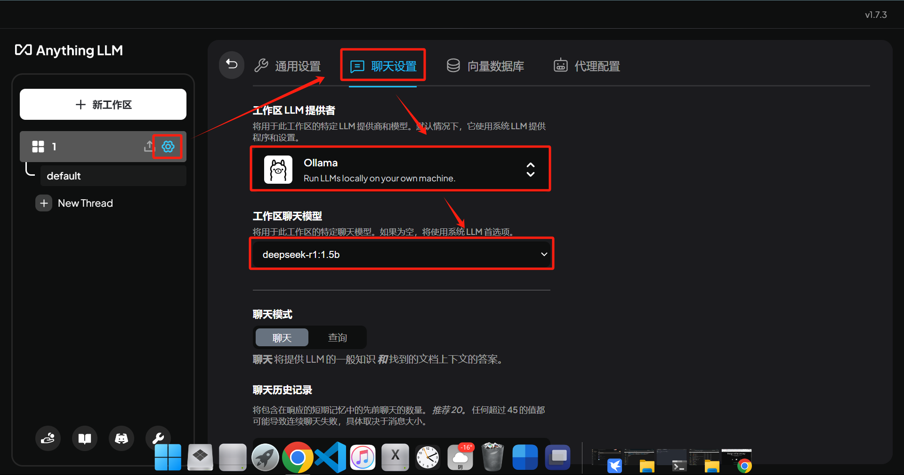

# Overview

[**AnythingLLM**](https://anythingllm.com/) 是一个 **本地部署的知识库管理和 AI 助手**，可以让大语言模型（LLM）与本地文件、笔记、文档等数据进行交互。它支持 **Ollama、GPT-4、Claude** 等多个 LLM 作为后端，可以用来搭建一个 **私人 AI 助手**，从本地知识库中查找信息并回答问题。

# Install

- [官网下载并安装 AnythingLLM](https://anythingllm.com/desktop)

- 确保 [Ollama](ollama.md) 和 Deepseek 已安装，添加模型（以 Deepseek 为例）

    

- 拉倒最底部，点击 `Update Workspace`。