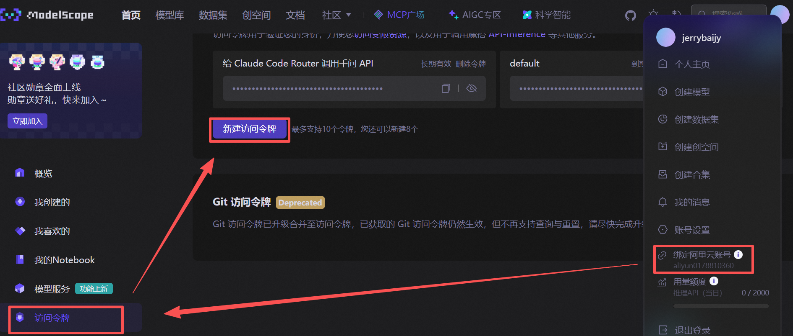

# Overview

[**Claude Code**](https://www.claude.com/product/claude-code) 是一个代理编码工具，可在多个平台上运行：终端、IDE 扩展、桌面应用和网页。

> [Claude Code 文档](https://docs.claude.com/zh-CN/docs/claude-code/overview)
>
> [CLI 参考](https://docs.claude.com/zh-CN/docs/claude-code/cli-reference)

# Install

> [Install Claude Code](https://code.claude.com/docs/zh-CN/overview)

## 在 windows 中使用 PowerShell 安装 CLI

> [在 windows 中使用 PowerShell 安装 CLI](https://code.claude.com/docs/zh-CN/overview#原生安装（推荐）)

```powershell
irm https://claude.ai/install.ps1 | iex
```

## 在 windows 中使用 npm 安装 CLI

- Claude code 官方不再推荐此种安装方式，此方法作为留存。

- 前提条件：

    - 安装 `Node.js 18` 或更新版本
    - 一个 [Claude.ai](https://claude.ai/)（推荐）或 [Claude Console](https://console.anthropic.com/) 账户

- 终端执行以下命令：

    ```bash
    # 安装
    npm install -g @anthropic-ai/claude-code
    
    # 查看安装版本
    claude -v
    ```

- 执行 `claude` 命令启动，选择颜色主题。

- 登录选项：

    - Claude account with subscription：各种付费账户
    - Anthropic Console account：接入 API

- 为了接入 API

    - 这里不登录，应该退出终端。
    - 安装并配置 [Claude Code Router](<#Claude Code Router>)。

- 运行 [Claude Code Router](<#Claude Code Router>)

    ```bash
    # 正常运行
    claude
    
    # 调用 API 运行
    ccr code
    ```

## 在 VS Code 中安装 Claude Code 扩展

- [为 VS Code 安装 Claude Code 扩展](vscode:extension/anthropic.claude-code)

- 修改 VS Code 配置

    ```json
    {
      "claudeCode.preferredLocation": "panel",
      "claudeCode.selectedModel": "MiniMax-M3",
      "claudeCode.environmentVariables": [
        {
          "name": "ANTHROPIC_BASE_URL",
          "value": "https://api.minimaxi.com/anthropic"
        },
        {
          "name": "ANTHROPIC_AUTH_TOKEN",
          "value": "<MINIMAX_API_KEY>"
        },
        {
          "name": "API_TIMEOUT_MS",
          "value": "3000000"
        },
        {
          "name": "CLAUDE_CODE_DISABLE_NONESSENTIAL_TRAFFIC",
          "value": "1"
        },
        {
          "name": "ANTHROPIC_MODEL",
          "value": "MiniMax-M3"
        },
        {
          "name": "ANTHROPIC_DEFAULT_SONNET_MODEL",
          "value": "MiniMax-M3"
        },
        {
          "name": "ANTHROPIC_DEFAULT_OPUS_MODEL",
          "value": "MiniMax-M3"
        },
        {
          "name": "ANTHROPIC_DEFAULT_HAIKU_MODEL",
          "value": "MiniMax-M3"
        },
        {
          "name": "CLAUDE_CODE_AUTO_COMPACT_WINDOW",
          "value": "512000"
        }
      ]
    }
    ```

- 关于登录 Anthropic

    - 环境变量中配置了 `ANTHROPIC_BASE_URL` 和 `ANTHROPIC_AUTH_TOKEN`，Claude Code 扩展在发起请求时会自动带上该 Token，从而跳过 Anthropic 的官方登录界面，直接通过 MiniMax 的 API 接口完成身份鉴权与模型调用。
    - 不需要访问 Anthropic 官方的服务器，所有请求都是直连 MiniMax 的国内/国际 API Endpoint。

# CLI

> [CLI Reference](https://code.claude.com/docs/zh-CN/cli-reference)

```bash
# 查看版本
claude -v

# 更新到最新版本
claude update

# 启动交互式 REPL
claude

# 启动并调用 API
ccr code
```

# Commands

> [Commands Reference](https://code.claude.com/docs/zh-CN/commands)

```bash
# 通读全文
/init

# 压缩之前的对话内容
/compact

# 清除之前对话内容
/clear

# 查看当前上下文使用情况
/context
/context all
```

# 快捷键

<!-- prettier-ignore -->

|             操作              |      Claude Code 快捷键       |
| :---------------------------: | :---------------------------: |
|         切换交互模式          | <kbd>Alt</kbd> + <kbd>M</kbd> |
| 将 IDE 中的选中行发送到输入框 | <kbd>Alt</kbd> + <kbd>K</kbd> |

# `CLAUDE.md`

[`CLAUDE.md`](https://code.claude.com/docs/zh-CN/memory) 是 Claude Code 的记忆文件。

> [选择 CLAUDE.md 文件的位置](https://code.claude.com/docs/zh-CN/memory#choose-where-to-put-claude-md-files)

- 企业级：`C:\Program Files\ClaudeCode\CLAUDE.md`
- 用户级： `~/.claude/CLAUDE.md`
- 项目级：
    - `my-project/.claude/CLAUDE.md`
    - `C:\Users\jerry\.claude\projects\d--projects-green-assistant-003\memory`，agent 自动生成。
- 本地级：`my-project/.claude/CLAUDE.local.md`
    - 不提交进仓库，如果是 Claude Code 自动创建，它会把 `**/.claude/CLAUDE.local.md` 加入 Git 的用户级 ignore 文件。

# `settings.json`

[`settings.json`](https://code.claude.com/docs/zh-CN/settings) 是 Claude Code 的配置文件。

> [设置文件及其影响范围](https://code.claude.com/docs/zh-CN/settings)

- 企业级
- 用户级：`~/.claude/settings.json`
- 项目级：`my-project/.claude/settings.json`
- 本地级：`my-project/.claude/settings.local.json`
    - 不提交进仓库，如果是 Claude Code 自动创建，它会把 `**/.claude/settings.local.json` 加入 Git 的用户级 ignore 文件。

> [配置字段](https://code.claude.com/docs/zh-CN/settings-reference#settings-index)

# 其它

## Claude Code Router

[Claude Code Router](https://github.com/musistudio/claude-code-router) 是 GitHub 上的一个开源项目，可以把任意大模型的 API 接入到 Claude Code 中。

**安装（前提已安装 Claude Code）**：

```bash
npm install -g @musistudio/claude-code-router
```

**配置** ：

- 项目 README 文件里有说明，另外抖音博主有[教程](https://www.douyin.com/video/7535010917268933898)。

- 用户根目录创建 `~/.claude-code-router/config.json` 文件夹和文件

- 用支付宝在魔搭社区绑定阿里云账号，并新建访问令牌。将新建的 API 填入到 `config.json`。

    

- `config.json` 内容如下：

    ```json
    {
      "Providers": [
        {
          "name": "modelscope",
          "api_base_url": "https://api-inference.modelscope.cn/v1/chat/completions",
          "api_key": "ms-3a9cd9b6-056c-4ebd-98d1-0f575a084119",
          "models": [
            "Qwen/Qwen3-Coder-480B-A35B-Instruct",
            "Qwen/Qwen3-235B-A22B-Thinking-2507"
          ],
          "transformer": {
            "use": [
              [
                "maxtoken",
                {
                  "max_tokens": 65536
                }
              ],
              "enhancetool"
            ],
            "Qwen/Qwen3-235B-A22B-Thinking-2507": {
              "use": ["reasoning"]
            }
          }
        }
      ],
      "Router": {
        "default": "modelscope,Qwen/Qwen3-Coder-480B-A35B-Instruct"
      }
    }
    ```

- 终端执行 `ccr code` 命令以启动 Claude Code Router

- 异常处理

    ```bash
    ccr stop
    ccr start
    ```

**实验项目**：

- 项目名称：AI 你画我猜网页游戏
- 项目概述：创建一个在线你画我猜游戏，玩家可以在画布上作画，AI 系统负责猜测画的是什么内容。
- 技术栈选择
    - 技术栈: nextjs
    - AI 使用 Qwen 的 API，从后台调用 API
    - 不要任何 SDK，直接调用 Qwen API 地址
