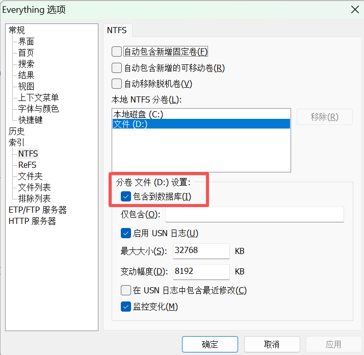

# Overview

[**Everything**](https://www.voidtools.com/zh-cn/) 是一款由 Voidtools 开发的 Windows 文件搜索工具，它最大的特点就是**搜索速度极快**，基本上能做到“输入即结果”。

# Install

[官网下载 Everything](https://www.voidtools.com/zh-cn/)

# Quickstart

第一次运行时，要把磁盘加入到数据库，等待几十秒建立索引完成。

`工具` > `选项`

# 其它

印象中可用于批量修改文件名，但最后一次不会用了，也许是记错了。