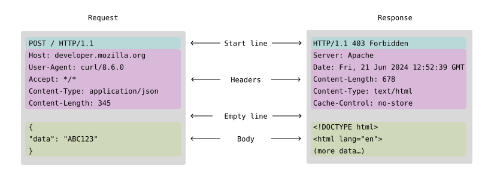
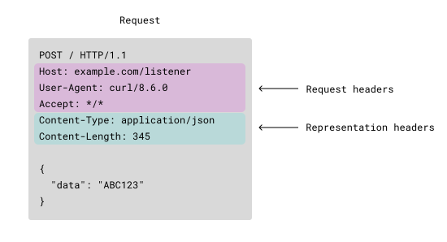
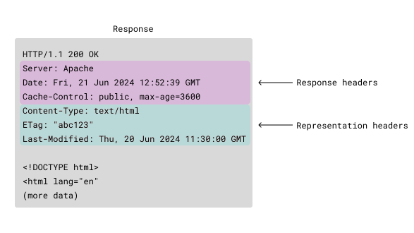

# Overview

[**HTTP**](https://developer.mozilla.org/zh-CN/docs/Web/HTTP)（**H**yper**T**ext **T**ransfer **P**rotocol，超文本传输协议），是一个用于传输超媒体文档（例如 HTML）的[应用层](<network.md#TCPIP 四层模型>)协议，旨在使客户端（通常是浏览器）能够和服务端进行通信和数据交换，是[网络通信](network.md)的基础。

HTTP 协议于 20 世纪 90 年代初期被规范化。得益于其扩展性，该规范至今又添加了大量的补充内容。[这些增补规范文档](https://developer.mozilla.org/zh-CN/docs/Web/HTTP/Reference/Resources_and_specifications)散落在网络的不同位置。

> [HTTP 官方参考](https://httpwg.org/specs/)
>
> [HTTP MDN 参考](https://developer.mozilla.org/zh-CN/docs/Web/HTTP/Reference)

# HTTPS

**HTTPS**（**H**yper**T**ext **T**ransfer **P**rotocol **S**ecure，超文本传输安全协议），是 HTTP 协议的加密版本。它通过在 HTTP 和 TCP 之间引入一个加密层（[SSL](https://developer.mozilla.org/zh-CN/docs/Glossary/SSL) 或 [TLS](https://developer.mozilla.org/zh-CN/docs/Glossary/TLS)）来实现安全通信。

HTTP 与 HTTPS 的直观对比：

| **特性**     | **HTTP**           | **HTTPS**                         |
| ------------ | ------------------ | --------------------------------- |
| **安全性**   | 明文，不安全       | 加密，安全                        |
| **默认端口** | 80                 | 443                               |
| **证书**     | 不需要             | 需要从 CA 购买或申请              |
| **SEO 排名** | 较低               | 搜索引擎（如 Google）会优先收录   |
| **性能**     | 稍快（无握手开销） | 现代技术下几乎无感（有 TLS 优化） |

# HTTP 消息

[**HTTP 消息**](https://developer.mozilla.org/en-US/docs/Web/HTTP/Guides/Messages)（HTTP Messages）是 HTTP 协议中用于在客户端与服务器之间交换数据的机制。

> [HTTP 消息](https://developer.mozilla.org/en-US/docs/Web/HTTP/Guides/Messages)
>
> [典型的 HTTP 会话](https://developer.mozilla.org/zh-CN/docs/Web/HTTP/Guides/Session)

消息有两种类型：

- **请求**（request）：客户端向服务端发送的消息
- **响应**（response）：服务端向客户端发送的消息

请求和响应的消息结构相似：

1. 起始行描述 HTTP 版本以及请求方法或请求结果的单行。
2. 接下来的行每一行都表示一个 HTTP 标头，这些 HTTP 标头形成一个以空行结尾的块。
3. 最后一块是可选数据块，包含与消息关联数据的可选正文 。

# HTTP 标头

## Headers 基础

[**HTTP 标头**](https://developer.mozilla.org/zh-CN/docs/Web/HTTP/Reference/Headers)（HTTP Headers）允许客户端和服务器通过 HTTP 请求（request）或者响应（response）传递附加信息。

- 所有标头形成一个以空行结尾的块。
- 每个标头的键称为指令。

  <figure>
    
    <figcaption style="font-size: 16px; color: gray">Request headers</figcaption>
  </figure>
  <figure>
    
    <figcaption style="font-size: 16px; color: gray">Response headers</figcaption>
  </figure>

## `Cache-Control`

[`Cache-Control`](https://developer.mozilla.org/en-US/docs/Web/HTTP/Reference/Headers/Cache-Control) 指令用于控制缓存。

- [`no-cache`](https://developer.mozilla.org/en-US/docs/Web/HTTP/Reference/Headers/Cache-Control#no-cache_2)：浏览器可以使用缓存，但在使用前应向服务端验证是否有改变，如果有改变就要更新。
- [`no-store`](https://developer.mozilla.org/en-US/docs/Web/HTTP/Reference/Headers/Cache-Control#no-store_2)：浏览器不可以使用缓存。

# HTTP 请求方法

[**HTTP 请求方法**](https://developer.mozilla.org/zh-CN/docs/Web/HTTP/Reference/Methods)（HTTP Request Methods）用于表明要对给定资源执行的操作。

> [Methods - 官方文档](https://httpwg.org/specs/rfc9110.html#methods)
>
> [HTTP 请求方法 - MDN 参考](https://developer.mozilla.org/zh-CN/docs/Web/HTTP/Reference/Methods)

## `GET`

[`GET`](https://developer.mozilla.org/zh-CN/docs/Web/HTTP/Reference/Methods/GET) 用于请求指定的资源。这种方式适合用于获取数据，但不适合包含敏感信息，因为数据会明文显示在 URL 中。

## `POST`

[`POST`](https://developer.mozilla.org/zh-CN/docs/Web/HTTP/Methods/POST) 用于发送数据给服务器。

# HTTP 响应状态码

[**HTTP 响应状态码**](https://developer.mozilla.org/zh-CN/docs/Web/HTTP/Reference/Status)（HTTP Response Status Codes）用来表明特定 HTTP 请求是否成功完成。 

> [Status Codes - 官方文档](https://httpwg.org/specs/rfc9110.html#status.codes)
>
> [Status Code Registry - IANA 官方参考](https://www.iana.org/assignments/http-status-codes)

响应状态码被归为以下五大类：

1. [信息响应](https://developer.mozilla.org/zh-CN/docs/Web/HTTP/Reference/Status#信息响应) （`100` - `199`）
2. [成功响应](https://developer.mozilla.org/zh-CN/docs/Web/HTTP/Reference/Status#成功响应) （`200` - `299`）
3. [重定向消息](https://developer.mozilla.org/zh-CN/docs/Web/HTTP/Reference/Status#重定向消息) （`300` - `399`）
4. [客户端错误响应](https://developer.mozilla.org/zh-CN/docs/Web/HTTP/Reference/Status#客户端错误响应) （`400` - `499`）
5. [服务端错误响应](https://developer.mozilla.org/zh-CN/docs/Web/HTTP/Reference/Status#服务端错误响应) （`500` - `599`）

以下状态码由 [section 10 of RFC 2616](https://datatracker.ietf.org/doc/html/rfc2616#section-10) 定义。你可以在 [RFC 7231](https://datatracker.ietf.org/doc/html/rfc7231#section-6) 中找到更新后的规范。

> [!NOTE]
>
> 如果你收到的响应不在此列表中，则它为非标准响应，可能是服务器软件的自定义响应。
