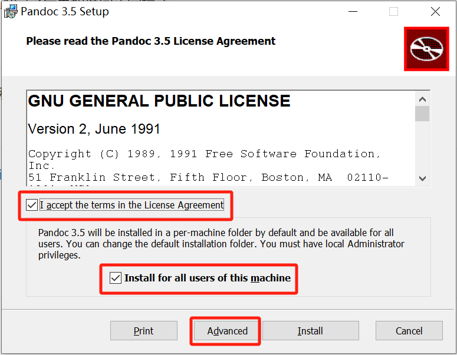
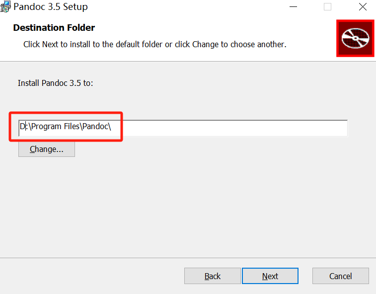

# Overview

[**Pandoc**](https://pandoc.org/) 是一个文档转换工具，支持多种文档格式之间的转换。

# Install

- [下载 pandoc-3.5-windows-x86_64.msi](https://github.com/jgm/pandoc/releases)

- 修改安装路径

    

    

- 点击 `Install` 安装，直到完成

- 验证

    ```bash
    pandoc -v
    ```

# 命令

```bash
# 查看版本
pandoc -v
# 帮助
pandoc --help
```

# word 转 MD

- 使用命令行转换

    ```bash
    pandoc 文件名1 -o 文件名2 --extract-media=图片存储路径
    ```

    ```bash
    pandoc 实验.md -o 实验.docx --extract-media=./assets
    ```

    - **`--extract-media`**：可以提取媒体文件并存储到指定路径。