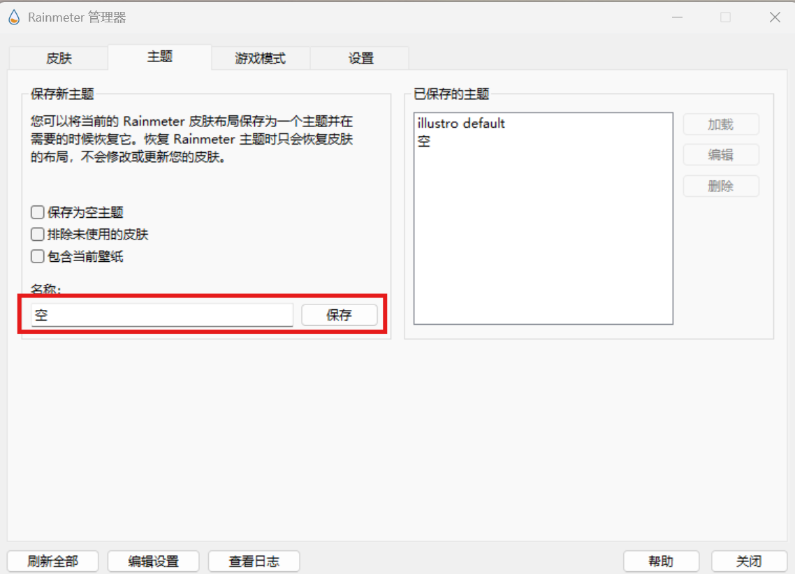

# Overview

[**Rainmeter**](https://www.rainmeter.net/) 是一款非常流行的桌面定制软件，主要用于在 Windows 系统上创建并显示动态桌面小部件（Widgets）或皮肤（Skins）。

# Install

- [官网下载 Rainmeter](https://www.rainmeter.net/)

- 正常安装并运行 Rainmeter

- 关闭所有默认显示的皮肤

- 保存空主题

    

# 相关资源

- [致美化](https://zhutix.com/)
- [htvisualskins](https://visualskins.com/)
- 个人网盘