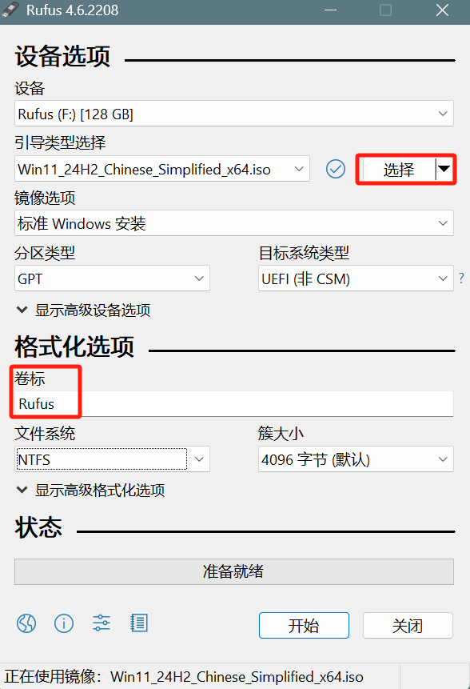
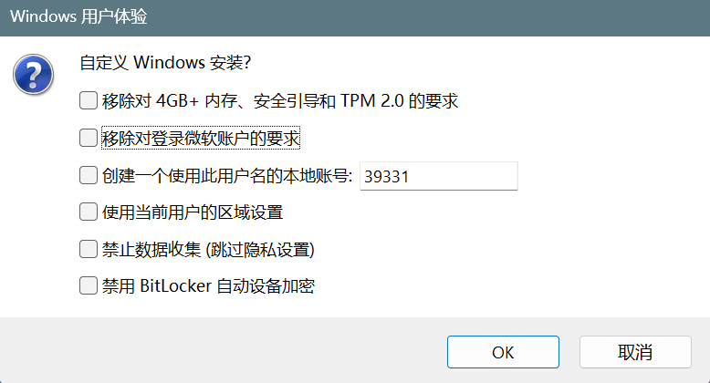

# Rufus

[**Rufus**](https://rufus.ie/zh/) 是一款轻量级、开源的工具。它可以帮助用户将 ISO 镜像文件（例如操作系统安装盘镜像）写入 U 盘，制作启动 U 盘，类似与 Windows 的 U 盘介质。

## 特点

- 按选项安装 Windows
- 无 PE 启动 U 盘

## 功能说明

- **镜像选项（Windows）**
    - **标准 Windows 安装**：即制作正常启动 U 盘。
    - **Windows To Go**：即把系统安装在 U 盘里，得到一个可以完整运行的 Windows 系统。
        - 当把 U 盘变成 Windows To Go 以后，插入任一台电脑，即可使用这个 Windows 系统。
        - **注意**：这台电脑和 Windows To Go 的引导方式要相同。
        - 当完成初始化设置以后，拔出 U 盘，再次插入电脑，运行 Rufus，即可把 Windows To Go 保存为 VHDX 镜像，供给 Ventoy 使用。

- **持久分区大小（Linux）**：当 Linux 以 Live CD 运行时，用来保存 Live 运行时所做的修改。否则关机后会丢失所有修改。
- **分区类型**
    - **GPT**：对应 UEFI 引导
    - **MBR**：对应传统 BIOS 引导

- **高级设备选项**
    - **显示 USB 外置硬盘**：如果插入的是移动硬盘且无法识别，即可勾选此项。
    - **启用对旧 BIOS 修正**：这是对传统 BIOS 引导的优化，提高兼容性。

- **卷标**：即 U 盘名称
- **高级格式化选项**
    - **创建扩展的标签和图标文件**：把 U 盘图标变成 Rufus

## 使用步骤

- [官网下载 Rufus 工具](https://rufus.ie/zh/)

- 电脑插入已备份的 U 盘（制作时会格式化）

- 双击已下载的 `.exe` 文件，免安装打开工具

- 配置安装选项

    - 选择 U 盘驱动器和 ISO 镜像文件，修改卷标（U 盘名称）

        

    - 如果不是老电脑，`分区类型` 和 `目标系统类型` 按工具默认选择即可

    - 点击 `开始`

    - 弹出选项窗口，选择需要的选项，点击 `确定`。

        

- Rufus 会将 ISO 镜像文件写入 U 盘并创建启动盘。

- 将 U 盘插入待做系统的电脑，从 U 盘启动做系统（注意此工具不是 PE，只能像 Windows 官网安装介质那样做系统）。