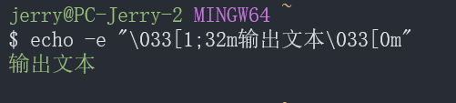

# Overview

**Shell 语言**（Shell Scripting Language）是用于编写 Shell 脚本的编程语言。

Shell 语言不是一种单一的、规范的语言，而是一系列 **Unix-like 操作系统命令行解释器**所使用的编程语言的总称。最常见和最有影响力的是 **Bourne Shell (sh)** 及其衍生品，如 **Bash**、**Zsh**、**Ksh** 等。

# Shell 命令

## 常用命令

<!-- prettier-ignore -->
| 操作 | 命令 |
| :---: | :---: |
| ==目录== |  |
| 进入目录 | `cd` |
| 创建目录 | `mkdir` |
| 删除空目录 | `rmdir` |
| 删除非空目录 | `rm -r` |
| 列出目录内容 | `ls` |
| 列出目录内容（含隐藏） | `ls -a` |
| 列出目录内容（以详细长格式） | `ls -l` |
| ==文件== |  |
| 创建文件 | `touch` |
| 复制文件 | `cp` |
| 移动文件 | `mv` |
| 删除文件 | `rm` |
| ==其它== |  |

## 命令选项

- `-rf` 选项是 `-r` 和 `-f` 的组合
  - `-r` 选项，递归删除子目录和文件。
  - `-f` 选项，强制删除。
- `-y`：默认同意

# Shell 脚本

**Shell 脚本** 是一个包含了一系列 **Shell 命令**的文本文件。

```shell
#!/bin/bash
echo "Hello World!"
```

- `#!/bin/bash`：Shebang，指定解释器。
- `#`，注释，可以在行尾注释。
- **`exec $SHELL`**：执行完毕保持窗口。

## 注释

```shell
#!/bin/bash

# /**
#  * 这是一个文档注释示例。
#  * 它通常包含有关类、方法或字段的详细信息。
#  * 例如，描述类的作用或方法的功能。
#  */

# 这是一个单行注释，描述下面的方法。
main() {
  # 多行注释第一行
  # 多行注释第二行
  # 多行注释第三行
  # 这里是对下面的输出代码块的解释。

  echo "Hello World"
}

# 调用 main 方法
main
```

## 执行 Shell 脚本

执行 Shell 脚本有三种方法：

- 作为可执行程序
- 作为解释器参数
- 直接双击 `.sh` 文件

### 作为可执行程序

```bash
./my-sh.sh
```

注意，一定要写成 **./my-sh.sh**，而不是 **my-sh.sh**，如果直接写 `my-sh.sh`，系统会去 PATH 里寻找有没有叫 `my-sh.sh` 的，而只有 `/bin`、`/sbin`、`/usr/bin`、`/usr/sbin` 等在 PATH 里，而你的**当前目录**通常不在 PATH 里，所以要用 `./test.sh` 告诉系统说，就在当前目录找。

### 作为解释器参数

直接运行解释器，其参数就是 shell 脚本的文件名。

```bash
/bin/bash my-sh.sh
```

### 直接双击 `.sh` 文件

在 Windows 中可直接双击执行 Shell 脚本。

## 传递参数

在执行 Shell 脚本时，可向脚本传递参数。脚本内获取参数的格式为 `$n`，**n** 代表第几个参数，`$0` 代表脚本文件名。

> [Shell 传递参数](https://www.runoob.com/linux/linux-shell-passing-arguments.html)

```shell
#!/bin/bash

echo "Shell 传递参数实例！";
echo "执行的文件名：$0";
echo "第一个参数为：$1";
echo "第二个参数为：$2";
echo "第三个参数为：$3";
```

```bash
$ ./my-sh.sh 1 2 3
Shell 传递参数实例！
执行的文件名：./test.sh
第一个参数为：1
第二个参数为：2
第三个参数为：3
```

### 特殊参数

| 参数处理 |                             说明                             |
| :------: | :----------------------------------------------------------: |
|    $#    |                     传递到脚本的参数个数                     |
|    $*    | 以一个单字符串显示所有向脚本传递的参数。<br />如 `$*` 用「"」括起来的情况、以"$1 $2 … $n"的形式输出所有参数。 |
|    $$    |                   脚本运行的当前进程 ID 号                   |
|    $!    |                后台运行的最后一个进程的 ID 号                |
|    $@    | 与 `$*` 相同，但是使用时加引号，并在引号中返回每个参数。<br />如 `$@` 用「"」括起来的情况、以"$1" "$2" … "$n" 的形式输出所有参数。 |
|    $-    | 显示Shell使用的当前选项，与[set命令](https://www.runoob.com/linux/linux-comm-set.html)功能相同。 |
|    $?    | 显示最后命令的退出状态。0表示没有错误，其他任何值表明有错误。 |

# 变量

## 赋值

变量名和等号之间不能有空格。

```bash
NAME="World"
AGE=30
```

## 引用变量

使用 `$` 符号来引用变量的值。

```bash
NAME="World"
echo "Hello, $NAME"
```

使用 `{}` 可规定变量的边界

```bash
NAME="World"

echo "Hello, $NAME!" # 此种写法也可以运行，容易产生歧义，但不易维护。
echo "Hello, ${NAME}!" # 使用花括号使变量名更清晰
```

## 环境变量

使用 `export` 关键字将变量提升为环境变量。仅在当前的 **Shell 会话**（或当前终端窗口）及其派生出的子进程中有效。

```bash
export PATH="/usr/local/bin:$PATH"
```

### 用户名和密码

避免在历史记录 (Shell History) 或脚本中直接暴露敏感的用户名和 Token。虽然它们不是永久的，但对于单次会话中的多次操作非常实用。

以下是一个 Helm 登录 GitLab Container Registry 的示例：

**慎用！！！第一次用就导致网页端无法登录！！！**

- 设置环境变量

    ```bash
    export GL_USERNAME="<Your_GitLab_Username>"
    export GL_TOKEN="<Your_Personal_Access_Token>"
    ```

- 使用环境变量

    ```bash
    helm registry login registry.gitlab.com \
      --username "${GL_USERNAME}" \
      --password-stdin <<< "${GL_TOKEN}"
    # 如果您没有使用环境变量，您可以直接输入：
    # helm registry login registry.gitlab.com -u <Your_GitLab_Username>
    # (然后会提示您输入密码/PAT)
    ```

# 数据类型

## String

Shell 中的[字符串边界标记](code-general.md#边界标记)可以用单引号，也可以用双引号，也可以不用引号。

- **双引号**：优先使用 `"`，可以对字符串中的字符进行**特殊处理**，如引用变量、转义等。

    ```bash
    # 在字符串中引用变量
    NAME="World"
    echo "Hello, ${NAME}!" # Hello, World!
    
    # 转义
    echo "Hello, \"World\"!" # Hello, "World"!
    ```

- **单引号**：会**完全保留**其中的字符，不进行任何特殊的处理。

    ```bash
    NAME="World"
    echo 'Hello, ${NAME}!' # Hello, ${NAME}!
    ```

## Array

> [Shell 数组](https://www.runoob.com/linux/linux-shell-array.html)

# 运算符

> [Shell 运算符](https://www.runoob.com/linux/linux-shell-basic-operators.html)

# 目录

## 目录命令

```bash
# 进入目录
cd $DIR
# 创建目录
mkdir $DIR/$FOLDER_NAME
# 创建并进入目录
DIR=/d/projects/todo-fullstack/terraform/argocd && mkdir -p $DIR && cd $DIR
# 删除空目录
rmdir $DIR/$FOLDER_NAME
# 删除非空目录
rm -r $DIR/$FOLDER_NAME
# 列出目录内容
ls [-al] # -al列出隐藏内容
```

## 创建目录

```bash
# 创建 b 目录（必须有 a）
mkdir a/b

# 递归创建缺失的目录（缺哪个创建哪个）
mkdir -p a/b

# 创建多个目录：a 和 b
mkdir a b
```

# 路径

- **命令**：`cd`
    - Linux：`cd /Home/$USER_NAME`
    - Windows：`cd C:/Users/$USER_NAME`
- **分隔符**
  - `/`：Linux、Unix、Windows、macOS、Android、IOS、URL 等都支持
  - `\`：仅 Windows PowerShell 支持，且为默认
- **大小写敏感**
  - 敏感：Linux、Unix、Android、iOS
  - 不敏感：Windows、macOS
- **路径符号**
  - 显示当前工作目录的绝对路径：`pwd`
  - 根目录：
    - Linux：`cd /`
    - Windows PowerShell（也支持 `/`）
      - `cd \`（当前磁盘根目录）
      - `cd C:\`（C 盘根目录）
    - Windows GitBash
      - `cd /`（Git Bash 的虚拟根目录）
      - `cd /c`（C 盘根目录）

  - User 目录：
    - Linux：`cd ~` 或 `home/用户名`
    - Windows：`cd ~` 或 `cd /c/Users/jerry` 或 `cd $HOME`

  - 当前目录：`cd .` （在当前目录操作可省略路径）
  - 上级目录：`cd ..`
  - 上一次工作目录：`cd -`
- **引用文件**
  - 上级：`../my-image.jpg`
  - 同级：`./my-image.jpg` 或 `my-image.jpg`（基于当前目录的相对路径可省略 `./`）
  - 子目录：`./subdirectory/my-image.jpg` 或 `subdirectory/my-image.jpg`

## 路径中的特殊字符

如果路径中包含特殊字符（如空格），需要特殊处理来避免错误，例如进入 `VMware Tools` 目录：

- 使用转义字符 `\` 进行转义

  ```bash
  # 使用反斜杠 \ 转义
  cd /media/jerry/VMware\ Tools
  ```

- 使用边界标记

    ```bash
    # 使用引号标记
    cd '/media/jerry/VMware Tools'
    ```
    

# 文件

## 文件基础

- **基础命令**

  ```bash
  # 查看文件
  cat $FILE
  # 创建文件
  touch $FILE
  # 编辑文件
  nano $FILE
  vim $FILE
  # 删除文件
  rm $FILE
  # 复制文件
  cp $FILE $DES_PATH
  ```

- **文本搜索**

  ```bash
  grep CONTENT
  ```

- 替换

  `sed`：流编辑器，用于对文本进行流式处理；`-i`：在原文件修改；`s`：替换；`g` ：全局替换

  ```bash
  sed -i 's/SOURCE_CONTENT/NEW_CONTENT/g' 'PATH/FILE'
  # e.g.
  sed -i 's/aaa/bbb/g' './html.py' # 将当前目录下的html.py文件中的aaa替换成bbb
  ```

- `echo`：快速向文件添加内容

  ```bash
  echo "[CONTENT]" > [FILE]
  # e.g.
  echo "Hello World!" > demo.txt
  ```

- 查找文件

  ```bash
  find PATH OPTION COMMAND
  # e.g.
  find . -name jquery* -print # 查找当前目录下所有文件名以jquery开头的文件，并打印路径
  ```

# 管道符

**`|`**：管道符，命令输出传递；e.g.：打开 `tmp` 目录中的 `html.py` 文件，然后找出字符串 `jquery-1.11.3.min.js`

```bash
cat /tmp/html.py | grep jquery-1.11.3.min.js
```

# 控制结构

## 选择结构

使用方括号 `[ ... ]` 或双层方括号 `[[ ... ]]` 进行条件测试。

```bash
if [ -f "venv/bin/activate" ]; then
    # Linux/macOS/Git Bash
    source venv/bin/activate
elif [ -f "venv/Scripts/activate" ]; then
    # Windows (WSL 或部分环境可能需要)
    source venv/Scripts/activate
else
    echo "错误：无法找到虚拟环境激活脚本。"
    exit 1
fi
```

## 循环结构

```bash
for file in *.log; do
    echo "Processing $file"
done

i=0
while [ $i -lt 5 ]; do
    echo $i
    i=$((i + 1)) # Bash 算术扩展
done
```

# 函数

```bash
my_function() {
    echo "Executing function with argument: $1"
    return 0
}

my_function "test_value"
```

# 关键字

## `echo`

### 基本实现

`echo` 用于在标准输出（终端）上打印文本。

```bash
echo "输出文本"
```

### `-e`

`-e` 选项用于启用 `echo` 命令的**转义功能**。以下是改变输出文本样式的示例：

```bash
echo -e "\033[1;32m输出文本\033[0m"
```



# Shell 花括号扩展

**花括号扩展**是 Shell 语言（特指 Bash、Zsh 等）提供的一种**字符串生成机制**，它主要用于方便地创建文件列表、路径或一系列命令参数。它在 Shell **解析命令行时**发生在变量替换和命令执行**之前**。

**注意**：花括号内的元素间不能有空格，否则 Shell 会视为普通字符（例：`{a, b}` 会被解析为 `{a,` 和 `b}` 两个错误字符串）。

## 基本语法

```bash
# 花括号扩展
前缀{项1,项2,项3...}后缀

# 扩展之后
前缀项1后缀 前缀项2后缀 前缀项3后缀 ...
```

## 创建多个同级目录/文件

```bash
# 目录：等价于 mkdir -p a b c（生成3个同级目录）
mkdir -p {a,b,c}

# 文件：等价于 touch file1.txt file2.txt file3.txt（生成3个文件）
touch file{1,2,3}.txt
```

## 共享前缀/后缀

```bash
# 目录：等价于 mkdir -p a/b a/c a/d（a下创建b、c、d子目录）
mkdir -p a/{b,c,d}

# 文件：等价于 touch src/index.js src/app.js src/utils.js（src目录下生成3个JS文件）
touch src/{index,app,utils}.js
```

## 嵌套扩展

```bash
# 目录：生成 a/b/x、a/b/y、a/c（嵌套+平级结合）
mkdir -p a/{b/{x,y},c}

# 最终结构：
a/
├── b/
│   ├── x/
│   └── y/
└── c/

# 扩展为: a1 a2 b1 b2
echo {a,b}{1,2}
```

## 范围扩展

```bash
# 数字范围：生成 dir1~dir5（5个目录）
mkdir -p dir{1..5}

# 字母范围：生成 file_a~file_e（5个文件）
touch file_{a..e}.txt

# 逆序范围：生成10~6（倒序目录）
mkdir -p num{10..6}

# 步长扩展（Bash 4.0+支持）：生成2、4、6（步长为2）
mkdir -p step{2..6..2}
```

## 综合示例

```bash
# 前端（React）+ 后端（Flask）+ 数据库（MySQL）目录一次性创建
mkdir -p \
frontend/{public/{static/{css,js,images},favicon.ico},src/{components,hooks,pages,utils}} \
backend/{app/{api,models,config,logs},src,requirements.txt} \
db/{sql,migrations,backup}
```

# 转义字符

在 Shell 中可以使用转义字符 `\` 对以下字符串进行转义：

- 不适用引号的字符串
- 使用双引号的字符串
