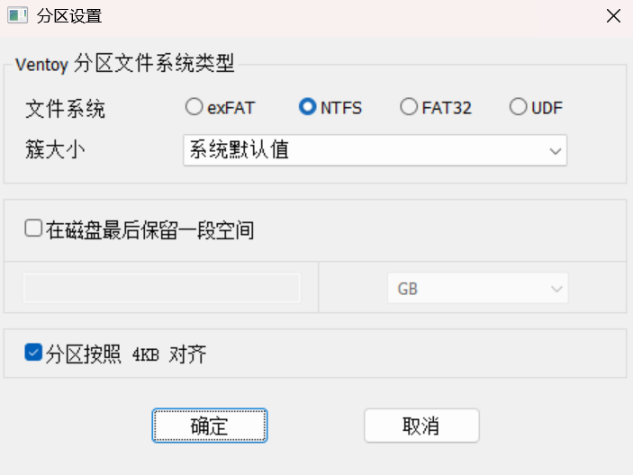

# Overview

[**Ventoy**](https://www.ventoy.net/cn/index.html) 是一个开源的工具，主要用于创建多重引导 USB 启动盘。与传统的方式不同，Ventoy 不需要你为每个操作系统或工具单独创建启动盘，而是只需将 ISO 文件复制到 USB 驱动器，然后通过 Ventoy 启动这些 ISO 文件。

# 制作 Ventoy U 盘

- 下载并解压 [Ventoy](https://www.ventoy.net/cn/download.html)。

- 将 USB 驱动器插入电脑，运行 `Ventoy2Disk.exe` 安装到 USB 上。

    - **安全启动**：选中。

    - **分区类型**：GPT。

    - **分区文件系统类型**：Ventoy U 盘的分区类型；为了保证新台式机安装系统成功，选 NTFS。

        

- 将你需要的 ISO 镜像文件直接复制到 USB 驱动器中。

- 重启电脑，选择从 USB 启动，Ventoy 会显示一个菜单让你选择要启动的 ISO 文件。

# 配置 Ventoy U 盘

- 运行 `VentoyPlugson.exe` 配置制作好的 Ventoy U 盘。

# Ventoy 启动菜单

在使用 **Ventoy** 时，选择了一个启动项后进入了如下的菜单：

- **Boot in normal mode**：标准启动模式，适用于大多数操作系统和工具。
- **Boot in wimboot mode**：wimboot 模式，用于从 Windows WIM 文件启动，适用于 Windows PE 或安装镜像。
- **Boot in memdisk mode**：memdisk 模式，将 ISO 文件加载到内存中启动，适用于旧版操作系统或某些特殊工具。
- **File checksum**：文件校验，用于验证 ISO 文件的完整性，确保文件没有损坏。
- **Return to previous menu**：返回到主菜单或前一个菜单，供你重新选择启动选项。