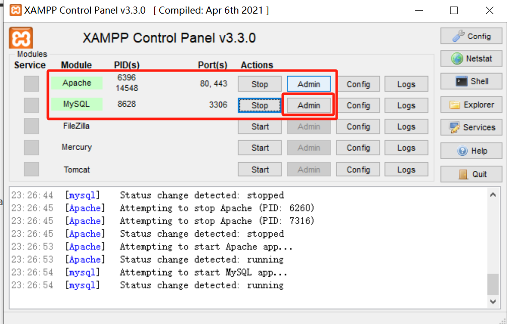

# Overview

[**XAMPP**](https://www.apachefriends.org/) 是一个流行的免费开源的跨平台软件包，用于搭建和运行 Web 服务器环境。XAMPP 包含了 Apache HTTP 服务器、MySQL 数据库、PHP 和 Perl 等工具，以及一些其他必要的组件，使用户能够在本地计算机上轻松地搭建和运行 Web 应用程序。

# Install

- [官网下载 XAMPP](https://www.apachefriends.org/download.html)
- 安装之前把以前的 MySQL 清理干净

# 使用方法

- 启动 XAMPP，启动 `Apache` 和 `MySQL`；

    

- 进入 `Admin` 新建一个数据库，其余交给后端；