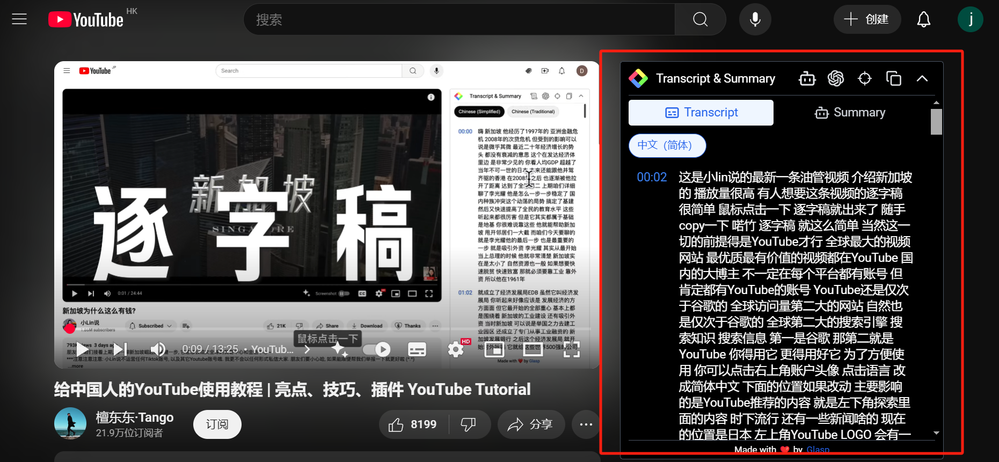
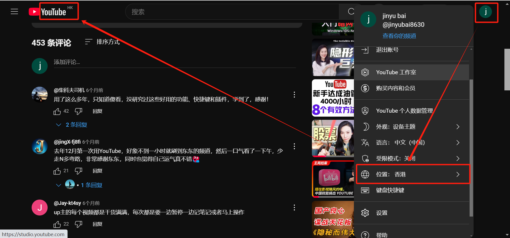

# Overview

[**YouTube**](https://www.youtube.com/) 是 Google 旗下的全球最大的视频网站。

# 快捷键

<!-- prettier-ignore -->
| 操作 | YouTube 快捷键 |
| :---: | :---: |
| 快捷键查询 | <kbd>?</kbd> |
| 减速播放 | <kbd><</kbd> |
| 加速播放 | <kbd>></kbd> |
| 快速跳转至播放进度的0% ~ 90% | <kbd>0</kbd> ~ <kbd>9</kbd> |
| 全屏模式 | <kbd>F</kbd> |
| 迷你模式 | <kbd>I</kbd> |
| 字幕 | <kbd>C</kbd> |
| 静音 | <kbd>M</kbd> |

# 插件

## YouTube Summary with ChatGPT & Claude

- 获取逐字稿
- 获取视频摘要并让 GPT 提取

## Picture-in-Picture Extension (by Google)

- 画中画：`Alt + P`

## Screenshot YouTube

- 截屏

## PocketTube: Youtube Subscription Manager

- 订阅分组

## 沉浸式翻译

- 双语字幕

# 其它技巧

## 内容区域

