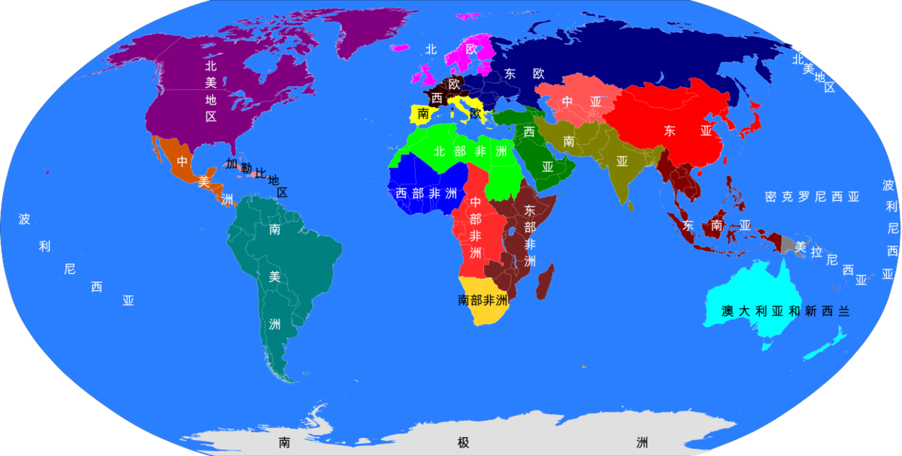
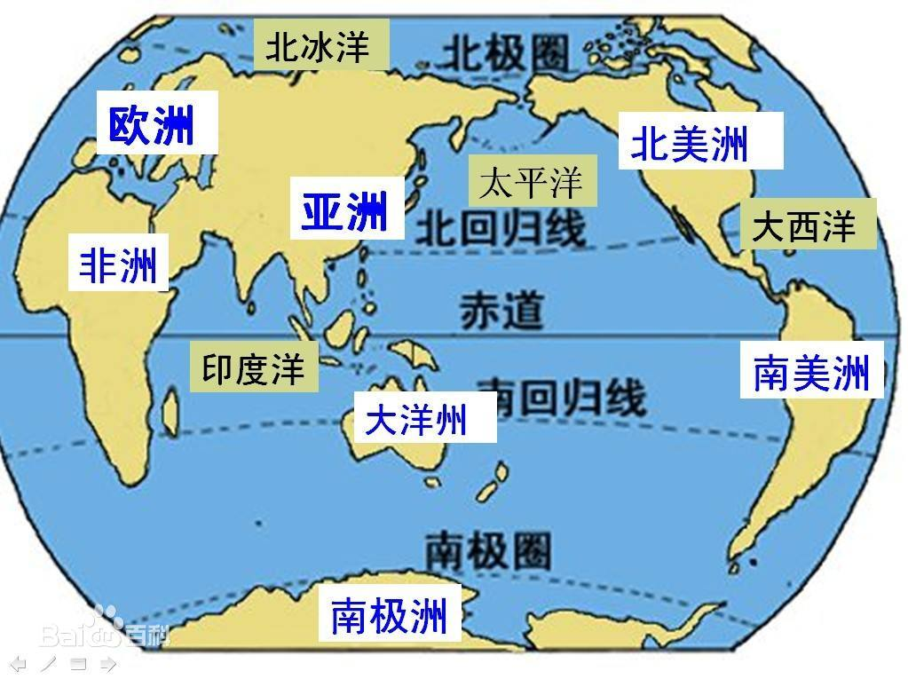

# 概述

  <figure>
    
    <figcaption style="font-size: 16px; color: gray">世界各洲</figcaption>
  </figure>
  <figure>
    
    <figcaption style="font-size: 16px; color: gray">世界地理</figcaption>
  </figure>

## 两河流域

[**美索不达米亚**](https://zh.wikipedia.org/wiki/美索不達米亚)，是[古希腊](https://zh.wikipedia.org/wiki/古希腊)对**两河流域**的称谓，两河指的是[幼发拉底河](https://zh.wikipedia.org/wiki/幼发拉底河)和[底格里斯河](https://zh.wikipedia.org/wiki/底格里斯河)。

# 相关词条

- [模板:世界分区](https://zh.wikipedia.org/wiki/Template:世界分区)
- [联合国地理区划列表](https://zh.wikipedia.org/wiki/联合国地理区划列表)：各个区域详细情况汇编
- [主权国家列表](https://zh.wikipedia.org/wiki/主权国家列表)
- [大洲](大洲.md)
- [大洋](大洋.md)
- [欧洲中心主义](https://zh.wikipedia.org/wiki/欧洲中心主义)
  - [近东](https://zh.wikipedia.org/wiki/近东)
  - [中东](中东.md)
  - [远东](https://zh.wikipedia.org/wiki/远东)
