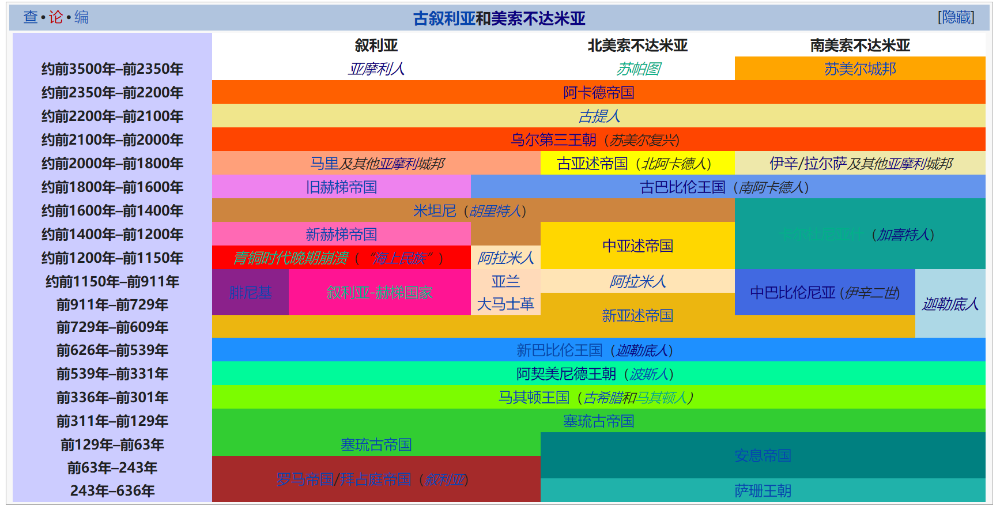

# 概述

**两河文明**，又称**美索不达米亚文明**，是在[两河流域](两河流域.md)上产生和发展的[文明摇篮](文明摇篮.md)，其存在时间从公元前4000年开始直到公元前2世纪，是人类最早的[文明](https://zh.wikipedia.org/wiki/文明)。

<figure>
  
  <figcaption style="font-size: 16px; color: gray">两河文明</figcaption>
</figure>

# 历史

## 前8000年—前5900年

公元前8000年左右，欧贝德人的祖先驯化动植物；于是在古代近东地区，人类由原本狩猎采集的生活方式，逐渐过渡到基本定居生活，这也是目前已知的人类最早的定居生活。

## 欧贝德时期

欧贝德时期（前5900年—前4000年）

欧贝德时期的一些遗址的发掘表明，当时因为灌溉农业的丰产，已经有多余的农产品，用于交换其他产品，由此产生社会分工，这就意味着更多的人可以聚居，农村将变为城市，社会等级也会更加分明。

考古学家发现欧贝德时期的埃里都有12座神庙叠建于同处，说明此时神庙已经成为城市的中心。这些发现表明在欧贝德后期，当地已经具备成熟城市所需的条件。

欧贝德时期的陶器呈淡黄色或淡绿色，经常装饰有棕色图案。

## 乌鲁克时期

乌鲁克时期（前4000年—前3000年）

前3500年左右，城市文明在两河流域的下游苏美尔产生，代表城市为乌鲁克，该城占地面积约100公顷，人口数千。

乌鲁克时期的各个城市里都有令人瞩目的神庙，神庙是苏美尔社会的核心。

伴随商业和贸易的迅速发展，前3200年左右，第一种文字在乌鲁克产生。这种被称为“楔形文字”的书写体系，将简单的象形符号刻在泥土板上，广泛应用于纪录商贸活动。其中年代最早的样品为前3300年，纪录粮食、啤酒和牲畜的具体数量。

这一时代还完善青铜冶炼并伴随犁、战车和帆船的发明，同时出现大量美索不达米亚特有的滚筒印章。乌鲁克沿河建立商业殖民地，并且其文化影响扩散到波斯、叙利亚、小亚细亚、埃及和巴勒斯坦。

## 早王朝时期

早王朝时期（前3000年—前2350年）

继乌鲁克之后，苏美尔出现其他城市。灌溉系统带来成功的农业发展，为新兴的城市带来繁荣。前3000年开始，苏美尔产生3000个左右小城邦，并以12个主要城市为中心发展起城市联盟。

为了争夺水源和有利的商业点，城邦之间经常发生冲突。这个时期被称为“早王朝时期”，基什城邦在早王朝中期曾一度称霸。

## 阿卡德帝国

阿卡德帝国（前2334年—前2192年）是人类历史上第一个帝国，统治区域位于美索不达米亚，
属于闪米特语族的一支。

前2334年左右，阿卡德君主萨尔贡的军事征服使其在整个美索不达米亚地区建立了君主制的集权国家，结束了苏美尔持续7个世纪的城邦各自为政时代。

帝国一度向东征服埃兰的一部分并扩展至库尔德斯坦，北部远至小亚细亚，向西征服幼发拉底河中游的马里和叙利亚古国埃卜拉，打开通往地中海的商路，并与南方的波斯湾国家战争，发展同古代的印度河平原、阿曼和巴林的海上贸易。

阿卡德帝国从萨尔贡开始，到纳拉姆辛的儿子沙尔卡利沙利结束，共经历5位国王，帝国持续时间不到150年，但它为该地区后来时代的君主，树立了在整个美索不达米亚地区建立统一国家的先例。

## 新苏美尔时期

### 古提王朝

《苏美尔王表》记载21位“古提游牧民族”君主在美索不达米亚统治近一个世纪，但鲜有历史遗存，历史学家由此估计他们未对两河流域的城市文明造成太多影响。萨尔贡王朝灭亡后，拉格什城邦获得一些自治权。前2140年拉格什统治者古地亚开始修建象征独立的神庙,建立拉格什第二王朝。

### 乌尔第三王朝

前2120年，古城乌鲁克国王乌图西加尔成功复兴，他在南方盟友的帮助下将古提人驱逐出苏美尔，并俘获古提人的末代君主梯里根。由于王权又重归苏美尔人的手中，所以历史学家称之为“新苏美尔时期”。乌图西加尔不明不白的意外去世后，由他任命的乌尔总督乌尔纳姆于前2112年左右登上苏美尔的王位，《苏美尔王表》中将这个时代成为“乌尔第三王朝”，表示王位第三次归于乌尔。

乌尔纳姆还制定迄今发现的最古老的《乌尔纳姆法典》。

在伊比辛统治的第七年，首都发生饥荒，粮价涨了60倍。于此同时大量亚摩利人从叙利亚和阿拉伯半岛迁入，对其统治造成严重影响。

前2004年，埃兰人攻陷乌尔，并掳走末代君主伊比辛。

## 阿摩利人和古亚述

### 伊辛—拉尔萨时期

乌尔陷落后，再也没有成为政治中心。美索不达米亚南部的巴比伦和北方的亚述将兴起并取代它的地位。在新苏美尔时期结束后，美索不达米亚再次陷入城邦纷争，南方主要城邦为伊辛和拉尔萨（“伊辛—拉尔萨时期”由此得名），北部主要城邦则为亚述古城和马里。

### 古亚述时期

在沙姆希阿达德一世去世后，马里的合法继任者夺回王位.

### 古巴比伦王国

前1894年，亚摩利人首领苏姆阿布姆在美索不达米亚南部建立巴比伦王国，史称古巴比伦第一王朝。

在汉摩拉比的统治下，巴比伦控制了包括马里、尼尼微和亚述在内的大部分美索不达米亚地区，使得古巴比伦王国达到鼎盛。

## 再后来

再后来，喀西特王国、米坦尼王国、中亚述时期、新亚述时期、新巴比伦、波斯阿赫美尼德王朝、马其顿—希腊时期、塞琉古王朝、安息王朝等都统治过该地区，随着伊斯兰哈里发王国的兴起，人们遗忘美索不达米亚的古文明。

# 相关条目

- [模板:两河文明](https://zh.wikipedia.org/wiki/Template:两河文明)