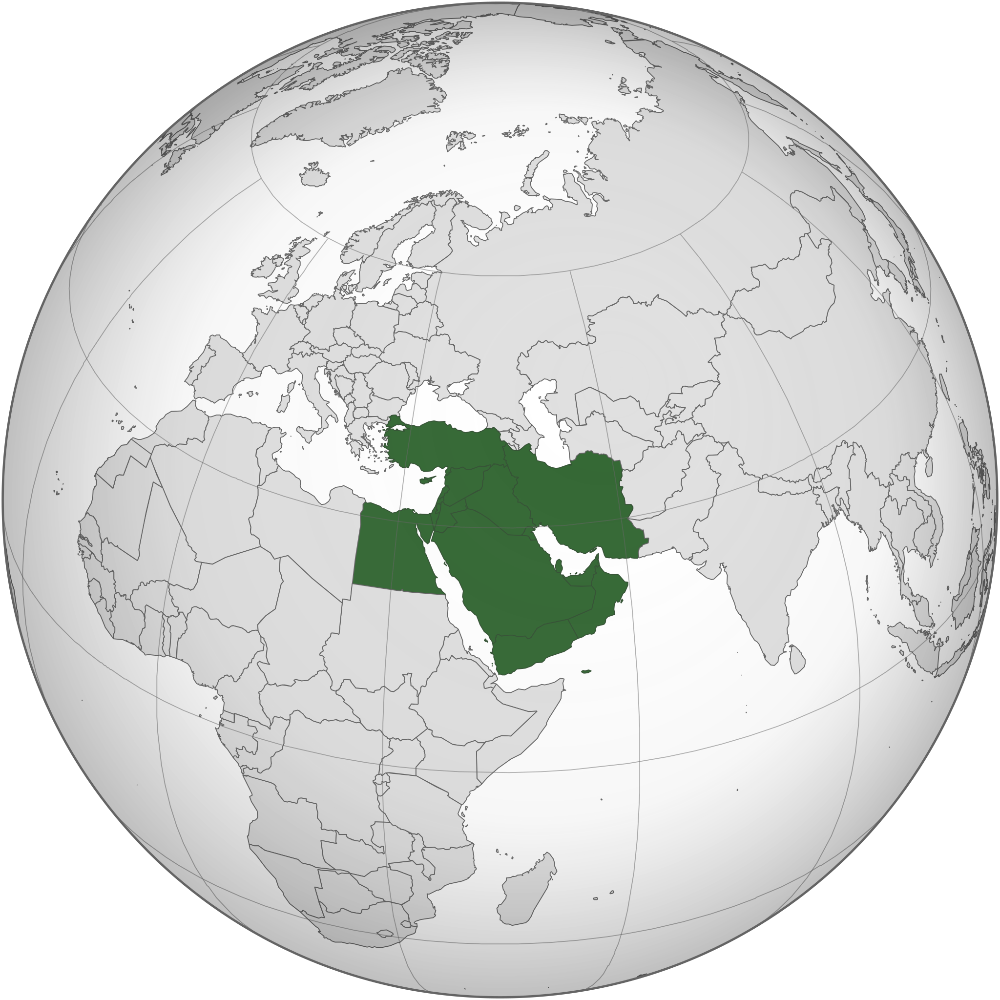
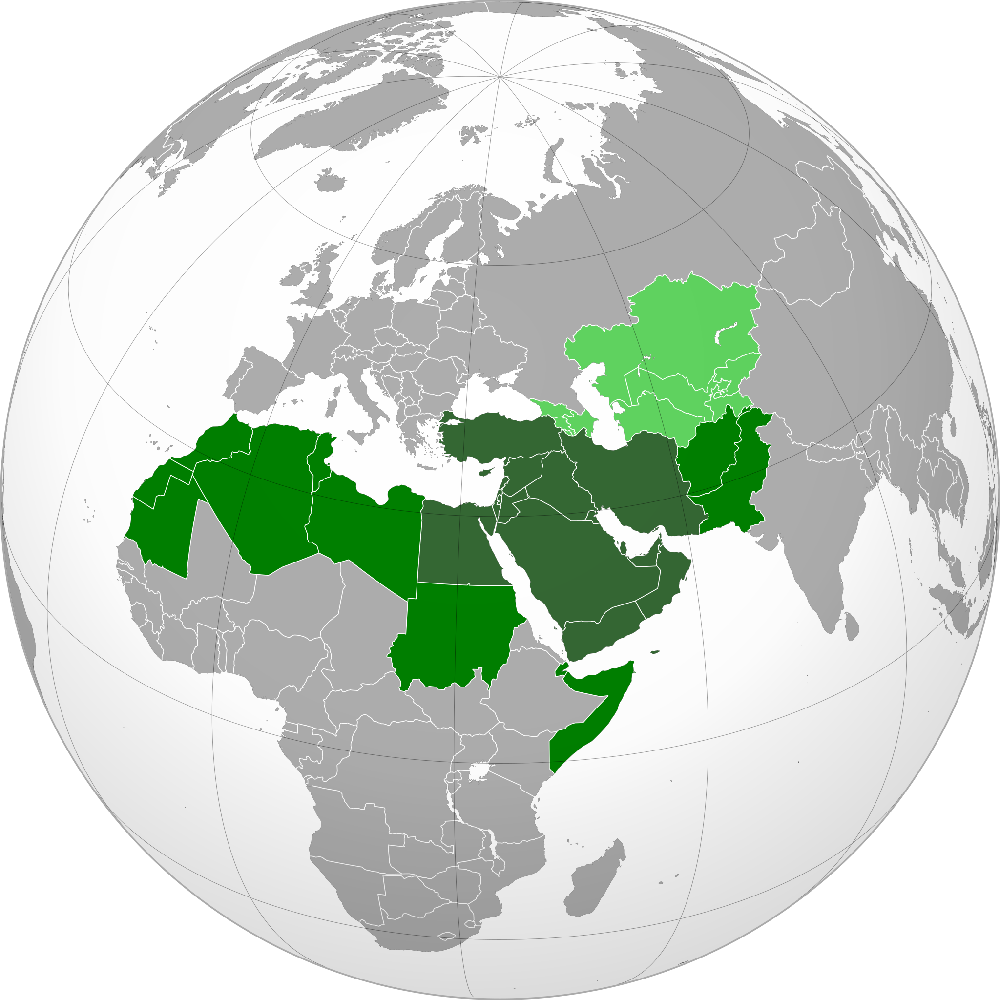

# 概述

  <figure>
    
    <figcaption style="font-size: 16px; color: gray">传统中东地区</figcaption>
  </figure>
  <figure>
    
    <figcaption style="font-size: 16px; color: gray">大中东地区</figcaption>
  </figure>

[**中东**](https://zh.wikipedia.org/wiki/中东)（英语：Middle East），又称**中东地区**。具体是指[地中海](https://zh.wikipedia.org/wiki/地中海)东部与南部区域，从地中海东部到[波斯湾](https://zh.wikipedia.org/wiki/波斯灣)的大片地区。这个词是[以欧洲为参考坐标](https://zh.wikipedia.org/wiki/歐洲中心主義)，意指[欧洲](https://zh.wikipedia.org/wiki/歐洲)以东，并介于[远东](https://zh.wikipedia.org/wiki/遠東)和[近东](https://zh.wikipedia.org/wiki/近東)之间的地区。若以非欧洲中心主义论述，最接近的词汇为[西亚](https://zh.wikipedia.org/wiki/西亚)，虽然两者地理上并不完全重合。

在西方国家开始向东方扩张时，他们[以欧洲为中心](https://zh.wikipedia.org/wiki/歐洲中心主義)，把东南欧、非洲东北称为[**近东**](https://zh.wikipedia.org/wiki/近東)，把西亚附近称为[**中东**](https://zh.wikipedia.org/wiki/中东)，把更远的东方亚洲最东部地区称为[**远东**](https://zh.wikipedia.org/wiki/遠東)。

- 地理位置划分
  - 西亚国家（地区）包括沙特、伊朗、伊拉克、科威特、阿联酋、阿曼、卡塔尔、巴林、土耳其、以色列、巴勒斯坦、叙利亚、黎巴嫩、约旦、也门和塞浦路斯。（16个）
  - 北非国家（地区）包括：埃及、利比亚、突尼斯、阿尔及利亚、摩洛哥、马德拉群岛、亚速尔群岛。（7个）
  - 中东不包括阿富汗

- 人种划分
  - 以阿拉伯人为主的众多阿拉伯国家
  - 以土耳其人为主的土耳其
  - 以波斯人为主的伊朗
  - 以犹太人为主的以色列

气候类型主要为热带沙漠气候、地中海气候、温带大陆性气候。其中热带沙漠气候分布最广。

中东是“一湾两洋三洲五海”之地，五海具体指里海，黑海，地中海，红海，阿拉伯海。其中里海是世界上最大的湖泊且为最大的内陆咸水湖，交通便利，海陆空的路线，可顺利运送石油到各国。其处在联系亚欧非三大洲，沟通大西洋和印度洋的枢纽地位。是沟通大西洋和印度洋、连接西方和东方的枢纽地位，也是欧洲经北非到西亚的枢纽和咽喉。中东在世界政治、经济和军事上的重要地位，战略位置极其重要，为争夺宝贵的淡水资源和石油资源，及宗教文化差异，常年局势动荡。使其成为世界历史上资本主义列强逐鹿、兵家必争之地。

# 历史

关于中东问题的历史沿革，可以用“一、二、三、四”概而言之，那就是：一个祖先，两个民族，三次流散，四次战争。

一个祖先，两个民族，迦南（现巴勒斯坦）人，原是阿拉伯半岛闪米特人的一支。约公元前11世纪，爱琴海沿岸的腓力斯丁人移居迦南。公元前5世纪，希腊史学家希罗多德首次称该地区为“巴勒斯坦”，即希腊语“腓力斯丁人的土地”之意，一直沿用至今。

约公元前1900年，闪族的另一支在族长亚伯拉罕（即基督教、犹太教、伊斯兰教共同的先知）率领下，由两河流域的乌尔迁徙到迦南。据《圣经》所说，亚伯拉罕与其妻撒拉生子以撒，他们便是犹太人的祖先。后犹太人逃亡埃及，摩西率众出埃及返迦南，一直到二战后建立以色列国，都是源于这一支系。亚伯拉罕与其妾埃及人夏甲生子以实玛利，因被撒拉所不容，被赶至阿拉伯半岛，繁衍生息，他们便是半岛北阿拉伯人的祖先，伊斯兰教的先知穆罕默德即是其后裔。

穆罕默德创教初期，犹太人和基督徒对他采取敌视态度。随着穆罕默德追随者不断增加，阿拉伯骑兵也开始对外扩张。7世纪时伊斯兰教分裂。拥戴穆罕默德后裔的人和接受哈里发代表真主的人逐渐形成“什叶派”和“逊尼派”。

# 动荡原因

政治上的**中东问题**：一般指阿拉伯国家和以色列的冲突问题。

## 文化差异

中东的各民族仍然保留着自己的宗教信仰和风俗习惯，大多数居民信仰伊斯兰教，少数居民信仰基督教、犹太教和其他宗教。伊斯兰教、基督教和犹太教都将耶路撒冷视为圣城。文化上的差异也是导致中东不安定的重要原因之一。

## 内部矛盾

埃及军人纳赛尔、萨达特打响了伊斯兰革命复兴运动的第一炮。在二战后，出现34个表面上独立的伊斯兰国家。接着一大批宗教领袖试图寻求新的革命道路反对世俗政权，实行“伊斯兰革命”，恢复神权统治。伊斯兰民族革命到宗教革命的过程中，始终贯穿着现实的政治目标，即脱离西方或苏联的政治与经济控制，期望成为真正独立的国家；改变王室政体，建立共和国；梦想组建新的阿拉伯联盟，重温以往阿拉伯帝国的梦想；反对犹太复国主义，共同在军事上抵抗以色列。

但是由于各种原因，阿拉伯世界内部并不团结

- 首先，各个国家信奉伊斯兰教的不同派别（很多国家内部也有派别之争，导致政局动荡），教派之间的冲突影响了国家之间的关系；
- 其次是伊斯兰世界又有阿拉伯民族国家与非阿拉伯民族国家之分，从历史来看信仰伊斯兰教的非阿拉伯民族大多遭到阿拉伯民族的歧视与偏见，由于宿怨，在产生矛盾时极易发生冲突；
- 第三，在各个国家争取独立时，由于西方国家为了自己的利益而将一些国家、民族进行拆分，为以后的纷争埋下伏笔（如海湾战争，伊拉克以科威特历来为伊拉克为由入侵科威特），使得各国不断为领土、种族等发生矛盾；
- 第四，在伊斯兰教复兴于现代的道路中，泛伊斯兰主义与伊斯兰原教旨主义思潮占伊斯兰复兴运动中的主导思想，但是这不切实际的幻想与现实相距甚远，很多抱有英雄主义观点的阿拉伯国家领导人在国家政策上采取与西方强硬对抗，坚决建立伟大统一的阿拉伯国家，彻底消灭以色列，自然遭到以色列与西方国家的制约。在多重原因（如西方国家的控制、内部种族矛盾）的作用下，使得众多阿拉伯国家中分为亲西派与疏西派（如1978年埃及与以色列和解，埃及总统萨达特与以色列总理贝京签订戴维营协议遭到一些阿拉伯国家的反对；叙利亚却与以色列政治立场完全不同，坚决与以色列对立。）
- 1964年，“巴勒斯坦解放组织”成立，同时成立“巴勒斯坦解放军”。它是一个不具备国境，实质是政府形态的政治实体的组织。1969年，阿拉法特领导的法塔赫温和派成为巴解组织的执政党，虽然一开始与以色列有军事冲突，但后来转变为希望通过和平方式与以色列谈判。随着21世纪初巴以冲突加剧，阿拉法特逝世，他的继承人阿巴斯继续坚持走和平道路。未想到在之后的巴勒斯坦民族权利机构改选之后败给激进派哈马斯（在欧洲一直被视为恐怖组织）领导人哈尼亚。原本自从阿拉法特后期，巴以逐渐进入磕磕绊绊的和平时期，但是巴方这一政治剧变又为未来蒙上阴影。

所以不论从以色列方面还是巴勒斯坦方面，内部都存在着很大分歧。

## 西方介入

在西方文艺复兴的影响下，由马丁·路德发起的16世纪基督宗教改革运动中，天主教教会分裂出新教。基督新教的改革运动同时，也是欧洲政治、经济发展处于转型期间，新教强调通过深入教徒的现世生活去请求上帝的救赎。新教这种对世俗行为的鼓励，使得人们在追求商业利润时解除了犯罪感，使得商业资本主义的各个运行领域都有了宗教的最后依据。

在一战中，西方国家本身是与阿拉伯诸国结盟以对抗昔日地跨欧亚非三洲的封建军事帝国—奥斯曼帝国，但二战后，由于支持以色列复国，与阿拉伯国家关系十分紧张，为了对抗西方国家，阿拉伯国家还大幅度调高国际油价。中东阿拉伯人的建国理想（一个统一的伊斯兰国家）经历了一个十分曲折的过程。在20世纪初，阿拉伯人试图摆脱土耳其人统治，在大叙利亚建立阿拉伯国家（自古以来，叙利亚、约旦、黎巴嫩、巴勒斯坦被视为一个整体）。但一战后，西方资本主义列强为了自身利益将叙利亚分割成四个区域。二战后，西方国家支持以色列建国，彻底粉碎了他们的梦想。同时，伊斯兰社会不断受到西方基督教世界文化的侵蚀，西方资本主义所倡导的人文主义、宽容、自立、科学、理性和民主等一整套文化价值体系缓慢影响着伊斯兰世界。

二战后，英孢国先是镇压中东犹太复国主义，改变殖民地政策后，又挑动阿拉伯人与犹太人的领土与宗教冲突，之后表面上抽身而退，将问题交给当时西方控制的联合国，暗中关注局面。而美国继英国之后开始支持以色列，总统杜鲁门向英国施加压力，率先收留犹太移民。在以色列建国后，美国第一个承认以色列。数次中东战争中，美国与一些西方国家（如英、法）更是提供给以色列大批军械武器和装备。若没有美国的支持，以色列根本不可能建国并得以大规模发展。

总体来说，美柿国在中东问题上的政策要点是：改造伊斯兰社会（镇压伊斯兰原教旨主义，用西方资本主义自由经济和“民主”价值观潜移默化影响阿拉伯国家）；扶植亲美政权；控制石油资源；调节巴以冲突（以和平方式解决巴勒斯坦问题）等。

## 一多一少

- **多：石油资源**
  - 中东是世界上石油储量最大，生产和输出石油最多的地区，中东石油主要分布在波斯湾及沿岸地区。由于自身对石油的消费量很少，中东所产石油90%以上由波斯湾沿岸港口用油轮运往欧洲西部、美国、日本、中国等国家和地区，是世界上输出石油最多的地区，对世界经济发展具有举足轻重的影响。

  - 中东主要的产油国家有沙特阿拉伯、科威特、阿拉伯联合酋长国、伊朗、伊拉克，其中沙特阿拉伯、科威特、阿拉伯联合酋长国等，靠出口石油获得了可观的经济收入，成为富裕国家。

- **少：水资源**
- 中东水资源极度匮乏，与石油资源的丰富形成鲜明的对比。中东气候干燥，河流稀少，还有大面积没有河流的沙漠地区。水资源匮乏严重影响中东人民的生活和生产。随着人口的增长、经济的发展，中东水资源紧缺日趋严重。河流、湖泊水资源分配上的矛盾，也是形成中东紧张局势的原因之一。

# 相关条目

- [中东战争](中东战争.md)
