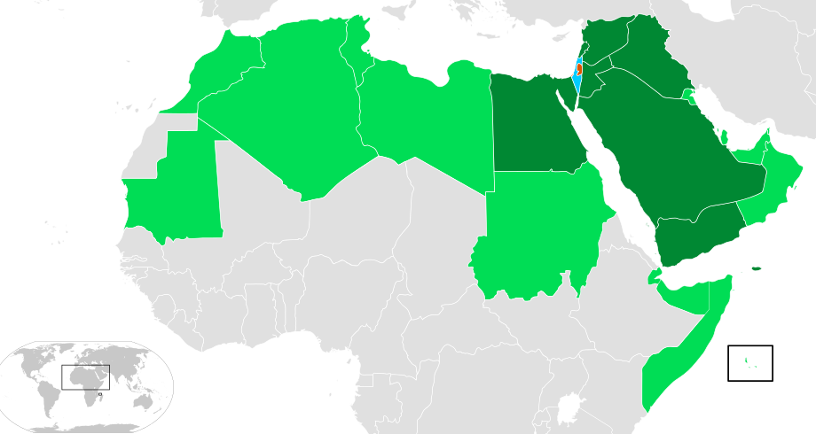

# 概述

[**中东战争**](https://zh.wikipedia.org/wiki/中东战争)，又称**阿以战争**，是指20世纪中期[以色列](以色列.md)立国后与[埃及](https://zh.wikipedia.org/wiki/埃及)、[叙利亚](https://zh.wikipedia.org/wiki/敘利亞)、[伊拉克](https://zh.wikipedia.org/wiki/伊拉克)等周围[阿拉伯国家](阿拉伯世界.md)所进行的五次大规模战争，双方的冲突至今仍尚未平息。中东战争是[阿以冲突](https://zh.wikipedia.org/wiki/阿以冲突)的一部分。

<figure>
  
  <figcaption style="font-size: 16px; color: gray">
    
以色列和阿拉伯联盟成员，深绿色为与以色列曾有直接军事冲突的国家。

  </figcaption>
</figure>

# 经过

- [第一次中东战争](第一次中东战争.md)（1947年11月—1949年3月）
- [第二次中东战争](第二次中东战争.md)（1956年10月29日—11月7日）
- [第三次中东战争](第三次中东战争.md)（1967年6月5日—6月10日）
- [第四次中东战争](第四次中东战争.md)（1973年10月6日—10月26日）
- [第五次中东战争](第五次中东战争.md)（1982年6月4日—9月29日）

# 相关条目
