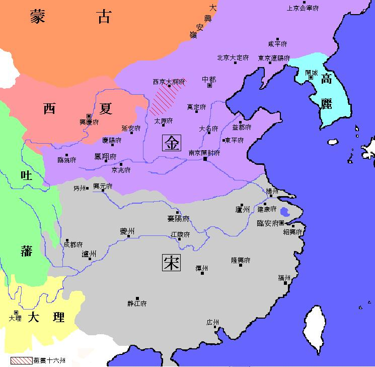

# 朝代模板

## 概述

## 历史

## 君主世系

[朝皇帝世系图](https://zh.wikipedia.org/wiki/朝皇帝世系图)

## 疆域

## 后裔

## 其它相关

# 中国史通述

## 中国历史条目

- [中国历史](https://zh.wikipedia.org/wiki/中国历史)
- [中国朝代](https://zh.wikipedia.org/wiki/中国朝代)
- [中国统一史](https://zh.wikipedia.org/wiki/中国统一)
- [中国历史朝代模板](https://zh.wikipedia.org/wiki/Template:%E4%B8%AD%E5%9B%BD%E5%8E%86%E5%8F%B2)
- [中国君主世系图](https://zh.wikipedia.org/wiki/中国君主世系图)
- [中国君主列表](https://zh.wikipedia.org/wiki/中国君主列表)
- [中国历史年表](https://zh.wikipedia.org/wiki/中国历史年表)
- [中国主要朝代列表](https://zh.wikipedia.org/wiki/中国朝代#中國主要朝代列表)

## 参考表

### 中国历史年表

<table style="text-align: center; margin: 0 auto">
  <tr>
    <th colspan="4">
      <a
        href="https://zh.wikipedia.org/wiki/Template:中国历史"
        title="中国历史年表"
        >中国历史年表</a
      >&nbsp;
      <a
        href="https://zh.wikipedia.org/wiki/Template:Neolithic_cultures_of_China"
        title="表格说明"
        ><small style="color: #9d9487">注</small></a
      >
    </th>
  </tr>
  <tr>
    <td rowspan="3" style="background-color: #095352">
      <a href="https://zh.wikipedia.org/wiki/中国史前文化" title="史前时代"
        >史前时代</a
      >
    </td>
    <td colspan="3" style="background-color: #114500">
      <a
        href="https://zh.wikipedia.org/wiki/中国旧石器文化列表"
        title="旧石器时代"
        >旧石器时代</a
      >
    </td>
  </tr>
  <tr>
    <td colspan="3" style="background-color: #343400">
      <a
        href="https://zh.wikipedia.org/wiki/中国中石器文化列表"
        title="中石器时代"
        >中石器时代</a
      >
    </td>
  </tr>
  <tr>
    <td colspan="3" style="background-color: #451900">
      <a
        href="http://zh.wikipedia.org/wiki/中国新石器文化列表"
        title="新石器时代"
        >新石器时代</a
      >
    </td>
  </tr>
  <tr>
    <td style="background-color: #450045">
      <a
        href="https://zh.wikipedia.org/wiki/%E5%8F%A4%E5%9B%BD%E6%97%B6%E4%BB%A3"
        title="古国时代"
        >古国时代 （三皇五帝）</a
      >
    </td>
    <td colspan="3" style="background-color: #095352">
      <a
        href="https://zh.wikipedia.org/wiki/%E9%93%9C%E7%9F%B3%E5%B9%B6%E7%94%A8%E6%97%B6%E4%BB%A3"
        title="铜石并用时代"
        >铜石并用时代</a
      > 
      <small>
        （<a href="https://zh.wikipedia.org/wiki/黄河文明" title="黄河文明"
          >黄河文明</a
        >、<a href="https://zh.wikipedia.org/wiki/长江文明" title="长江文明"
          >长江文明</a
        >、<a href="https://zh.wikipedia.org/wiki/辽河文明" title="辽河文明"
          >辽河文明</a
        >、<a
          href="https://zh.wikipedia.org/wiki/珠江文明"
          class="mw-redirect"
          title="珠江文明"
          >珠江文明</a
        >）
      </small>
    </td>
  </tr>
  <tr>
    <td colspan="4" style="background-color: #114500">
      <a href="https://zh.wikipedia.org/wiki/夏朝" title="夏朝"
        >夏 前21世纪—前17世纪</a
      >
    </td>
  </tr>
  <tr>
    <td colspan="4" style="background-color: #451900">
      <a href="https://zh.wikipedia.org/wiki/商朝" title="商朝"
        >商 前17世纪—前11世纪</a
      >
    </td>
  </tr>
  <tr>
    <td rowspan="3" style="background-color: #450045">
      <a href="https://zh.wikipedia.org/wiki/周朝" title="周朝"
        >周 前11世纪—前256年</a
      >
    </td>
    <td colspan="3" style="background-color: #450045">
      <a href="https://zh.wikipedia.org/wiki/西周" title="西周"
        >西周&nbsp;前11世纪—前771年</a
      >
    </td>
  </tr>
  <tr>
    <td rowspan="2" style="background-color: #450045">
      <a href="https://zh.wikipedia.org/wiki/东周" title="东周"
        >东周 前770年—前256年</a
      >
    </td>
    <td colspan="2" style="background-color: #343400">
      <a href="https://zh.wikipedia.org/wiki/春秋" title="春秋"
        >春秋&nbsp;前770年—前5世纪</a
      >
    </td>
  </tr>
  <tr>
    <td colspan="2" style="background-color: #114500">
      <a href="https://zh.wikipedia.org/wiki/战国" title="战国"
        >战国&nbsp;前5世纪—前221年</a
      >
    </td>
  </tr>
  <tr>
    <td colspan="4" style="background-color: #451900">
      <a href="https://zh.wikipedia.org/wiki/秦朝" title="秦朝"
        >秦&nbsp;前221年—前207年</a
      >
    </td>
  </tr>
  <tr>
    <td rowspan="3" style="background-color: #114500">
      <a href="https://zh.wikipedia.org/wiki/汉朝" title="汉朝"
        >汉 前202年—220年</a
      >
    </td>
    <td colspan="3" style="background-color: #114500">
      <a href="https://zh.wikipedia.org/wiki/西楚" title="西楚"
        >西楚&nbsp;前206年—前202年</a
      > 
      <a href="https://zh.wikipedia.org/wiki/西汉" title="西汉"
        >西汉&nbsp;前202年—9年</a
      >
    </td>
  </tr>
  <tr>
    <td colspan="3" style="background-color: #343400">
      <a href="https://zh.wikipedia.org/wiki/新朝" title="新朝"
        >新朝&nbsp;9年—23年</a
      >
    </td>
  </tr>
  <tr>
    <td colspan="3" style="background-color: #114500">
      <a href="https://zh.wikipedia.org/wiki/更始政权" title="更始政权"
        >更始政权&nbsp;23年—25年</a
      > 
      <a href="https://zh.wikipedia.org/wiki/东汉" title="东汉"
        >东汉&nbsp;25年—220年</a
      >
    </td>
  </tr>
  <tr>
    <td style="background-color: #450045">
      <a href="三国.md" title="三国"
        >三国 220年—280年</a
      >
    </td>
    <td style="background-color: #095352">
      <a href="https://zh.wikipedia.org/wiki/曹魏" title="曹魏"
        >魏 220年—266年</a
      >
    </td>
    <td style="background-color: #114500">
      <a href="https://zh.wikipedia.org/wiki/蜀汉" title="蜀汉"
        >蜀汉 221年—263年</a
      >
    </td>
    <td style="background-color: #343400">
      <a href="https://zh.wikipedia.org/wiki/孙吴" title="孙吴"
        >吴 222年—280年</a
      >
    </td>
  </tr>
  <tr>
    <td rowspan="2" style="background-color: #451900">
      <a href="https://zh.wikipedia.org/wiki/晋朝" title="晋朝"
        >晋 266年—420年</a
      >
    </td>
    <td colspan="3" style="background-color: #451900">
      <a href="https://zh.wikipedia.org/wiki/西晋" title="西晋"
        >西晋 266年—316年</a
      >
    </td>
  </tr>
  <tr>
    <td style="background-color: #451900">
      <a href="https://zh.wikipedia.org/wiki/东晋" title="东晋"
        >东晋 317年—420年</a
      >
    </td>
    <td colspan="2" style="background-color: #450045">
      <a href="https://zh.wikipedia.org/wiki/五胡十六国" title="五胡十六国"
        >五胡十六国 266年—316年</a
      >
    </td>
  </tr>
  <tr>
    <td rowspan="4" style="background-color: #095352">
      <a href="https://zh.wikipedia.org/wiki/南北朝" title="南北朝"
        >南北朝 420年—589年</a
      >
    </td>
    <td style="background-color: #114500">
      <a href="https://zh.wikipedia.org/wiki/刘宋" title="刘宋"
        >宋 420年—479年</a
      >
    </td>
    <td colspan="2" rowspan="2" style="background-color: #343400">
      <a href="https://zh.wikipedia.org/wiki/北魏" title="北魏"
        >北魏 386年—534年</a
      >
    </td>
  </tr>
  <tr>
    <td style="background-color: #114500">
      <a href="https://zh.wikipedia.org/wiki/南齐" title="南齐"
        >齐 479年—502年</a
      >
    </td>
  </tr>
  <tr>
    <td style="background-color: #114500">
      <a href="https://zh.wikipedia.org/wiki/梁_(南朝)" title="梁(南朝)"
        >梁 502年—557年</a
      >
    </td>
    <td style="background-color: #343400">
      <a href="https://zh.wikipedia.org/wiki/西魏" title="西魏"
        >西魏 535年—557年</a
      >
    </td>
    <td style="background-color: #343400">
      <a href="https://zh.wikipedia.org/wiki/东魏" title="东魏"
        >东魏 534年—550年</a
      >
    </td>
  </tr>
  <tr>
    <td style="background-color: #114500">
      <a href="https://zh.wikipedia.org/wiki/陈_(南朝)" title="陈(南朝)"
        >陈 557年—589年</a
      >
    </td>
    <td style="background-color: #343400">
      <a href="https://zh.wikipedia.org/wiki/北周" title="北周"
        >北周 557年—581年</a
      >
    </td>
    <td style="background-color: #343400">
      <a href="https://zh.wikipedia.org/wiki/北齐" title="北齐"
        >北齐 534年—550年</a
      >
    </td>
  </tr>
  <tr>
    <td colspan="4" style="background-color: #451900">
      <a href="https://zh.wikipedia.org/wiki/隋朝" title="隋朝"
        >隋&nbsp;581年—619年</a
      >
    </td>
  </tr>
  <tr>
    <td colspan="4" style="background-color: #343400">
      <a href="https://zh.wikipedia.org/wiki/唐朝" title="唐朝"
        >唐&nbsp;618年—907年</a
      > 
      <a href="https://zh.wikipedia.org/wiki/武周" title="武周"
        >武周&nbsp;690年—705年</a
      >
    </td>
  </tr>
  <tr>
    <td rowspan="5" style="background-color: #095352">
      <a href="https://zh.wikipedia.org/wiki/五代十国" title="五代十国"
        >五代十国 907年—979年</a
      >
    </td>
    <td style="background-color: #114500">
      <a href="https://zh.wikipedia.org/wiki/后梁" title="后梁"
        >后梁 907年—923年</a
      >
    </td>
    <td rowspan="5" style="background-color: #451900">
      十国
       
      （
      <a href="https://zh.wikipedia.org/wiki/杨吴" title="杨吴">杨吴</a>
      、
      <a href="https://zh.wikipedia.org/wiki/南唐" title="南唐">南唐</a>
       
      <a href="https://zh.wikipedia.org/wiki/吴越" title="吴越">吴越</a>
      、
      <a href="https://zh.wikipedia.org/wiki/闽" title="闽">闽</a>
       
      <a href="https://zh.wikipedia.org/wiki/前蜀" title="前蜀">前蜀</a>
      、
      <a href="https://zh.wikipedia.org/wiki/后蜀" title="后蜀">后蜀</a>
       
      <a href="https://zh.wikipedia.org/wiki/荆南" title="荆南">荆南</a>
      、
      <a href="https://zh.wikipedia.org/wiki/马楚" title="马楚">马楚</a>
       
      <a href="https://zh.wikipedia.org/wiki/南汉" title="南汉">南汉</a>
      、
      <a href="https://zh.wikipedia.org/wiki/北汉" title="北汉">北汉</a>
      ）
    </td>
    <td rowspan="6" style="background-color: #095352">
      <a href="https://zh.wikipedia.org/wiki/辽朝" title="辽朝"
        >辽（契丹） 916年—1125年</a
      >
       
      <a href="https://zh.wikipedia.org/wiki/西辽" title="西辽"
        >西辽&nbsp;1124年—1218年</a
      >
    </td>
  </tr>
  <tr>
    <td style="background-color: #114500">
      <a href="https://zh.wikipedia.org/wiki/后唐" title="后唐"
        >后唐 923年—936年</a
      >
    </td>
  </tr>
  <tr>
    <td style="background-color: #114500">
      <a href="https://zh.wikipedia.org/wiki/后晋" title="后晋"
        >后晋 936年—947年</a
      >
    </td>
  </tr>
  <tr>
    <td style="background-color: #114500">
      <a href="https://zh.wikipedia.org/wiki/后汉" title="后汉"
        >后汉 947年—950年</a
      >
    </td>
  </tr>
  <tr>
    <td style="background-color: #114500">
      <a href="https://zh.wikipedia.org/wiki/后周" title="后周"
        >后周 951年—960年</a
      >
    </td>
  </tr>
  <tr>
    <td rowspan="2" style="background-color: #450045">
      <a href="https://zh.wikipedia.org/wiki/宋朝" title="宋朝"
        >宋 960年—1279年</a
      >
    </td>
    <td style="background-color: #450045">
      <a href="https://zh.wikipedia.org/wiki/北宋" title="北宋"
        >北宋 960年—1127年</a
      >
    </td>
    <td rowspan="2" style="background-color: #114500">
      <a href="https://zh.wikipedia.org/wiki/西夏" title="西夏"
        >西夏 1038年—1227年</a
      >
    </td>
  </tr>
  <tr>
    <td style="background-color: #450045">
      <a href="https://zh.wikipedia.org/wiki/南宋" title="南宋"
        >南宋 1127年—1279年</a
      >
    </td>
    <td style="background-color: #343400">
      <a href="https://zh.wikipedia.org/wiki/金朝" title="金朝"
        >金 1115年—1234年</a
      >
    </td>
  </tr>
  <tr>
    <td colspan="4" style="background-color: #451900">
      <a href="https://zh.wikipedia.org/wiki/蒙古帝国" title="蒙古帝国"
        >蒙古帝国&nbsp;1206年—1368年</a
      >
       
      <a href="https://zh.wikipedia.org/wiki/元朝" title="元朝"
        >元&nbsp;1271年—1368年</a
      >
       
      <a href="https://zh.wikipedia.org/wiki/北元" title="北元"
        >北元&nbsp;1368年—1388年</a
      >
    </td>
  </tr>
  <tr>
    <td colspan="4" style="background-color: #450045">
      <a href="https://zh.wikipedia.org/wiki/明朝" title="明朝"
        >明&nbsp;1368年—1644年</a
      >
       
      <a href="https://zh.wikipedia.org/wiki/南明" title="南明"
        >南明&nbsp;1644年—1662年</a
      >
    </td>
  </tr>
  <tr>
    <td colspan="4" style="background-color: #343400">
      <a href="https://zh.wikipedia.org/wiki/后金" title="后金"
        >后金&nbsp;1616年—1636年</a
      >
       
      <a href="https://zh.wikipedia.org/wiki/清朝" title="清朝"
        >清&nbsp;1636年/1644年—1912年</a
      >
    </td>
  </tr>
  <tr>
    <td colspan="4" style="background-color: #095352">
      <a
        href="https://zh.wikipedia.org/wiki/中华民国大陆时期"
        title="中华民国大陆时期"
        >中华民国 大陆时期&nbsp;1912年—1949年</a
      >
    </td>
  </tr>
  <tr>
    <td colspan="2" style="background-color: #450045">
      <a
        href="https://zh.wikipedia.org/wiki/中华人民共和国"
        title="中华人民共和国"
        >中华人民共和国 1949年至今</a
      >
    </td>
    <td colspan="2" style="background-color: #095352">
      <a href="https://zh.wikipedia.org/wiki/中华民国" title="中华民国"
        >中华民国 台湾时期&nbsp;1949年至今</a
      >
    </td>
  </tr>
</table>

### 中国主要朝代列表

<table style="text-align: center">
  <tr>
    <th colspan="10" style="font-size: larger">
      <a href="https://zh.wikipedia.org/wiki/中国朝代#中國主要朝代列表"
        >中国主要历史朝代列表</a
      >
    </th>
  </tr>
  <tr>
    <th rowspan="2"></th>
    <th rowspan="2">
      朝代 
      <small
        style="color: #9d9487"
        title="本列表显示的名号为历史学给予的称谓，不应与各朝正式确立的国号混淆。同一王朝亦可有多个历史学称谓。"
        >[注]</small
      >
    </th>
    <th colspan="2">统治家族</th>
    <th colspan="3">统治时期</th>
    <th colspan="3">君主</th>
  </tr>
  <tr>
    <th>国姓</th>
    <th>民族</th>
    <th>建立</th>
    <th>灭亡</th>
    <th>国祚</th>
    <th>
      开国之君 
      <small
        style="color: #9d9487"
        title="本列表显示的开国君主为王朝实际开创者。"
        >[注]</small
      >
    </th>
    <th>亡国之君</th>
    <th>
      <a href="https://zh.wikipedia.org/wiki/中国君主列表" title="中国君主列表"
        >表</a
      >
      

      <a
        href="https://zh.wikipedia.org/wiki/中国君主世系图列表"
        title="中国君主世系图列表"
        >图</a
      >
    </th>
  </tr>
  <tr>
    <td></td>
    <td><a href="https://zh.wikipedia.org/wiki/夏朝" title="夏朝">夏朝</a></td>
    <td>
      姒 
      <small style="color: #9d9487" title="夏朝统治家族为“姒”姓，“夏后”氏。"
        >[注]</small
      >
    </td>
    <td><a href="https://zh.wikipedia.org/wiki/华夏" title="华夏">华夏</a></td>
    <td>
      前2070年 
      <small
        style="color: #9d9487"
        title="据汉代史学家刘歆推算，夏朝的统治始于前2205年，终于前1766年，历时约440年。晚清官方审定的《中国历史教科书》采用此说。"
        >[注]</small
      >
    </td>
    <td>
      <a href="https://zh.wikipedia.org/wiki/鸣条之战" title="鸣条之战"
        >前1600年</a
      > 
      <small
        style="color: #9d9487"
        title="据汉代史学家刘歆推算，夏朝的统治始于前2205年，终于前1766年，历时约440年。晚清官方审定的《中国历史教科书》采用此说。"
        >[注]</small
      >
    </td>
    <td>
      470年 
      <small
        style="color: #9d9487"
        title="据汉代史学家刘歆推算，夏朝的统治始于前2205年，终于前1766年，历时约440年。晚清官方审定的《中国历史教科书》采用此说。"
        >[注]</small
      >
    </td>
    <td>
      <a href="https://zh.wikipedia.org/wiki/禹" title="禹">禹 姒文命</a>
    </td>
    <td>
      <a href="https://zh.wikipedia.org/wiki/桀" title="桀">桀 姒履癸</a>
    </td>
    <td>
      <a href="https://zh.wikipedia.org/wiki/夏朝君主列表" title="夏朝君主列表"
        >表</a
      >
      

      <a
        href="https://zh.wikipedia.org/wiki/夏朝君主世系图"
        title="夏朝君主世系图"
        >图</a
      >
    </td>
  </tr>
  <tr>
    <td></td>
    <td><a href="https://zh.wikipedia.org/wiki/商朝" title="商朝">商朝</a></td>
    <td>子</td>
    <td><a href="https://zh.wikipedia.org/wiki/华夏" title="华夏">华夏</a></td>
    <td>
      <a href="https://zh.wikipedia.org/wiki/鸣条之战" title="鸣条之战"
        >前1600年</a
      > 
      <small
        style="color: #9d9487"
        title="据汉代史学家刘歆推算，商朝的统治始于公元前1766年，终于公元前1122年，历时约645年。晚清官方审定的《中国历史教科书》采用此说。"
        >[注]</small
      >
    </td>
    <td>
      <a href="https://zh.wikipedia.org/wiki/牧野之战" title="牧野之战"
        >前1046年</a
      > 
      <small
        style="color: #9d9487"
        title="据汉代史学家刘歆推算，商朝的统治始于公元前1766年，终于公元前1122年，历时约645年。晚清官方审定的《中国历史教科书》采用此说。"
        >[注]</small
      >
    </td>
    <td>
      554年 
      <small
        style="color: #9d9487"
        title="据汉代史学家刘歆推算，商朝的统治始于公元前1766年，终于公元前1122年，历时约645年。晚清官方审定的《中国历史教科书》采用此说。"
        >[注]</small
      >
    </td>
    <td>
      <a href="https://zh.wikipedia.org/wiki/商汤" title="商汤">汤 子履</a>
    </td>
    <td>
      <a href="https://zh.wikipedia.org/wiki/帝辛" title="帝辛">商纣王 子受</a>
    </td>
    <td>
      <a href="https://zh.wikipedia.org/wiki/商朝君主列表" title="商朝君主列表"
        >表</a
      >
      

      <a
        href="https://zh.wikipedia.org/wiki/商朝君主世系图"
        title="商朝君主世系图"
        >图</a
      >
    </td>
  </tr>
  <tr>
    <td style="background-color: #451900"></td>
    <td style="background-color: #451900">
      <a href="https://zh.wikipedia.org/wiki/周朝" title="周朝">周朝</a>
    </td>
    <td style="background-color: #451900">姬</td>
    <td style="background-color: #451900">
      <a href="https://zh.wikipedia.org/wiki/华夏" title="华夏">华夏</a>
    </td>
    <td style="background-color: #451900">
      <a href="https://zh.wikipedia.org/wiki/牧野之战" title="牧野之战"
        >前1046年</a
      >
    </td>
    <td style="background-color: #451900">
      <a href="https://zh.wikipedia.org/wiki/秦灭周" title="秦灭周">前256年</a>
    </td>
    <td style="background-color: #451900">789年</td>
    <td style="background-color: #451900">
      <a href="https://zh.wikipedia.org/wiki/周武王" title="周武王"
        >周武王 姬发</a
      >
    </td>
    <td style="background-color: #451900">
      <a href="https://zh.wikipedia.org/wiki/周赧王" title="周赧王"
        >周赧王 姬延</a
      >
    </td>
    <td style="background-color: #451900">
      <a href="https://zh.wikipedia.org/wiki/周朝君主列表" title="周朝君主列表"
        >表</a
      >
      

      <a
        href="https://zh.wikipedia.org/wiki/周朝君主世系图"
        title="周朝君主世系图"
        >图</a
      >
    </td>
  </tr>
  <tr>
    <td style="background-color: #451900"></td>
    <td>
      <a href="https://zh.wikipedia.org/wiki/西周" title="西周">西周</a> 
      <small style="color: #9d9487" title="西周与东周统称为“周朝”。"
        >[注]</small
      >
    </td>
    <td>姬</td>
    <td><a href="https://zh.wikipedia.org/wiki/华夏" title="华夏">华夏</a></td>
    <td>
      <a href="https://zh.wikipedia.org/wiki/牧野之战" title="牧野之战"
        >前1046年</a
      > 
      <small
        style="color: #9d9487"
        title="据汉代史学家刘歆推算，西周的统治始于前1122年，终于前771年，历时351年。”。"
        >[注]</small
      >
    </td>
    <td>
      <a href="https://zh.wikipedia.org/wiki/犬戎攻周之战" title="犬戎攻周之战"
        >前771年</a
      >
    </td>
    <td>
      275年 
      <small
        style="color: #9d9487"
        title="据汉代史学家刘歆推算，西周的统治始于前1122年，终于前771年，历时351年。"
        >[注]</small
      >
    </td>
    <td>
      <a href="https://zh.wikipedia.org/wiki/周武王" title="周武王"
        >周武王 姬发</a
      >
    </td>
    <td>
      <a href="https://zh.wikipedia.org/wiki/周幽王" title="周幽王"
        >周幽王 姬宫涅</a
      >
    </td>
    <td>
      <a
        href="https://zh.wikipedia.org/wiki/周朝君主列表#西周"
        title="周朝君主列表"
        >表</a
      >
      

      <a
        href="https://zh.wikipedia.org/wiki/周朝君主世系图"
        title="周朝君主世系图"
        >图</a
      >
    </td>
  </tr>
  <tr>
    <td style="background-color: #451900"></td>
    <td>
      <a href="https://zh.wikipedia.org/wiki/东周" title="东周">东周</a> 
      <small style="color: #9d9487" title="西周与东周统称为“周朝”。"
        >[注]</small
      >
    </td>
    <td>姬</td>
    <td><a href="https://zh.wikipedia.org/wiki/华夏" title="华夏">华夏</a></td>
    <td>
      <a href="https://zh.wikipedia.org/wiki/周平王东迁" title="周平王东迁"
        >前770年</a
      >
    </td>
    <td>
      <a href="https://zh.wikipedia.org/wiki/秦灭周" title="秦灭周">前256年</a>
    </td>
    <td>514年</td>
    <td>
      <a href="https://zh.wikipedia.org/wiki/周平王" title="周平王"
        >周平王 姬宜臼</a
      >
    </td>
    <td>
      <a href="https://zh.wikipedia.org/wiki/周赧王" title="周赧王"
        >周赧王 姬延</a
      >
    </td>
    <td>
      <a
        href="https://zh.wikipedia.org/wiki/周朝君主列表#东周"
        title="周朝君主列表"
        >表</a
      >
      

      <a
        href="https://zh.wikipedia.org/wiki/周朝君主世系图"
        title="周朝君主世系图"
        >图</a
      >
    </td>
  </tr>
  <tr>
    <td></td>
    <td><a href="https://zh.wikipedia.org/wiki/秦朝" title="秦朝">秦朝</a></td>
    <td>
      嬴 
      <small style="color: #9d9487" title="秦朝统治家族为“嬴”姓，“赵”氏。"
        >[注]</small
      >
    </td>
    <td><a href="https://zh.wikipedia.org/wiki/华夏" title="华夏">华夏</a></td>
    <td>
      <a href="https://zh.wikipedia.org/wiki/秦灭齐之战" title="秦灭齐之战"
        >前221年</a
      >
    </td>
    <td>前207年</td>
    <td>14年</td>
    <td>
      <a href="https://zh.wikipedia.org/wiki/秦始皇" title="秦始皇"
        >秦始皇 嬴政</a
      >
    </td>
    <td>
      <a href="https://zh.wikipedia.org/wiki/子婴" title="子婴">嬴子婴</a>
    </td>
    <td>
      <a href="https://zh.wikipedia.org/wiki/秦朝君主列表" title="秦朝君主列表"
        >表</a
      >
      

      <a
        href="https://zh.wikipedia.org/wiki/秦朝君主世系图"
        title="秦朝君主世系图"
        >图</a
      >
    </td>
  </tr>
  <tr>
    <td style="background-color: #343400"></td>
    <td style="background-color: #343400">
      <a href="https://zh.wikipedia.org/wiki/汉朝" title="汉朝">汉朝</a>
    </td>
    <td style="background-color: #343400">刘</td>
    <td style="background-color: #343400">
      <a href="https://zh.wikipedia.org/wiki/汉族" title="汉族">汉</a>
    </td>
    <td style="background-color: #343400">
      前202年 
      <small
        style="color: #9d9487"
        title="部分学者视公元前206年汉高帝刘邦称“汉王”为西汉与汉朝之始。若以此观点，西汉享国215年，汉朝享国共410年。"
        >[注]</small
      >
    </td>
    <td style="background-color: #343400">
      <a href="https://zh.wikipedia.org/wiki/" title="事件"> 220年 </a> 
      (<a href="https://zh.wikipedia.org/wiki/延康_(东汉)" title="延康 (东汉)"
        >延康</a
      >元年)
    </td>
    <td style="background-color: #343400">
      406年 
      <small
        style="color: #9d9487"
        title="部分学者视公元前206年汉高帝刘邦称“汉王”为西汉与汉朝之始。若以此观点，西汉享国215年，汉朝享国共410年。"
        >[注]</small
      >
    </td>
    <td style="background-color: #343400">
      <a href="https://zh.wikipedia.org/wiki/刘邦" title="刘邦">汉高帝 刘邦</a>
    </td>
    <td style="background-color: #343400">
      <a href="https://zh.wikipedia.org/wiki/汉献帝" title="汉献帝"
        >汉献帝 刘协</a
      >
    </td>
    <td style="background-color: #343400">
      <a href="https://zh.wikipedia.org/wiki/汉朝君主列表" title="汉朝君主列表"
        >表</a
      >
      

      <a
        href="https://zh.wikipedia.org/wiki/汉朝皇帝世系图"
        title="汉朝皇帝世系图"
        >图</a
      >
    </td>
  </tr>
  <tr>
    <td style="background-color: #343400"></td>
    <td>
      <a href="https://zh.wikipedia.org/wiki/西汉" title="西汉">西汉</a> 
      <small style="color: #9d9487" title="西汉与东汉统称为“汉朝”。"
        >[注]</small
      >
    </td>
    <td>刘</td>
    <td><a href="https://zh.wikipedia.org/wiki/汉族" title="汉族">汉</a></td>
    <td>
      前202年 
      <small
        style="color: #9d9487"
        title="部分学者视公元前206年汉高帝刘邦称“汉王”为西汉与汉朝之始。若以此观点，西汉享国215年，汉朝享国共410年。"
        >[注]</small
      >
    </td>
    <td>
      9年 
      (<a href="https://zh.wikipedia.org/wiki/初始" title="初始">初始</a>元年)
    </td>
    <td>
      211年 
      <small
        style="color: #9d9487"
        title="部分学者视公元前206年汉高帝刘邦称“汉王”为西汉与汉朝之始。若以此观点，西汉享国215年，汉朝享国共410年。"
        >[注]</small
      >
    </td>
    <td>
      <a href="https://zh.wikipedia.org/wiki/刘邦" title="刘邦">汉高帝 刘邦</a>
    </td>
    <td>
      <a href="https://zh.wikipedia.org/wiki/孺子婴" title="孺子婴">刘婴</a
      > 
      <small
        style="color: #9d9487"
        title="刘婴在王莽摄政期间称“皇太子”，并未正式登基为帝。西汉最后一位正式登基的君主是汉平帝刘衎。"
        >[注]</small
      >
    </td>
    <td>
      <a
        href="https://zh.wikipedia.org/wiki/汉朝君主列表#西汉"
        title="西汉君主列表"
        >表</a
      >
      

      <a
        href="https://zh.wikipedia.org/wiki/汉朝皇帝世系图"
        title="汉朝皇帝世系图"
        >图</a
      >
    </td>
  </tr>
  <tr>
    <td></td>
    <td><a href="https://zh.wikipedia.org/wiki/新朝" title="新朝">新朝</a></td>
    <td>王</td>
    <td><a href="https://zh.wikipedia.org/wiki/汉族" title="汉族">汉</a></td>
    <td>
      <a href="https://zh.wikipedia.org/wiki/" title="事件"
        >9年 
        (<a href="https://zh.wikipedia.org/wiki/始建国" title="始建国">始建国</a
        >元年)</a
      >
    </td>
    <td>
      <a href="https://zh.wikipedia.org/wiki/昆阳之战" title="昆阳之战">23年</a
      > 
      (<a href="https://zh.wikipedia.org/wiki/地皇_(年号)" title="地皇 (年号)"
        >地皇</a
      >四年)
    </td>
    <td>14年</td>
    <td colspan="2">
      <a href="https://zh.wikipedia.org/wiki/王莽" title="王莽">王莽</a>
    </td>
    <td>
      <a
        href="https://zh.wikipedia.org/wiki/汉朝君主列表#新"
        title="汉朝君主列表"
        >表</a
      >
      

      <a
        href="https://zh.wikipedia.org/wiki/魏郡王氏世系图#王莽系"
        title="魏郡王氏世系图"
        >图</a
      >
    </td>
  </tr>
  <tr>
    <td style="background-color: #343400"></td>
    <td>
      <a href="https://zh.wikipedia.org/wiki/东汉" title="东汉">东汉</a> 
      <small style="color: #9d9487" title="西汉与东汉统称为“汉朝”。"
        >[注]</small
      >
    </td>
    <td>刘</td>
    <td><a href="https://zh.wikipedia.org/wiki/汉族" title="汉族">汉</a></td>
    <td>
      25年 
      (<a href="https://zh.wikipedia.org/wiki/建武_(东汉)" title="建武 (东汉)"
        >建武</a
      >元年)
    </td>
    <td>
      <a href="https://zh.wikipedia.org/wiki/曹丕代汉" title="曹丕代汉">220年</a
      > 
      (<a href="https://zh.wikipedia.org/wiki/延康_(东汉)" title="延康 (东汉)"
        >延康</a
      >元年)
    </td>
    <td>195年</td>
    <td>
      <a href="https://zh.wikipedia.org/wiki/汉光武帝" title="汉光武帝"
        >汉光武帝 刘秀</a
      >
    </td>
    <td>
      <a href="https://zh.wikipedia.org/wiki/汉献帝" title="汉献帝"
        >汉献帝 刘协</a
      >
    </td>
    <td>
      <a
        href="https://zh.wikipedia.org/wiki/汉朝君主列表#东汉"
        title="东汉君主列表"
        >表</a
      >
      

      <a
        href="https://zh.wikipedia.org/wiki/汉朝皇帝世系图"
        title="汉朝皇帝世系图"
        >图</a
      >
    </td>
  </tr>
  <tr>
    <td style="background-color: #42446c"></td>
    <td style="background-color: #42446c">
      <a href="三国.md" title="三国">三国</a>
    </td>
    <td style="background-color: #42446c">—</td>
    <td style="background-color: #42446c">
      <a href="https://zh.wikipedia.org/wiki/汉族" title="汉族">汉</a>
    </td>
    <td style="background-color: #42446c">
      <a href="https://zh.wikipedia.org/wiki/曹丕代汉" title="曹丕代汉"
        >220年</a
      >
    </td>
    <td style="background-color: #42446c">
      <a href="https://zh.wikipedia.org/wiki/晋灭吴之战" title="晋灭吴之战"
        >280年</a
      >
    </td>
    <td style="background-color: #42446c">60年</td>
    <td style="background-color: #42446c">—</td>
    <td style="background-color: #42446c">—</td>
    <td style="background-color: #42446c">
      <a
        href="三国.md时期君主列表"
        title="三国时期君主列表"
        >表</a
      >
    </td>
  </tr>
  <tr>
    <td style="background-color: #42446c"></td>
    <td><a href="https://zh.wikipedia.org/wiki/曹魏" title="曹魏">曹魏</a></td>
    <td>曹</td>
    <td><a href="https://zh.wikipedia.org/wiki/汉族" title="汉族">汉</a></td>
    <td>
      <a href="https://zh.wikipedia.org/wiki/曹丕代汉" title="曹丕代汉">220年</a
      > 
      (<a href="https://zh.wikipedia.org/wiki/黄初" title="黄初">黄初</a>元年)
    </td>
    <td>
      266年 
      (<a href="https://zh.wikipedia.org/wiki/咸熙" title="咸熙">咸熙</a>二年)
    </td>
    <td>46年</td>
    <td>
      <a href="https://zh.wikipedia.org/wiki/曹丕" title="曹丕">魏文帝 曹丕</a>
    </td>
    <td>
      <a href="https://zh.wikipedia.org/wiki/曹奂" title="曹奂">魏元帝 曹奂</a>
    </td>
    <td>
      <a
        href="三国.md时期君主列表#曹魏"
        title="三国时期君主列表"
        >表</a
      >
      

      <a href="https://zh.wikipedia.org/wiki/曹魏#世系图" title="曹魏世系图"
        >曹魏世系图</a
      >
    </td>
  </tr>
  <tr>
    <td style="background-color: #42446c"></td>
    <td><a href="https://zh.wikipedia.org/wiki/蜀汉" title="蜀汉">蜀汉</a></td>
    <td>刘</td>
    <td><a href="https://zh.wikipedia.org/wiki/汉族" title="汉族">汉</a></td>
    <td>
      221年 
      (<a href="https://zh.wikipedia.org/wiki/章武" title="章武">章武</a>元年)
    </td>
    <td>
      <a href="https://zh.wikipedia.org/wiki/魏灭蜀汉之战" title="魏灭蜀汉之战"
        >263年</a
      > 
      (<a href="https://zh.wikipedia.org/wiki/炎兴" title="炎兴">炎兴</a>元年)
    </td>
    <td>42年</td>
    <td>
      <a href="https://zh.wikipedia.org/wiki/刘备" title="刘备"
        >汉昭烈帝 刘备</a
      >
    </td>
    <td>
      <a href="https://zh.wikipedia.org/wiki/刘禅" title="刘禅">汉怀帝 刘禅</a>
    </td>
    <td>
      <a
        href="三国.md时期君主列表#蜀漢"
        title="三国时期君主列表#蜀汉"
        >表</a
      >
      

      <a
        href="https://zh.wikipedia.org/wiki/汉朝皇帝世系图"
        title="汉朝皇帝世系图"
        >图</a
      >
    </td>
  </tr>
  <tr>
    <td style="background-color: #42446c"></td>
    <td><a href="https://zh.wikipedia.org/wiki/孙吴" title="孙吴">东吴</a></td>
    <td>孙</td>
    <td><a href="https://zh.wikipedia.org/wiki/汉族" title="汉族">汉</a></td>
    <td>
      222年 
      (<a href="https://zh.wikipedia.org/wiki/黄武" title="黄武">黄武</a>元年)
    </td>
    <td>
      <a href="https://zh.wikipedia.org/wiki/" title="事件">280年</a> 
      (<a href="https://zh.wikipedia.org/wiki/晋灭吴之战" title="晋灭吴之战"
        >天纪</a
      >四年)
    </td>
    <td>58年</td>
    <td>
      <a href="https://zh.wikipedia.org/wiki/孙权" title="孙权">吴大帝 孙权</a>
    </td>
    <td>
      <a href="https://zh.wikipedia.org/wiki/孙皓" title="孙皓">孙皓</a>
    </td>
    <td>
      <a
        href="三国.md时期君主列表#孫吳"
        title="三国时期君主列表#孙吴"
        >表</a
      >
      

      <a href="https://zh.wikipedia.org/wiki/孫吳#世系图" title="孙吳世系图"
        >图</a
      >
    </td>
  </tr>
  <tr>
    <td style="background-color: #4d5356"></td>
    <td style="background-color: #4d5356">
      <a href="https://zh.wikipedia.org/wiki/晋朝" title="晋朝">晋朝</a>
    </td>
    <td style="background-color: #4d5356">司马</td>
    <td style="background-color: #4d5356">
      <a href="https://zh.wikipedia.org/wiki/汉族" title="汉族">汉</a>
    </td>
    <td style="background-color: #4d5356">
      266年 
      (<a href="https://zh.wikipedia.org/wiki/泰始_(西晋)" title="泰始 (西晋)"
        >泰始</a
      >元年)
    </td>
    <td style="background-color: #4d5356">
      420年 
      (<a href="https://zh.wikipedia.org/wiki/元熙_(东晋)" title="元熙 (东晋)"
        >元熙</a
      >二年)
    </td>
    <td style="background-color: #4d5356">153年</td>
    <td style="background-color: #4d5356">
      <a href="https://zh.wikipedia.org/wiki/司马炎" title="司马炎"
        >晋武帝 司马炎</a
      >
    </td>
    <td style="background-color: #4d5356">
      <a href="https://zh.wikipedia.org/wiki/晋恭帝" title="晋恭帝"
        >晋恭帝 司马德文</a
      >
    </td>
    <td style="background-color: #4d5356">
      <a href="https://zh.wikipedia.org/wiki/晋朝君主列表" title="晋朝君主列表"
        >表</a
      >
      

      <a
        href="https://zh.wikipedia.org/wiki/晋朝皇帝世系图"
        title="晋朝皇帝世系图"
        >图</a
      >
    </td>
  </tr>
  <tr>
    <td style="background-color: #4d5356"></td>
    <td>
      <a href="https://zh.wikipedia.org/wiki/西晋" title="西晋">西晋</a> 
      <small style="color: #9d9487" title="西晋与东晋统称为“晋朝”。"
        >[注]</small
      >
    </td>
    <td>司马</td>
    <td><a href="https://zh.wikipedia.org/wiki/汉族" title="汉族">汉</a></td>
    <td>
      266年 
      (<a href="https://zh.wikipedia.org/wiki/泰始_(西晋)" title="泰始 (西晋)"
        >泰始</a
      >元年)
    </td>
    <td>
      316年 
      (<a href="https://zh.wikipedia.org/wiki/建兴_(西晋)" title="建兴 (西晋)"
        >建兴</a
      >四年)
    </td>
    <td>50年</td>
    <td>
      <a href="https://zh.wikipedia.org/wiki/司马炎" title="司马炎"
        >晋武帝 司马炎</a
      >
    </td>
    <td>
      <a href="https://zh.wikipedia.org/wiki/晋愍帝" title="晋愍帝"
        >晋愍帝 司马邺</a
      >
    </td>
    <td>
      <a
        href="https://zh.wikipedia.org/wiki/晋朝君主列表#西晋"
        title="晋朝君主列表#西晋"
        >表</a
      >
      

      <a
        href="https://zh.wikipedia.org/wiki/晋朝皇帝世系图"
        title="晋朝皇帝世系图"
        >图</a
      >
    </td>
  </tr>
  <tr>
    <td style="background-color: #4d5356"></td>
    <td>
      <a href="https://zh.wikipedia.org/wiki/东晋" title="东晋">东晋</a> 
      <small style="color: #9d9487" title="西晋与东晋统称为“晋朝”。"
        >[注]</small
      >
    </td>
    <td>司马</td>
    <td><a href="https://zh.wikipedia.org/wiki/汉族" title="汉族">汉</a></td>
    <td>
      <a href="https://zh.wikipedia.org/wiki/衣冠南渡" title="衣冠南渡">317年</a
      > 
      (<a href="https://zh.wikipedia.org/wiki/建武_(东晋)" title="建武 (东晋)"
        >建武</a
      >元年)
    </td>
    <td>
      420年 
      (<a href="https://zh.wikipedia.org/wiki/元熙_(东晋)" title="元熙 (东晋)"
        >元熙</a
      >二年)
    </td>
    <td>103年</td>
    <td>
      <a href="https://zh.wikipedia.org/wiki/晋元帝" title="晋元帝"
        >晋元帝 司马睿</a
      >
    </td>
    <td>
      <a href="https://zh.wikipedia.org/wiki/晋恭帝" title="晋恭帝"
        >晋恭帝 司马德文</a
      >
    </td>
    <td>
      <a
        href="https://zh.wikipedia.org/wiki/晋朝君主列表#东晋"
        title="晋朝君主列表#东晋"
        >表</a
      >
      

      <a
        href="https://zh.wikipedia.org/wiki/晋朝皇帝世系图"
        title="晋朝皇帝世系图"
        >图</a
      >
    </td>
  </tr>
  <tr>
    <td style="background-color: #450045"></td>
    <td style="background-color: #450045">
      <a href="https://zh.wikipedia.org/wiki/五胡十六国" title="五胡十六国"
        >十六国</a
      > 
      <small
        style="color: #9d9487"
        title="十六国亦称作“五胡十六国”，但并非所有计入十六国之列的王朝均由“五胡”所统治。"
        >[注]</small
      >
    </td>
    <td style="background-color: #450045">—</td>
    <td style="background-color: #450045">—</td>
    <td style="background-color: #450045">304年</td>
    <td style="background-color: #450045">
      <a href="https://zh.wikipedia.org/wiki/北魏统一北方" title="北魏统一北方"
        >439年</a
      >
    </td>
    <td style="background-color: #450045">135年</td>
    <td style="background-color: #450045">—</td>
    <td style="background-color: #450045">—</td>
    <td style="background-color: #450045">
      <a
        href="https://zh.wikipedia.org/wiki/五胡十六国君主列表"
        title="五胡十六国君主列表"
        >表</a
      >
    </td>
  </tr>
  <tr>
    <td style="background-color: #450045"></td>
    <td><a href="https://zh.wikipedia.org/wiki/汉赵" title="汉赵">汉赵</a></td>
    <td>
      刘 
      <small
        style="color: #9d9487"
        title="汉赵统治家族本姓“挛鞮”，于汉赵建立前改姓“刘”。"
        >[注]</small
      > 
      <small
        style="color: #9d9487"
        title="由于靳准非出自刘氏，他的即位并非正常的世袭继承。"
        >[注]</small
      >
    </td>
    <td><a href="https://zh.wikipedia.org/wiki/匈奴" title="匈奴">匈奴</a></td>
    <td>
      304年 
      (<a href="https://zh.wikipedia.org/wiki/元熙_(前赵)" title="元熙 (前赵)"
        >元熙</a
      >元年)
    </td>
    <td>
      <a
        href="https://zh.wikipedia.org/wiki/后赵灭前赵之战"
        title="后赵灭前赵之战"
        >329年</a
      > 
      (<a href="https://zh.wikipedia.org/wiki/光初" title="光初">光初</a>十二年)
    </td>
    <td>25年</td>
    <td>
      <a href="https://zh.wikipedia.org/wiki/刘渊" title="刘渊"
        >汉光文帝 刘渊</a
      >
    </td>
    <td>
      <a href="https://zh.wikipedia.org/wiki/刘曜" title="刘曜">刘曜</a>
    </td>
    <td>
      <a
        href="https://zh.wikipedia.org/wiki/五胡十六国君主列表#汉赵（前赵）"
        title="五胡十六国君主列表#汉赵（前赵）"
        >表</a
      >
      

      <a
        href="https://zh.wikipedia.org/wiki/汉赵皇帝世系图"
        title="汉赵皇帝世系图"
        >图</a
      >
    </td>
  </tr>
  <tr>
    <td style="background-color: #450045"></td>
    <td><a href="https://zh.wikipedia.org/wiki/成汉" title="成汉">成汉</a></td>
    <td>李</td>
    <td><a href="https://zh.wikipedia.org/wiki/氐" title="氐">氐</a></td>
    <td>
      304年 
      (<a href="https://zh.wikipedia.org/wiki/建兴_(成汉)" title="建兴 (成汉)"
        >建兴</a
      >元年) 
      <small
        style="color: #9d9487"
        title="部分学者视公元303年（建初元年）成景帝李特定年号“建初”为成汉之始。若以此观点，成汉建立者为成景帝，享国44年。"
        >[注]</small
      >
    </td>
    <td>
      <a href="https://zh.wikipedia.org/wiki/晋灭成汉之战" title="晋灭成汉之战"
        >347年</a
      > 
      (<a href="https://zh.wikipedia.org/wiki/嘉宁" title="嘉宁">嘉宁</a>二年)
    </td>
    <td>
      43年 
      <small
        style="color: #9d9487"
        title="部分学者视公元303年（建初元年）成景帝李特定年号“建初”为成汉之始。若以此观点，成汉建立者为成景帝，享国44年。"
        >[注]</small
      >
    </td>
    <td>
      <a
        href="https://zh.wikipedia.org/wiki/李雄_(十六國)"
        title="李雄 (十六国)"
        >成武帝 李雄</a
      > 
      <small
        style="color: #9d9487"
        title="部分学者视公元303年（建初元年）成景帝李特定年号“建初”为成汉之始。若以此观点，成汉建立者为成景帝，享国44年。"
        >[注]</small
      >
    </td>
    <td>
      <a href="https://zh.wikipedia.org/wiki/李势" title="李势">李势</a>
    </td>
    <td>
      <a
        href="https://zh.wikipedia.org/wiki/五胡十六国君主列表#成漢"
        title="五胡十六国君主列表#成汉"
        >表</a
      >
      

      <a href="https://zh.wikipedia.org/wiki/成汉#世系图" title="成汉世系图"
        >图</a
      >
    </td>
  </tr>
  <tr>
    <td style="background-color: #450045"></td>
    <td><a href="https://zh.wikipedia.org/wiki/后赵" title="后赵">后赵</a></td>
    <td>国姓</td>
    <td><a href="https://zh.wikipedia.org/wiki/羯" title="羯">羯</a></td>
    <td>
      319年 
      (<a href="https://zh.wikipedia.org/wiki/太和_(后赵)" title="太和 (后赵)"
        >太和</a
      >元年)
    </td>
    <td>
      351年 
      (<a href="https://zh.wikipedia.org/wiki/永宁_(后赵)" title="永宁 (后赵)"
        >永宁</a
      >元年)
    </td>
    <td>32年</td>
    <td>
      <a href="https://zh.wikipedia.org/wiki/石勒" title="石勒">赵明帝 石勒</a>
    </td>
    <td>
      <a href="https://zh.wikipedia.org/wiki/石祗" title="石祗">石祗</a>
    </td>
    <td>
      <a
        href="https://zh.wikipedia.org/wiki/五胡十六国君主列表#后赵"
        title="五胡十六国君主列表#后赵"
        >表</a
      >
      

      <a
        href="https://zh.wikipedia.org/wiki/后赵#后赵冉魏世系图"
        title="后赵#后赵冉魏世系图"
        >图</a
      >
    </td>
  </tr>
  <tr>
    <td style="background-color: #450045"></td>
    <td><a href="https://zh.wikipedia.org/wiki/前凉" title="前凉">前凉</a></td>
    <td>张</td>
    <td><a href="https://zh.wikipedia.org/wiki/汉族" title="汉族">汉</a></td>
    <td>
      320年 
      (<a href="https://zh.wikipedia.org/wiki/建兴_(西晋)" title="建兴 (西晋)"
        >建兴</a
      >五年)
    </td>
    <td>
      376年 
      (<a href="https://zh.wikipedia.org/wiki/升平" title="升平">升平</a>二十年)
    </td>
    <td>56年</td>
    <td>
      <a href="https://zh.wikipedia.org/wiki/张茂" title="张茂">凉成王 张茂</a>
    </td>
    <td>
      <a
        href="https://zh.wikipedia.org/wiki/張天錫_(前涼)"
        title="张天锡 (前凉)"
        >张天锡</a
      >
    </td>
    <td>
      <a
        href="https://zh.wikipedia.org/wiki/五胡十六国君主列表#前凉"
        title="五胡十六国君主列表#前凉"
        >表</a
      >
      

      <a
        href="https://zh.wikipedia.org/wiki/前凉#前凉世系图"
        title="前凉#前凉世系图"
        >图</a
      >
    </td>
  </tr>
  <tr>
    <td style="background-color: #450045"></td>
    <td><a href="https://zh.wikipedia.org/wiki/前燕" title="前燕">前燕</a></td>
    <td>慕容</td>
    <td><a href="https://zh.wikipedia.org/wiki/鲜卑" title="鲜卑">鲜卑</a></td>
    <td>337年</td>
    <td>
      <a
        href="https://zh.wikipedia.org/wiki/前秦灭前燕之战"
        title="前秦灭前燕之战"
        >370年</a
      > 
      (<a href="https://zh.wikipedia.org/wiki/建熙" title="建熙">建熙</a>十一年)
    </td>
    <td>33年</td>
    <td>
      <a href="https://zh.wikipedia.org/wiki/慕容皝" title="慕容皝"
        >燕文明帝 慕容皝</a
      >
    </td>
    <td>
      <a href="https://zh.wikipedia.org/wiki/慕容𬀩" title="慕容𬀩"
        >燕幽帝 慕容𬀩</a
      >
    </td>
    <td>
      <a
        href="https://zh.wikipedia.org/wiki/慕容燕君主列表#前燕"
        title="慕容燕君主列表#前燕"
        >表</a
      >
      

      <a
        href="https://zh.wikipedia.org/wiki/诸燕慕容氏世系图"
        title="诸燕慕容氏世系图"
        >图</a
      >
    </td>
  </tr>
  <tr>
    <td style="background-color: #450045"></td>
    <td><a href="https://zh.wikipedia.org/wiki/前秦" title="前秦">前秦</a></td>
    <td>
      苻 
      <small
        style="color: #9d9487"
        title="前秦统治家族本姓“蒲”，秦惠武帝苻洪于公元349年前秦建立前改姓“苻”。"
        >[注]</small
      >
    </td>
    <td><a href="https://zh.wikipedia.org/wiki/氐" title="氐">氐</a></td>
    <td>
      351年 
      (<a href="https://zh.wikipedia.org/wiki/皇始_(前秦)" title="皇始 (前秦)"
        >皇始</a
      >元年) 
      <small
        style="color: #9d9487"
        title="部分学者视公元350年秦惠武帝苻洪称“三秦王”为前秦之始。若以此观点，前秦建立者为秦惠武帝，享国44年"
        >[注]</small
      >
    </td>
    <td>
      394年 
      (<a href="https://zh.wikipedia.org/wiki/延初" title="延初">延初</a>元年)
    </td>
    <td>
      43年 
      <small
        style="color: #9d9487"
        title="部分学者视公元350年秦惠武帝苻洪称“三秦王”为前秦之始。若以此观点，前秦建立者为秦惠武帝，享国44年"
        >[注]</small
      >
    </td>
    <td>
      <a href="https://zh.wikipedia.org/wiki/苻健" title="苻健">秦景明帝 苻健</a
      > 
      <small
        style="color: #9d9487"
        title="部分学者视公元350年秦惠武帝苻洪称“三秦王”为前秦之始。若以此观点，前秦建立者为秦惠武帝，享国44年"
        >[注]</small
      >
    </td>
    <td>
      <a href="https://zh.wikipedia.org/wiki/苻崇" title="苻崇">苻崇</a>
    </td>
    <td>
      <a
        href="https://zh.wikipedia.org/wiki/五胡十六国君主列表#前秦"
        title="五胡十六国君主列表#前秦"
        >表</a
      >
      

      <a href="https://zh.wikipedia.org/wiki/前秦#世系图" title="前秦#世系图"
        >图</a
      >
    </td>
  </tr>
  <tr>
    <td style="background-color: #450045"></td>
    <td><a href="https://zh.wikipedia.org/wiki/后燕" title="后燕">后燕</a></td>
    <td>
      慕容 
      <small
        style="color: #9d9487"
        title="由于兰汗非出自慕容氏，他的即位并非正常的世袭继承。"
        >[注]</small
      > 
      <small
        style="color: #9d9487"
        title="燕惠懿帝高云为高句丽族，本姓“高”，后被慕容氏收养。因此，燕惠懿帝的即位并非正常的世袭继承。"
        >[注]</small
      >
    </td>
    <td>
      <a href="https://zh.wikipedia.org/wiki/鲜卑" title="鲜卑">鲜卑</a> 
      <small
        style="color: #9d9487"
        title="燕惠懿帝高云为高句丽族，本姓“高”，后被慕容氏收养。因此，燕惠懿帝的即位并非正常的世袭继承。"
        >[注]</small
      >
    </td>
    <td>
      384年 
      (<a href="https://zh.wikipedia.org/wiki/燕元" title="燕元">燕元</a>元年)
    </td>
    <td>
      409年 
      (<a href="https://zh.wikipedia.org/wiki/正始_(北燕)" title="正始 (北燕)"
        >正始</a
      >三年) 
      <small
        style="color: #9d9487"
        title="据燕惠懿帝高云的王朝归属，后燕灭亡年份可为公元407年（建始元年）或公元409年（正始三年），享国23年或25年。"
        >[注]</small
      >
    </td>
    <td>
      25年 
      <small
        style="color: #9d9487"
        title="据燕惠懿帝高云的王朝归属，后燕灭亡年份可为公元407年（建始元年）或公元409年（正始三年），享国23年或25年。"
        >[注]</small
      >
    </td>
    <td>
      <a href="https://zh.wikipedia.org/wiki/慕容垂" title="慕容垂"
        >燕成武帝 慕容垂</a
      >
    </td>
    <td>
      <a href="https://zh.wikipedia.org/wiki/慕容熙" title="慕容熙"
        >燕昭文帝 慕容熙</a
      > 
      或 
      <a
        href="https://zh.wikipedia.org/wiki/高雲_(十六國)"
        title="高云 (十六国)"
        >燕惠懿帝 高云</a
      > 
      <small
        style="color: #9d9487"
        title="据不同学者的划分，燕惠懿帝高云可被视为后燕末代君主或北燕开国之君。"
        >[注]</small
      >
    </td>
    <td>
      <a
        href="https://zh.wikipedia.org/wiki/慕容燕君主列表#后燕"
        title="慕容燕君主列表#后燕"
        >表</a
      >
      

      <a
        href="https://zh.wikipedia.org/wiki/诸燕慕容氏世系图"
        title="诸燕慕容氏世系图"
        >图</a
      >
    </td>
  </tr>
  <tr>
    <td style="background-color: #450045"></td>
    <td><a href="https://zh.wikipedia.org/wiki/后秦" title="后秦">后秦</a></td>
    <td>姚</td>
    <td>
      <a href="https://zh.wikipedia.org/wiki/古羌人" title="古羌人">羌</a>
    </td>
    <td>
      384年 
      (<a href="https://zh.wikipedia.org/wiki/白雀" title="白雀">白雀</a>元年)
    </td>
    <td>
      <a href="https://zh.wikipedia.org/wiki/刘裕北伐" title="刘裕北伐">417年</a
      > 
      (<a href="https://zh.wikipedia.org/wiki/永和_(后秦)" title="永和 (后秦)"
        >永和</a
      >二年)
    </td>
    <td>33年</td>
    <td>
      <a href="https://zh.wikipedia.org/wiki/姚苌" title="姚苌"
        >秦武昭帝 姚苌</a
      >
    </td>
    <td>
      <a href="https://zh.wikipedia.org/wiki/姚泓" title="姚泓">姚泓</a>
    </td>
    <td>
      <a
        href="https://zh.wikipedia.org/wiki/五胡十六国君主列表#后秦"
        title="五胡十六国君主列表#后秦"
        >表</a
      >
      

      <a href="https://zh.wikipedia.org/wiki/后秦#世系图" title="后秦#世系图"
        >图</a
      >
    </td>
  </tr>
  <tr>
    <td style="background-color: #450045"></td>
    <td><a href="https://zh.wikipedia.org/wiki/西秦" title="西秦">西秦</a></td>
    <td>乞伏</td>
    <td><a href="https://zh.wikipedia.org/wiki/鲜卑" title="鲜卑">鲜卑</a></td>
    <td>
      385年 
      (<a href="https://zh.wikipedia.org/wiki/建义_(西秦)" title="建义 (西秦)"
        >建义</a
      >元年)
    </td>
    <td>
      431年 
      (<a href="https://zh.wikipedia.org/wiki/永弘" title="永弘">永弘</a>三年)
    </td>
    <td>
      37年 
      <small
        style="color: #9d9487"
        title="公元400年（太初十三年），西秦亡于后秦。公元409年（更始元年），西秦复国。中国历史学并无对公元400年以前的西秦与复国后的西秦做出名号上的区分。秦武元王乞伏乾归是西秦短暂亡国前的最后一位君主，亦是复国后的首位。"
        >[注]</small
      >
    </td>
    <td>
      <a href="https://zh.wikipedia.org/wiki/乞伏国仁" title="乞伏国仁"
        >秦宣烈王 乞伏国仁</a
      >
    </td>
    <td>
      <a href="https://zh.wikipedia.org/wiki/乞伏暮末" title="乞伏暮末"
        >乞伏暮末</a
      >
    </td>
    <td>
      <a
        href="https://zh.wikipedia.org/wiki/五胡十六国君主列表#西秦"
        title="五胡十六国君主列表#西秦"
        >表</a
      >
      

      <a href="https://zh.wikipedia.org/wiki/西秦#世系图" title="西秦#世系图"
        >图</a
      >
    </td>
  </tr>
  <tr>
    <td style="background-color: #450045"></td>
    <td><a href="https://zh.wikipedia.org/wiki/后凉" title="后凉">后凉</a></td>
    <td>吕</td>
    <td><a href="https://zh.wikipedia.org/wiki/氐" title="氐">氐</a></td>
    <td>
      386年 
      (<a href="https://zh.wikipedia.org/wiki/太安_(后凉)" title="太安 (后凉)"
        >太安</a
      >元年)
    </td>
    <td>
      403年 
      (<a href="https://zh.wikipedia.org/wiki/神鼎" title="神鼎">神鼎</a>三年)
    </td>
    <td>17年</td>
    <td>
      <a href="https://zh.wikipedia.org/wiki/吕光" title="吕光"
        >凉懿武帝 吕光</a
      >
    </td>
    <td>
      <a href="https://zh.wikipedia.org/wiki/吕隆" title="吕隆">吕隆</a>
    </td>
    <td>
      <a
        href="https://zh.wikipedia.org/wiki/五胡十六国君主列表#后凉"
        title="五胡十六国君主列表#后凉"
        >表</a
      >
      

      <a href="https://zh.wikipedia.org/wiki/后凉#世系图" title="后凉#世系图"
        >图</a
      >
    </td>
  </tr>
  <tr>
    <td style="background-color: #450045"></td>
    <td><a href="https://zh.wikipedia.org/wiki/南凉" title="南凉">南凉</a></td>
    <td>
      秃发 
      <small
        style="color: #9d9487"
        title="南凉统治家族本姓“拓跋”，秃发匹孤于南凉建立前改姓“秃发”。"
        >[注]</small
      >
    </td>
    <td><a href="https://zh.wikipedia.org/wiki/鲜卑" title="鲜卑">鲜卑</a></td>
    <td>
      397年 
      (<a href="https://zh.wikipedia.org/wiki/太初_(南凉)" title="太初 (南凉)"
        >太初</a
      >元年)
    </td>
    <td>
      414年 
      (<a href="https://zh.wikipedia.org/wiki/嘉平_(南凉)" title="嘉平 (南凉)"
        >嘉平</a
      >七年)
    </td>
    <td>
      13年 
      <small
        style="color: #9d9487"
        title="公元404年（弘昌三年），南凉亡于后秦。公元408年（嘉平元年），南凉复国。中国历史学并无对公元404年以前的南凉与复国后的南凉做出名号上的区分。凉景王秃发傉檀是南凉短暂亡国前的最后一位君主，亦是复国后的首位。"
        >[注]</small
      >
    </td>
    <td>
      <a href="https://zh.wikipedia.org/wiki/秃发乌孤" title="秃发乌孤"
        >武威武王 秃发乌孤</a
      >
    </td>
    <td>
      <a href="https://zh.wikipedia.org/wiki/秃发傉檀" title="秃发傉檀"
        >凉景王 秃发傉檀</a
      >
    </td>
    <td>
      <a
        href="https://zh.wikipedia.org/wiki/五胡十六国君主列表#南凉"
        title="五胡十六国君主列表#南凉"
        >表</a
      >
      

      <a href="https://zh.wikipedia.org/wiki/南凉#世系图" title="南凉#世系图"
        >图</a
      >
    </td>
  </tr>
  <tr>
    <td style="background-color: #450045"></td>
    <td><a href="https://zh.wikipedia.org/wiki/北凉" title="北凉">北凉</a></td>
    <td>
      沮渠 
      <small
        style="color: #9d9487"
        title="段业为汉族。因此，凉武宣王沮渠蒙逊的即位并非正常的世袭继承。"
        >[注]</small
      >
    </td>
    <td>
      <a href="https://zh.wikipedia.org/wiki/卢水胡" title="卢水胡">卢水胡</a
      > 
      <small
        style="color: #9d9487"
        title="段业为汉族。因此，凉武宣王沮渠蒙逊的即位并非正常的世袭继承。"
        >[注]</small
      >
    </td>
    <td>
      397年 
      (<a href="https://zh.wikipedia.org/wiki/神玺" title="神玺">神玺</a>元年)
    </td>
    <td>
      <a href="https://zh.wikipedia.org/wiki/北魏统一北方" title="北魏统一北方"
        >439年</a
      > 
      (<a href="https://zh.wikipedia.org/wiki/承和_(北凉)" title="承和 (北凉)"
        >承和</a
      >七年)
    </td>
    <td>42年</td>
    <td>
      <a href="https://zh.wikipedia.org/wiki/段业" title="段业">段业</a>
    </td>
    <td>
      <a href="https://zh.wikipedia.org/wiki/沮渠牧犍" title="沮渠牧犍"
        >凉哀王 沮渠牧犍</a
      >
    </td>
    <td>
      <a
        href="https://zh.wikipedia.org/wiki/五胡十六国君主列表#北凉"
        title="五胡十六国君主列表#北凉"
        >表</a
      >
      

      <a href="https://zh.wikipedia.org/wiki/北凉#世系图" title="北凉#世系图"
        >图</a
      >
    </td>
  </tr>
  <tr>
    <td style="background-color: #450045"></td>
    <td>
      <a
        href="https://zh.wikipedia.org/wiki/南燕_(十六國)"
        title="南燕 (十六国)"
        >南燕</a
      >
    </td>
    <td>慕容</td>
    <td><a href="https://zh.wikipedia.org/wiki/鲜卑" title="鲜卑">鲜卑</a></td>
    <td>
      398年 
      (<a href="https://zh.wikipedia.org/wiki/建平_(南燕)" title="建平 (南燕)"
        >建平</a
      >元年)
    </td>
    <td>
      <a href="https://zh.wikipedia.org/wiki/刘裕北伐" title="刘裕北伐">410年</a
      > 
      (<a href="https://zh.wikipedia.org/wiki/太上" title="太上">太上</a>六年)
    </td>
    <td>12年</td>
    <td>
      <a href="https://zh.wikipedia.org/wiki/慕容德" title="慕容德"
        >燕献武帝 慕容德</a
      >
    </td>
    <td>
      <a href="https://zh.wikipedia.org/wiki/慕容超" title="慕容超">慕容超</a>
    </td>
    <td>
      <a
        href="https://zh.wikipedia.org/wiki/慕容燕君主列表#南燕"
        title="慕容燕君主列表#南燕"
        >表</a
      >
      

      <a
        href="https://zh.wikipedia.org/wiki/诸燕慕容氏世系图"
        title="诸燕慕容氏世系图"
        >图</a
      >
    </td>
  </tr>
  <tr>
    <td style="background-color: #450045"></td>
    <td><a href="https://zh.wikipedia.org/wiki/西凉" title="西凉">西凉</a></td>
    <td>李</td>
    <td><a href="https://zh.wikipedia.org/wiki/汉族" title="汉族">汉</a></td>
    <td>
      400年 
      (<a href="https://zh.wikipedia.org/wiki/庚子_(西凉)" title="庚子 (西凉)"
        >庚子</a
      >元年)
    </td>
    <td>
      421年 
      (<a href="https://zh.wikipedia.org/wiki/永建_(西凉)" title="永建 (西凉)"
        >永建</a
      >二年)
    </td>
    <td>21年</td>
    <td>
      <a href="https://zh.wikipedia.org/wiki/李暠" title="李暠"
        >凉武昭王 李暠</a
      >
    </td>
    <td>
      <a href="https://zh.wikipedia.org/wiki/李恂_(西凉)" title="李恂 (西凉)"
        >李恂</a
      >
    </td>
    <td>
      <a
        href="https://zh.wikipedia.org/wiki/五胡十六国君主列表#西凉"
        title="五胡十六国君主列表#西凉"
        >表</a
      >
      

      <a href="https://zh.wikipedia.org/wiki/西涼#世系图" title="西涼#世系图"
        >图</a
      >
    </td>
  </tr>
  <tr>
    <td style="background-color: #450045"></td>
    <td>
      <a href="https://zh.wikipedia.org/wiki/夏_(十六国)" title="夏 (十六国)"
        >胡夏</a
      >
    </td>
    <td>
      赫连 
      <small
        style="color: #9d9487"
        title="胡夏统治家族本姓“挛鞮”，于胡夏建立前改姓“刘”，夏武烈帝赫连勃勃又于公元413年胡夏建立后改姓“赫连”。"
        >[注]</small
      >
    </td>
    <td><a href="https://zh.wikipedia.org/wiki/匈奴" title="匈奴">匈奴</a></td>
    <td>
      407年 
      (<a href="https://zh.wikipedia.org/wiki/龙升" title="龙升">龙升</a>元年)
    </td>
    <td>
      431年 
      (<a href="https://zh.wikipedia.org/wiki/胜光" title="胜光">胜光</a>四年)
    </td>
    <td>24年</td>
    <td>
      <a href="https://zh.wikipedia.org/wiki/赫连勃勃" title="赫连勃勃"
        >夏武烈帝 赫连勃勃</a
      >
    </td>
    <td>
      <a href="https://zh.wikipedia.org/wiki/赫连定" title="赫连定">赫连定</a>
    </td>
    <td>
      <a
        href="https://zh.wikipedia.org/wiki/五胡十六国君主列表#胡夏"
        title="五胡十六国君主列表#胡夏"
        >表</a
      >
      

      <a
        href="https://zh.wikipedia.org/wiki/胡夏皇帝世系图"
        title="胡夏皇帝世系图"
        >图</a
      >
    </td>
  </tr>
  <tr>
    <td style="background-color: #450045"></td>
    <td><a href="https://zh.wikipedia.org/wiki/北燕" title="北燕">北燕</a></td>
    <td>
      冯 
      <small
        style="color: #9d9487"
        title="燕惠懿帝高云为高句丽族，本姓“高”，后被慕容氏收养。因此，燕文成帝冯跋的即位并非正常的世袭继承。"
        >[注]</small
      >
    </td>
    <td>
      <a href="https://zh.wikipedia.org/wiki/汉族" title="汉族">汉</a> 
      <small
        style="color: #9d9487"
        title="燕惠懿帝高云为高句丽族，本姓“高”，后被慕容氏收养。因此，燕文成帝冯跋的即位并非正常的世袭继承。"
        >[注]</small
      >
    </td>
    <td>
      407年 
      (<a href="https://zh.wikipedia.org/wiki/正始_(北燕)" title="正始 (北燕)"
        >正始</a
      >元年) 
      <small
        style="color: #9d9487"
        title="据燕惠懿帝高云的王朝归属，北燕建立年份可为公元407年（正始元年）或公元409年（正始三年），享国29年或27年。"
        >[注]</small
      >
    </td>
    <td>
      <a href="https://zh.wikipedia.org/wiki/北魏统一北方" title="北魏统一北方"
        >436年</a
      > 
      (<a href="https://zh.wikipedia.org/wiki/太兴" title="太兴">太兴</a>元年)
    </td>
    <td>
      29年 
      <small
        style="color: #9d9487"
        title="据燕惠懿帝高云的王朝归属，北燕建立年份可为公元407年（正始元年）或公元409年（正始三年），享国29年或27年。"
        >[注]</small
      >
    </td>
    <td>
      <a
        href="https://zh.wikipedia.org/wiki/高雲_(十六國)"
        title="高云 (十六国)"
        >燕惠懿帝 高云</a
      > 
      <small
        style="color: #9d9487"
        title="据不同学者的划分，燕惠懿帝高云可被视为后燕末代君主或北燕开国之君。"
        >[注]</small
      > 
      或 
      <a href="https://zh.wikipedia.org/wiki/冯跋" title="冯跋"
        >燕文成帝 冯跋</a
      >
    </td>
    <td>
      <a href="https://zh.wikipedia.org/wiki/冯弘" title="冯弘"
        >燕昭成帝 冯弘</a
      >
    </td>
    <td>
      <a
        href="https://zh.wikipedia.org/wiki/五胡十六国君主列表#北燕"
        title="五胡十六国君主列表#北燕"
        >表</a
      >
      

      <a
        href="https://zh.wikipedia.org/wiki/长乐冯氏世系图"
        title="长乐冯氏世系图"
        >图</a
      >
    </td>
  </tr>
  <tr>
    <td style="background-color: #114500"></td>
    <td style="background-color: #114500">
      <a href="https://zh.wikipedia.org/wiki/南北朝" title="南北朝">北朝</a>
    </td>
    <td style="background-color: #114500">—</td>
    <td style="background-color: #114500">—</td>
    <td style="background-color: #114500">386年</td>
    <td style="background-color: #114500">581年</td>
    <td style="background-color: #114500">195年</td>
    <td style="background-color: #114500">—</td>
    <td style="background-color: #114500">—</td>
    <td style="background-color: #114500">
      <a
        href="https://zh.wikipedia.org/wiki/南北朝君主列表#北朝"
        title="南北朝君主列表#北朝"
        >表</a
      >
    </td>
  </tr>
  <tr>
    <td style="background-color: #114500"></td>
    <td><a href="https://zh.wikipedia.org/wiki/北魏" title="北魏">北魏</a></td>
    <td>
      <a href="https://zh.wikipedia.org/wiki/拓跋氏" title="拓跋氏">拓跋</a
      > 
      <small
        style="color: #9d9487"
        title="北魏统治家族本姓“拓跋”，魏孝文帝元宏于公元493年北魏建立后改姓“元”。"
        >[注]</small
      >
    </td>
    <td><a href="https://zh.wikipedia.org/wiki/鲜卑" title="鲜卑">鲜卑</a></td>
    <td>
      386年 
      (<a href="https://zh.wikipedia.org/wiki/登国" title="登国">登国</a>元年)
    </td>
    <td>
      <a href="https://zh.wikipedia.org/wiki/" title="北魏分裂">535年</a> 
      (<a href="https://zh.wikipedia.org/wiki/永熙_(北魏)" title="永熙 (北魏)"
        >永熙</a
      >三年)
    </td>
    <td>149年</td>
    <td>
      <a href="https://zh.wikipedia.org/wiki/魏道武帝" title="魏道武帝"
        >魏道武帝 拓跋珪</a
      >
    </td>
    <td>
      <a href="https://zh.wikipedia.org/wiki/魏孝武帝" title="魏孝武帝"
        >魏孝武帝 元修</a
      >
    </td>
    <td>
      <a
        href="https://zh.wikipedia.org/wiki/元魏君主列表#北魏"
        title="元魏君主列表#北魏"
        >表</a
      >
      

      <a
        href="https://zh.wikipedia.org/wiki/元魏皇帝世系图"
        title="元魏皇帝世系图"
        >图</a
      >
    </td>
  </tr>
  <tr>
    <td style="background-color: #114500"></td>
    <td><a href="https://zh.wikipedia.org/wiki/东魏" title="东魏">东魏</a></td>
    <td>
      元 
      <small
        style="color: #9d9487"
        title="东魏统治家族本姓“拓跋”，魏孝文帝元宏于公元493年东魏建立前改姓“元”。"
        >[注]</small
      >
    </td>
    <td><a href="https://zh.wikipedia.org/wiki/鲜卑" title="鲜卑">鲜卑</a></td>
    <td>
      <a href="https://zh.wikipedia.org/wiki/北魏分裂" title="北魏分裂">534年</a
      > 
      (<a href="https://zh.wikipedia.org/wiki/天平_(东魏)" title="天平 (东魏)"
        >天平</a
      >元年)
    </td>
    <td>
      550年 
      (<a href="https://zh.wikipedia.org/wiki/武定_(东魏)" title="武定 (东魏)"
        >武定</a
      >八年)
    </td>
    <td>16年</td>
    <td colspan="2">
      <a href="https://zh.wikipedia.org/wiki/魏孝静帝" title="魏孝静帝"
        >魏孝静帝 元善见</a
      >
    </td>
    <td>
      <a
        href="https://zh.wikipedia.org/wiki/元魏君主列表#东魏"
        title="元魏君主列表#东魏"
        >表</a
      >
      

      <a
        href="https://zh.wikipedia.org/wiki/元魏皇帝世系图"
        title="元魏皇帝世系图"
        >图</a
      >
    </td>
  </tr>
  <tr>
    <td style="background-color: #114500"></td>
    <td><a href="https://zh.wikipedia.org/wiki/西魏" title="西魏">西魏</a></td>
    <td>
      元 
      <small
        style="color: #9d9487"
        title="西魏统治家族本姓“拓跋”，魏孝文帝元宏于公元493年西魏建立前改姓“元”，魏恭帝拓跋廓又于公元554年西魏建立后复姓“拓跋”。"
        >[注]</small
      >
    </td>
    <td><a href="https://zh.wikipedia.org/wiki/鲜卑" title="鲜卑">鲜卑</a></td>
    <td>
      <a href="https://zh.wikipedia.org/wiki/北魏分裂" title="北魏分裂">535年</a
      > 
      (<a href="https://zh.wikipedia.org/wiki/大统_(西魏)" title="大统 (西魏)"
        >大统</a
      >元年)
    </td>
    <td>557年</td>
    <td>22年</td>
    <td>
      <a href="https://zh.wikipedia.org/wiki/元宝炬" title="元宝炬"
        >魏文帝 元宝炬</a
      >
    </td>
    <td>
      <a href="https://zh.wikipedia.org/wiki/魏恭帝" title="魏恭帝"
        >魏恭帝 拓跋廓</a
      >
    </td>
    <td>
      <a
        href="https://zh.wikipedia.org/wiki/元魏君主列表#西魏"
        title="元魏君主列表#西魏"
        >表</a
      >
      

      <a
        href="https://zh.wikipedia.org/wiki/元魏皇帝世系图"
        title="元魏皇帝世系图"
        >图</a
      >
    </td>
  </tr>
  <tr>
    <td style="background-color: #114500"></td>
    <td><a href="https://zh.wikipedia.org/wiki/北齐" title="北齐">北齐</a></td>
    <td>高</td>
    <td><a href="https://zh.wikipedia.org/wiki/汉族" title="汉族">汉</a></td>
    <td>
      550年 
      (<a href="https://zh.wikipedia.org/wiki/天保_(北齐)" title="天保 (北齐)"
        >天保</a
      >元年)
    </td>
    <td>
      <a
        href="https://zh.wikipedia.org/wiki/北周灭北齐之战"
        title="北周灭北齐之战"
        >577年</a
      > 
      (<a href="https://zh.wikipedia.org/wiki/承光_(北齐)" title="承光 (北齐)"
        >承光</a
      >元年)
    </td>
    <td>27年</td>
    <td>
      <a href="https://zh.wikipedia.org/wiki/齐文宣帝" title="齐文宣帝"
        >齐文宣帝 高洋</a
      >
    </td>
    <td>
      <a href="https://zh.wikipedia.org/wiki/齐幼主" title="齐幼主"
        >齐幼主 高恒</a
      >
    </td>
    <td>
      <a
        href="https://zh.wikipedia.org/wiki/南北朝君主列表#北齐"
        title="南北朝君主列表#北齐"
        >表</a
      >
      

      <a
        href="https://zh.wikipedia.org/wiki/北齐#君主世系图"
        title="北齐#君主世系图"
        >图</a
      >
    </td>
  </tr>
  <tr>
    <td style="background-color: #114500"></td>
    <td><a href="https://zh.wikipedia.org/wiki/北周" title="北周">北周</a></td>
    <td>宇文</td>
    <td><a href="https://zh.wikipedia.org/wiki/鲜卑" title="鲜卑">鲜卑</a></td>
    <td>557年</td>
    <td>
      581年 
      (<a href="https://zh.wikipedia.org/wiki/大定_(北周)" title="大定 (北周)"
        >大定</a
      >元年)
    </td>
    <td>24年</td>
    <td>
      <a href="https://zh.wikipedia.org/wiki/周孝闵帝" title="周孝闵帝"
        >周孝闵帝 宇文觉</a
      >
    </td>
    <td>
      <a href="https://zh.wikipedia.org/wiki/周静帝" title="周静帝"
        >周静帝 宇文阐</a
      >
    </td>
    <td>
      <a
        href="https://zh.wikipedia.org/wiki/南北朝君主列表#北周"
        title="南北朝君主列表#北周"
        >表</a
      >
      

      <a
        href="https://zh.wikipedia.org/wiki/北周皇帝世系图"
        title="北周皇帝世系图"
        >图</a
      >
    </td>
  </tr>
  <tr>
    <td style="background-color: #095352"></td>
    <td style="background-color: #095352">
      <a href="https://zh.wikipedia.org/wiki/南北朝" title="南朝">南朝</a>
    </td>
    <td style="background-color: #095352">—</td>
    <td style="background-color: #095352">—</td>
    <td style="background-color: #095352">420年</td>
    <td style="background-color: #095352">
      <a href="https://zh.wikipedia.org/wiki/隋灭陈之战" title="隋灭陈之战"
        >589年</a
      >
    </td>
    <td style="background-color: #095352">169年</td>
    <td style="background-color: #095352">—</td>
    <td style="background-color: #095352">—</td>
    <td style="background-color: #095352">
      <a
        href="https://zh.wikipedia.org/wiki/南北朝君主列表#南朝"
        title="南北朝君主列表#南朝"
        >表</a
      >
    </td>
  </tr>
  <tr>
    <td style="background-color: #095352"></td>
    <td><a href="https://zh.wikipedia.org/wiki/刘宋" title="刘宋">刘宋</a></td>
    <td>刘</td>
    <td><a href="https://zh.wikipedia.org/wiki/汉族" title="汉族">汉</a></td>
    <td>
      420年 
      (<a href="https://zh.wikipedia.org/wiki/永初_(刘宋)" title="永初 (刘宋)"
        >永初</a
      >元年)
    </td>
    <td>
      479年 
      (<a href="https://zh.wikipedia.org/wiki/昇明" title="昇明">昇明</a>三年)
    </td>
    <td>59年</td>
    <td>
      <a href="https://zh.wikipedia.org/wiki/宋武帝" title="宋武帝"
        >宋武帝 刘裕</a
      >
    </td>
    <td>
      <a href="https://zh.wikipedia.org/wiki/宋顺帝" title="宋顺帝"
        >宋顺帝 刘准</a
      >
    </td>
    <td>
      <a
        href="https://zh.wikipedia.org/wiki/南北朝君主列表#宋"
        title="南北朝君主列表#宋"
        >表</a
      >
      

      <a
        href="https://zh.wikipedia.org/wiki/刘宋#君主世系图"
        title="刘宋#君主世系图"
        >图</a
      >
    </td>
  </tr>
  <tr>
    <td style="background-color: #095352"></td>
    <td><a href="https://zh.wikipedia.org/wiki/南齐" title="南齐">南齐</a></td>
    <td>萧</td>
    <td><a href="https://zh.wikipedia.org/wiki/汉族" title="汉族">汉</a></td>
    <td>
      479年 
      (<a href="https://zh.wikipedia.org/wiki/建元_(南齐)" title="建元 (南齐)"
        >建元</a
      >元年)
    </td>
    <td>
      502年 
      (<a href="https://zh.wikipedia.org/wiki/中兴_(南齐)" title="中兴 (南齐)"
        >中兴</a
      >二年)
    </td>
    <td>23年</td>
    <td>
      <a href="https://zh.wikipedia.org/wiki/萧道成" title="萧道成"
        >齐高帝 萧道成</a
      >
    </td>
    <td>
      <a href="https://zh.wikipedia.org/wiki/齐和帝" title="齐和帝"
        >齐和帝 萧宝融</a
      >
    </td>
    <td>
      <a
        href="https://zh.wikipedia.org/wiki/南北朝君主列表#齐"
        title="南北朝君主列表#齐"
        >表</a
      >
      

      <a
        href="https://zh.wikipedia.org/wiki/南齐#君主世系图"
        title="南齐#君主世系图"
        >图</a
      >
    </td>
  </tr>
  <tr>
    <td style="background-color: #095352"></td>
    <td>
      <a href="https://zh.wikipedia.org/wiki/梁_(南朝)" title="梁 (南朝)"
        >梁朝</a
      >
    </td>
    <td>萧</td>
    <td><a href="https://zh.wikipedia.org/wiki/汉族" title="汉族">汉</a></td>
    <td>
      502年 
      (<a href="https://zh.wikipedia.org/wiki/天监" title="天监">天监</a>元年)
    </td>
    <td>
      557年 
      (<a href="https://zh.wikipedia.org/wiki/太平_(南梁)" title="太平 (南梁)"
        >太平</a
      >二年)
    </td>
    <td>55年</td>
    <td>
      <a href="https://zh.wikipedia.org/wiki/梁武帝" title="梁武帝"
        >梁武帝 萧衍</a
      >
    </td>
    <td>
      <a href="https://zh.wikipedia.org/wiki/梁敬帝" title="梁敬帝"
        >梁敬帝 萧方智</a
      >
    </td>
    <td>
      <a
        href="https://zh.wikipedia.org/wiki/南北朝君主列表#梁"
        title="南北朝君主列表#梁"
        >表</a
      >
      

      <a
        href="https://zh.wikipedia.org/wiki/梁_(南朝)#世系图"
        title="梁(南朝)#世系图"
        >图</a
      >
    </td>
  </tr>
  <tr>
    <td style="background-color: #095352"></td>
    <td>
      <a href="https://zh.wikipedia.org/wiki/陳_(南朝)" title="陈 (南朝)"
        >陈朝</a
      >
    </td>
    <td>陈</td>
    <td><a href="https://zh.wikipedia.org/wiki/汉族" title="汉族">汉</a></td>
    <td>
      557年 
      (<a
        href="https://zh.wikipedia.org/wiki/永定_(南朝陳)"
        title="永定 (南朝陈)"
        >永定</a
      >元年)
    </td>
    <td>
      <a href="https://zh.wikipedia.org/wiki/隋灭陈之战" title="隋灭陈之战"
        >589年</a
      > 
      (<a href="https://zh.wikipedia.org/wiki/祯明" title="祯明">祯明</a>三年)
    </td>
    <td>32年</td>
    <td>
      <a href="https://zh.wikipedia.org/wiki/陈霸先" title="陈霸先"
        >陈武帝 陈霸先</a
      >
    </td>
    <td>
      <a href="https://zh.wikipedia.org/wiki/陈叔宝" title="陈叔宝">陈叔宝</a>
    </td>
    <td>
      <a
        href="https://zh.wikipedia.org/wiki/南北朝君主列表#陈"
        title="南北朝君主列表#陈"
        >表</a
      >
      

      <a
        href="https://zh.wikipedia.org/wiki//陳_(南朝)#君主世系图"
        title="/陳(南朝)#君主世系图"
        >图</a
      >
    </td>
  </tr>
  <tr>
    <td></td>
    <td><a href="https://zh.wikipedia.org/wiki/隋朝" title="隋朝">隋朝</a></td>
    <td>
      杨 
      <small
        style="color: #9d9487"
        title="隋朝统治家族本姓“杨”，西魏赐姓“普六茹”，隋文帝杨坚于公元580年隋朝建立前复姓“杨”。"
        >[注]</small
      >
    </td>
    <td><a href="https://zh.wikipedia.org/wiki/汉族" title="汉族">汉</a></td>
    <td>
      581年 
      (<a href="https://zh.wikipedia.org/wiki/开皇" title="开皇">开皇</a>元年)
    </td>
    <td>
      619年 
      (<a href="https://zh.wikipedia.org/wiki/皇泰" title="皇泰">皇泰</a>二年)
    </td>
    <td>38年</td>
    <td>
      <a href="https://zh.wikipedia.org/wiki/隋文帝" title="隋文帝"
        >隋文帝 杨坚</a
      >
    </td>
    <td>
      <a href="https://zh.wikipedia.org/wiki/杨侗" title="杨侗">隋恭帝 杨侗</a>
    </td>
    <td>
      <a href="https://zh.wikipedia.org/wiki/隋朝君主列表" title="隋朝君主列表"
        >表</a
      >
      

      <a
        href="https://zh.wikipedia.org/wiki/隋朝皇帝世系图"
        title="隋朝皇帝世系图"
        >图</a
      >
    </td>
  </tr>
  <tr>
    <td></td>
    <td><a href="https://zh.wikipedia.org/wiki/唐朝" title="唐朝">唐朝</a></td>
    <td>
      李 
      <small
        style="color: #9d9487"
        title="唐朝统治家族本姓“李”，西魏赐姓“大野”，于公元580年唐朝建立前复姓“李”。"
        >[注]</small
      >
    </td>
    <td><a href="https://zh.wikipedia.org/wiki/汉族" title="汉族">汉</a></td>
    <td>
      618年 
      (<a href="https://zh.wikipedia.org/wiki/武德" title="武德">武德</a>元年)
    </td>
    <td>
      907年 
      (<a href="https://zh.wikipedia.org/wiki/天祐_(唐朝)" title="天祐 (唐朝)"
        >天祐</a
      >四年)
    </td>
    <td>
      274年 
      <small
        style="color: #9d9487"
        title="公元690年（载初元年），唐朝亡于武周。公元705年（神龙元年），唐朝复国。中国历史学并无对公元690年以前的唐朝与复国后的唐朝做出名号上的区分。唐睿宗李旦是唐朝短暂亡国前的最后一位君主，而唐中宗李显则是复国后的首位。"
        >[注]</small
      >
    </td>
    <td>
      <a href="https://zh.wikipedia.org/wiki/李渊" title="李渊">唐高祖 李渊</a>
    </td>
    <td>
      <a href="https://zh.wikipedia.org/wiki/唐哀帝" title="唐哀帝"
        >唐哀帝 李柷</a
      >
    </td>
    <td>
      <a href="https://zh.wikipedia.org/wiki/唐朝君主列表" title="唐朝君主列表"
        >表</a
      >
      

      <a
        href="https://zh.wikipedia.org/wiki/唐朝皇帝世系图"
        title="唐朝皇帝世系图"
        >图</a
      >
    </td>
  </tr>
  <tr>
    <td></td>
    <td><a href="https://zh.wikipedia.org/wiki/武周" title="武周">武周</a></td>
    <td>武</td>
    <td><a href="https://zh.wikipedia.org/wiki/汉族" title="汉族">汉</a></td>
    <td>
      690年 
      (<a href="https://zh.wikipedia.org/wiki/天授_(武周)" title="天授 (武周)"
        >天授</a
      >元年)
    </td>
    <td>
      <a href="https://zh.wikipedia.org/wiki/神龙革命" title="神龙革命">705年</a
      > 
      (<a href="https://zh.wikipedia.org/wiki/神龍_(年號)" title="神龙 (年号)"
        >神龙</a
      >元年)
    </td>
    <td>15年</td>
    <td colspan="2">
      <a href="https://zh.wikipedia.org/wiki/武则天" title="武则天"
        >周圣神帝 武则天</a
      >
    </td>
    <td>
      <a
        href="https://zh.wikipedia.org/wiki/唐朝君主列表#武周"
        title="唐朝君主列表#武周"
        >表</a
      >
      

      <a
        href="https://zh.wikipedia.org/wiki/唐朝皇帝世系图"
        title="唐朝皇帝世系图"
        >图</a
      >
    </td>
  </tr>
  <tr>
    <td style="background-color: #fffeaa"></td>
    <td style="background-color: #fffeaa">
      <a href="https://zh.wikipedia.org/wiki/五代十国" title="五代十国">五代</a>
    </td>
    <td style="background-color: #fffeaa">—</td>
    <td style="background-color: #fffeaa">—</td>
    <td style="background-color: #fffeaa">907年</td>
    <td style="background-color: #fffeaa">
      <a href="https://zh.wikipedia.org/wiki/陈桥兵变" title="陈桥兵变"
        >960年</a
      >
    </td>
    <td style="background-color: #fffeaa">53年</td>
    <td style="background-color: #fffeaa">—</td>
    <td style="background-color: #fffeaa">—</td>
    <td style="background-color: #fffeaa">
      <a
        href="https://zh.wikipedia.org/wiki/五代十国君主列表#五代"
        title="五代十国君主列表#五代"
        >表</a
      >
    </td>
  </tr>
  <tr>
    <td style="background-color: #fffeaa"></td>
    <td><a href="https://zh.wikipedia.org/wiki/后梁" title="后梁">后梁</a></td>
    <td>朱</td>
    <td><a href="https://zh.wikipedia.org/wiki/汉族" title="汉族">汉</a></td>
    <td>
      907年 
      (<a href="https://zh.wikipedia.org/wiki/開平_(年號)" title="开平 (年号)"
        >开平</a
      >元年)
    </td>
    <td>
      <a
        href="https://zh.wikipedia.org/wiki/后唐灭后梁之战"
        title="后唐灭后梁之战"
        >923年</a
      > 
      (<a href="https://zh.wikipedia.org/wiki/龙德" title="龙德">龙德</a>三年)
    </td>
    <td>16年</td>
    <td>
      <a href="https://zh.wikipedia.org/wiki/朱温" title="朱温">梁太祖 朱温</a>
    </td>
    <td>
      <a href="https://zh.wikipedia.org/wiki/朱友贞" title="朱友贞">朱友贞</a>
    </td>
    <td>
      <a
        href="https://zh.wikipedia.org/wiki/五代十国君主列表#后梁"
        title="五代十国君主列表#后梁"
        >表</a
      >
      

      <a
        href="https://zh.wikipedia.org/wiki/后梁#君主世系图"
        title="后梁#君主世系图"
        >图</a
      >
    </td>
  </tr>
  <tr>
    <td style="background-color: #fffeaa"></td>
    <td><a href="https://zh.wikipedia.org/wiki/后唐" title="后唐">后唐</a></td>
    <td>
      李 
      <small
        style="color: #9d9487"
        title="后唐统治家族本姓“朱邪”，唐献祖李国昌于公元869年后唐建立前改姓“李”。"
        >[注]</small
      > 
      <small
        style="color: #9d9487"
        title="唐明宗李嗣源本无姓，后被李氏收养。因此，唐明宗的即位并非正常的世袭继承。"
        >[注]</small
      > 
      <small
        style="color: #9d9487"
        title="李从珂为汉族，本姓“王”，后被李氏收养。因此，李从珂的即位并非正常的世袭继承。"
        >[注]</small
      >
    </td>
    <td>
      <a href="https://zh.wikipedia.org/wiki/沙陀部" title="沙陀部">沙陀</a
      > 
      <small
        style="color: #9d9487"
        title="李从珂为汉族，本姓“王”，后被李氏收养。因此，李从珂的即位并非正常的世袭继承。"
        >[注]</small
      >
    </td>
    <td>
      923年 
      (<a href="https://zh.wikipedia.org/wiki/同光" title="同光">同光</a>元年)
    </td>
    <td>
      <a
        href="https://zh.wikipedia.org/wiki/后晋灭后唐之战"
        title="后晋灭后唐之战"
        >937年</a
      > 
      (<a href="https://zh.wikipedia.org/wiki/清泰" title="清泰">清泰</a>三年)
    </td>
    <td>14年</td>
    <td>
      <a href="https://zh.wikipedia.org/wiki/唐庄宗" title="唐庄宗"
        >唐庄宗 李存勗</a
      >
    </td>
    <td>
      <a href="https://zh.wikipedia.org/wiki/李从珂" title="李从珂">李从珂</a>
    </td>
    <td>
      <a
        href="https://zh.wikipedia.org/wiki/后唐君主列表#后唐"
        title="后唐君主列表#后唐"
        >表</a
      >
      

      <a
        href="https://zh.wikipedia.org/wiki/后唐#君主世系图"
        title="后唐#君主世系图"
        >图</a
      >
    </td>
  </tr>
  <tr>
    <td style="background-color: #fffeaa"></td>
    <td><a href="https://zh.wikipedia.org/wiki/后晋" title="后晋">后晋</a></td>
    <td>石</td>
    <td>
      <a href="https://zh.wikipedia.org/wiki/沙陀部" title="沙陀部">沙陀</a>
    </td>
    <td>
      936年 
      (<a href="https://zh.wikipedia.org/wiki/天福_(后晋)" title="天福 (后晋)"
        >天福</a
      >元年)
    </td>
    <td>
      <a
        href="https://zh.wikipedia.org/wiki/契丹灭后晋之战"
        title="契丹灭后晋之战"
        >947年</a
      > 
      (<a href="https://zh.wikipedia.org/wiki/开运_(后晋)" title="开运 (后晋)"
        >开运</a
      >三年)
    </td>
    <td>11年</td>
    <td>
      <a href="https://zh.wikipedia.org/wiki/石敬瑭" title="石敬瑭"
        >晋高祖 石敬瑭</a
      >
    </td>
    <td>
      <a href="https://zh.wikipedia.org/wiki/石重贵" title="石重贵"
        >晋出帝 石重贵</a
      >
    </td>
    <td>
      <a
        href="https://zh.wikipedia.org/wiki/五代十国君主列表#后晋"
        title="五代十国君主列表#后晋"
        >表</a
      >
      

      <a
        href="https://zh.wikipedia.org/wiki/后晋#君主世系图"
        title="后晋#君主世系图"
        >图</a
      >
    </td>
  </tr>
  <tr>
    <td style="background-color: #fffeaa"></td>
    <td><a href="https://zh.wikipedia.org/wiki/后汉" title="后汉">后汉</a></td>
    <td>刘</td>
    <td>
      <a href="https://zh.wikipedia.org/wiki/沙陀部" title="沙陀部">沙陀</a>
    </td>
    <td>
      947年 
      (<a href="https://zh.wikipedia.org/wiki/天福_(后晋)" title="天福 (后晋)"
        >天福</a
      >十二年)
    </td>
    <td>
      <a href="https://zh.wikipedia.org/wiki/后周代汉" title="后周代汉">951年</a
      > 
      (<a href="https://zh.wikipedia.org/wiki/乾祐_(后汉)" title="乾祐 (后汉)"
        >乾祐</a
      >四年)
    </td>
    <td>4年</td>
    <td>
      <a href="https://zh.wikipedia.org/wiki/刘知远" title="刘知远"
        >汉高祖 刘知远</a
      >
    </td>
    <td>
      <a href="https://zh.wikipedia.org/wiki/汉隐帝" title="汉隐帝"
        >汉隐帝 刘承祐</a
      >
    </td>
    <td>
      <a
        href="https://zh.wikipedia.org/wiki/五代十国君主列表#后汉"
        title="五代十国君主列表#后汉"
        >表</a
      >
      

      <a
        href="https://zh.wikipedia.org/wiki/後漢#君主世系图"
        title="后汉#君主世系图"
        >图</a
      >
    </td>
  </tr>
  <tr>
    <td style="background-color: #fffeaa"></td>
    <td><a href="https://zh.wikipedia.org/wiki/后周" title="后周">后周</a></td>
    <td>
      郭 
      <small
        style="color: #9d9487"
        title="周世宗郭荣本姓“柴”，后被郭氏收养。因此，周世宗的即位并非正常的世袭继承。"
        >[注]</small
      >
    </td>
    <td><a href="https://zh.wikipedia.org/wiki/汉族" title="汉族">汉</a></td>
    <td>
      <a href="https://zh.wikipedia.org/wiki/后周代汉" title="后周代汉">951年</a
      > 
      (<a href="https://zh.wikipedia.org/wiki/广顺" title="广顺">广顺</a>元年)
    </td>
    <td>
      <a href="https://zh.wikipedia.org/wiki/陈桥兵变" title="陈桥兵变">960年</a
      > 
      (<a href="https://zh.wikipedia.org/wiki/显德" title="显德">显德</a>七年)
    </td>
    <td>9年</td>
    <td>
      <a href="https://zh.wikipedia.org/wiki/郭威" title="郭威">周太祖 郭威</a>
    </td>
    <td>
      <a href="https://zh.wikipedia.org/wiki/周恭帝" title="周恭帝"
        >周恭帝 郭宗训</a
      >
    </td>
    <td>
      <a
        href="https://zh.wikipedia.org/wiki/五代十国君主列表#后周"
        title="五代十国君主列表#后周"
        >表</a
      >
      

      <a
        href="https://zh.wikipedia.org/wiki/后周#君主世系图"
        title="后周#君主世系图"
        >图</a
      >
    </td>
  </tr>
  <tr>
    <td style="background-color: #812f33"></td>
    <td style="background-color: #812f33">
      <a href="https://zh.wikipedia.org/wiki/五代十国" title="五代十国">十国</a>
    </td>
    <td style="background-color: #812f33">—</td>
    <td style="background-color: #812f33">—</td>
    <td style="background-color: #812f33">907年</td>
    <td style="background-color: #812f33">
      <a href="https://zh.wikipedia.org/wiki/宋灭北汉之战" title="宋灭北汉之战"
        >979年</a
      >
    </td>
    <td style="background-color: #812f33">62年</td>
    <td style="background-color: #812f33">—</td>
    <td style="background-color: #812f33">—</td>
    <td style="background-color: #812f33">
      <a
        href="https://zh.wikipedia.org/wiki/五代十国君主列表#十国"
        title="五代十国君主列表#十国"
        >表</a
      >
    </td>
  </tr>
  <tr>
    <td style="background-color: #812f33"></td>
    <td><a href="https://zh.wikipedia.org/wiki/前蜀" title="前蜀">前蜀</a></td>
    <td>王</td>
    <td><a href="https://zh.wikipedia.org/wiki/汉族" title="汉族">汉</a></td>
    <td>
      907年 
      (<a href="https://zh.wikipedia.org/wiki/天复" title="天复">天复</a>七年)
    </td>
    <td>
      <a
        href="https://zh.wikipedia.org/wiki/后唐灭前蜀之战"
        title="后唐灭前蜀之战"
        >925年</a
      > 
      (<a href="https://zh.wikipedia.org/wiki/咸康_(前蜀)" title="咸康 (前蜀)"
        >咸康</a
      >元年)
    </td>
    <td>18年</td>
    <td>
      <a href="https://zh.wikipedia.org/wiki/王建_(前蜀)" title="王建 (前蜀)"
        >蜀高祖 王建</a
      >
    </td>
    <td>
      <a href="https://zh.wikipedia.org/wiki/王衍_(前蜀)" title="王衍 (前蜀)"
        >王衍</a
      >
    </td>
    <td>
      <a
        href="https://zh.wikipedia.org/wiki/五代十国君主列表#前蜀"
        title="五代十国君主列表#前蜀"
        >表</a
      >
      

      <a
        href="https://zh.wikipedia.org/wiki/前蜀#君主世系图"
        title="前蜀#君主世系图"
        >图</a
      >
    </td>
  </tr>
  <tr>
    <td style="background-color: #812f33"></td>
    <td><a href="https://zh.wikipedia.org/wiki/杨吴" title="杨吴">杨吴</a></td>
    <td>杨</td>
    <td><a href="https://zh.wikipedia.org/wiki/汉族" title="汉族">汉</a></td>
    <td>
      907年 
      (<a href="https://zh.wikipedia.org/wiki/天祐_(唐朝)" title="天祐 (唐朝)"
        >天祐</a
      >四年) 
      <small
        style="color: #9d9487"
        title="部分学者视公元902年（天复二年）吴太祖杨行密称“吴王”为杨吴之始。若以此观点，杨吴建立者为吴太祖，享国35年。"
        >[注]</small
      >
    </td>
    <td>
      937年 
      (<a href="https://zh.wikipedia.org/wiki/天祚" title="天祚">天祚</a>三年)
    </td>
    <td>
      30年 
      <small
        style="color: #9d9487"
        title="部分学者视公元902年（天复二年）吴太祖杨行密称“吴王”为杨吴之始。若以此观点，杨吴建立者为吴太祖，享国35年。"
        >[注]</small
      >
    </td>
    <td>
      <a href="https://zh.wikipedia.org/wiki/杨渥" title="杨渥">吴烈祖 杨渥</a
      > 
      <small
        style="color: #9d9487"
        title="部分学者视公元902年（天复二年）吴太祖杨行密称“吴王”为杨吴之始。若以此观点，杨吴建立者为吴太祖，享国35年。"
        >[注]</small
      >
    </td>
    <td>
      <a href="https://zh.wikipedia.org/wiki/楊溥_(十國)" title="杨溥 (十国)"
        >吴睿帝 杨溥</a
      >
    </td>
    <td>
      <a
        href="https://zh.wikipedia.org/wiki/五代十国君主列表#吴"
        title="五代十国君主列表#吴"
        >表</a
      >
      

      <a
        href="https://zh.wikipedia.org/wiki/杨吴#君主世系图"
        title="杨吴#君主世系图"
        >图</a
      >
    </td>
  </tr>
  <tr>
    <td style="background-color: #812f33"></td>
    <td><a href="https://zh.wikipedia.org/wiki/马楚" title="马楚">马楚</a></td>
    <td>马</td>
    <td><a href="https://zh.wikipedia.org/wiki/汉族" title="汉族">汉</a></td>
    <td>907年</td>
    <td>
      951年 
      (<a href="https://zh.wikipedia.org/wiki/保大_(南唐)" title="保大 (南唐)"
        >保大</a
      >九年)
    </td>
    <td>44年</td>
    <td>
      <a href="https://zh.wikipedia.org/wiki/马殷" title="马殷"
        >楚武穆王 马殷</a
      >
    </td>
    <td>
      <a href="https://zh.wikipedia.org/wiki/马希崇" title="马希崇">马希崇</a>
    </td>
    <td>
      <a
        href="https://zh.wikipedia.org/wiki/五代十国君主列表#楚"
        title="五代十国君主列表#楚"
        >表</a
      >
      

      <a
        href="https://zh.wikipedia.org/wiki/马楚#君主世系图"
        title="马楚#君主世系图"
        >图</a
      >
    </td>
  </tr>
  <tr>
    <td style="background-color: #812f33"></td>
    <td>
      <a href="https://zh.wikipedia.org/wiki/吴越国" title="吴越国">吴越</a>
    </td>
    <td>钱</td>
    <td><a href="https://zh.wikipedia.org/wiki/汉族" title="汉族">汉</a></td>
    <td>
      907年 
      (<a href="https://zh.wikipedia.org/wiki/天祐_(唐朝)" title="天祐 (唐朝)"
        >天祐</a
      >四年)
    </td>
    <td>
      978年 
      (<a href="https://zh.wikipedia.org/wiki/太平兴国" title="太平兴国"
        >太平兴国</a
      >三年)
    </td>
    <td>71年</td>
    <td>
      <a href="https://zh.wikipedia.org/wiki/钱镠" title="钱镠"
        >吴越太祖 钱镠</a
      >
    </td>
    <td>
      <a href="https://zh.wikipedia.org/wiki/钱俶" title="钱俶"
        >吴越忠懿王 钱俶</a
      >
    </td>
    <td>
      <a
        href="https://zh.wikipedia.org/wiki/五代十国君主列表#吴越"
        title="五代十国君主列表#吴越"
        >表</a
      >
      

      <a
        href="https://zh.wikipedia.org/wiki/吴越国#君主世系图"
        title="吴越国#君主世系图"
        >图</a
      >
    </td>
  </tr>
  <tr>
    <td style="background-color: #812f33"></td>
    <td><a href="https://zh.wikipedia.org/wiki/闽国" title="闽国">闽</a></td>
    <td>
      王 
      <small
        style="color: #9d9487"
        title="由于朱文进非出自王氏，他的即位并非正常的世袭继承。"
        >[注]</small
      >
    </td>
    <td><a href="https://zh.wikipedia.org/wiki/汉族" title="汉族">汉</a></td>
    <td>
      909年 
      (<a href="https://zh.wikipedia.org/wiki/開平_(年號)" title="开平 (年号)"
        >开平</a
      >三年)
    </td>
    <td>
      945年 
      (<a href="https://zh.wikipedia.org/wiki/天德_(闽)" title="天德 (闽)"
        >天德</a
      >三年)
    </td>
    <td>36年</td>
    <td>
      <a href="https://zh.wikipedia.org/wiki/王审知" title="王审知"
        >闽太祖 王审知</a
      >
    </td>
    <td>
      <a href="https://zh.wikipedia.org/wiki/王延政" title="王延政"
        >天德帝 王延政</a
      >
    </td>
    <td>
      <a
        href="https://zh.wikipedia.org/wiki/五代十国君主列表#闽"
        title="五代十国君主列表#闽"
        >表</a
      >
      

      <a
        href="https://zh.wikipedia.org/wiki/闽国#君主世系图"
        title="闽国#君主世系图"
        >图</a
      >
    </td>
  </tr>
  <tr>
    <td style="background-color: #812f33"></td>
    <td><a href="https://zh.wikipedia.org/wiki/南汉" title="南汉">南汉</a></td>
    <td>刘</td>
    <td><a href="https://zh.wikipedia.org/wiki/汉族" title="汉族">汉</a></td>
    <td>
      917年 
      (<a href="https://zh.wikipedia.org/wiki/乾亨_(南汉)" title="乾亨 (南汉)"
        >乾亨</a
      >元年)
    </td>
    <td>
      <a href="https://zh.wikipedia.org/wiki/宋灭南汉之战" title="宋灭南汉之战"
        >971年</a
      > 
      (<a href="https://zh.wikipedia.org/wiki/大寶_(南漢)" title="大宝 (南汉)"
        >大宝</a
      >十四年)
    </td>
    <td>54年</td>
    <td>
      <a href="https://zh.wikipedia.org/wiki/刘䶮" title="刘䶮">汉高祖 刘䶮</a>
    </td>
    <td>
      <a href="https://zh.wikipedia.org/wiki/刘𬬮" title="刘𬬮">刘𬬮</a>
    </td>
    <td>
      <a
        href="https://zh.wikipedia.org/wiki/五代十国君主列表#南漢"
        title="五代十国君主列表#南漢"
        >表</a
      >
      

      <a
        href="https://zh.wikipedia.org/wiki/南汉#君主世系图"
        title="南汉#君主世系图"
        >图</a
      >
    </td>
  </tr>
  <tr>
    <td style="background-color: #812f33"></td>
    <td><a href="https://zh.wikipedia.org/wiki/荆南" title="荆南">荆南</a></td>
    <td>
      高 
      <small
        style="color: #9d9487"
        title="荆南统治家族本姓“高”，楚武信王高季兴后改姓“朱”，又于荆南建立前复姓“高”。"
        >[注]</small
      >
    </td>
    <td><a href="https://zh.wikipedia.org/wiki/汉族" title="汉族">汉</a></td>
    <td>
      924年 
      (<a href="https://zh.wikipedia.org/wiki/同光" title="同光">同光</a>二年)
    </td>
    <td>
      <a href="https://zh.wikipedia.org/wiki/荆湖之战" title="荆湖之战">963年</a
      > 
      (<a href="https://zh.wikipedia.org/wiki/建隆" title="建隆">建隆</a>四年)
    </td>
    <td>39年</td>
    <td>
      <a href="https://zh.wikipedia.org/wiki/高季兴" title="高季兴"
        >楚武信王 高季兴</a
      >
    </td>
    <td>
      <a href="https://zh.wikipedia.org/wiki/高继冲" title="高继冲">高继冲</a>
    </td>
    <td>
      <a
        href="https://zh.wikipedia.org/wiki/五代十国君主列表#荊南"
        title="五代十国君主列表#荊南"
        >表</a
      >
      

      <a href="https://zh.wikipedia.org/wiki/荆南#世系图" title="荆南#世系图"
        >图</a
      >
    </td>
  </tr>
  <tr>
    <td style="background-color: #812f33"></td>
    <td><a href="https://zh.wikipedia.org/wiki/后蜀" title="后蜀">后蜀</a></td>
    <td>孟</td>
    <td><a href="https://zh.wikipedia.org/wiki/汉族" title="汉族">汉</a></td>
    <td>
      934年 
      (<a href="https://zh.wikipedia.org/wiki/明德_(后蜀)" title="明德 (后蜀)"
        >明德</a
      >元年)
    </td>
    <td>
      <a href="https://zh.wikipedia.org/wiki/剑门之战" title="剑门之战">965年</a
      > 
      (<a href="https://zh.wikipedia.org/wiki/广政" title="广政">广政</a
      >二十八年)
    </td>
    <td>31年</td>
    <td>
      <a href="https://zh.wikipedia.org/wiki/孟知祥" title="孟知祥"
        >蜀高祖 孟知祥</a
      >
    </td>
    <td>
      <a href="https://zh.wikipedia.org/wiki/孟昶" title="孟昶">孟昶</a>
    </td>
    <td>
      <a
        href="https://zh.wikipedia.org/wiki/五代十国君主列表#后蜀"
        title="五代十国君主列表#后蜀"
        >表</a
      >
      

      <a
        href="https://zh.wikipedia.org/wiki/後蜀#君主世系图"
        title="后蜀#君主世系图"
        >图</a
      >
    </td>
  </tr>
  <tr>
    <td style="background-color: #812f33"></td>
    <td><a href="https://zh.wikipedia.org/wiki/南唐" title="南唐">南唐</a></td>
    <td>
      李 
      <small
        style="color: #9d9487"
        title="南唐统治家族本姓“李”，唐烈祖李昪后改姓“徐”，又于公元939年南唐建立后复姓“李”。"
        >[注]</small
      >
    </td>
    <td><a href="https://zh.wikipedia.org/wiki/汉族" title="汉族">汉</a></td>
    <td>
      937年 
      (<a href="https://zh.wikipedia.org/wiki/昇元" title="昇元">昇元</a>元年)
    </td>
    <td>
      <a href="https://zh.wikipedia.org/wiki/宋灭南唐之战" title="宋灭南唐之战"
        >976年</a
      >
    </td>
    <td>37年</td>
    <td>
      <a href="https://zh.wikipedia.org/wiki/李昪" title="李昪">唐烈祖 李昪</a>
    </td>
    <td>
      <a href="https://zh.wikipedia.org/wiki/李煜" title="李煜">李煜</a>
    </td>
    <td>
      <a
        href="https://zh.wikipedia.org/wiki/五代十国君主列表#南唐"
        title="五代十国君主列表#南唐"
        >表</a
      >
      

      <a
        href="https://zh.wikipedia.org/wiki/南唐皇帝世系图"
        title="南唐皇帝世系图"
        >图</a
      >
    </td>
  </tr>
  <tr>
    <td style="background-color: #812f33"></td>
    <td><a href="https://zh.wikipedia.org/wiki/北汉" title="北汉">北汉</a></td>
    <td>
      刘 
      <small
        style="color: #9d9487"
        title="刘继恩为汉族，本姓“薛”，后被刘氏收养。因此，刘继恩的即位并非正常的世袭继承"
        >[注]</small
      > 
      <small
        style="color: #9d9487"
        title="汉英武帝刘继元为汉族，本姓“何”，后被刘氏收养。因此，汉英武帝的即位并非正常的世袭继承。"
        >[注]</small
      >
    </td>
    <td>
      <a href="https://zh.wikipedia.org/wiki/沙陀部" title="沙陀部">沙陀</a
      > 
      <small
        style="color: #9d9487"
        title="刘继恩为汉族，本姓“薛”，后被刘氏收养。因此，刘继恩的即位并非正常的世袭继承"
        >[注]</small
      > 
      <small
        style="color: #9d9487"
        title="汉英武帝刘继元为汉族，本姓“何”，后被刘氏收养。因此，汉英武帝的即位并非正常的世袭继承。"
        >[注]</small
      >
    </td>
    <td>
      951年 
      (<a href="https://zh.wikipedia.org/wiki/乾祐_(后汉)" title="乾祐 (后汉)"
        >乾祐</a
      >四年)
    </td>
    <td>
      <a href="https://zh.wikipedia.org/wiki/宋灭北汉之战" title="宋灭北汉之战"
        >979年</a
      > 
      (<a href="https://zh.wikipedia.org/wiki/广运_(北汉)" title="广运 (北汉)"
        >广运</a
      >六年)
    </td>
    <td>28年</td>
    <td>
      <a href="https://zh.wikipedia.org/wiki/刘旻" title="刘旻">汉世祖 刘旻</a>
    </td>
    <td>
      <a href="https://zh.wikipedia.org/wiki/刘继元" title="刘继元"
        >汉英武帝 刘继元</a
      >
    </td>
    <td>
      <a
        href="https://zh.wikipedia.org/wiki/五代十国君主列表#北汉"
        title="五代十国君主列表#北汉"
        >表</a
      >
      

      <a
        href="https://zh.wikipedia.org/wiki/北汉#君主世系图"
        title="北汉#君主世系图"
        >图</a
      >
    </td>
  </tr>
  <tr>
    <td></td>
    <td><a href="https://zh.wikipedia.org/wiki/辽朝" title="辽朝">辽朝</a></td>
    <td>耶律</td>
    <td>
      <a href="https://zh.wikipedia.org/wiki/契丹人" title="契丹人">契丹</a>
    </td>
    <td>
      916年 
      (<a href="https://zh.wikipedia.org/wiki/神册" title="神册">神册</a
      >元年) 
      <small
        style="color: #9d9487"
        title="部分学者视公元907年辽太祖耶律阿保机获选为契丹族部落联盟首领为辽朝之始。若以此观点，辽朝享国218年。"
        >[注]</small
      >
    </td>
    <td>
      <a href="https://zh.wikipedia.org/wiki/金灭辽之战" title="金灭辽之战"
        >1125年</a
      > 
      (<a href="https://zh.wikipedia.org/wiki/保大_(辽朝)" title="保大 (辽朝)"
        >保大</a
      >五年)
    </td>
    <td>
      209年 
      <small
        style="color: #9d9487"
        title="部分学者视公元907年辽太祖耶律阿保机获选为契丹族部落联盟首领为辽朝之始。若以此观点，辽朝享国218年。"
        >[注]</small
      >
    </td>
    <td>
      <a href="https://zh.wikipedia.org/wiki/耶律阿保机" title="耶律阿保机"
        >辽太祖 耶律阿保机</a
      >
    </td>
    <td>
      <a href="https://zh.wikipedia.org/wiki/辽天祚帝" title="辽天祚帝"
        >辽天祚帝 耶律延禧</a
      >
    </td>
    <td>
      <a
        href="https://zh.wikipedia.org/wiki/辽朝君主列表#辽"
        title="辽朝君主列表#辽"
        >表</a
      >
      

      <a
        href="https://zh.wikipedia.org/wiki/辽朝皇帝世系图"
        title="辽朝皇帝世系图"
        >图</a
      >
    </td>
  </tr>
  <tr>
    <td></td>
    <td><a href="https://zh.wikipedia.org/wiki/西辽" title="西辽">西辽</a></td>
    <td>
      耶律 
      <small
        style="color: #9d9487"
        title="屈出律为乃蛮族，本无姓。由于屈出律非出自耶律氏，他的即位并非正常的世袭继承。"
        >[注]</small
      >
    </td>
    <td>
      <a href="https://zh.wikipedia.org/wiki/契丹人" title="契丹人">契丹</a
      > 
      <small
        style="color: #9d9487"
        title="屈出律为乃蛮族，本无姓。由于屈出律非出自耶律氏，他的即位并非正常的世袭继承。"
        >[注]</small
      >
    </td>
    <td>
      1124年 
      (<a href="https://zh.wikipedia.org/wiki/延慶_(西遼)" title="延庆 (西辽)"
        >延庆</a
      >元年) 
      <small
        style="color: #9d9487"
        title="部分学者视公元1132年（延庆九年）辽德宗耶律大石称“菊儿汗”为西辽之始。若以此观点，西辽享国86年。"
        >[注]</small
      >
    </td>
    <td>
      <a
        href="https://zh.wikipedia.org/wiki/蒙古攻西辽之战"
        title="蒙古攻西辽之战"
        >1218年</a
      >
    </td>
    <td>
      94年 
      <small
        style="color: #9d9487"
        title="部分学者视公元1132年（延庆九年）辽德宗耶律大石称“菊儿汗”为西辽之始。若以此观点，西辽享国86年。"
        >[注]</small
      >
    </td>
    <td>
      <a href="https://zh.wikipedia.org/wiki/耶律大石" title="耶律大石"
        >辽德宗 耶律大石</a
      >
    </td>
    <td>
      <a href="https://zh.wikipedia.org/wiki/屈出律" title="屈出律">屈出律</a>
    </td>
    <td>
      <a
        href="https://zh.wikipedia.org/wiki/辽朝君主列表#西辽"
        title="辽朝君主列表#西辽"
        >表</a
      >
      

      <a
        href="https://zh.wikipedia.org/wiki/辽朝皇帝世系图"
        title="辽朝皇帝世系图"
        >图</a
      >
    </td>
  </tr>
  <tr>
    <td style="background-color: #42613b"></td>
    <td style="background-color: #42613b">
      <a href="https://zh.wikipedia.org/wiki/宋朝" title="宋朝">宋朝</a>
    </td>
    <td style="background-color: #42613b">
      <a href="https://zh.wikipedia.org/wiki/宋朝皇室" title="宋朝皇室">赵</a>
    </td>
    <td style="background-color: #42613b">
      <a href="https://zh.wikipedia.org/wiki/汉族" title="汉族">汉</a>
    </td>
    <td style="background-color: #42613b">
      <a href="https://zh.wikipedia.org/wiki/陈桥兵变" title="陈桥兵变">960年</a
      > 
      (<a href="https://zh.wikipedia.org/wiki/建隆" title="建隆">建隆</a>元年)
    </td>
    <td style="background-color: #42613b">
      <a href="https://zh.wikipedia.org/wiki/崖门海战" title="崖门海战"
        >1279年</a
      > 
      (<a href="https://zh.wikipedia.org/wiki/祥兴" title="祥兴">祥兴</a>二年)
    </td>
    <td style="background-color: #42613b">319年</td>
    <td style="background-color: #42613b">
      <a href="https://zh.wikipedia.org/wiki/赵匡胤" title="赵匡胤"
        >宋太祖 赵匡胤</a
      >
    </td>
    <td style="background-color: #42613b">
      <a href="https://zh.wikipedia.org/wiki/赵昺" title="赵昺">赵昺</a>
    </td>
    <td style="background-color: #42613b">
      <a href="https://zh.wikipedia.org/wiki/宋朝君主列表" title="宋朝君主列表"
        >表</a
      >
      

      <a
        href="https://zh.wikipedia.org/wiki/宋朝皇帝世系图"
        title="宋朝皇帝世系图"
        >图</a
      >
    </td>
  </tr>
  <tr>
    <td style="background-color: #42613b"></td>
    <td>
      <a href="https://zh.wikipedia.org/wiki/北宋" title="北宋">北宋</a> 
      <small style="color: #9d9487" title="北宋与南宋统称为“宋朝”。"
        >[注]</small
      >
    </td>
    <td>
      <a href="https://zh.wikipedia.org/wiki/宋朝皇室" title="宋朝皇室">赵</a>
    </td>
    <td><a href="https://zh.wikipedia.org/wiki/汉族" title="汉族">汉</a></td>
    <td>
      <a href="https://zh.wikipedia.org/wiki/陈桥兵变" title="陈桥兵变">960年</a
      > 
      (<a href="https://zh.wikipedia.org/wiki/建隆" title="建隆">建隆</a>元年)
    </td>
    <td>
      <a href="https://zh.wikipedia.org/wiki/靖康之变" title="靖康之变"
        >1127年</a
      > 
      (<a href="https://zh.wikipedia.org/wiki/靖康" title="靖康">靖康</a>二年)
    </td>
    <td>167年</td>
    <td>
      <a href="https://zh.wikipedia.org/wiki/赵匡胤" title="赵匡胤"
        >宋太祖 赵匡胤</a
      >
    </td>
    <td>
      <a href="https://zh.wikipedia.org/wiki/宋钦宗" title="宋钦宗"
        >宋钦宗 赵桓</a
      >
    </td>
    <td>
      <a
        href="https://zh.wikipedia.org/wiki/宋朝君主列表#北宋"
        title="宋朝君主列表#北宋"
        >表</a
      >
      

      <a
        href="https://zh.wikipedia.org/wiki/宋朝皇帝世系图"
        title="宋朝皇帝世系图"
        >图</a
      >
    </td>
  </tr>
  <tr>
    <td style="background-color: #42613b"></td>
    <td>
      <a href="https://zh.wikipedia.org/wiki/南宋" title="南宋">南宋</a> 
      <small style="color: #9d9487" title="北宋与南宋统称为“宋朝”。"
        >[注]</small
      >
    </td>
    <td>
      <a href="https://zh.wikipedia.org/wiki/宋朝皇室" title="宋朝皇室">赵</a>
    </td>
    <td><a href="https://zh.wikipedia.org/wiki/汉族" title="汉族">汉</a></td>
    <td>
      <a href="https://zh.wikipedia.org/wiki/建炎南渡" title="建炎南渡"
        >1127年</a
      > 
      (<a href="https://zh.wikipedia.org/wiki/建炎" title="建炎">建炎</a>元年)
    </td>
    <td>
      <a href="https://zh.wikipedia.org/wiki/崖门海战" title="崖门海战"
        >1279年</a
      > 
      (<a href="https://zh.wikipedia.org/wiki/祥兴" title="祥兴">祥兴</a>二年)
    </td>
    <td>152年</td>
    <td>
      <a href="https://zh.wikipedia.org/wiki/宋高宗" title="宋高宗"
        >宋高宗 赵构</a
      >
    </td>
    <td>
      <a href="https://zh.wikipedia.org/wiki/赵昺" title="赵昺">赵昺</a>
    </td>
    <td>
      <a
        href="https://zh.wikipedia.org/wiki/宋朝君主列表#南宋"
        title="宋朝君主列表#南宋"
        >表</a
      >
      

      <a
        href="https://zh.wikipedia.org/wiki/宋朝皇帝世系图"
        title="宋朝皇帝世系图"
        >图</a
      >
    </td>
  </tr>
  <tr>
    <td></td>
    <td><a href="https://zh.wikipedia.org/wiki/西夏" title="西夏">西夏</a></td>
    <td>
      嵬名 
      <small
        style="color: #9d9487"
        title="西夏统治家族本姓“拓跋”，唐朝与宋朝分别赐姓“李”和“赵”，夏景宗李元昊于公元1032年西夏建立前改姓“嵬名”。"
        >[注]</small
      >
    </td>
    <td><a href="https://zh.wikipedia.org/wiki/党项" title="党项">党项</a></td>
    <td>
      1038年 
      (<a href="https://zh.wikipedia.org/wiki/天授礼法延祚" title="天授礼法延祚"
        >天授礼法延祚</a
      >元年)
    </td>
    <td>
      <a
        href="https://zh.wikipedia.org/wiki/蒙古灭西夏之战"
        title="蒙古灭西夏之战"
        >1227年</a
      > 
      (<a href="https://zh.wikipedia.org/wiki/宝义" title="宝义">宝义</a>二年)
    </td>
    <td>189年</td>
    <td>
      <a href="https://zh.wikipedia.org/wiki/夏景宗" title="夏景宗"
        >夏景宗 嵬名元昊</a
      >
    </td>
    <td>
      <a href="https://zh.wikipedia.org/wiki/夏末帝" title="夏末帝">嵬名𪾢</a>
    </td>
    <td>
      <a
        href="https://zh.wikipedia.org/wiki/西夏君主列表#西夏"
        title="西夏君主列表#西夏"
        >表</a
      >
      

      <a
        href="https://zh.wikipedia.org/wiki/西夏皇帝世系图"
        title="西夏皇帝世系图"
        >图</a
      >
    </td>
  </tr>
  <tr>
    <td></td>
    <td><a href="https://zh.wikipedia.org/wiki/金朝" title="金朝">金朝</a></td>
    <td>
      <a href="https://zh.wikipedia.org/wiki/完颜氏" title="完颜氏">完颜</a>
    </td>
    <td><a href="https://zh.wikipedia.org/wiki/女真" title="女真">女真</a></td>
    <td>
      1115年 
      (<a href="https://zh.wikipedia.org/wiki/收国" title="收国">收国</a>元年)
    </td>
    <td>
      <a href="https://zh.wikipedia.org/wiki/蔡州之战" title="蔡州之战"
        >1234年</a
      > 
      (<a href="https://zh.wikipedia.org/wiki/天兴_(金朝)" title="天兴 (金朝)"
        >天兴</a
      >三年)
    </td>
    <td>119年</td>
    <td>
      <a href="https://zh.wikipedia.org/wiki/完颜阿骨打" title="完颜阿骨打"
        >金太祖 完颜阿骨打</a
      >
    </td>
    <td>
      <a href="https://zh.wikipedia.org/wiki/金末帝" title="金末帝">完颜承麟</a>
    </td>
    <td>
      <a
        href="https://zh.wikipedia.org/wiki/金朝君主列表#金朝"
        title="金朝君主列表#金朝"
        >表</a
      >
      

      <a
        href="https://zh.wikipedia.org/wiki/金朝皇帝世系图"
        title="金朝皇帝世系图"
        >图</a
      >
    </td>
  </tr>
  <tr>
    <td></td>
    <td><a href="https://zh.wikipedia.org/wiki/元朝" title="元朝">元朝</a></td>
    <td>
      <a href="https://zh.wikipedia.org/wiki/孛儿只斤氏" title="孛儿只斤氏"
        >孛儿只斤</a
      > 
      <small
        style="color: #9d9487"
        title="蒙古帝国统治家族本姓“乞颜”，“孛儿只斤”起源于孛端察儿，蒙古帝国前身蒙兀国的合不勒改姓“乞颜·孛儿只斤”，蒙古帝国建立者成吉思汗的父亲也速该又恢复姓氏为“孛儿只斤”。成吉思汗的孙子忽必烈建立元朝后延续黄金家族的传承。"
        >[注]</small
      >
    </td>
    <td>
      <a href="https://zh.wikipedia.org/wiki/蒙古族" title="蒙古族">蒙古</a>
    </td>
    <td>
      1271年 
      (<a
        href="https://zh.wikipedia.org/wiki/至元_(元世祖)"
        title="至元 (元世祖)"
        >至元</a
      >八年) 
      <small
        style="color: #9d9487"
        title="部分学者视公元1260年（中统元年）元世祖孛儿只斤·忽必烈自立为“大蒙古国皇帝”及定年号“中统”为元朝建立之始。若以此观点，元朝享国108年。"
        >[注]</small
      >
    </td>
    <td>
      <a href="https://zh.wikipedia.org/wiki/徐达北伐" title="徐达北伐"
        >1368年</a
      > 
      (<a href="https://zh.wikipedia.org/wiki/至正" title="至正">至正</a
      >二十八年)
    </td>
    <td>
      97年 
      <small
        style="color: #9d9487"
        title="部分学者视公元1260年（中统元年）元世祖孛儿只斤·忽必烈自立为“大蒙古国皇帝”及定年号“中统”为元朝建立之始。若以此观点，元朝享国108年。"
        >[注]</small
      >
    </td>
    <td>
      <a href="https://zh.wikipedia.org/wiki/忽必烈" title="忽必烈"
        >元世祖 忽必烈</a
      >
    </td>
    <td>
      <a href="https://zh.wikipedia.org/wiki/元顺帝" title="元顺帝"
        >元顺帝 妥懽贴睦尔</a
      >
    </td>
    <td>
      <a
        href="https://zh.wikipedia.org/wiki/元朝君主列表#元（1271－1368）"
        title="元朝君主列表#元（1271－1368）"
        >表</a
      >
      

      <a
        href="https://zh.wikipedia.org/wiki/蒙古可汗世系图"
        title="蒙古可汗世系图"
        >图</a
      >
    </td>
  </tr>
  <tr>
    <td></td>
    <td><a href="https://zh.wikipedia.org/wiki/北元" title="北元">北元</a></td>
    <td>
      <a href="https://zh.wikipedia.org/wiki/孛儿只斤氏" title="孛儿只斤氏"
        >孛儿只斤</a
      > 
      <small
        style="color: #9d9487"
        title="元朝末代皇帝元顺帝（庙号惠宗）即北元首位皇帝，故仍为孛儿只斤氏。"
        >[注]</small
      > 
      <small
        style="color: #9d9487"
        title="自称“大元可汗”的绰罗斯·也先为瓦剌人。由于其出自绰罗斯氏，非出自孛儿只斤氏，他的即位并非正常的世袭继承。"
        >[注]</small
      >
    </td>
    <td>
      <a href="https://zh.wikipedia.org/wiki/蒙古族" title="蒙古族">蒙古</a
      > 
      <small
        style="color: #9d9487"
        title="自称“大元可汗”的绰罗斯·也先为瓦剌人。由于其出自绰罗斯氏，非出自孛儿只斤氏，他的即位并非正常的世袭继承。"
        >[注]</small
      >
    </td>
    <td>
      <a href="https://zh.wikipedia.org/wiki/徐达北伐" title="徐达北伐"
        >1368年</a
      > 
      (<a href="https://zh.wikipedia.org/wiki/至正" title="至正">至正</a
      >二十八年)
    </td>
    <td>
      1388年 
      (<a href="https://zh.wikipedia.org/wiki/天元_(北元)" title="天元 (北元)"
        >天元</a
      >十年) 
      <small
        style="color: #9d9487"
        title="中国历史学通常以公元1388年（天元十年）忽必烈后裔脱古思帖木儿被杀，阿里不哥后裔卓里克图汗取消“大元”国号作为其终结年份（清修《明史》声称是鬼力赤于公元1402年所为）。然而，少数学者将此后（1388或1402年）至公元1635年间的蒙古族政权（《明史》称之为“鞑靼”，明代汉籍也证实此时蒙古人已恢复“野克莽官儿”（大蒙古）的国号）也视为“北元”的直接延续。若以公元1388年为北元终结年份，北元享国21年；若以公元1635年为北元终结年份，北元享国267年，其末代君主为察哈尔部的额尔克孔果尔。"
        >[注]</small
      >
    </td>
    <td>
      20年 
      <small
        style="color: #9d9487"
        title="中国历史学通常以公元1388年（天元十年）忽必烈后裔脱古思帖木儿被杀，阿里不哥后裔卓里克图汗取消“大元”国号作为其终结年份（清修《明史》声称是鬼力赤于公元1402年所为）。然而，少数学者将此后（1388或1402年）至公元1635年间的蒙古族政权（《明史》称之为“鞑靼”，明代汉籍也证实此时蒙古人已恢复“野克莽官儿”（大蒙古）的国号）也视为“北元”的直接延续。若以公元1388年为北元终结年份，北元享国21年；若以公元1635年为北元终结年份，北元享国267年，其末代君主为察哈尔部的额尔克孔果尔。"
        >[注]</small
      >
    </td>
    <td>
      <a href="https://zh.wikipedia.org/wiki/元顺帝" title="元顺帝"
        >元顺帝 妥懽贴睦尔</a
      >
    </td>
    <td>
      <a href="https://zh.wikipedia.org/wiki/脱古思帖木儿" title="脱古思帖木儿"
        >天元帝 脱古思帖木儿</a
      > 
      <small
        style="color: #9d9487"
        title="中国历史学通常以公元1388年（天元十年）忽必烈后裔脱古思帖木儿被杀，阿里不哥后裔卓里克图汗取消“大元”国号作为其终结年份（清修《明史》声称是鬼力赤于公元1402年所为）。然而，少数学者将此后（1388或1402年）至公元1635年间的蒙古族政权（《明史》称之为“鞑靼”，明代汉籍也证实此时蒙古人已恢复“野克莽官儿”（大蒙古）的国号）也视为“北元”的直接延续。若以公元1388年为北元终结年份，北元享国21年；若以公元1635年为北元终结年份，北元享国267年，其末代君主为察哈尔部的额尔克孔果尔。"
        >[注]</small
      >
    </td>
    <td>
      <a
        href="https://zh.wikipedia.org/wiki/元朝君主列表#北元（1368－1388）"
        title="元朝君主列表#北元（1368－1388）"
        >表</a
      >
      

      <a
        href="https://zh.wikipedia.org/wiki/蒙古可汗世系图"
        title="蒙古可汗世系图"
        >图</a
      >
    </td>
  </tr>
  <tr>
    <td></td>
    <td><a href="https://zh.wikipedia.org/wiki/明朝" title="明朝">明朝</a></td>
    <td>
      <a href="https://zh.wikipedia.org/wiki/明朝皇族" title="明朝皇族">朱</a>
    </td>
    <td><a href="https://zh.wikipedia.org/wiki/汉族" title="汉族">汉</a></td>
    <td>
      1368年 
      (<a href="https://zh.wikipedia.org/wiki/洪武" title="洪武">洪武</a>元年)
    </td>
    <td>
      <a href="https://zh.wikipedia.org/wiki/甲申之变" title="甲申之变"
        >1644年</a
      > 
      (<a href="https://zh.wikipedia.org/wiki/崇祯" title="崇祯">崇祯</a>十七年)
    </td>
    <td>276年</td>
    <td>
      <a href="https://zh.wikipedia.org/wiki/朱元璋" title="朱元璋"
        >洪武帝 朱元璋</a
      >
    </td>
    <td>
      <a href="https://zh.wikipedia.org/wiki/崇祯帝" title="崇祯帝"
        >崇祯帝 朱由检</a
      >
    </td>
    <td>
      <a
        href="https://zh.wikipedia.org/wiki/明朝君主列表#明"
        title="明朝君主列表#明"
        >表</a
      >
      

      <a
        href="https://zh.wikipedia.org/wiki/明朝皇帝世系图"
        title="明朝皇帝世系图"
        >图</a
      >
    </td>
  </tr>
  <tr>
    <td></td>
    <td><a href="https://zh.wikipedia.org/wiki/南明" title="南明">南明</a></td>
    <td>
      <a href="https://zh.wikipedia.org/wiki/明朝皇族" title="明朝皇族">朱</a>
    </td>
    <td><a href="https://zh.wikipedia.org/wiki/汉族" title="汉族">汉</a></td>
    <td>
      1644年 
      (<a href="https://zh.wikipedia.org/wiki/崇祯" title="崇祯">崇祯</a>十七年)
    </td>
    <td>
      1662年 
      (<a href="https://zh.wikipedia.org/wiki/永历" title="永历">永历</a
      >十六年) 
      <small
        style="color: #9d9487"
        title="部分学者视公元1664年定武帝政权覆灭为南明之终结。若以此观点，南明末代君主为定武帝，享国20年。然而，史学界对于定武帝（学者推测其姓名为“朱亶塉”或“朱本𫟷”，其统治时期为公元1646年至公元1664年）是否是真实人物及其确切身份尚存争议。"
        >[注]</small
      >
    </td>
    <td>
      18年 
      <small
        style="color: #9d9487"
        title="部分学者视公元1664年定武帝政权覆灭为南明之终结。若以此观点，南明末代君主为定武帝，享国20年。然而，史学界对于定武帝（学者推测其姓名为“朱亶塉”或“朱本𫟷”，其统治时期为公元1646年至公元1664年）是否是真实人物及其确切身份尚存争议。"
        >[注]</small
      >
    </td>
    <td>
      <a href="https://zh.wikipedia.org/wiki/弘光帝" title="弘光帝"
        >弘光帝 朱由崧</a
      >
    </td>
    <td>
      <a href="https://zh.wikipedia.org/wiki/永历帝" title="永历帝"
        >永历帝 朱由榔</a
      > 
      <small
        style="color: #9d9487"
        title="部分学者视公元1664年定武帝政权覆灭为南明之终结。若以此观点，南明末代君主为定武帝，享国20年。然而，史学界对于定武帝（学者推测其姓名为“朱亶塉”或“朱本𫟷”，其统治时期为公元1646年至公元1664年）是否是真实人物及其确切身份尚存争议。"
        >[注]</small
      >
    </td>
    <td>
      <a
        href="https://zh.wikipedia.org/wiki/明朝君主列表#南明"
        title="明朝君主列表#南明"
        >表</a
      >
      

      <a
        href="https://zh.wikipedia.org/wiki/明朝皇帝世系图"
        title="明朝皇帝世系图"
        >图</a
      >
    </td>
  </tr>
  <tr>
    <td></td>
    <td><a href="https://zh.wikipedia.org/wiki/后金" title="后金">后金</a></td>
    <td>
      <a href="https://zh.wikipedia.org/wiki/爱新觉罗氏" title="爱新觉罗氏"
        >爱新觉罗</a
      >
    </td>
    <td>
      <a href="https://zh.wikipedia.org/wiki/女真" title="女真">女真</a> 
      <small
        style="color: #9d9487"
        title="公元1635年（天聪九年），清太宗爱新觉罗·皇太极将族名女真更名为“满洲”。"
        >[注]</small
      >
    </td>
    <td>
      1616年 
      (<a href="https://zh.wikipedia.org/wiki/天命_(后金)" title="天命 (后金)"
        >天命</a
      >元年)
    </td>
    <td>
      1636年 
      (<a href="https://zh.wikipedia.org/wiki/天聪" title="天聪">天聪</a>十年)
    </td>
    <td>20年</td>
    <td>
      <a href="https://zh.wikipedia.org/wiki/努尔哈赤" title="努尔哈赤"
        >清太祖 努尔哈赤</a
      >
    </td>
    <td>
      <a href="https://zh.wikipedia.org/wiki/皇太极" title="皇太极"
        >清太宗 皇太极</a
      >
    </td>
    <td>
      <a href="https://zh.wikipedia.org/wiki/清朝君主列表" title="清朝君主列表"
        >表</a
      >
      

      <a
        href="https://zh.wikipedia.org/wiki/清朝皇帝世系图"
        title="清朝皇帝世系图"
        >图</a
      >
    </td>
  </tr>
  <tr>
    <td></td>
    <td><a href="https://zh.wikipedia.org/wiki/清朝" title="清朝">清朝</a></td>
    <td>
      <a href="https://zh.wikipedia.org/wiki/爱新觉罗氏" title="爱新觉罗氏"
        >爱新觉罗</a
      >
    </td>
    <td><a href="https://zh.wikipedia.org/wiki/满族" title="满族">满洲</a></td>
    <td>
      1636年或1644年 
      <small
        style="color: #9d9487"
        title="公元1636年（崇德元年）皇太极在沈阳改国号为“大清”，然而直至顺治帝在北京登基，“建有天下之号曰大清”，方才正式昭告清朝建立，而晚清官方审定的《中国历史教科书》亦认为清朝建立于清军入关的公元1644年（顺治元年）"
        >[注]</small
      > 
      (<a href="https://zh.wikipedia.org/wiki/崇德" title="崇德">崇德</a
      >元年或<a href="https://zh.wikipedia.org/wiki/顺治" title="顺治">顺治</a
      >元年)
    </td>
    <td>
      <a href="https://zh.wikipedia.org/wiki/辛亥革命" title="辛亥革命"
        >1912年</a
      > 
      (<a href="https://zh.wikipedia.org/wiki/宣统" title="宣统">宣统</a
      >三年) 
      <small
        style="color: #9d9487"
        title="《关于大清皇帝辞位之后优待之条件》允许宣统帝爱新觉罗·溥仪在退位后仍可保留“大清皇帝”称号并享有其他优待条件，北京紫禁城内仍以“宣统”年号纪年，故形成逊清皇室小朝廷。该朝廷存在于公元1912年至公元1924年间，直至冯玉祥发动北京政变后才被废除"
        >[注]</small
      > 
      <small
        style="color: #9d9487"
        title="公元1917年（宣统九年）7月1日至7月12日逊清小朝廷在张勋领导下短暂复辟，再次推举溥仪为帝。由于此事件短暂并以失败告终，故通常不被视为清朝历史的一部分。"
        >[注]</small
      >
    </td>
    <td>276年</td>
    <td>
      <a href="https://zh.wikipedia.org/wiki/皇太极" title="皇太极"
        >清太宗 皇太极</a
      >
    </td>
    <td>
      <a href="https://zh.wikipedia.org/wiki/溥仪" title="溥仪">宣统帝 溥仪</a>
    </td>
    <td>
      <a href="https://zh.wikipedia.org/wiki/清朝君主列表" title="清朝君主列表"
        >表</a
      >
      

      <a
        href="https://zh.wikipedia.org/wiki/清朝皇帝世系图"
        title="清朝皇帝世系图"
        >图</a
      >
    </td>
  </tr>
</table>

### 中国历代疆域

    <video src="assets/中国历代疆域.MP4" controls style="width: 80%; max-width: 300px; height: auto;">您的浏览器不支持视频标签。</video>

## 中国史开端

- **商朝中期**：从中国的**文字史首次成体系**的甲骨文出现的商朝中期（前 1300 年算起）算起约有 3,300 年；（这是国际史学界普遍承认的中国史“有历史可考”的开端）
  - 因为殷墟出土的甲骨文是中国最早、系统化的文字记录，可与考古遗址对应，能验证《史记》等后世文献记载，所以国际学界一般把中国历史的“有历史可考”的开端定在商朝。

- **二里头文化遗址**：从考古学上具有**城市定位**代表性的二里头文化遗址（前 1920 年）算起约有 3,700 年；
- **夏朝**：从**西周《尚书》**中传说中的夏朝（前 2070 年算起）算起约有 4,100 年；
  - 虽然在中国传统史书中记载，但在国际上通常仍被列为“传说王朝”或“考古假说阶段”，直到有足够直接证据（目前二里头文化是否就是夏仍在争论）。

- **尧**：从**西周文献**中传说中的尧（前 2350 年算起）算起约有 4400 年；
- **三皇五帝**：从孔子所言三皇五帝的传说时代算起约有 4,700 年（前 2698 年算起）或者 5300 年（前 3300 年算起）；
- **良渚文化遗址**：从已发现的**最早城市**良渚文化遗址算起约有 5,300 年（也有意见认为良渚文化仍属史前时期）；
- **神话时代**：从盘古、上帝、女娲等不确定的神话时代算起约有五六千年（这也是中国历史传统意义上的长度）；
- **牛河梁遗址**：从考古学上具有**酋邦定位**的西辽河流域牛河梁遗址（古国时代开端）算起有 5800 年；
- **彭头山遗迹**：从**第一座城市**高庙文化彭头山遗迹算起有 6800 年；
- 从最早的文字雏形贾湖契刻符号开始算起有 8600 年；
- **磁山文化**：从**新石器时代**的磁山文化算起约有 1 万年；
- **北京猿人和蓝田猿人**：从**旧石器时代**的北京猿人和蓝田猿人时期算起约有 68–100 多万年。

## 从政治和社会形态区分中国历史

- 据考古资料显示，约在早于距今 6,000 年前的裴李岗文化晚期或者仰韶文化早期时代，中原地区从母系氏族社会过渡到氏族。同时，原始社会平等被打破。
- 据有文字记载的历史，夏朝已经开始君王世袭，周朝建立完备的礼制，至东周逐渐解构，秦朝统一各国政治和许多民间分歧的文字和丈量制度，并建立中央集权的专制君权统治。
- 自汉朝起则以文官主治国家直至清朝。
- 清末以降，从西方世界东传的科学主义、民主主义、资本主义、共产主义、社会主义等之各种新思潮始规模性流传。
- 20 世纪初，人民兴起革命终推翻数千年来的中国帝制及封建社会等传统，并于 1912 年初建立首次共和制——“中华民国”。
- 1949 年 10 月 1 日，中国共产党在中国大陆建立中华人民共和国，而中国国民党主政的中华民国政府因国共内战失败而退到台湾，维持两岸分治格局至今。

## 从经济形态划分

- 中国古代人口主要由自由人构成，私有制、商业活动发达。
- 周朝时商业主要由封建领主阶层控制的官商贸易和庶人的自由贸易构成。
- 秦汉以后实行中央集权，人口由士、农、工、商等构成，其中以从事农业的自由民为主体，是一个君权官僚制下的以土地为主要生产资本的较为自由的商业经济社会，一些重要的行业譬如油盐米等由官僚和商人垄断。除了农业，手工业以及商业贸易也有很大的发展。
- 早在汉朝丝绸之路的开通，促进东亚与中亚至欧洲的陆上交通时，国际贸易早已起步；隋唐时大运河的开通促进南北贸易；唐朝的盛世及外交的开放、交通的建设，更使各国文化、物资得以交流；唐朝时出现类似汇兑证券的飞钱，宋代时出现纸币；元代时更因为全面开通商旅的关卡使得与中亚的商业交流十分繁荣；
- 明朝中叶实行海禁，
- 清代则受到西方国家海上发展的影响，海上国际贸易发展迅猛。
- 自中华民国成立起试图建立民主国家，实行自由经济；
- 1949 年后中共执政后起先为公有制的计划经济社会，改革开放后逐步向私有制的市场经济社会转型，该形态被称为在宏观调控下的社会主义市场经济，同时 1980 年代以来工业化发展迅猛，数亿人口在短短 20 多年内从农民转为工人（目前仅仅被称为“农民工”的产业工人就达到约 2 亿）。随着中国的发展，中华人民共和国加入世界贸易组织之后，中国经济成为全球经济中越来越重要的组成部分。21 世纪初，中国经济成为世界第二大经济体。

## 起源谱系

中国起源的谱系传说主要围绕创世神话和[三皇五帝](三皇五帝.md)两个脉络展开。

# 创世神话

- [盘古](盘古.md)开天辟地
- [女娲](女娲.md)造人

# 三皇五帝

[三皇五帝](三皇五帝.md)是中国传说时代的君王，“[三皇](https://zh.wikipedia.org/wiki/三皇)”与“[五帝](https://zh.wikipedia.org/wiki/三皇五帝#五帝)”的合称。

三皇时代处于约 6000 年前到 4000 年前，五帝时代在约 4000 多年前。

# 夏

[夏朝](夏朝.md)（约前 21 世纪—约前 16 世纪 ）

- 约前 21 世纪，[禹](禹.md)治水有功，舜把天子位禅让给禹。夏禹登位，立国号为**夏**，夏朝正式建立。
- 约前 1600 年，[鸣条之战](https://zh.wikipedia.org/wiki/鸣条之战)，[商汤](商汤.md)战胜夏桀，夏朝灭亡。

# 商

[商朝](商朝.md)（约公元前 1600 年—约公元前 1046 年）

- 约前 1600 年，[鸣条之战](https://zh.wikipedia.org/wiki/鸣条之战)，[商汤](商汤.md)战胜夏桀，夏朝灭亡，商朝建立。
- 周武王十一年（公元前 1046 年），[牧野之战](https://zh.wikipedia.org/wiki/牧野之战)，周武王战胜[商纣王](商纣王.md)，商朝灭亡。

# 周

[周朝](周朝.md)（[前 1046 年](https://zh.wikipedia.org/wiki/牧野之战 "牧野之战")—[前 256 年](https://zh.wikipedia.org/wiki/秦灭周 "秦灭周")）,可分为**西周**与**东周**两个时期。

- [西周](https://zh.wikipedia.org/wiki/西周)（[前 1046 年](https://zh.wikipedia.org/wiki/牧野之战 "牧野之战")—[前 771 年](https://zh.wikipedia.org/wiki/犬戎攻周之战 "犬戎攻周之战")），为[平王东迁](https://zh.wikipedia.org/wiki/平王东迁)之前的周朝时期。
- [东周](https://zh.wikipedia.org/wiki/东周)（[前 770 年](https://zh.wikipedia.org/wiki/周平王东迁 "周平王东迁")—[前 256 年](https://zh.wikipedia.org/wiki/秦灭周 "秦灭周")），为[平王东迁](https://zh.wikipedia.org/wiki/平王东迁)之后的周朝时期。
  - [春秋时期](春秋时期.md)（[前 770 年](https://zh.wikipedia.org/wiki/周平王东迁 "周平王东迁")—[前 403 年](https://zh.wikipedia.org/wiki/三家分晋 "三家分晋")），简称**春秋**， 是[东周](https://zh.wikipedia.org/wiki/东周)建立至[三家分晋](https://zh.wikipedia.org/wiki/三家分晋)的历史时期。
  - [战国时期](战国时期.md)（[前 403 年](https://zh.wikipedia.org/wiki/三家分晋 "三家分晋")—[前 221 年](https://zh.wikipedia.org/wiki/秦灭齐之战 "秦灭齐之战")），简称**战国**，是[三家分晋](https://zh.wikipedia.org/wiki/三家分晋)至[秦朝](秦朝.md)建立的历史时期。

# 秦

[秦朝](秦朝.md)（前221年9月10日—前207年11月17日），是中国历史上首个大一统中央集权的帝国。

# 汉

[汉朝](汉朝.md)（前202年2月28日—9年1月10日，25年8月5日—220年11月25日），分为[西汉](https://zh.wikipedia.org/wiki/西汉)与[东汉](https://zh.wikipedia.org/wiki/东汉)时期，合称**两汉**。

- [西汉](https://zh.wikipedia.org/wiki/西汉)（前202年2月28日—9年1月10日），是汉朝的前半部分，与东汉合称**两汉**。历经11代12帝，国祚194年。

- [东汉](https://zh.wikipedia.org/wiki/东汉)（25年—220年），是汉朝的后半部分，与西汉合称**两汉**。历经代帝，国祚196年。

# 三国

[三国](三国.md)（220年—280年）是从[曹丕](https://zh.wikipedia.org/wiki/曹丕)篡汉建立曹魏到[司马炎](https://zh.wikipedia.org/wiki/司馬炎)篡魏建立[晋朝](晋朝.md)的历史时期，广义上[曹魏](https://zh.wikipedia.org/wiki/曹魏)、[蜀汉](https://zh.wikipedia.org/wiki/蜀漢)及[孙吴](https://zh.wikipedia.org/wiki/孫吳)三个国家并立的时期。

# 晋朝

[晋朝](晋朝.md)（266年2月4日—420年7月10日）分为[西晋](https://zh.wikipedia.org/wiki/西晋)与[东晋](https://zh.wikipedia.org/wiki/东晋)时期，合称“**两晋**”，国君为**司马**氏。

- [西晋](https://zh.wikipedia.org/wiki/西晋)（266年2月4日—316年12月11日），是晋朝的前半部分，与后来的东晋合称**晋朝**。西晋经历3代4帝，国祚51年。
- [东晋](https://zh.wikipedia.org/wiki/东晋)（317年4月6日—420年7月10日），是晋朝的后半部分，与之前的西晋合称**晋朝**。东晋历经11帝，国祚104年。

# 南北朝

[南北朝](南北朝.md)（420年—589年）由420年[刘宋](https://zh.wikipedia.org/wiki/劉宋)代[晋](https://zh.wikipedia.org/wiki/東晉)起至589年[隋灭陈](https://zh.wikipedia.org/wiki/隋滅陳之戰)为止，上承[两晋](https://zh.wikipedia.org/wiki/晋朝)、[五胡十六国](https://zh.wikipedia.org/wiki/十六国)、下接[隋朝](隋朝.md)。因为南北长时间对立，所以称“南北朝”。

- 南朝（420年—589年）包含[宋](https://zh.wikipedia.org/wiki/刘宋)、[齐](https://zh.wikipedia.org/wiki/南齐)、[梁](<https://zh.wikipedia.org/wiki/梁_(南朝)>)、[陈](<https://zh.wikipedia.org/wiki/陳_(南朝)>)等四朝。
- 北朝（439年—581年）包含[北魏](https://zh.wikipedia.org/wiki/北魏)、[东魏](https://zh.wikipedia.org/wiki/东魏)、[西魏](https://zh.wikipedia.org/wiki/西魏)、[北齐](https://zh.wikipedia.org/wiki/北齐)和[北周](https://zh.wikipedia.org/wiki/北周)等五朝。

# 隋

[隋朝](隋朝.md)（581年3月4日—619年5月23日）上承[南北朝](南北朝.md)、下启[唐朝](唐朝.md)，历经5帝，国祚38年。

# 唐

[唐朝](唐朝.md)（618 年 6 月 18 日—690 年 10 月 16 日、705 年 3 月 3 日—907 年 5 月 12 日）国祚 289 年，历 22 位皇帝（包含[武则天](https://zh.wikipedia.org/wiki/武则天)）。

# 五代十国

[五代十国](五代十国.md)（狭义907年—960年，广义907年—979年）由[唐朝](https://zh.wikipedia.org/wiki/唐朝)灭亡开始，至[宋朝](https://zh.wikipedia.org/wiki/宋朝)统一大部分汉地为止。

# 宋

## 概述

[辽宋夏金元](https://zh.wikipedia.org/wiki/辽宋夏金元)，是对[辽朝](https://zh.wikipedia.org/wiki/遼朝)（包括[南](https://zh.wikipedia.org/wiki/北遼)、[北](https://zh.wikipedia.org/wiki/耶律雅里政权)、[西辽](https://zh.wikipedia.org/wiki/西辽)）、[宋朝](https://zh.wikipedia.org/wiki/宋朝)、[金朝](https://zh.wikipedia.org/wiki/金朝)和[西夏](https://zh.wikipedia.org/wiki/西夏)和[元朝](https://zh.wikipedia.org/wiki/元朝)（包括其前身[大蒙古国](https://zh.wikipedia.org/wiki/蒙古帝国)）之合称，这几个朝代分别由不同的民族所建立，辽朝为[契丹族](https://zh.wikipedia.org/wiki/契丹人)、宋朝为汉族、西夏为[党项族](https://zh.wikipedia.org/wiki/党項)、金朝为[女真族](https://zh.wikipedia.org/wiki/女真)、蒙元为[蒙古族](https://zh.wikipedia.org/wiki/蒙古族)统治。反映出[两宋](https://zh.wikipedia.org/wiki/宋朝)（即[北宋](https://zh.wikipedia.org/wiki/北宋)和[南宋](https://zh.wikipedia.org/wiki/南宋)）和与它同时存在的北方主要边疆少数民族政权的对峙局面。

[辽朝](https://zh.wikipedia.org/wiki/辽朝)（916 年 3 月 17 日—1125 年 3 月 26 日），是由[契丹人](https://zh.wikipedia.org/wiki/契丹人)在中国北方建立的王朝，国号**大辽**，国祚 210 年。详见 `中国史支线 | 辽`。

[宋朝](https://zh.wikipedia.org/wiki/宋朝)（960 年 2 月 4 日—1279 年 3 月 19 日）是继[五代十国](https://zh.wikipedia.org/wiki/五代十国)的一个朝代，分为[北宋](https://zh.wikipedia.org/wiki/北宋)与[南宋](https://zh.wikipedia.org/wiki/南宋)时期，合称“两宋”，国君为赵氏。

宋朝是中国建立皇帝制度后，国祚最长的一个中国朝代（[汉朝](https://zh.wikipedia.org/wiki/漢朝)因被[新朝](https://zh.wikipedia.org/wiki/新朝)及[更始帝](https://zh.wikipedia.org/wiki/更始帝)时期隔断而非国祚延续最长）。

[宋朝皇帝世系图](https://zh.wikipedia.org/wiki/宋朝皇帝世系图)

[北宋](https://zh.wikipedia.org/wiki/北宋)（960 年 2 月 4 日—1127 年 3 月 20 日），是宋朝的前半部分，与后来的南宋合称**两宋**。北宋经历代帝，国祚年。

[南宋](https://zh.wikipedia.org/wiki/南宋)（1127 年 6 月 12 日—1279 年 3 月 19 日），是宋朝的后半部分，与之前的北宋合称**两宋**。南宋经历代帝，国祚年。

[西夏](https://zh.wikipedia.org/wiki/西夏)（1038 年 11 月 10 日—1227 年 8 月 28 日），国号**大夏**、**邦泥定国**，是中国历史上以[党项族](https://zh.wikipedia.org/wiki/党項)主体，包括汉族、回鹘族与吐蕃族等民族在内的王国。因位于中原地区的西北方，史称西夏。详见 `中国史支线 | 西夏`。

[金朝](https://zh.wikipedia.org/wiki/金朝)（1115 年 1 月 28 日—1234 年 2 月 9 日），是北宋时期由[女真人](https://zh.wikipedia.org/wiki/女真人)建立的一个朝代，国号**大金**，国君为**完颜**氏。详见 `中国史支线 | 金`。

## 历史

- 960 年，[后周](https://zh.wikipedia.org/wiki/後周)大将[赵匡胤](https://zh.wikipedia.org/wiki/趙匡胤)发动兵变建立[北宋](https://zh.wikipedia.org/wiki/北宋)，是为[宋太祖](https://zh.wikipedia.org/wiki/宋太祖)，定都[汴京](https://zh.wikipedia.org/wiki/汴京)（今河南开封市）。
- [宋神宗](https://zh.wikipedia.org/wiki/宋神宗)时，因着[王安石变法](https://zh.wikipedia.org/wiki/熙寧變法)，发生分别以[王安石](https://zh.wikipedia.org/wiki/王安石)、[司马光](https://zh.wikipedia.org/wiki/司馬光)为首的[新旧党争](https://zh.wikipedia.org/wiki/新舊黨爭)，增加社会的不安，新旧党争长达三十多年，影响深远，也使改革失败。
- 1005 年[辽](https://zh.wikipedia.org/wiki/辽朝)与[北宋](https://zh.wikipedia.org/wiki/北宋)签订[澶渊之盟](https://zh.wikipedia.org/wiki/澶渊之盟)，从此宋辽的和平局面长达一百多年。

  <figure>
    
    <figcaption style="font-size: 16px; color: gray">1111年北宋疆域</figcaption>
  </figure>

- 1115 年，[完颜阿骨打](https://zh.wikipedia.org/wiki/完颜阿骨打)建立[金朝](https://zh.wikipedia.org/wiki/金朝)并逐渐强大。
- 1038 年，[李元昊](https://zh.wikipedia.org/wiki/李元昊)正式称帝，建立[西夏](https://zh.wikipedia.org/wiki/西夏)。
- 1127 年（靖康元年）金国攻破北宋首都汴京，俘虏三千多名皇族，其中包括当时的皇帝[宋钦宗](https://zh.wikipedia.org/wiki/宋欽宗)和太上皇[宋徽宗](https://zh.wikipedia.org/wiki/宋徽宗)，史称[靖康之变](https://zh.wikipedia.org/wiki/靖康之变)，北宋灭亡。
- 1127 年，宋钦宗之弟[赵构](https://zh.wikipedia.org/wiki/宋高宗)于南京应天府（今河南[商丘市](https://zh.wikipedia.org/wiki/商丘市)）即皇帝位，是为[宋高宗](https://zh.wikipedia.org/wiki/宋高宗)，定都临安（今[浙江省](https://zh.wikipedia.org/wiki/浙江省)[杭州市](https://zh.wikipedia.org/wiki/杭州市)），史称**[南宋](https://zh.wikipedia.org/wiki/南宋)**。
- 1142 年南宋和金达成[绍兴和议](https://zh.wikipedia.org/wiki/紹興和議)，导致宋金南北分治的局面。

  

    <figure style="margin-right: 50px">
      
      <figcaption style="font-size: 16px; color: gray">1141年《绍兴和议》后，南宋、金、西夏、蒙古版图</figcaption>
    </figure>
    <figure>
      
      <figcaption style="font-size: 16px; color: gray">橙色部分为南宋绍兴十二年（1142年）疆域</figcaption>
    </figure>
  

- 1234 年，[蒙古](https://zh.wikipedia.org/wiki/蒙古帝國)与南宋联合灭[金](https://zh.wikipedia.org/wiki/金朝)。随即蒙古与南宋对抗。
- 1276 年，蒙古攻破临安，占领南宋大部分领土。
- 1279 年，蒙古与南宋[崖山海战](https://zh.wikipedia.org/wiki/崖山海戰)，8 岁的小皇帝[赵昺](https://zh.wikipedia.org/wiki/趙昺)被[陆秀夫](https://zh.wikipedia.org/wiki/陸秀夫)背着跳海殉国，南宋灭亡。

## 人物

### 岳飞

## 事件

### 靖康之变

[靖康之变](https://zh.wikipedia.org/wiki/靖康之变)，又称**靖康之耻**，是指公元 1125 年至 1127 年，来自北方的[女真族](https://zh.wikipedia.org/wiki/女真族)攻陷[北宋](https://zh.wikipedia.org/wiki/北宋)首都[汴梁](https://zh.wikipedia.org/wiki/汴梁)，掳走皇帝[宋钦宗](https://zh.wikipedia.org/wiki/宋欽宗)、太上皇[宋徽宗](https://zh.wikipedia.org/wiki/宋徽宗)、几乎全部[宋太宗](https://zh.wikipedia.org/wiki/宋太宗)一系皇族、后妃、官吏及逾十万首都平民的重大战争，北宋灭亡。

# 元

## 概述

[蒙古帝国](https://zh.wikipedia.org/wiki/蒙古帝国)（1206 年—1368 年 9 月 14 日），正式国号为**大蒙古国**，是[蒙古人](https://zh.wikipedia.org/wiki/蒙古族)建立的国家，强盛时是一个横跨欧亚两洲的[全球帝国](https://zh.wikipedia.org/wiki/全球帝国)，也是历史上[邻接版图最辽阔的国家](https://zh.wikipedia.org/wiki/最大帝國列表)。

[元朝](https://zh.wikipedia.org/wiki/元朝)（1260 年或 1271 年—1368 年 9 月 14 日），国号**大元**，是由成吉思汗的孙子[忽必烈](https://zh.wikipedia.org/wiki/忽必烈)开创的朝代，[蒙古帝国](https://zh.wikipedia.org/wiki/蒙古帝国)的一部分。

[北元](https://zh.wikipedia.org/wiki/北元)（1368 年 9 月 14 日—1388 年 11 月 1 日），是[明朝](https://zh.wikipedia.org/wiki/明朝)建国后汉文典籍对于[元朝](https://zh.wikipedia.org/wiki/元朝)主力北迁撤回蒙古草原的残存政权之称。详见 `中国史支线 | 北元`。

## 历史

- 1206 年，[成吉思汗](https://zh.wikipedia.org/wiki/成吉思汗)征服漠北各部，即皇帝位，建立**大蒙古国**，即“蒙古帝国”。
- 1218 年—1234 年，灭[西辽](https://zh.wikipedia.org/wiki/西遼)、[西夏](https://zh.wikipedia.org/wiki/西夏)及[金朝](https://zh.wikipedia.org/wiki/金朝)。
  - 1218 年，西辽被[蒙古帝国](https://zh.wikipedia.org/wiki/蒙古帝国)在[攻辽战役](https://zh.wikipedia.org/wiki/蒙古攻西辽之战)中击败，西辽灭亡。
- 1219 年—1260 年，[ 蒙古西征](https://zh.wikipedia.org/wiki/蒙古征戰)。
- 1260 年 5 月 5 日，[忽必烈](https://zh.wikipedia.org/wiki/忽必烈)即皇帝位，引发大蒙古国分裂，并形成分立的[四大汗国](https://zh.wikipedia.org/wiki/蒙古四大汗国)。
- 1271 年 12 月 18 日，忽必烈颁《[建国号诏](https://zh.wikisource.org/wiki/建國號詔)》，建国号**大元**。
- 1279 年 3 月 19 日，元将[张弘范](https://zh.wikipedia.org/wiki/張弘範)于[厓山海战](https://zh.wikipedia.org/wiki/厓山海戰)击败宋军，宋帝[赵昺](https://zh.wikipedia.org/wiki/趙昺)投海殉国，[宋朝](https://zh.wikipedia.org/wiki/宋朝)灭亡，元朝统一中国。
- 1368 年 9 月 14 日，[明朝](https://zh.wikipedia.org/wiki/明朝)[徐达](https://zh.wikipedia.org/wiki/徐達)率军攻陷大都（北京），[元顺帝](https://zh.wikipedia.org/wiki/元順帝)撤退至[上都](https://zh.wikipedia.org/wiki/元上都)，“蒙古帝国”瓦解，[北元](https://zh.wikipedia.org/wiki/北元)开始。
- 1388 年 11 月 1 日，[也速迭儿](https://zh.wikipedia.org/wiki/卓里克圖)杀害[天元帝](https://zh.wikipedia.org/wiki/天元帝)，北元灭亡，[大元国号](https://zh.wikipedia.org/wiki/元朝)废除。
- 1635 年 6 月 12 日，[额哲](https://zh.wikipedia.org/wiki/额哲)投降[后金](https://zh.wikipedia.org/wiki/後金)，[大蒙古国](https://zh.wikipedia.org/wiki/蒙古帝國)正式灭国。

## 君主世系

[蒙古可汗世系图](https://zh.wikipedia.org/wiki/蒙古可汗世系图)

## 疆域

## 后裔

## 其它相关

# 明

## 概述

[明朝](https://zh.wikipedia.org/wiki/明朝)（1368 年 1 月 23 日—1644 年 4 月 25 日），国号**大明**，是继[元朝](https://zh.wikipedia.org/wiki/元朝)之后的大一统王朝，也是最后一个由汉族统治的帝制王朝，历经 12 世 16 帝，国祚 277 年。

[南明](https://zh.wikipedia.org/wiki/南明)（1644 年 6 月 19 日—1662 年 6 月 1 日），由 1644 年[甲申之变](https://zh.wikipedia.org/wiki/甲申之變)后，明朝宗室与官员在中国南方相继成立的政权构成。详见 `中国史支线 | 南明`。

## 历史

- 1368 年 1 月 23 日，[朱元璋](https://zh.wikipedia.org/wiki/朱元璋)于应天府登基，明朝建立。
- 1402 年 7 月 13 日，[ 靖难之役](https://zh.wikipedia.org/wiki/靖難之役)结束，[朱棣](https://zh.wikipedia.org/wiki/朱棣)登基，[永乐盛世](https://zh.wikipedia.org/wiki/永乐盛世)开始，明朝走向极盛时期。
- 1449 年 9 月 1 日，[土木堡之变](https://zh.wikipedia.org/wiki/土木堡之变)，明朝对外政策由攻势转为防御，开始明中叶时期。
- 1644 年 4 月 25 日，[甲申之变](https://zh.wikipedia.org/wiki/甲申之變)，[李自成](https://zh.wikipedia.org/wiki/李自成)攻占北京，[朱由检](https://zh.wikipedia.org/wiki/朱由檢)自缢，明朝灭亡。

## 君主

### 君主世系

> [明朝皇帝世系图](https://zh.wikipedia.org/wiki/明朝皇帝世系图)

# 清

[清朝](清朝.md)（[1636年5月15日](https://zh.wikipedia.org/wiki/皇太極#建立大清 "皇太极称帝建立大清")或[1644年6月6日](https://zh.wikipedia.org/wiki/清朝#清兵入关 "清兵入关并迁都顺天府")—[1912年2月12日](https://zh.wikipedia.org/wiki/宣统帝退位诏书 "宣统帝退位")），历经11帝（入关后共有10位皇帝），国祚276年。

# 中华民国时期

- [**北洋政府时期**](北洋政府.md)（[1912年3月10日](https://zh.wikipedia.org/wiki/中华民国临时大总统 "袁世凯就任中华民国临时大总统")—[1928年6月4日](https://zh.wikipedia.org/wiki/皇姑屯事件 "皇姑屯事件")）
  - [中华民国北京临时政府](https://zh.wikipedia.org/wiki/中华民国临时政府)（[1912年3月10日](https://zh.wikipedia.org/wiki/中华民国临时大总统 "袁世凯就任中华民国临时大总统")—[1913年10月10日](北洋政府.md "中华民国政府（北洋政府）正式成立，袁世凯正式就任中华民国大总统")）
  - [北洋政府](北洋政府.md)（[1913年10月10日](北洋政府.md "中华民国政府（北洋政府）正式成立，袁世凯正式就任中华民国大总统")—[1928年6月4日](https://zh.wikipedia.org/wiki/皇姑屯事件 "皇姑屯事件")）

- [**国民政府时期**](国民政府.md)（[1928年7月](https://zh.wikipedia.org/wiki/改订新约 "美国与中华民国签订《中美关税条约》")—[1949年10月1日](<https://zh.wikipedia.org/wiki/中华人民共和国中央人民政府_(1949年—1954年)> "中华人民共和国中央人民政府成立")）
  - [国民政府时期](国民政府.md)（[1928年7月](https://zh.wikipedia.org/wiki/改订新约 "美国与中华民国签订《中美关税条约》")—[1948年5月20日](中国国民党.md#国民政府#改組更名：成立中華民國政府 "国民政府改组为中华民国政府")）
  - [中华民国政府时期](中华民国政府.md)（[1948年5月20日](中国国民党.md#国民政府#改組更名：成立中華民國政府 "国民政府改组为中华民国政府")—[1949年10月1日](<https://zh.wikipedia.org/wiki/中华人民共和国中央人民政府_(1949年—1954年)> "中华人民共和国中央人民政府成立")）

# 中华人民共和国时期

- [中央人民政府时期](中央人民政府.md)（[1949年10月1日](<https://zh.wikipedia.org/wiki/中华人民共和国中央人民政府_(1949年—1954年)> "中华人民共和国中央人民政府成立")—[1954年9月20日](https://zh.wikipedia.org/wiki/中华人民共和国国务院 "五四宪法颁布，国务院代替中央人民政府")）
- [国务院时期](国务院.md)（[1954年9月20日](https://zh.wikipedia.org/wiki/中华人民共和国国务院 "五四宪法颁布，国务院代替中央人民政府")—至今）
