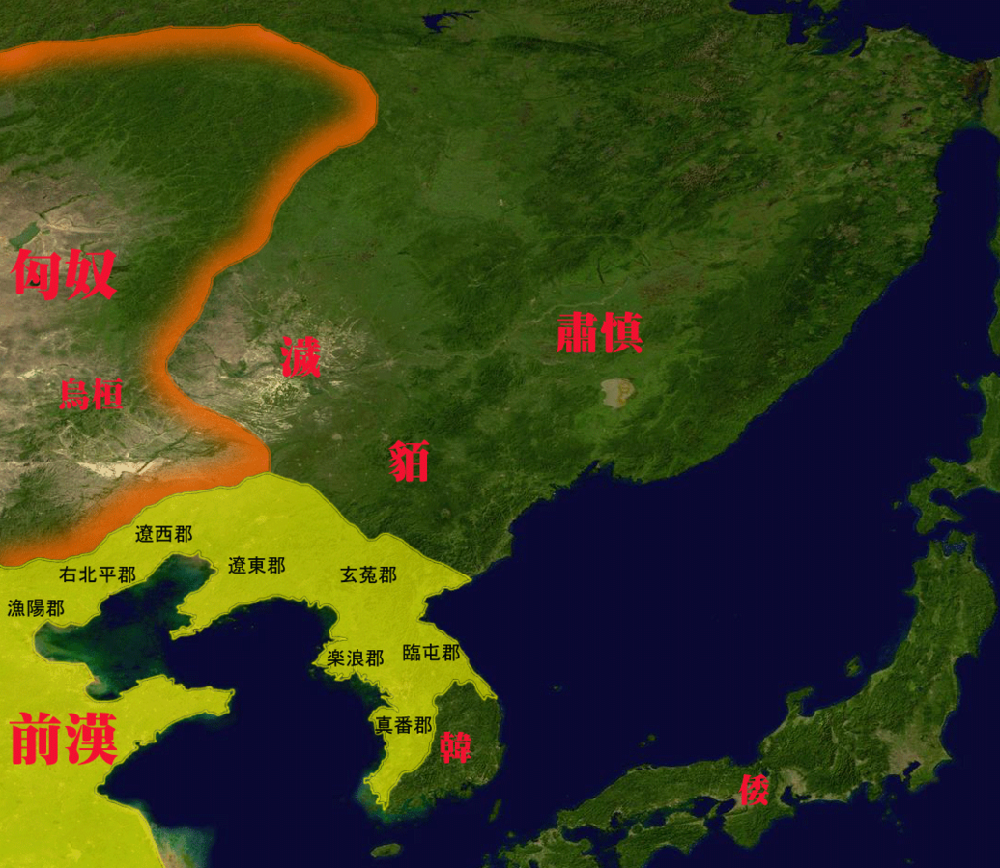

# 概述

[**乌桓**](https://zh.wikipedia.org/wiki/乌桓)，分支自[东胡](东胡.md)，同源于**原始蒙古族**，是最早附属于[匈奴](https://zh.wikipedia.org/wiki/匈奴)的部落。

<figure>
  
  <figcaption style="font-size: 16px; color: gray">乌桓位于汉朝东北</figcaption>
</figure>

# 历史

- 前206年，东胡被[匈奴](https://zh.wikipedia.org/wiki/匈奴)[冒顿单于](https://zh.wikipedia.org/wiki/冒顿单于)击败瓦解，并入[匈奴](https://zh.wikipedia.org/wiki/匈奴)帝国。[乌桓](乌桓.md)与[鲜卑](https://zh.wikipedia.org/wiki/鮮卑)为东胡瓦解后的两个分支。
- [汉武帝](https://zh.wikipedia.org/wiki/汉武帝)[元狩](https://zh.wikipedia.org/wiki/元狩)4年（前119年），汉骠骑将军[霍去病](https://zh.wikipedia.org/wiki/霍去病)进攻匈奴左地，迁乌桓于[上谷](https://zh.wikipedia.org/wiki/上谷)、[渔阳](https://zh.wikipedia.org/wiki/渔阳)、[右北平](https://zh.wikipedia.org/wiki/右北平)、[辽东](https://zh.wikipedia.org/wiki/辽东)、[辽西](https://zh.wikipedia.org/wiki/辽西)五郡，置[护乌桓校尉](https://zh.wikipedia.org/wiki/护乌桓校尉)，使之与匈奴隔离。
- [汉光武帝](https://zh.wikipedia.org/wiki/漢光武帝)[建武](<https://zh.wikipedia.org/wiki/建武_(东汉)>)二十二年（46年）乌桓趁[匈奴](https://zh.wikipedia.org/wiki/匈奴)内乱之时进攻匈奴，把匈奴赶出大漠以南。
- [东汉](https://zh.wikipedia.org/wiki/东汉)末年，辽东、辽西等地的乌桓大人趁乱称王。[初平](https://zh.wikipedia.org/wiki/初平)元年（190年），辽西乌桓大人[蹋顿](https://zh.wikipedia.org/wiki/蹋顿)统一现辽宁一带的乌桓各部。
- 207年，曹操北征乌桓，[白狼山之战](https://zh.wikipedia.org/wiki/白狼山之战)，斩杀[蹋顿](https://zh.wikipedia.org/wiki/蹋顿)，从此乌桓彻底衰落。
