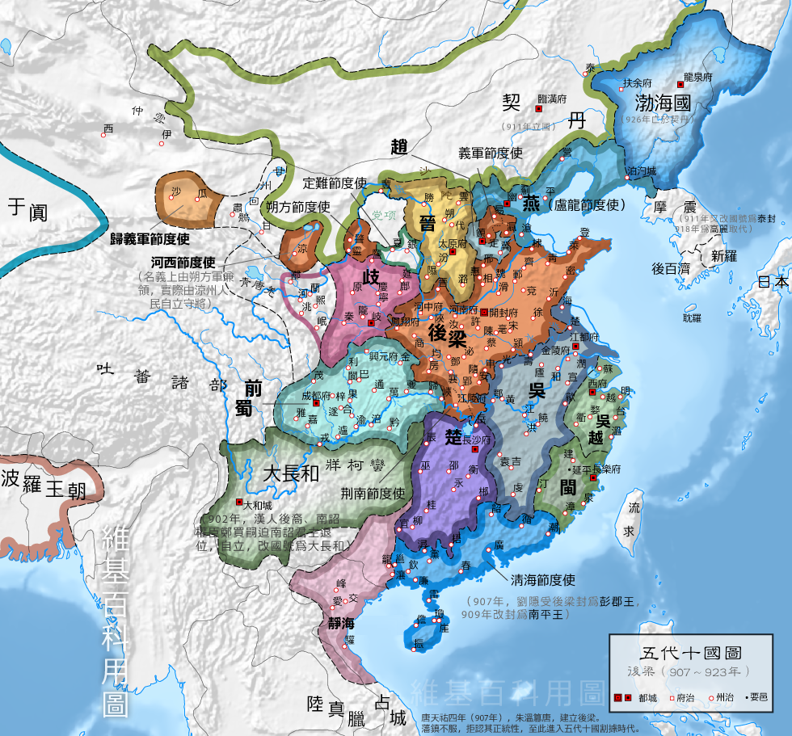
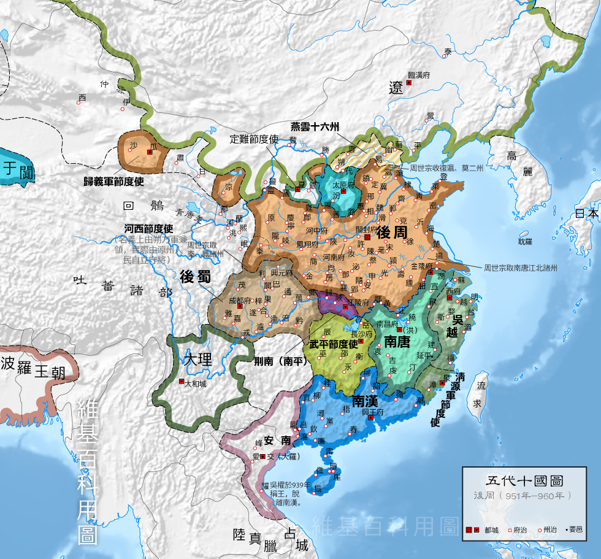

# 概述

[**五代十国**](https://zh.wikipedia.org/wiki/五代十国)（狭义907年—[960年2月4日](https://zh.wikipedia.org/wiki/陈桥兵变 "陈桥兵变")，广义907年—[979年](https://zh.wikipedia.org/wiki/宋灭北汉之战 "宋灭北汉之战")），是[中国历史主线](中国历史主线.md)之一，该时期由[唐朝](唐朝.md)灭亡开始，至[宋朝](宋朝.md)统一大部分汉地为止。

- 五代（907年—[960年2月4日](https://zh.wikipedia.org/wiki/陈桥兵变 "陈桥兵变")）
- 十国（907年—[979年](https://zh.wikipedia.org/wiki/宋灭北汉之战 "宋灭北汉之战")）

  <figure>
    
    <figcaption style="font-size: 16px; color: gray">五代十国前期形势</figcaption>
  </figure>
  <figure>
    
    <figcaption style="font-size: 16px; color: gray">五代十国前期形势</figcaption>
  </figure>

