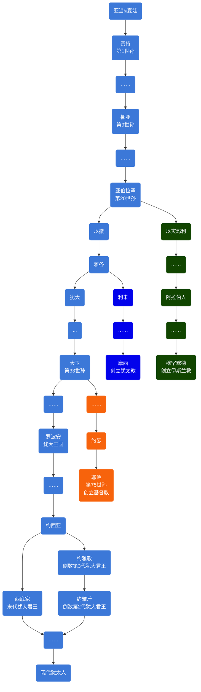

# 概述

[**亚伯拉罕诸教**](https://zh.wikipedia.org/wiki/亚伯拉罕诸教)，又称**亚伯拉罕宗教**、**亚伯拉罕一神诸教**、**天启宗教**、**天启诸教**、**闪族一神诸教**、**闪米特一神诸教**、**闪米特诸教**等，指世界主要的三个有共同源头的[一神教](https://zh.wikipedia.org/wiki/一神论)：[基督教](基督教.md)（包括[天主教](https://zh.wikipedia.org/wiki/天主教)、[新教](https://zh.wikipedia.org/wiki/新教)与[东正教](https://zh.wikipedia.org/wiki/东正教)）、[伊斯兰教](伊斯兰教.md)与[犹太教](犹太教.md)。如此称呼，皆因这三个宗教均给予[圣经](https://zh.wikipedia.org/wiki/圣经)[旧约](https://zh.wikipedia.org/wiki/旧约)中的[亚伯拉罕](https://zh.wikipedia.org/wiki/亚伯拉罕)（阿拉伯语译作[易卜拉欣](https://zh.wikipedia.org/wiki/易卜拉欣)）崇高的地位，且均发源于[西亚](https://zh.wikipedia.org/wiki/西亚)沙漠地区，来源于[闪米特人](https://zh.wikipedia.org/wiki/闪米特人)的原始宗教。

# 区分

- 都信奉“独一真神”，真神创造万物，将来会有审判和复活。
  - 犹太教和基督教称作上帝耶和华，都相信弥赛亚，但是犹太教不相信耶稣就是弥赛亚，也不是先知。
  - 伊斯兰教称为真主安拉，认为耶稣只是先知，穆罕默德是上帝挑选的最后一位先知，即“封印先知”。

- 关于经典
  - 犹太教的经典为《塔纳赫》，不承认《圣经·新约》和《古兰经》。
  - 基督教的经典为《圣经》，承认《塔纳赫》，不承认《古兰经》。
  - 伊斯兰教的经典为《古兰经》，只承认《塔纳赫》的前五卷和《圣经·新约》的部分内容。伊斯兰教相信《圣经》的神圣，但认为《圣经》的内容在历史的进程中已被修改或者失真误解，各种《圣经》的不同处一律要以上帝最后赐予穆罕默德的《古兰经》为准。

- 伊斯兰教比基督教更接近犹太教。

  反对把先知神化，彻底地禁绝偶像崇拜，没有对于供奉天使或圣人的仪式，并且禁食猪肉和行割礼，一夫多妻制。

  <table style="text-align: center;">
    <tr>
      <th colspan="2">类别</th>
      <th>犹太教</th>
      <th>基督教</th>
      <th>伊斯兰教</th>
    </tr>
    <tr>
      <td rowspan="3">属性</td>
      <td>神的名字（中译）</td>
      <td colspan="2">耶和华或雅威</td>
      <td>安拉</td>
    </tr>
    <tr>
      <td>独一性</td>
      <td colspan="3">独一真神，创造世界，全知、全能、全善、全在、永恒，将来审判</td>
    </tr>
    <tr>
      <td>三位一体</td>
      <td>否</td>
      <td>是</td>
      <td>否</td>
    </tr>
    <tr>
      <td rowspan="5">工作</td>
      <td>创造与审判</td>
      <td></td>
      <td></td>
      <td></td>
    </tr>
    <tr>
      <td rowspan="3">拣选</td>
      <td colspan="3">拣选亚伯拉罕</td>
    </tr>
    <tr>
      <td colspan="2">
        拣选亚伯拉罕的二儿子 以撒 （亚伯拉罕与其妻撒拉所生，是以色列人的祖先）
      </td>
      <td>拣选亚伯拉罕的大儿子 以实玛利 （亚伯拉罕与其妾夏甲所生，是阿拉伯人的祖先）</td>
    </tr>
    <tr>
      <td>拣选亚伯拉罕的孙子 以色列的后裔：以色列人</td>
      <td>拣选一切相信耶稣基督的人</td>
      <td>拣选一切相信安拉的人</td>
    </tr>
    <tr>
      <td>救赎工作</td>
      <td>神拣选以色列人</td>
      <td>耶稣付上赎价，人信耶稣。</td>
      <td>安拉的仁慈，人行善功。</td>
    </tr>
    <tr>
      <td rowspan="2">圣者</td>
      <td>耶稣是谁</td>
      <td>亵渎者</td>
      <td>圣子真神</td>
      <td>先知</td>
    </tr>
    <tr>
      <td>穆罕默德是谁</td>
      <td colspan="2">亵渎者</td>
      <td>最后的先知</td>
    </tr>
    <tr>
      <td rowspan="3">圣书</td>
      <td>希伯来圣经是？</td>
      <td>圣经</td>
      <td>旧约圣经</td>
      <td rowspan="2">受启示的经典已被篡改</td>
    </tr>
    <tr>
      <td>新约圣经是？</td>
      <td>亵渎</td>
      <td>新约圣经，神终极的启示</td>
    </tr>
    <tr>
      <td>古兰经是？</td>
      <td colspan="2">亵渎</td>
      <td>安拉的启示</td>
    </tr>
    <tr>
      <td rowspan="3">总结</td>
      <td>对犹太教看法</td>
      <td>—</td>
      <td>是基督教信仰的前身，但错误理解拣选和律法。</td>
      <td rowspan="2">奉行已被篡改的宗教</td>
    </tr>
    <tr>
      <td>对基督教看法</td>
      <td>是亵渎神</td>
      <td>—</td>
    </tr>
    <tr>
      <td>对伊斯兰教看法</td>
      <td colspan="2">是亵渎神</td>
      <td>—</td>
    </tr>
  </table>

# 相关条目

- [模板:亚伯拉罕诸教中的弥赛亚／基督](https://zh.wikipedia.org/wiki/Template:基督)
