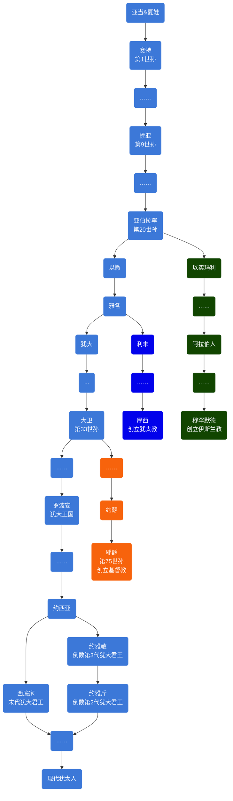

# 概述

[**亚伯拉罕诸教**](https://zh.wikipedia.org/wiki/亚伯拉罕诸教)，又称**亚伯拉罕宗教**、**亚伯拉罕一神诸教**、**天启宗教**、**天启诸教**、**闪族一神诸教**、**闪米特一神诸教**、**闪米特诸教**等，指世界主要的三个有共同源头的[一神教](https://zh.wikipedia.org/wiki/一神论)：[基督教](基督教.md)（包括[天主教](天主教.md)、[新教](新教.md)与[东正教](东正教.md)）、[伊斯兰教](伊斯兰教.md)与[犹太教](犹太教.md)。如此称呼，皆因这三个宗教均给予[圣经旧约](https://zh.wikipedia.org/wiki/旧约)中的[亚伯拉罕](亚伯拉罕.md)崇高的地位，且均发源于[西亚](https://zh.wikipedia.org/wiki/西亚)沙漠地区，来源于[闪米特人](https://zh.wikipedia.org/wiki/闪米特人)的原始宗教。

# 谱系

# 区分

- 都信奉“独一真神”，真神创造万物，将来会有审判和复活。
  - [犹太教](犹太教.md)和[基督教](基督教.md)称作上帝[耶和华](https://zh.wikipedia.org/wiki/耶和华)，都相信[弥赛亚](https://zh.wikipedia.org/wiki/弥赛亚)，但是犹太教不相信[耶稣](耶稣.md)就是弥赛亚，也不是[先知](https://zh.wikipedia.org/wiki/先知)。
  - [伊斯兰教](伊斯兰教.md)称为[真主](https://zh.wikipedia.org/wiki/伊斯兰教的神)[安拉](https://zh.wikipedia.org/wiki/安拉)，认为耶稣只是先知，[穆罕默德](穆罕默德.md)是上帝挑选的最后一位先知，即**封印先知**。

- 关于经典
  - 犹太教的经典为《[塔纳赫](https://zh.wikipedia.org/wiki/塔纳赫)》，不承认《[圣经旧约](https://zh.wikipedia.org/wiki/旧约)》和《[古兰经](古兰经.md)》。
  - 基督教的经典为《[圣经](圣经.md)》，承认《塔纳赫》，不承认《古兰经》。
  - 伊斯兰教的经典为《古兰经》，只承认《塔纳赫》的前五卷和《[圣经新约](https://zh.wikipedia.org/wiki/新约)》的部分内容。伊斯兰教相信《圣经》的神圣，但认为《圣经》的内容在历史的进程中已被修改或者失真误解，各种《圣经》的不同处一律要以上帝最后赐予穆罕默德的《古兰经》为准。

- [伊斯兰教](伊斯兰教.md)比[基督教](基督教.md)更接近[犹太教](犹太教.md)。

  反对把[先知](https://zh.wikipedia.org/wiki/先知)神化，彻底地禁绝偶像崇拜，没有对于供奉天使或圣人的仪式，并且禁食猪肉和行割礼，一夫多妻制。

<table style="text-align: center">
  <tr>
    <th colspan="2">类别</th>
    <th>
      <a href="犹太教.md" title="犹太教">犹太教</a>
    </th>
    <th>
      <a href="基督教.md" title="基督教">基督教</a> (<a
        href="天主教.md"
        title="天主教"
        >天主教</a
      >、<a href="东正教.md" title="东正教">东正教</a>、<a
        href="新教.md"
        title="新教"
        >新教</a
      >)
    </th>
    <th>
      <a href="伊斯兰教.md" title="伊斯兰教">伊斯兰教</a>
    </th>
  </tr>
  <tr>
    <td rowspan="3">属性</td>
    <td>神的名字（中译）</td>
    <td colspan="2">
      <a href="https://zh.wikipedia.org/wiki/四字神名" title="四字神名"
        >四字神名</a
      > （汉语主要译为<a
        href="https://zh.wikipedia.org/wiki/耶和华"
        title="耶和华"
        >耶和华</a
      >、<a href="https://zh.wikipedia.org/wiki/雅威" title="雅威">雅威</a
      >、上帝、天主）
    </td>
    <td>
      <a href="https://zh.wikipedia.org/wiki/安拉" title="安拉">安拉</a
      >（汉语又称：真主）
    </td>
  </tr>
  <tr>
    <td>独一性</td>
    <td colspan="3">独一真神，全知、全能、全善、全在、永恒</td>
  </tr>
  <tr>
    <td>
      <a href="https://zh.wikipedia.org/wiki/三位一体" title="三位一体"
        >三位一体</a
      >
    </td>
    <td>否</td>
    <td>是</td>
    <td>否</td>
  </tr>
  <tr>
    <td rowspan="5">工作</td>
    <td>创造与审判</td>
    <td colspan="3">神创造天地，并造人。神是世界的审判者</td>
  </tr>
  <tr>
    <td rowspan="3">拣选</td>
    <td colspan="3">
      拣选<a href="https://zh.wikipedia.org/wiki/亚伯拉罕" title="亚伯拉罕"
        >亚伯拉罕</a
      >
    </td>
  </tr>
  <tr>
    <td colspan="2">
      拣选亚伯拉罕的二儿子<a
        href="https://zh.wikipedia.org/wiki/以撒"
        title="以撒"
        >以撒</a
      > （亚伯拉罕与其妻<a
        href="https://zh.wikipedia.org/wiki/撒拉"
        title="撒拉"
        >撒拉</a
      >所生，是<a href="犹太人.md" title="犹太人">犹太人</a>的祖先）
    </td>
    <td>
      拣选亚伯拉罕的大儿子<a
        href="https://zh.wikipedia.org/wiki/以实玛利"
        title="以实玛利"
        >以实玛利</a
      > （亚伯拉罕与其妾<a
        href="https://zh.wikipedia.org/wiki/夏甲"
        title="夏甲"
        >夏甲</a
      >所生，是<a href="阿拉伯人.md" title="阿拉伯人">阿拉伯人</a>的祖先）
    </td>
  </tr>
  <tr>
    <td>
      拣选亚伯拉罕的孙子<a
        href="https://zh.wikipedia.org/wiki/雅各_(旧约圣经)"
        title="雅各_(旧约圣经)"
        >雅各</a
      >的后裔：<a href="犹太人.md" title="犹太人">犹太人</a>
    </td>
    <td>拣选一切相信<a href="耶稣.md" title="耶稣">耶稣</a>的人</td>
    <td>
      拣选一切相信<a href="https://zh.wikipedia.org/wiki/安拉" title="安拉"
        >安拉</a
      >的人
    </td>
  </tr>
  <tr>
    <td>救赎工作</td>
    <td>神拣选<a href="犹太人.md" title="犹太人">犹太人</a></td>
    <td><a href="耶稣.md" title="耶稣">耶稣</a>付上赎价，人信耶稣。</td>
    <td>
      <a href="https://zh.wikipedia.org/wiki/安拉" title="安拉">安拉</a
      >的仁慈，人行善功。
    </td>
  </tr>
  <tr>
    <td rowspan="2">圣者</td>
    <td><a href="耶稣.md" title="耶稣">耶稣</a>是谁</td>
    <td>亵渎者</td>
    <td>圣子真神</td>
    <td><a href="先知.md" title="先知">先知</a></td>
  </tr>
  <tr>
    <td><a href="穆罕默德.md" title="穆罕默德">穆罕默德</a>是谁</td>
    <td colspan="2">亵渎者</td>
    <td>最后的<a href="先知.md" title="先知">先知</a></td>
  </tr>
  <tr>
    <td rowspan="3">圣书</td>
    <td><a href="希伯来圣经.md" title="希伯来圣经">希伯来圣经</a>是什么</td>
    <td>圣经</td>
    <td>
      <a href="https://zh.wikipedia.org/wiki/旧约" title="圣经旧约"
        >圣经旧约</a
      > （与<a href="犹太教.md" title="犹太教">犹太教</a
      >的解读有很多不同）
    </td>
    <td rowspan="2">受启示的经典已被篡改</td>
  </tr>
  <tr>
    <td>
      <a href="https://zh.wikipedia.org/wiki/新约" title="圣经新约"
        >圣经新约</a
      >是什么
    </td>
    <td>亵渎</td>
    <td>
      <a href="https://zh.wikipedia.org/wiki/新约" title="圣经新约"
        >圣经新约</a
      >，神终极的启示
    </td>
  </tr>
  <tr>
    <td><a href="古兰经.md" title="古兰经">古兰经</a>是什么</td>
    <td colspan="2">亵渎</td>
    <td>
      <a href="https://zh.wikipedia.org/wiki/安拉" title="安拉">安拉</a
      >的启示
    </td>
  </tr>
  <tr>
    <td rowspan="3">总结</td>
    <td>对<a href="犹太教.md" title="犹太教">犹太教</a>的看法</td>
    <td>—</td>
    <td>
      是<a href="基督教.md" title="基督教">基督教</a
      >信仰的前身，但错误理解拣选和律法。
    </td>
    <td rowspan="2">奉行已被篡改的宗教</td>
  </tr>
  <tr>
    <td>对<a href="基督教.md" title="基督教">基督教</a
      >的看法</td>
    <td>是亵渎神</td>
    <td>—</td>
  </tr>
  <tr>
    <td>对<a href="伊斯兰教.md" title="伊斯兰教">伊斯兰教</a>的看法</td>
    <td colspan="2">是亵渎神</td>
    <td>—</td>
  </tr>
</table>

# 相关条目

- [从亚当到大卫的谱系](https://zh.wikipedia.org/wiki/Template:Adam_to_David)
- [模板:亚伯拉罕诸教中的弥赛亚／基督](https://zh.wikipedia.org/wiki/Template:基督)
- [犹太教与基督教](https://zh.wikipedia.org/wiki/犹太教与基督教)
- [犹太教-基督教伦理](https://zh.wikipedia.org/wiki/犹太教-基督教伦理)
- [伊斯兰教与基督教关系](https://zh.wikipedia.org/wiki/伊斯兰教与基督教关系)
- [四字神名](https://zh.wikipedia.org/wiki/四字神名)
    - [耶和华](https://zh.wikipedia.org/wiki/耶和华)
    - [雅威](https://zh.wikipedia.org/wiki/雅威)
