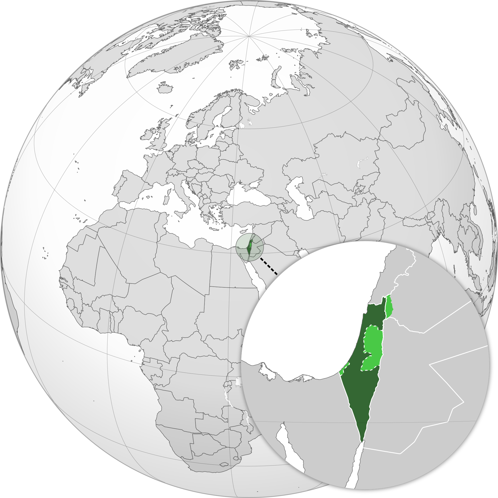
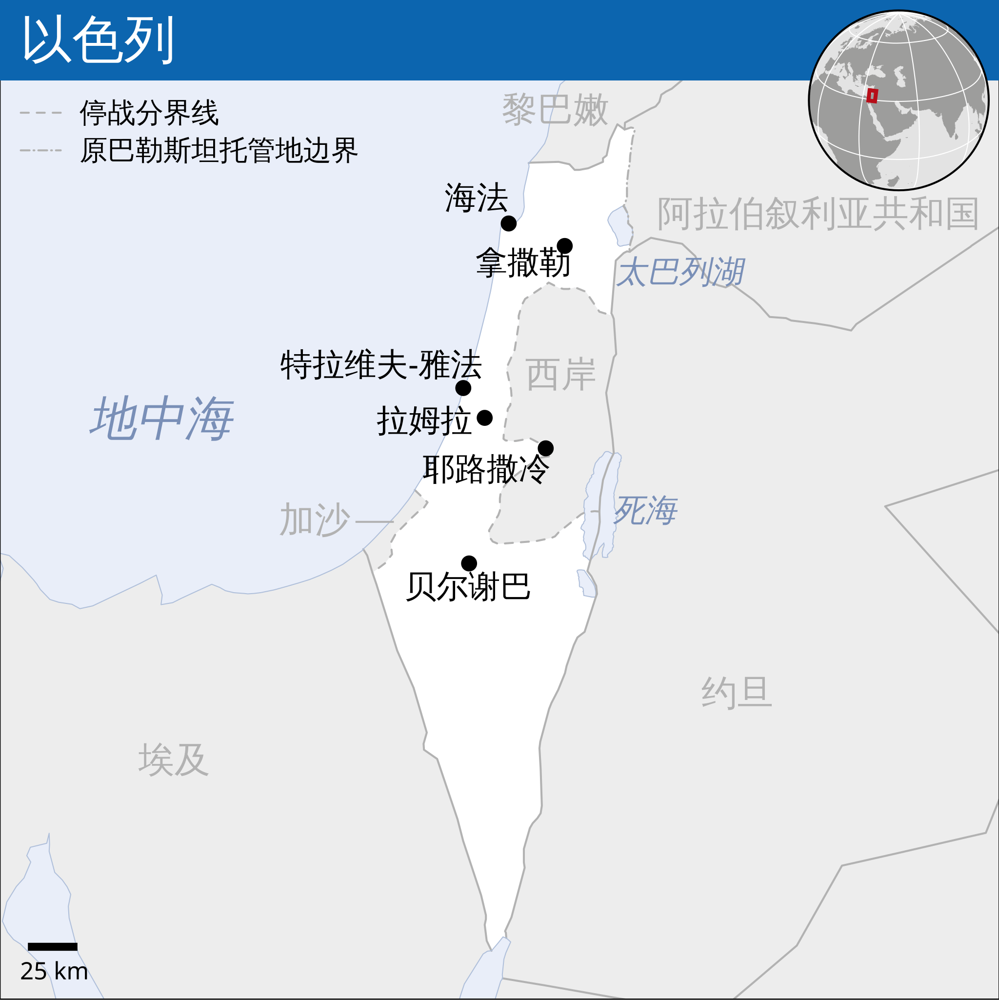
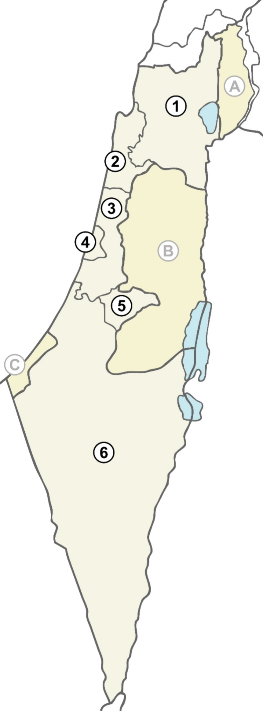
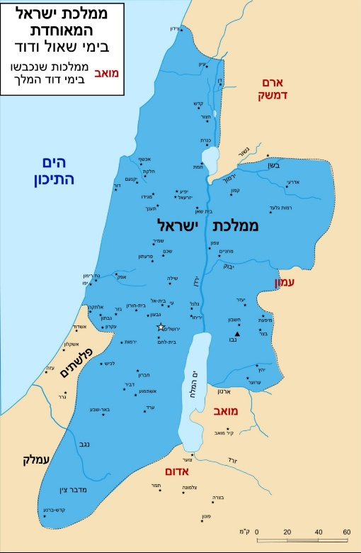
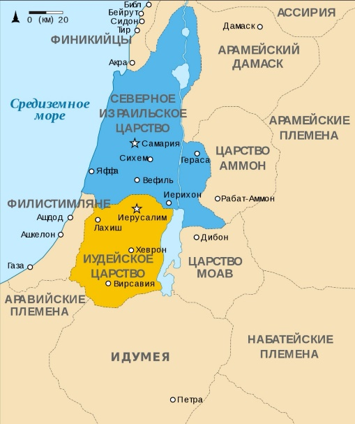

# 概述

[**以色列国**](https://zh.wikipedia.org/wiki/以色列)（英语：The State of Israel，1948年5月14日—至今），简称**以色列**，是位于[西亚](https://zh.wikipedia.org/wiki/西亚)[地中海](https://zh.wikipedia.org/wiki/地中海)东南岸的国家，主体民族为[犹太人](犹太人.md)，官方语言为[希伯来语](https://zh.wikipedia.org/wiki/希伯来语)，国教为[犹太教](https://zh.wikipedia.org/wiki/犹太教)，首都为[耶路撒冷](https://zh.wikipedia.org/wiki/耶路撒冷)（联合国及多数国家仅承认其首都为[特拉维夫](https://zh.wikipedia.org/wiki/特拉维夫)）。

  <figure style="margin-right: 40px">
    
    <figcaption style="font-size: 16px; color: gray">
      
深绿：以色列无争议领土

      

        浅绿：存在争议的<a
          href="https://zh.wikipedia.org/wiki/约旦河西岸"
          title="约旦河西岸"
          >约旦河西岸</a
        >、<a href="https://zh.wikipedia.org/wiki/戈兰高地" title="戈兰高地"
          >戈兰高地</a
        >及<a href="https://zh.wikipedia.org/wiki/加沙地带" title="加沙地带"
          >加沙地带</a
        >
      

    </figcaption>
  </figure>
  <figure>
    
    <figcaption style="font-size: 16px; color: gray">
      以<a
        href="https://zh.wikipedia.org/wiki/绿线_(以色列)"
        title="绿线 (以色列)"
        >绿线</a
      >为界的以色列地图
    </figcaption>
  </figure>

# 领土

- 1947年11月29日，《[联合国大会181号决议](https://zh.wikipedia.org/wiki/联合国大会181号决议)》规定：犹太国国土为14942平方公里，约占巴勒斯坦总面积的57%。

- 侵占领土：
  - 加沙地带（1967年—2005年；2005年撤兵后以色列仍控制着边界、领空和海岸线）
  - 约旦河西岸地区（1967年全部—至今部分地区）
  - 西奈半岛（1967年—1982年）
  - 戈兰高地（1967年全部—至今）
  - 整个耶路撒冷（1967年全部—至今）

- 截止目前，全部由以色列控制的土地约为2.5万平方公里。

    

      

        
      

      <figcaption style="flex: 2; font-size: 16px; color: gray">
        
以色列的行政区划包括以下六个行政区（括号内为首府）：

        <ul>
          <li>
            1 <a href="https://zh.wikipedia.org/wiki/北部区_(以色列)">北部区</a>（<a
              href="https://zh.wikipedia.org/wiki/拿撒勒"
              >拿撒勒</a
            >）
          </li>
          <li>
            2 <a href="https://zh.wikipedia.org/wiki/海法区">海法区</a>（<a
              href="https://zh.wikipedia.org/wiki/海法"
              >海法</a
            >）
          </li>
          <li>
            3 <a href="https://zh.wikipedia.org/wiki/中央区_(以色列)">中央区</a>（<a
              href="https://zh.wikipedia.org/wiki/拉姆拉"
              >拉姆拉</a
            >）
          </li>
          <li>
            4 <a href="https://zh.wikipedia.org/wiki/特拉维夫区">特拉维夫区</a>（<a
              href="https://zh.wikipedia.org/wiki/特拉维夫"
              >特拉维夫</a
            >）
          </li>
          <li>
            5 <a href="https://zh.wikipedia.org/wiki/耶路撒冷区">耶路撒冷区</a>（<a
              href="https://zh.wikipedia.org/wiki/耶路撒冷"
              >耶路撒冷</a
            >）
          </li>
          <li>
            6 <a href="https://zh.wikipedia.org/wiki/南部区_(以色列)">南部区</a>（<a
              href="https://zh.wikipedia.org/wiki/贝尔谢巴"
              >贝尔谢巴</a
            >）
          </li>
        </ul>
        

          另外，以色列还有以下三个<a
            href="https://zh.wikipedia.org/wiki/世界主權爭端領土列表"
            >争议地区</a
          >（括号内为争议地区所属的以色列行政区划）：
        

        <ul>
          <li>
            A <a href="https://zh.wikipedia.org/wiki/戈蘭高地">戈兰高地</a>（<a
              href="https://zh.wikipedia.org/wiki/北部区_(以色列)"
              >北部区</a
            >）
            <ul>
              <li>六日战争前为原叙利亚领土，目前由以色列控制。</li>
            </ul>
          </li>
          <li>
            B <a href="https://zh.wikipedia.org/wiki/約旦河西岸">约旦河西岸</a>（<a
              href="https://zh.wikipedia.org/wiki/猶太-撒馬利亚區"
              >犹太-撒马利亚区</a
            >）
            <ul>
              <li>
                六日战争前由约旦占领，现为《<a
                  href="https://zh.wikipedia.org/wiki/聯合國安全理事會第242號決議"
                  >联合国安全理事会第242号决议</a
                >》的<a href="https://zh.wikipedia.org/wiki/巴勒斯坦领土"
                  >巴勒斯坦领土</a
                >，目前分别由以色列及<a
                  href="https://zh.wikipedia.org/wiki/巴勒斯坦自治政府"
                  >巴勒斯坦自治政府</a
                >控制。
              </li>
            </ul>
          </li>
          <li>
            C
            <a href="https://zh.wikipedia.org/wiki/加沙地帶">加沙地带</a
            >（无所属区划）
            <ul>
              <li>
                六日战争前由埃及占领，现为《联合国安全理事会第242号决议》的巴勒斯坦领土，目前分别由以色列及<a
                  href="https://zh.wikipedia.org/wiki/哈馬斯"
                  >哈马斯</a
                >控制。
              </li>
            </ul>
          </li>
        </ul>
      </figcaption>
      

    

# 历史

> [以色列历史](https://zh.wikipedia.org/wiki/以色列历史)
>
> [犹太人历史](https://zh.wikipedia.org/wiki/犹太人历史)
>
> [以色列地犹太人及犹太教历史](https://zh.wikipedia.org/wiki/以色列地犹太人及犹太教历史)

## 远古时期

- **起源**
  - 犹太人的祖先为[希伯来人](https://zh.wikipedia.org/wiki/希伯來人)，属于[闪米特人](https://zh.wikipedia.org/wiki/閃米特人)的一支，起源于约4000年前两河流域的美索不达米亚。

- [**亚伯拉罕**](https://zh.wikipedia.org/wiki/亚伯拉罕)
  - 公元前2000年左右，[亚伯拉罕](https://zh.wikipedia.org/wiki/亚伯拉罕)带领族人离开两河流域迦勒底的[乌尔](https://zh.wikipedia.org/wiki/乌尔)（今伊拉克南郡），西迁至[迦南地](https://zh.wikipedia.org/wiki/迦南)（今巴勒斯坦及周边地区）。
  - 这些人被当地居民称为”[**希伯来人**](https://zh.wikipedia.org/wiki/希伯来人)“，意为“河对面的人”。

- [**雅各**](https://zh.wikipedia.org/wiki/雅各)（[亚伯拉罕](https://zh.wikipedia.org/wiki/亚伯拉罕)之孙）
  - [雅各](https://zh.wikipedia.org/wiki/雅各)（亚伯拉罕的孙子）与神（天使）角力并取胜，神（天使）将雅各的名字改为**以色列**，意为“与神角力者”。希伯来部落开始用雅各的别名称呼自己为“[**以色列人**](https://zh.wikipedia.org/wiki/以色列人)”。
  - 为躲避饥荒，[雅各](https://zh.wikipedia.org/wiki/雅各)带领族人前往埃及投奔约瑟，达430年之久，后期被贬为奴隶。
  - 雅各的12个儿子发展的部落组成”[**十二支派**](https://zh.wikipedia.org/wiki/以色列十二支派)“。

- [**摩西**](https://zh.wikipedia.org/wiki/摩西)（[雅各](https://zh.wikipedia.org/wiki/雅各)之后代）
  - 约公元前1450年，[摩西](https://zh.wikipedia.org/wiki/摩西)带领色列人出埃及前往迦南。
  - 约公元前1290年，[摩西](https://zh.wikipedia.org/wiki/摩西)在西奈山颁布**《[摩西十诫](https://zh.wikipedia.org/wiki/十诫)》**，人类第一个一神教“[**犹太教**](https://zh.wikipedia.org/wiki/犹太教)”诞生了。
  - [约书亚](https://zh.wikipedia.org/wiki/约书亚)带领族人进入迦南。

## 以色列联合王国时期

<figure>
  
  <figcaption style="font-size: 16px; color: gray">
    扫罗和大卫王时期以色列疆域图
  </figcaption>
</figure>

- 以色列人在约公元前1050年建立起*第一个以色列国家*，[**以色列联合王国**](<https://zh.wikipedia.org/wiki/以色列王國_(前期)>)（约前1050年—前931年）历经三代国王（实际是5代）：[扫罗](https://zh.wikipedia.org/wiki/扫罗王)、[大卫](https://zh.wikipedia.org/wiki/大卫王)、[所罗门](https://zh.wikipedia.org/wiki/所罗门)。

- [**扫罗**](https://zh.wikipedia.org/wiki/扫罗王)：（在位：前1050年—前1010年）
  - [扫罗](https://zh.wikipedia.org/wiki/扫罗王)出自[便雅悯支派](https://zh.wikipedia.org/wiki/便雅悯支派)，是以色列联合王国的第一个国王。
  - 扫罗骁勇善战但不懂治理，且多次得罪神，最后战死于和非利士的战争中。

- [**大卫**](https://zh.wikipedia.org/wiki/大卫王)：（在位：前1010年—前970年）
  - [大卫](https://zh.wikipedia.org/wiki/大卫王)出自[犹大支派](https://zh.wikipedia.org/wiki/犹大支派)，是[扫罗](https://zh.wikipedia.org/wiki/扫罗王)的女婿。
  - [大卫](https://zh.wikipedia.org/wiki/大卫王)使以色列国强盛，约前1003年首次将[耶路撒冷](耶路撒冷.md)定为首都。
  - [大卫](https://zh.wikipedia.org/wiki/大卫王)是以色列人最爱戴的国王，犹太人的象征“[**大卫之星**](https://zh.wikipedia.org/wiki/大卫之星)”就是代表大卫王的。

- [**所罗门**](https://zh.wikipedia.org/wiki/所罗门)：（在位：前970年—前931年）
  - [所罗门](https://zh.wikipedia.org/wiki/所罗门)是[大卫](https://zh.wikipedia.org/wiki/大卫王)的儿子。
  - [所罗门](https://zh.wikipedia.org/wiki/所罗门)的统治时期可以说是以色列历史的黄金时代的顶点，但后期腐败。
  - [所罗门](https://zh.wikipedia.org/wiki/所罗门)在位期间建“[**第一圣殿**](https://zh.wikipedia.org/wiki/所罗门圣殿)”。

## 南北王国时期

<figure>
  
  <figcaption style="font-size: 16px; color: gray">
    
公元前九世纪，南黎凡特地区地图：

    
蓝色为北国以色列，黄色为南国犹大。

  </figcaption>
</figure>

- 前931年，[以色列联合王国](<https://zh.wikipedia.org/wiki/以色列王國_(前期)>)分裂为南北两国。
- **北方**是由十个支派（即[**失踪的十支派**](https://zh.wikipedia.org/wiki/失蹤的以色列十支派)）组成的[**以色列王国**](<https://zh.wikipedia.org/wiki/以色列王國_(後期)>)（前931年—前722年），北部以色列地区的人，便保持“**以色列人**”的称号；后被[亚述帝国](亚述.md)所灭，大批居民迁往异域。
- **南方**是由大卫后裔世袭的[**犹大王国**](https://zh.wikipedia.org/wiki/犹大王国)。（前931年—前586年），犹大地区的人，自此被称作“**犹太人**”；前586年被[新巴比伦帝国](https://zh.wikipedia.org/wiki/新巴比伦帝国)灭亡，犹大王国的后人就是现在的犹太人。

## 巴比伦时期

- 前597年，[新巴比伦帝国](https://zh.wikipedia.org/wiki/新巴比伦帝国)攻占耶路撒冷。
  - 掳走国王[约雅斤](https://zh.wikipedia.org/wiki/约雅斤)，第一批犹太人被驱逐到巴比伦。
  - 任命[西底家](https://zh.wikipedia.org/wiki/西底家)（约雅斤的叔叔）为犹太王。

- [**西底家**](https://zh.wikipedia.org/wiki/西底家)在位期间与埃及结盟对抗[新巴比伦帝国](https://zh.wikipedia.org/wiki/新巴比伦帝国)。
- 前586年，[新巴比伦帝国](https://zh.wikipedia.org/wiki/新巴比伦帝国)再次攻占耶路撒冷。
  - 耶路撒冷被夷为平地。
  - [犹大王国](https://zh.wikipedia.org/wiki/犹大王国)彻底灭亡，犹大末代国王[西底家](https://zh.wikipedia.org/wiki/西底家)和全城居民被掳至巴比伦，沦为“[**巴比伦之囚**](https://zh.wikipedia.org/wiki/巴比伦之囚)”。这段历史，犹太人自称为“**受难时代**”。

## 波斯时期

- 前539年，波斯[阿契美尼德王朝](https://zh.wikipedia.org/wiki/阿契美尼德王朝)击败[新巴比伦帝国](https://zh.wikipedia.org/wiki/新巴比伦帝国)后，犹太人获准返回耶路撒冷。
- 这时犹太民族已不能算是在一个国王领导之下的国家，而是一个以祭司领导的宗教性的团体。
- 前515年建成“[第二圣殿](https://zh.wikipedia.org/wiki/第二圣殿)”。

## 希腊时期

- [马其顿王国](https://zh.wikipedia.org/wiki/马其顿王国)征服波斯以后，犹太地被[希腊](希腊.md)人统治，历经[马其顿王国](https://zh.wikipedia.org/wiki/马其顿王国)、[托勒密王朝](https://zh.wikipedia.org/wiki/托勒密王朝)和[塞琉古王朝](https://zh.wikipedia.org/wiki/塞琉古王朝)。
- 前198年，[塞琉古王朝](https://zh.wikipedia.org/wiki/塞琉古王朝)占领犹太地，开始压迫犹太教信仰。
- 前167年，[哈斯蒙尼](https://zh.wikipedia.org/wiki/哈斯蒙尼王朝#“哈斯蒙尼”词源)祭司家族的[玛他提亚](https://zh.wikipedia.org/wiki/玛他提亚)领导犹太人掀起“[马加比起义](https://zh.wikipedia.org/wiki/马加比起义)”。

## 哈斯蒙尼王朝时期

- [哈斯蒙尼王朝](https://zh.wikipedia.org/wiki/哈斯蒙尼王朝)（即“马加比王朝”）（前140年—前37年）
  - [ 塞琉古帝国](https://zh.wikipedia.org/wiki/塞琉古帝国)[附庸国](https://zh.wikipedia.org/wiki/附庸國)（前140年—前110年）
  - 独立王国（前110年—前63年，前40年—前37年）
  - [罗马共和国](https://zh.wikipedia.org/wiki/罗马共和国)[从属国](https://zh.wikipedia.org/wiki/從屬國)（前63年—前40年）

- 前140年，[西门·马加比](https://zh.wikipedia.org/wiki/西门·马加比)（[玛他提亚](https://zh.wikipedia.org/wiki/玛他提亚)二子）建立了“[哈斯蒙尼王朝](https://zh.wikipedia.org/wiki/哈斯蒙尼王朝)”（即“马加比王朝”）。哈斯蒙尼王朝在[塞琉古帝国](https://zh.wikipedia.org/wiki/塞琉古帝国)下，半自治的统治犹太。
- 前110年，随着[塞琉古帝国](https://zh.wikipedia.org/wiki/塞琉古帝国)的分裂，哈斯蒙尼王朝完全取得独立。

## 罗马时期

- 公元前63年，[罗马共和国](https://zh.wikipedia.org/wiki/罗马共和国)的[庞培](https://zh.wikipedia.org/wiki/格奈烏斯·龐貝)占领耶路撒冷，废黜[哈斯蒙尼王朝](https://zh.wikipedia.org/wiki/哈斯蒙尼王朝)末代君主[阿里斯托布鲁斯二世](https://zh.wikipedia.org/wiki/阿里斯托布鲁斯二世)。
  - 任命哈斯蒙尼家族的[海卡努斯二世](https://zh.wikipedia.org/wiki/海卡努斯二世)（犹太人）为“[大祭司](<https://zh.wikipedia.org/wiki/大祭司_(犹太教)>)”统治犹太地，但不立他为王。
  - 罗马在[哈斯蒙尼王朝](https://zh.wikipedia.org/wiki/哈斯蒙尼王朝)的利益由[安提帕特](https://zh.wikipedia.org/wiki/以东人安提帕特)（[以东人](https://zh.wikipedia.org/wiki/以东人)，[大希律王](https://zh.wikipedia.org/wiki/大希律王)的父亲）代表。
  - [哈斯蒙尼王朝](https://zh.wikipedia.org/wiki/哈斯蒙尼王朝)沦为罗马的**从属国**。

- 前40年，[安提柯二世](<https://zh.wikipedia.org/wiki/安提柯二世_(哈斯蒙尼)>)夺取耶路撒冷的统治权。[哈斯蒙尼王朝](https://zh.wikipedia.org/wiki/哈斯蒙尼王朝)重新短暂独立。
- 前37年，[安提帕特](https://zh.wikipedia.org/wiki/以东人安提帕特)之子[希律](https://zh.wikipedia.org/wiki/大希律王)受罗马支持返回耶路撒冷，被罗马任命为“**犹太王**”，即[大希律王](https://zh.wikipedia.org/wiki/大希律王)。犹太地再次沦为罗马的从属国，[希律王朝](https://zh.wikipedia.org/wiki/希律王朝)建立，[哈斯蒙尼王朝](https://zh.wikipedia.org/wiki/哈斯蒙尼王朝)彻底覆灭。
- 公元44年，罗马任命了总督和希律国王们一同统治犹太地。
- 此后，犹太人和罗马人发生三次[犹太-罗马战争](https://zh.wikipedia.org/wiki/犹太-罗马战争)（公元66年—136年）。
- [**第一次犹太–罗马战争**](https://zh.wikipedia.org/wiki/第一次犹太–罗马战争)（公元66年—74年），犹太人失败。
  - 犹太人的国家实体至此宣告终结，犹太人失去了政治自主权，犹太地区成为罗马帝国的一个普通行省（[犹太行省](https://zh.wikipedia.org/wiki/犹太 \_(罗马行省))）。
  - 公元70年，罗马人攻陷耶路撒冷，摧毁“[第二圣殿](https://zh.wikipedia.org/wiki/第二圣殿)”。

- [**第二次犹太–罗马战争**](https://zh.wikipedia.org/wiki/第二次犹太–罗马战争)（公元115年—117年），犹太人失败。
- [**第三次犹太–罗马战争**](https://zh.wikipedia.org/wiki/巴尔科赫巴起义 "巴尔科赫巴起义")（公元132年—136年），犹太人失败。
  - 135年，罗马人再次攻陷耶路撒冷，耶路撒冷城被彻底破坏，遗址翻耕成田。
  - 罗马人为了消除犹太人的记忆。
    - 将“[犹太行省](https://zh.wikipedia.org/wiki/犹太 \_(罗马行省))”的名字改为“[叙利亚巴勒斯坦](https://zh.wikipedia.org/wiki/叙利亚巴勒斯坦)”来泛指这一地区。
    - 将耶路撒冷更名为“[爱利亚加比多连](https://zh.wikipedia.org/wiki/爱利亚加比多连)”。
  - 犹太人被禁止在[耶路撒冷](耶路撒冷.md)及其附近定居，从此流落到世界各地，在接近2000年的时间里没有自己的家园，直到现代以色列建国。犹太人正式开启了近两千年的“**大流散**”时代。

## 基督教时期

- 公元380年，罗马皇帝[狄奥多西一世](https://zh.wikipedia.org/wiki/狄奥多西一世)颁布[萨洛尼卡敕令](https://zh.wikipedia.org/wiki/薩洛尼卡敕令)，基督教开始成为这个帝国的国教。
- 公元800年至1100年间，约有150万犹太人生活在基督教统治下的欧洲各国，收到较好待遇。
- 公元1300年以后，随着罗马天主教廷通过变革，势力大幅增强，犹太人开始收到排挤和迫害。
- 公元1500年左右，屡受压迫的犹太人终于在[波兰](https://zh.wikipedia.org/wiki/波兰)找到了相对安全的环境。
- 到了17世纪，西欧各国的犹太人已严重受到成文法律或无形社会压力的迫害，被迫聚居在所谓“[隔都](https://zh.wikipedia.org/wiki/猶太區)”之中。
- 在20世纪初，绝大多数犹太人都生活在沙俄帝国西部及相邻的波兰、立陶宛、白俄罗斯等国境内。

## 伊斯兰教时期

[中世纪（638 - 1099）：伊斯兰统治下的欧洲、北非和中东](https://zh.wikipedia.org/wiki/犹太人历史#中世纪（638_-_1099）：伊斯兰统治下的欧洲、北非和中东)

## 犹太人回归浪潮

- 【**第一次回归浪潮**】
  - 第一次大规模的回归浪潮则始于1881年，散居在世界其他地区的犹太人来到巴勒斯坦。犹太人从[奥斯曼帝国](https://zh.wikipedia.org/wiki/奥斯曼帝国)的阿拉伯人手中购买土地并且定居。

- 【**第二次回归浪潮**】
  - 1896年，犹太裔记者[西奥多·赫茨尔](https://zh.wikipedia.org/wiki/西奥多·赫茨尔)（现代以色列国父）发起“[锡安主义运动](https://zh.wikipedia.org/wiki/锡安主义)”（又称“犹太复国主义运动”），号召全世界犹太人回归故土。锡安主义运动的发展推动了第二次回归浪潮（1904年—1914年），约有四万名犹太人返回定居。
- 【**第三、四次回归浪潮**】
  - 1917年，英国占领[巴勒斯坦地区](巴勒斯坦地区.md)，发表《[贝尔福宣言](https://zh.wikipedia.org/wiki/贝尔福宣言)》：“英王陛下政府赞成在巴勒斯坦建立一个犹太人的民族国家，并将尽最大努力促其实现”。
  - 一战结束，[奥斯曼帝国](https://zh.wikipedia.org/wiki/奥斯曼帝国)完全退出此地区，由英国占领，此地区遂被正式称为"[巴勒斯坦地区](巴勒斯坦地区.md)"。
  - 1920年，国际联盟委托英国管辖巴勒斯坦。
  - 1922年英国将托管地划分为两部分：东部（现约旦）为哈希姆家族管理，西部为英国管理。
  - 第一次世界大战后，犹太人掀起了第三和第四次回归浪潮。

- 【**第五次回归浪潮**】1933年，纳粹在德国执政，掀起第五次犹太人回归浪潮。
  - 二战期间，在欧洲发生的犹太人大屠杀（即[犹太人最终解决方案](https://zh.wikipedia.org/wiki/最终解决方案)），进一步推动了犹太人回归。

- 第二次世界大战结束后，巴勒斯坦地区已经有60万犹太居民。
- 1947年，犹太人占当地人口的将近1/3，已拥有6%的土地，大多“传统聚居点”建于阿拉伯人拥有的土地上。
- [第一次中东战争](第一次中东战争.md)后，约旦河西岸地区和加沙地带的60万犹太人移居至以色列。
- 在1990年代早期，随著苏联解体，大量犹太人开始移民至以色列。大约有380,000人在1990—1991年抵达以色列。
- 2019年以色列总人口902万人，犹太人占74.9%，阿拉伯人占20.7%，其它族裔占4.4%。

## 以色列复国

- 1947年，鉴于犹太人与阿拉伯人之间的暴力冲突不断升级，和平努力受到挫败，英国政府决定从[巴勒斯坦托管地](https://zh.wikipedia.org/wiki/巴勒斯坦托管地)脱身。
- 1947年11月29日，联大通过《[联合国大会181号决议](https://zh.wikipedia.org/wiki/联合国大会181号决议)》，英国结束托管，犹太人获得14942平方公里，约占当时[巴勒斯坦地区](巴勒斯坦地区.md)总面积的57%，用以建立犹太国家。阿拉伯人因联大违背“民族自决权”而拒绝接受“分治方案”，并导致大规模冲突。
- 1948年5月14日，在英国的托管期结束前一天的子夜，以色列国正式宣布成立，定都特拉维夫。1949年1月25日，大卫·本-古里安当选首任总理。

## 20世纪50—60年代

- 【**以色列建国**】1948年5月14日，以色列国正式宣布成立，定都特拉维夫。
- 【**土地和人口增长**】1948年5月15日，“第一次中东战争”（详见“巴勒斯坦地区”章节）爆发，1949年达成停火协议。
  - 协议划清暂时的边界，即“绿线”（Green Line）。
  - 以色列暂时在约旦河的西方侵占额外的23.5%的管辖领域。
  - 随著第一次中东战争，约旦河西岸地区和加沙地带的犹太人口开始迁入以色列，大量来自阿拉伯国家的犹太难民使得以色列的人口骤增两倍。在接下来几年里将近850,000名瑟法底犹太人移民，其中约有600,000人迁移至以色列，其他的人则移民至欧洲和美国。

- 1949年5月11日，以色列取得联合国的席位，成为第59个会员国。
- 1949年以色列将首都迁至耶路撒冷。（未获国际认可）
- 1954年至1955年间，担任以色列总理的摩西·夏里特（MosheSharett）试图轰炸埃及未遂而爆发丑闻，造成以色列在政治上蒙羞。
- 1956年10月29日，“第二次中东战争”爆发（详见“巴勒斯坦地区”章节）。
  - 经过此次危机，以色列解除了埃及对蒂朗海峡的封锁。
- 【**控制全境**】1967年6月5日，“第三次中东战争”爆发（详见“巴勒斯坦地区”章节）。
  - 以色列一口气夺下了约旦河西岸（1967年全部—至今部分地区）、加沙地带（1967年—2005年；但2005年撤退后仍被视为占领）、西奈半岛（1967年—1982年）、和戈兰高地，控制了巴勒斯坦全境。以色列将其法律管辖范围拓展至戈兰高地和东耶路撒冷。

- 1969年，为了长期守住西奈半岛这一战略要地，以色列在苏伊士运河东岸构筑起正面宽约175公里、纵深长约10公里的防御体系，即“巴列夫防线”。
- 【**埃以消耗战争**】1968年至1972年这段期间被称为埃以消耗战争，以色列和叙利亚、埃及间的边界频繁爆发许多小规模的冲突。

## 20世纪70年代

- 1972年，发生“慕尼黑惨案”（详见“巴勒斯坦地区”章节）。以色列对此展开“上帝之怒行动”（详见“巴勒斯坦地区”章节）报复行动。
- 【**赎罪日战争**】1973年10月6日，爆发“第二次中东战争”（详见“巴勒斯坦地区”章节）。
- 【**政治转折**】1977年的国会选举成为以色列政治历史上的主要转折点，从1948年来一直支配以色列政坛的工党联盟（המערך）遭到梅纳赫姆.贝京领导的联合党击败，这次选举在以色列还被称为是一场“革命”。
- 【**埃以和谈**】
  - 1977年11月，埃及的总统萨达特史无前例的拜访了以色列，这是以色列建国以来第一次获得阿拉伯国家的承认。
  - 以色列与埃及分别在1978年9月17日签订“戴维营协议（详见”巴勒斯坦地区“章节）”、1979年3月26日签订《埃及—以色列和平条约》，结束战争状态。
  - “戴维营协议”以色列将西奈半岛还给埃及。
  - 1980年2月26日，埃以建交。

## 20世纪80年代

- 1980年，以色列立法认定耶路撒冷是该国“永远的和不可分割的首都”。
- 1982年4月25日，以色列军队完成第二阶段撤军计划，即全部撤出西奈半岛，除塔巴地区外，埃及重新恢复对整个西奈半岛的主权。
- 【**巴比伦行动**】1981年6月7日，以色列空军轰炸了伊拉克的核子反应炉，阻止了伊拉克制造核武器的企图，这次事件被称为“巴比伦行动”。
- 【**第五次中东战争**】1982年，即“黎巴嫩战争”（详见“巴勒斯坦地区”章节）。
  - 以色列军队将巴勒斯坦解放组织逐出了黎巴嫩，迫使巴解转移基地至突尼斯。
  - 以色列最后在1986年撤出了大部分在黎巴嫩的军队，边界的缓冲地带则一直被维持，直到2000年以色列进行单方面的撤军。

- 在1980年代里，原本由伊扎克·沙米尔领导的右派政府被左派的西蒙·佩雷斯取代。佩雷斯从1984年开始担任总理，但在1986年又被沙米尔取代，沙米尔达成了一个政党联盟的协议。
- 【**第一次巴勒斯坦大起义**】（详见“巴勒斯坦地区”章节）在1987年爆发的巴勒斯坦大起义引燃了占领区域的一连串暴动。

## 20世纪90年代

- 在1990年代早期，随著苏联解体，大量犹太人开始移民至以色列，大约有380,000人在1990年—1991年抵达以色列。
- 1992年1月24日，以色列与中国正式建立大使级外交关系。
- 【**巴以互相承认**】1993年8月20日巴以双方达成“奥斯陆协议”（详见“巴勒斯坦地区”章节），相互承认对方政治地位，9月16日巴解宣布结束对以色列的敌对状态。此协议被认为是巴以和平进程中的里程碑。但在协议签署后两年，拉宾遭以色列极端分子剌杀，奥斯陆协议的执行遭无限期搁置。
- 1994年，约旦成为继埃及之后第二个承诺与以色列和平共处的阿拉伯国家。
- 【**从巴勒斯坦逐步撤军**】
  - 1994年5月4日，巴以在开罗签署“开罗协议”。以色列从加沙地带（以色列仍然控制着边界、领空和海岸线）和杰里科的撤军，结束了对这两地长达27年的军事占领。
  - 1995年以来，根据巴以签署的各项协议（详见“巴勒斯坦地区”章节），巴自治区逐渐扩大，巴逐渐收回并控制着包括加沙和约旦河西岸的约2500平方公里的土地。

## 2000年代

- 【**第二次巴勒斯坦大起义**】2000年9月，即“阿克萨群众起义”。
- 【**以色列隔离墙**】2002年6月起，以色列开始建隔离墙（详见“巴勒斯坦地区”章节）。
- 【**夏雨行动**】2006年6月28日，哈马斯的民兵部队从加沙地带挖地道潜入以色列境内，杀害两名士兵。以色列展开报复性的“夏雨行动”，轰炸黎巴嫩唯一的国际机场，并派军占领此地区。
- 2008年—2014年，哈马斯占有加沙地带时，与以色列经常发生军事冲突，以色列对哈马斯展开了“铸铅行动”、“云柱行动”、“保护边缘行动”（详见“巴勒斯坦地区”章节）。

## 21世纪10年代

- 2017年12月6日（北京7日凌晨2点），特朗普正式在白宫外交厅宣布美国承认耶路撒冷为以色列首都。
- 2019年1月1日，以色列正式退出联合国教科文组织。

## 以色列现状

由于阿以双方多年以来都未遵循1947年《[联合国大会181号决议](https://zh.wikipedia.org/wiki/联合国大会181号决议)》，并且在耶路撒冷的归属、犹太人定居点、巴勒斯坦难民回归、巴以边界划定、巴勒斯坦政府合法代表等棘手问题上没有达成一致，冲突仍在继续。

# 相关条目

- [犹太人](犹太人.md)
- [以色列地](https://zh.wikipedia.org/wiki/以色列地)
- [埃以消耗战争](https://zh.wikipedia.org/wiki/埃以消耗战争)
- [巴比伦行动](https://zh.wikipedia.org/wiki/巴比伦行动)
