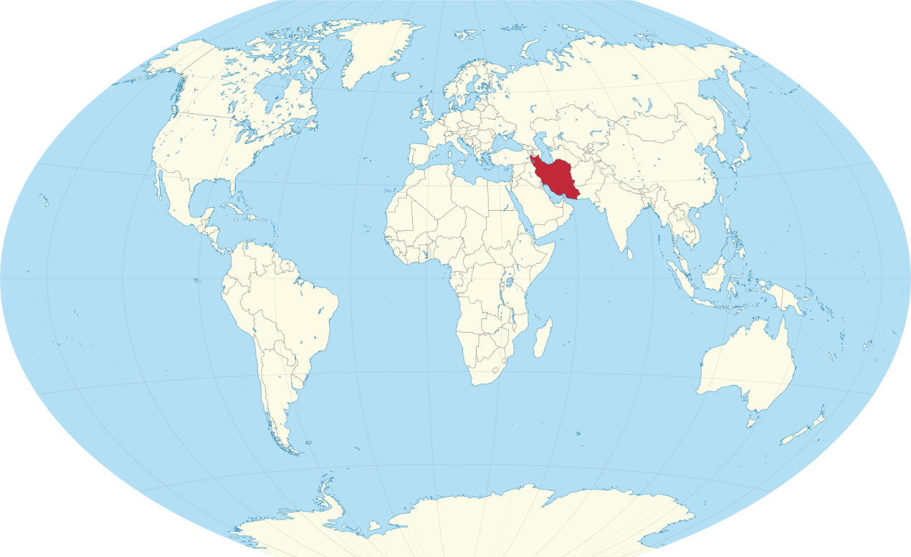

# 概述

[**伊朗伊斯兰共和国**](https://zh.wikipedia.org/wiki/伊朗)（1979年4月1日—至今），通称**伊朗**，1935年前被外界称为**波斯**，主体民族为[波斯人](https://zh.wikipedia.org/wiki/波斯人)，官方语言为[波斯语](https://zh.wikipedia.org/wiki/波斯语)，国教为[伊斯兰教](https://zh.wikipedia.org/wiki/伊斯兰教)[什叶派](https://zh.wikipedia.org/wiki/什叶派)[十二伊玛目宗](https://zh.wikipedia.org/wiki/十二伊玛目派)，首都为[德黑兰](https://zh.wikipedia.org/wiki/德黑兰)。

<figure>
  
  <figcaption style="font-size: 16px; color: gray">伊朗地理位置</figcaption>
</figure>

# 历史

> [伊朗历史](https://zh.wikipedia.org/wiki/伊朗历史)

## 早期文明

- 波斯人相信自己是雅利安人的后裔。
- 埃兰（前3200年—前639年），是波斯地区最古老的文明，

## 米底王国时期

- 米底人隶属印欧语系，是雅利安人，也是第一批在伊朗高原地区定落的民族。
- 随着亚述帝国的入侵，米底的各个部族汇聚在一起，迪奥塞斯（前678年—前665年在位），建立米底王国（前678年—前550年），该王国成为了新亚述帝国的封臣。
- 米底王国是一个以古波斯地区为中心的王国，伊朗历史上第一个统一的国家。
- 弗拉欧尔特斯（前665年—前633年在位）领导米底人打败波斯部落。
- 在公元前616年至前609年之间，米底王国国王基亚克萨雷斯与新巴比伦王国的那波帕拉萨尔国王结盟并摧毁了新亚述帝国。
- 此后，米底王国横跨伊朗高原一直延伸到安纳托利亚。其确切的地理范围仍然未知。
- 公元前585年，米底最后的国王阿斯提阿格斯继位，他把女儿下嫁给了当时隶属于米底的波斯部落的阿契美尼德家族的冈比西斯一世，后来生下王子居鲁士。
- 前553年—前550年，居鲁士二世起兵反叛米底，最后打败自己的外公阿斯提阿格斯，建立了阿契美尼德帝国，米底王国结束。

## 阿契美尼德王朝

- 阿契美尼德王朝（前550年—前330年）。
- 公元前550年，居鲁士大帝推翻米底王国的统治，建立阿契美尼德王朝，建立了第一个波斯帝国，成为世界上第一个真正意义上的帝国。
- 前539年，居鲁士二世武力入侵征服在美索不达米亚的新巴比伦帝国的首都巴比伦。
- 前525年，冈比西斯二世征服古埃及后王朝。
- 前521年，大流士一世挥军东征印度河平原，纳入阿契美尼德王朝的治下，西面则出兵多瑙河三角洲、色雷斯、马其顿王国、古希腊，但却因马拉松战役（前490年）之失利而功败垂成（见前499年—前449年的波希战争）。
- 在大流士一世（前522年至前486年）统治时期，波斯帝国国力达到鼎盛，其疆土东起葱岭、西至巴尔干半岛、北逾高加索山脉、南抵埃塞俄比亚，国土面积约达700万平方公里的国土，包括70个民族共1800万人，成为世界上第一个真正意义上的帝国。
- 波斯帝国在公元前492年希波战争后逐渐由鼎盛走向衰落。
- 公元前334年，马其顿国王亚历山大大帝东侵，征服波斯全境。
- 公元前330年，波斯即将沦亡时，总督贝苏斯兵变，挟持并软禁了大流士三世，贝苏斯为了不让亚历山大一世掳获大流士三世，将大流士三世杀死，波斯帝国灭亡。

## 希腊化时期

- 希腊化时期（前330年—前247年），马其顿王国亚历山大大帝征服波斯帝国，对波斯推行“希腊化”的殖民统治。
- 亚历山大大帝死後帝國分裂，伊朗一帶落入塞琉古帝国手中。
- 这一时期伊朗成为东西方的交流的一个枢纽：丝绸之路由此连接锡尔河与阿姆河之间的中亚河中地区（索格狄亚那）和印度，佛教从印度孔雀王朝传来，琐罗亚斯德教则西去影响了犹太教。

## 安息王朝

- 安息王朝（前247年—224年）。又名阿萨息斯王朝或安息帝国，是亚洲西部伊朗地区古典时期的奴隶制帝国。
- 全盛时期的安息帝国疆域西达小亚细亚东南的幼发拉底河，东抵阿姆河。安息帝国位于罗马帝国与汉朝中国之间的丝绸之路上，成为了商贸中心，与汉朝、罗马、贵霜帝国并列为当时亚欧四大强国之一。

## 萨珊王朝

- 萨珊王朝（224年—651年），萨珊王朝完成了波斯的第二次统一，被认为是第二个波斯帝国。
- 萨珊王朝的居民称萨珊王朝为埃兰沙赫尔或埃兰，在中古波斯语里意指雅利安人的帝国。
- 萨珊王朝取代了被视为西亚及欧洲两大势力之一的安息帝国，与罗马帝国共存了超过400年。
- 萨珊王朝统治时期的领土包括当今伊朗、阿富汗、伊拉克、叙利亚、高加索地区、中亚西南部、土耳其部分地区、阿拉伯半岛海岸部分地区、波斯湾地区、巴基斯坦西南部，控制范围甚至延伸到印度。
- 帝国在632年起始被阿拉伯军队攻击，651年，伊嗣埃三世被梅尔夫一名磨坊工人刺杀，正式终结了萨珊王朝。
- 萨珊王朝末代皇帝的儿子俾路斯曾逃到唐朝中国，请求唐高宗救兵抗击阿拉伯人入侵，唐朝护送其返回今阿富汗斯坦锡斯坦一带于661年建立波斯督护府，但到663年终为阿拉伯人所灭。

## 阿拉伯时期

- 阿拉伯时期（632年—1258年）。公元651年，萨珊王朝被阿拉伯帝国击溃，波斯成为阿拉伯帝国的一部分。阿拉伯语成了通行的语言，伊斯兰教迅速取代了拜火教。
- 750年后，阿巴斯王朝统治阿拉伯帝国，而波斯人则在地方首府中取得了支配地位。在这期间波斯文化得到巨大的发展。
- 马蒙之后，阿巴斯王朝因军事实力衰落而国势日衰，割据局面形成；期间波斯土地上先后出现塔希尔王朝、萨法尔王朝、萨曼王朝、齐亚尔王朝、阿拉菲德王朝、白益王朝、加兹尼王朝、古尔王朝、塞尔柱王朝、花拉子模王朝；塞尔柱帝国的建筑师于1042年在伊斯法汗城兴建了令人难以置信的礼拜五清真寺。著名的波斯数学家及诗人奥马尔·海亚姆（Omar Khayyám）在塞尔柱时期写下了他的诗集《鲁拜集》（Rubaiyat）。
- 塞尔柱土克曼人在12世纪末期失去波斯的控制权，并由来自咸海的阿姆河下游三角洲的另一伊朗语民族所建的花剌子模沙王朝所取代。1194年，花拉子模沙王朝的阿拉乌丁摩诃末攻灭塞尔柱帝国，继而攻占伊朗高原。1205年，阿拉乌丁摩诃末最终攻占波西斯。1212年，阿拉乌丁摩诃末攻灭喀拉汗王朝，继而统治全部中亚河中地区。1215年，阿拉乌丁摩诃末攻灭古尔王朝。

## 萨曼王朝

- 萨曼王朝（Sulala Samaniyya）（874年—999年），又称萨曼帝国。阿巴斯王朝时期波斯人在中亚地区建立的波斯—伊斯兰教中央集权封建帝国，10世纪为中亚乃至世界军事强国之一，其领土以乌兹别克斯坦为核心，囊括哈萨克斯坦南部，土克曼斯坦，塔吉克斯坦，阿富汗斯坦，以及伊朗大部分，与西部的布韦希王朝遥相呼应。
- 由中亚河中地总督纳斯尔·伊本·艾哈迈德（Nasr ibn Ahmad，874年—892年在位）奠基，波斯文化在此期间复兴，并加入新的内涵，为波斯文化圈的扩展奠定基础。

## 蒙古时期

- 蒙古时期（1220年—1357年）。
- 1219年底—1220年间，成吉思汗亲率蒙古帝国十万大军武力侵略征服花剌子模，并镇压了其境内的三十个城市，大伊朗地区随后被蒙古人统治。
- 之后在历任蒙古帝国最高统治者拖雷、窝阔台、乃马真后、贵由汗、斡兀立海迷失和蒙哥时代的地方总督绰儿马罕、拜住、野里知吉带，维吾尔人阔里吉思与卫拉特人阿儿浑阿加的继续对亚美尼亚、格鲁吉亚、阿塞拜疆和罗姆苏丹国的镇压。
- 尤其是他的孙子旭烈兀在1256年—1259年间先后镇压木剌夷、阿巴斯王朝、叙利亚阿尤布王朝，正式建立伊尔汗国。1295年伊尔汗国的君主合赞汗最终皈依伊斯兰教。直到1357年伊尔汗国灭亡后，波斯依然被从伊尔汗国分裂出的五个王朝统治。
- 1381年到1467年，波斯成为兴起于河中突厥人帖木儿帝国的一部分。

## 地方政权时期

- 帖木儿死后不久西波斯先后被土克曼人建立的存在于1375年—1468年的黑羊王朝和存在于1378年—1508年的白羊王朝统治。
- 1468年，黑羊王朝被也是土库曼族建立的白羊王朝所灭。
- 1508年，白羊王朝为萨非王朝所取代。

## 萨菲王朝

- 萨非王朝（波斯语：سلسلهٔ صفويان，英语：Safavid dynasty；1501年—1736年），又称萨法维王朝、沙法维王朝，是由波斯人建立统治伊朗的王朝，是继阿契美尼德王朝、萨珊王朝以来第三个完全统一伊朗东西部的王朝，故又称“波斯第三帝国”。
- 1501年，萨非王朝（成员多为土库曼人与阿塞拜疆人）当政，征服了整个伊朗。随后，萨非王朝强迫大量的伊朗逊尼派穆斯林改信什叶派十二伊玛目派，并以什叶派伊斯兰教为国教。直至现在，十二伊玛目派仍然是伊朗的国教。

## 阿夫沙尔王朝

## 殖民时期

- 从19世纪下半叶至20世纪初，随着欧洲列强的侵入，波斯逐渐沦为英国和俄国的半殖民地，伊朗处于半封建、半殖民地。

## 巴列维王朝

- 1921年2月21日，礼萨·汗上校发动军事政变，占据德黑兰，1925年取得王位，建立巴列维王朝，于1935年改国名为伊朗。
- 1941年礼萨·汗逊位，由其子穆罕默德·礼萨·巴列维继位。巴列维执政时期，伊朗逐渐摆脱英、苏两国对伊朗的控制，奉行亲美政策，国家经济建设获得较大发展，在中东地区获得了较大的影响力。

## 伊斯兰共和国

- 1978年，爆发伊朗伊斯兰革命。
- 1979年2月1日，霍梅尼回到德黑兰，宣布废除君主立宪制度，成立伊斯兰临时革命政府，任命马赫迪·巴扎尔甘为伊朗总理正式接管政权，巴列维王朝覆亡。
- 1979年4月1日，霍梅尼宣布改国名为伊朗伊斯兰共和国，举行公民投票，建立了政教合一的制度。
- 1949年10月，发生伊朗人质危机，自此美国与伊朗断交。
- 1980年9月22日，两伊战争，直到1988年8月20日停火。
- 1991年8月31日，苏联解体前，阿塞拜疆宣布独立，这是一个什叶派的伊斯兰国家，扩充了伊朗在伊斯兰世界的發言权。
- 1991年9月9日，苏联解体前，塔吉克斯坦宣布独立，其主体民族就是古代波斯人的后裔，塔吉克语是波斯语的一种方言，扩充了伊朗的文化势力范围。
- 1997年当选的温和派哈塔米总统致力于改革，同时向西方释放出和解讯号。可惜由于美国入侵阿富汗与伊拉克，从东西两面威胁伊朗的国家安全，并用邪恶轴心这样的字眼攻讦伊朗，哈塔米的和解政策在伊朗国内渐渐不受欢迎，受到保守派抨击。和解进程在2005年内贾德当选之后戛然而止。
- 美国发动的阿富汗战争推翻了阿富汗南方的塔利班政权，让北方的主要民族塔吉克族（波斯人后裔）走向政权中心，这让波斯人获得了更大的政治利益；
- 美国发动的伊拉克战争推翻了伊拉克逊尼派的萨达姆政权，什叶派以其占多数的人口成为伊拉克的新政权主体，而伊拉克什叶派的精英阶层大多曾在什叶派宗教中心伊朗就读深造，美国除去了伊朗在两伊战争中的死敌，留给伊朗一个亲密的什叶派伙伴。
- 至此，伊朗西方的什叶宗教带和东方的波斯文化带各自连成一片，交相辉映，成为伊朗崛起的双翼。
- 2003年初，伊朗宣布提炼出核电站燃料铀，引发伊朗核问题，并遭到一系列制裁。
- 2015年7月14日，伊朗核问题六国在维也纳签订伊朗核协议，通过解除部分对伊制裁换取伊朗减少铀浓缩活动。
- 2018年5月，美国宣布退出伊朗核协议，11月初，美国对伊朗实施石油出口制裁，但允许中国大陆、日本、印度、韩国、台湾、土耳其、意大利和希腊在半年内可以继续进口伊朗石油而免遭美国制裁。
- 2019年5月2日开始，美国对所有进口伊朗石油的国家实施制裁。
- 2020年1月3日，在美国和伊朗日益紧张的局势之下，美军对正在伊拉克进行工作访问的伊朗伊斯兰革命卫队和圣城军指挥官卡西姆·苏莱曼尼少将进行刺杀。

# 名称

自从前600年开始，希腊人把这一地区叫做“波斯”。而关于波斯人的第一个书面记录是来自亚述帝国人在公元前九世纪的叙述，他们称为“帕尔苏阿什”（Parsuash）及“帕尔苏阿”（Parsua）。这些近似的词语源自古伊朗语“Parsava”，大概是指“边界”、“边陲”的意思，用在地理上指称伊朗人（他们在种族上自称为雅利安人，以示尊贵）。帕尔苏阿及帕尔苏阿什其实是两个不同的地方，后者位于伊朗西南部，在古波斯语当中称为“帕尔萨”（Pârsa，今法尔斯）。希腊人在公元前六世纪使用“帕尔撒斯”（Perses）、“帕尔斯卡”（Persica）及“波西斯”（Persis）等形容词用于居鲁士二世的帝国的古波斯阿契美尼德王朝，英词里的波斯人（Persian）因此而得。在圣经较后的部分常提及到波斯帝国（以斯帖、但以理、以斯拉及尼希米记），称为“帕拉斯”（英语：Paras；希伯来语：פרס），如“Paras ve Madai”（פרס ומדי）即是“波斯及米底王国”。直到1935年，欧洲人一直使用波斯来称呼这个地区和位于这一地区的国家。而波斯人则从萨珊王朝时期起开始称呼自己的国家为埃兰沙赫尔，意为“中古雅利安人帝国”。

1935年，波斯国王礼萨·汗宣布国际上该国应被称作“伊朗”。但“波斯”一词在这之后还有人使用。

在中文里，“波斯”被用于描述1935年之前的事，或该民族从古就有的事物，如波斯语和波斯地毯。现代政治、经济等事物则用“伊朗”一词。

# 政治

根据伊朗伊斯兰共和国宪法规定，伊朗实行政教合一制度，神权统治高于一切，最高领袖是伊朗在政治和宗教上的最高领导人，也是军队和伊斯兰革命卫队的最高统帅。伊朗最高领袖由“专家会议”选举产生，任期终身。伊朗专家会议负责选举、监督、罢免最高领袖。第一任最高领袖是霍梅尼。

伊朗实行一院制，“伊斯兰议会”是国家最高立法机关。议会由290位议员组成。议员任期4年，可连选连任，由选民直接选举。

伊朗政府采用总统内阁制，伊朗总统既是国家元首，也是政府首脑，是继最高领袖之后的国家第二号领导人，但不是军事统帅。伊朗总统任期4年，可连任一次，由选民直接选出，由最高领袖任命。

伊朗是一个多党制的国家，有着较为发达的选举制度，这种将神权统治和民主选举相结合的“伊斯兰共和国”迄今仍是独一无二的政治体制。

# 司法

- 伊斯兰革命后第一部宪法于1979年12月颁布。

- 司法总监是国家司法最高首脑，由领袖任命，任期5年。最高法院院长和总检察长由司法总监任命，任期5年。司法部长由司法总监推荐，总统任命，议会批准，负责协调行政权与司法权的关系。在司法总监领导下，还设有行政公正法庭和国家监察总局，分别审理民众对政府机关的诉讼和监督国家机关的工作。

- 伊朗现行法律体系为伊斯兰教法。

# 军事

伊朗宪法规定政教统一，最高领袖为武装部队总司令。“最高国防委员会”是领袖领导下的军事决策机构，成员有总统、国防部长、武装部队总参谋长、伊斯兰革命卫队总司令以及领袖指定的两名顾问。

武装力量由正规军、革命卫队和准军事部队组成。实行义务兵役制，士兵服役期2年。

伊朗没有核武器，但正在发展。

# 经济

伊朗是亚洲主要经济体之一。伊朗的经济实力位居亚洲第七位（次于中、日、印、韩、印尼、沙特）。

伊朗拥有全球10%的石油资源。伊朗亦拥有全球第二大天然气的资源。伊朗经济以石油开采业为主，是世界第四大石油生产国、欧佩克第二大石油输出国。石油是伊朗经济命脉和外汇收入的主要来源之一，石油收入占伊外汇总收入的一半以上。

伊朗的石油化工、钢铁、汽车制造业也比较发达。

# 外交

- 伊朗是联合国、不结盟运动（NAM）、伊斯兰会议组织、石油输出国组织（OPEC）的创始会员国。

## 与以色列关系

伊朗认为以色列是中东地区局势紧张的主要根源，支持巴勒斯坦人民为解放被占领土而进行的正义斗争，反对阿以和谈，但表示不采取干扰和阻碍中东和平进程的行动。

## 与美国关系

- 数十年来，美国一直是伊朗国王穆罕默德·礼萨·巴列维的主要支持者。
- 1953年改革派穆罕默德·摩萨台当选上伊朗首相。在阿贾克斯行动中，美国中央情报局帮助巴列维国王和保守派发动政变推翻了摩萨台。
- 前后八位美国总统为巴列维国王提供了大量的军事和经济援助，用以换取伊朗的石油供应，以及在中东的战略存在。
- 伊朗伊斯兰革命使伊朗和美国由盟友变成仇敌。
- 伊朗人质危机过程中，1980年4月7日，美国宣布同伊朗断绝外交关系。

## 与伊拉克关系

伊朗和伊拉克长期存在着边界、教派和民族争端。进入20世纪80年代两国关系恶化。1980年9月两伊战争爆发。经国际上多方调解于1988年8月宣布接受停火。

## 与中国关系

据中国“史书”记载，汉武帝时，张骞派其副使访问安息（即波斯），安息王令两万骑兵迎候，礼仪极为隆重。

东汉末年，安息王的太子、佛教高僧安世高也曾来汉访问，并在中国待了多年。

在中国南北朝时代，波斯派使节到中国北魏王朝友好聘问达十多次。随着双方友好往来，汉文化传至西域，西域文化传来中国，中国、伊朗等国的“丝绸之路”也全面畅通，为两国的经济及文化交流开辟了新的纪元。中国的丝绸、瓷器以及打井、炼铁、制漆、缫丝等工艺源源传入伊朗等西亚诸国，伊朗的物产如蚕豆、苜蓿、葡萄、胡桃、石榴等也源源传入中国。

到了唐代，两国往来曾达到鼎盛时期。后来，波斯遭外来侵略，波斯王亲自到唐帝国访问并请援，唐高宗封他为都督，遣将派兵护送他回国，但回国未成死于长安。其子尼列斯谋策复国未成，于唐中宗景龙年间返华也死于长安。当时，尼列斯率领数千波斯人，其中有些在唐朝当上了将军、外交官、天文学家、医学家和学者。

在战乱的宋朝，陆上的“丝绸之路”几度中断。这时，造船业开始发达，罗盘针相继使用，许多波斯人经由海路来到中国广州、扬州和泉州等地经商，有的还在那里安家落户。这就是后人称之为的海上“陶瓷之路”。据记载，中国发行钞票的方法在元朝传到了波斯，后来，波斯钞票上的图案还保留了中国文字。当时，两国的史学家还合编史书“史集”。波斯等国的西域乐舞也盛行于长安。

在明代，明成祖和中亚的沙哈鲁王子曾先后互派300人和500人的大型代表团互访；郑和七次航海访问亚非各国时，其中3次访问了波斯湾的忽鲁谟斯（即今霍尔木兹）。当时，随同郑和访问的费信曾写纪行诗句描写当地的风俗及特产。1516年，波斯旅行家阿里·阿克巴尔撰写的《中国纪行》一书，后来，成为中、伊友好交往的珍贵史料和重要见证。据考证，多年来，两国植物的传播和移植就达几十种。波斯的拜火教和摩尼教还曾在中国流行。

1971年8月16日，中国和伊朗正式建交。

2015年9月28日，习近平主席在纽约联合国会见伊朗总统鲁哈尼。

伊中两国在经贸合作上，中国是伊朗在亚洲的第一大贸易伙伴，也是世界第三大贸易伙伴。

伊中两国在文化上，中国同伊朗成立文化联合委员会并定期举办会议。

# 待拆分

## 伊朗伊斯兰革命

伊朗伊斯兰革命（又称1979年革命；波斯语：انقلاب اسلامی, Enghelābe Eslāmi）是1970年代后期在伊朗发生的政变，是反对国王推行西方化和世俗化的伊斯兰复兴运动。

1962年，巴列维政府推行白色革命，使整个社会逐渐被西方化，社会问题凸显，并奉行亲美政策，削弱宗教权利。

1979年沙阿（伊朗君主）穆罕默德·礼萨·巴列维领导的伊朗君主立宪政体在过程中被推翻，阿亚图拉（革命领袖）鲁霍拉·穆萨维·霍梅尼成立了以什叶派为核心的政教合一的伊朗伊斯兰共和国。

伊朗伊斯兰革命包括了推翻旧政府、成立新国家、伊朗人质危机、两伊战争及压制反对派的一系列事件。

伊朗伊斯兰革命使伊朗和美国由盟友变成仇敌。在中东及穆斯林世界，伊朗伊斯兰革命触发了巨大的热忱，使反对西方干预和影响的力度成倍增长。

伊朗伊斯兰革命造成了第二次石油危机，石油价格大涨，西方工业国家经济有所衰退。

## 伊朗人质危机

伊斯兰革命后，美国又不顾伊朗当局的抗议，准许伊朗前国王巴列维赴美治病，激起了伊朗人对美国政府的不满。

1979年11月4日，美国驻伊朗大使馆被占领，52名美国外交官和平民被扣留，作为要求美国交出巴列维的人质，一直持续到1981年的1月20日，长达444天。

1980年4月7日，美国宣布同伊朗断绝外交关系。

1981年1月19日，美伊双方达成协议，持续一年多的人质问题最终得以解决。1月20日，一架阿尔及利亚飞机载着被获释的人质离开德黑兰前往阿尔及利亚。

伊朗人质危机体现了伊朗反美情绪的扩大以及国家化，美国对伊朗也是越来越记恨，从而继1979年伊朗革命后
再一次沉重打击了美国，使得美伊关系处于历史最低谷。

很多人至今仍认为，这场人质危机导致了当时的美国总统吉米·卡特连选失败。

受此次事件启发，阿拉伯斯坦解放民主革命阵线（DRFLA）于1980年4月30日策划了伊朗驻英大使馆人质事件。

导演本·阿弗莱克以此为背景拍出了电影《逃离德黑兰》。

## 两伊战争

两伊战争，伊朗称为伊拉克入侵战争、神圣抗战、或伊朗革命战争，伊拉克称为萨达姆的卡迪西亚，是发生在伊朗和伊拉克之间的一场长达8年（1980年9月22日—1988年8月20日）的边境战争。

1979年2月，伊朗伊斯兰革命成功，以宗教领袖霍梅尼为代表的什叶派穆斯林上台执政。伊拉克是什叶派发源地，占人口55%的什叶派穆斯林中反政府势力活跃，从而成为伊朗输出革命的首要目标。伊拉克国富兵强，积极谋求海湾地区霸权，企图趁霍梅尼政权立足未稳之际对其进行打击，以消除所面临的威胁并彻底解决边界争端。两国关系日趋紧张，边境冲突加剧。

两伊战争于1980年9月22日爆发，战争进程可分为四个阶段。

- 第一阶段，伊拉克全面进攻，伊朗组织边境防御和反攻。
- 1982年2月，伊朗发展反攻势头，伊拉克被动挨打。
- 1984年开始，双方展开地面拉锯战，加强空中与海上袭击。
- 第四阶段，1988年，伊拉克重新掌握战场主动权，再次攻入伊朗境内。

1987年7月23日和1988年7月18日，伊拉克和伊朗各自接受了联合国的停火决议，但双方直至1988年8月20日才正式停止战斗。

# 相关条目

- [波斯人](https://zh.wikipedia.org/wiki/波斯人)
- [波斯](https://zh.wikipedia.org/wiki/波斯)
- [伊朗核问题](https://zh.wikipedia.org/wiki/伊朗核问题)
- [伊朗伊斯兰革命](https://zh.wikipedia.org/wiki/伊朗伊斯兰革命)
- [伊朗战争 (2026年)](https://zh.wikipedia.org/wiki/伊朗战争_(2026年))
- [伊朗—美国关系](https://zh.wikipedia.org/wiki/伊朗—美国关系)