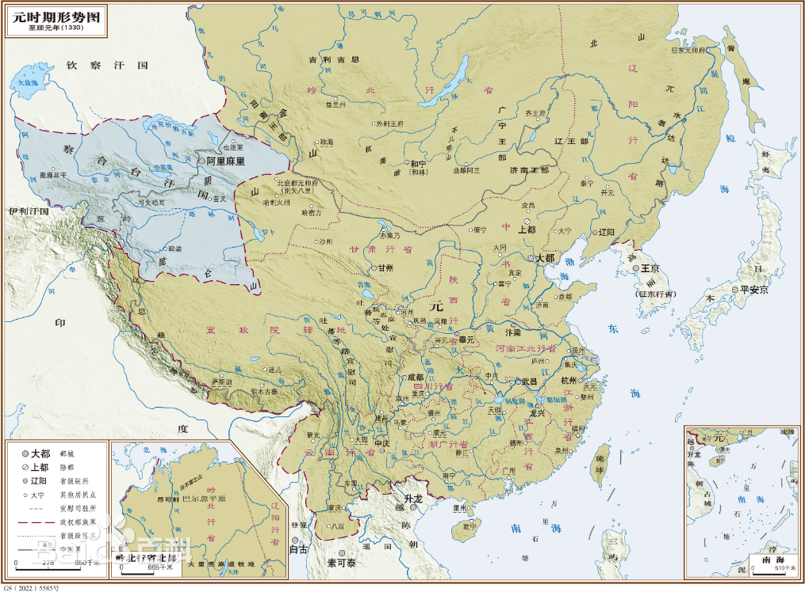

# 概述

[**元朝**](https://zh.wikipedia.org/wiki/元朝)（[1260年](https://zh.wikipedia.org/wiki/忽必烈 "忽必烈称帝")或[1271年](https://zh.wikipedia.org/wiki/忽必烈 "忽必烈改国号为大元")—[1368年9月14日](https://zh.wikipedia.org/wiki/徐达北伐 "徐达北伐")），是[中国历史主线](中国朝代.md#中国历史主线)之一，是由[成吉思汗](https://zh.wikipedia.org/wiki/成吉思汗)的孙子[忽必烈](https://zh.wikipedia.org/wiki/忽必烈)开创的朝代，[蒙古帝国](蒙古帝国.md)的一部分，国号**大元**，国君姓氏[**孛儿只斤**](https://zh.wikipedia.org/wiki/孛兒只斤氏)，历经5代11帝，国祚98年（1260年起算）或109年（1271年起算）。

<figure>
  
  <figcaption style="font-size: 16px; color: gray">元朝疆域图（1330年）</figcaption>
</figure>

# 历史

- 前期历史详见[蒙古族历史](蒙古族.md)和[蒙古帝国历史](蒙古帝国.md)。
- [南宋](https://zh.wikipedia.org/wiki/南宋)[开禧](https://zh.wikipedia.org/wiki/开禧)二年（1206年），蒙古人[铁木真](https://zh.wikipedia.org/wiki/铁木真)在[斡难河](https://zh.wikipedia.org/wiki/鄂嫩河)称**汗**（即**成吉思汗**），建立**大蒙古国**。
- 1260年5月5日，[忽必烈](https://zh.wikipedia.org/wiki/忽必烈)自立为**大蒙古国皇帝**。
- [至元](<https://zh.wikipedia.org/wiki/至元_(元世祖)>)八年十一月十五日（1271年12月18日），[忽必烈](https://zh.wikipedia.org/wiki/忽必烈)颁步《[建国号诏](https://zh.wikisource.org/wiki/建國號詔)》，将国号由**大蒙古国**改为[**大元**](元朝.md)，元朝开始。
- 1279年3月19日，元将[张弘范](https://zh.wikipedia.org/wiki/張弘範)于[厓山海战](https://zh.wikipedia.org/wiki/厓山海戰)击败宋军，宋帝[赵昺](https://zh.wikipedia.org/wiki/趙昺)投海殉国，[宋朝](https://zh.wikipedia.org/wiki/宋朝)灭亡，元朝统一中国。
- 1368年9月14日，[明朝](明朝.md)[徐达](https://zh.wikipedia.org/wiki/徐達)率军攻陷大都（北京），[元顺帝](https://zh.wikipedia.org/wiki/元順帝)撤退至[上都](https://zh.wikipedia.org/wiki/元上都)，“蒙古帝国”瓦解，[北元](北元.md)开始。

# 君主世系

> [蒙古可汗世系图](https://zh.wikipedia.org/wiki/蒙古可汗世系图)
>
> [元朝君主列表](https://zh.wikipedia.org/wiki/元朝君主列表)
