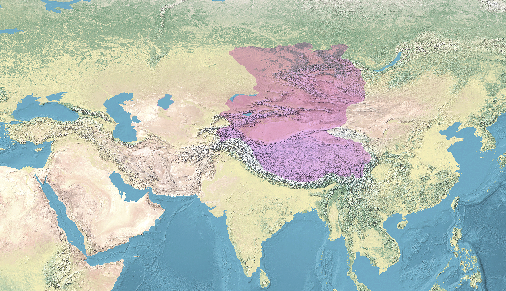

# 概述

[**准噶尔汗国**](https://zh.wikipedia.org/wiki/准噶尔汗国)（1635年—1758年），是[卫拉特](https://zh.wikipedia.org/wiki/瓦剌)[蒙古](蒙古族.md)[准噶尔部](准噶尔部.md)建立的[汗国](https://zh.wikipedia.org/wiki/汗國)政权，亦是人类史上最后一个[游牧帝国](https://zh.wikipedia.org/wiki/游牧帝国)。

<figure>
  
  <figcaption style="font-size: 16px; color: gray">约18世纪准噶尔汗国疆域</figcaption>
</figure>

# 历史

- 明末清初，[准噶尔部](准噶尔部.md)首领最早是[哈喇忽剌](https://zh.wikipedia.org/wiki/哈喇忽剌)。
- 1635年，[巴图尔珲台吉](https://zh.wikipedia.org/wiki/巴图尔珲台吉)建立[准噶尔汗国](准噶尔汗国.md)。
- 1670年，[巴图尔珲台吉](https://zh.wikipedia.org/wiki/巴图尔珲台吉)的儿子[僧格](https://zh.wikipedia.org/wiki/僧格)被杀后，僧格的异母弟[噶尔丹](https://zh.wikipedia.org/wiki/噶尔丹)夺得了准噶尔的统治权。
- 1678年，西藏的[五世达赖](https://zh.wikipedia.org/wiki/第五世达赖喇嘛)赐[噶尔丹](https://zh.wikipedia.org/wiki/噶尔丹)**博硕克图汗**号，[准噶尔汗国](准噶尔汗国.md)正式成立。
- [准噶尔之役](https://zh.wikipedia.org/wiki/准噶尔之役)（1688年—1758年），清朝吞并[准噶尔汗国](准噶尔汗国.md)，将西域全境纳入版图。
    - [清](清朝.md)康熙帝[三征噶尔丹](https://zh.wikipedia.org/wiki/准噶尔之役)
    - [准噶尔灭族](https://zh.wikipedia.org/wiki/准噶尔灭族)