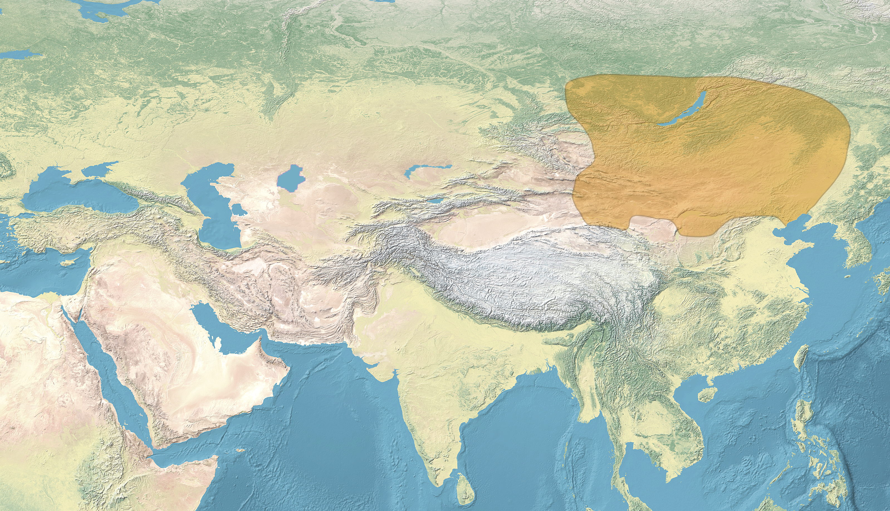

# 概述

[**北元**](https://zh.wikipedia.org/wiki/北元)（[1368年9月14日](https://zh.wikipedia.org/wiki/徐达北伐 "徐达北伐，元朝灭亡")—1388年11月1日），国号**大元**，也被称为**残元**、**故元**，是[明朝](明朝.md)建国后汉文典籍对于[元朝](元朝.md)主力北迁撤回蒙古草原的残存政权之称。是[**中国历史支线**](中国-朝代.md#中国历史支线)之一。

<figure>
  
  <figcaption style="font-size: 16px; color: gray">北元疆域图</figcaption>
</figure>

# 历史

- 之前历史详见[蒙古帝国](蒙古帝国.md)。
- 1368年9月14日，[明朝](明朝.md)[徐达](https://zh.wikipedia.org/wiki/徐達)率军攻陷大都（北京），[元顺帝](https://zh.wikipedia.org/wiki/元順帝)撤退至[上都](https://zh.wikipedia.org/wiki/元上都)，继续沿用**大元**国号，[北元](北元.md)**开始**。
- 1388年11月1日，[也速迭儿](https://zh.wikipedia.org/wiki/卓里克圖)杀害[天元帝](https://zh.wikipedia.org/wiki/天元帝)，[北元](北元.md)**灭亡**，[大元](元朝.md)国号废除。
- 此后，蒙古草原进入[**鞑靼**](https://zh.wikipedia.org/wiki/鞑靼_(蒙古))（东蒙古，蒙古本部，黄金家族系）与[**瓦剌**](https://zh.wikipedia.org/wiki/瓦剌)（西蒙古，卫拉特系）并立争雄时期。
- 1635年6月12日，[额哲](https://zh.wikipedia.org/wiki/额哲)投降[后金](后金.md)，漠南蒙古诸部奉[皇太极](皇太极.md)为蒙古可汗，[黄金家族](https://zh.wikipedia.org/wiki/黄金家族)对漠南蒙古的法统终结，北元**正式灭亡**，大蒙古国正式灭亡。
- 之后历史见[蒙古帝国](蒙古帝国.md)。
