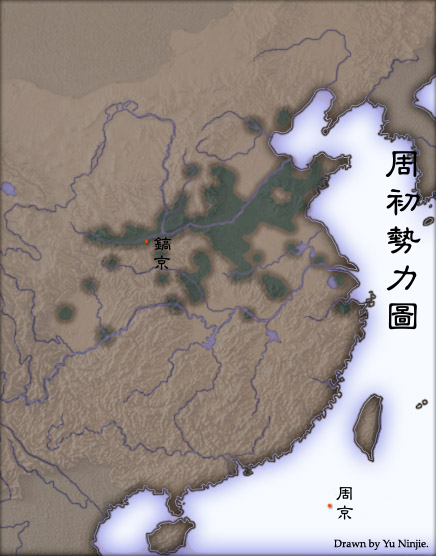
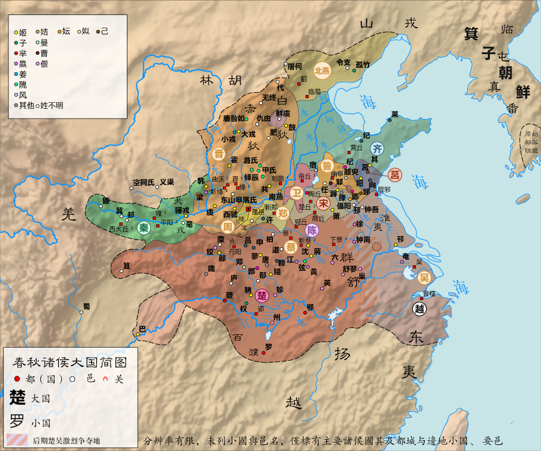
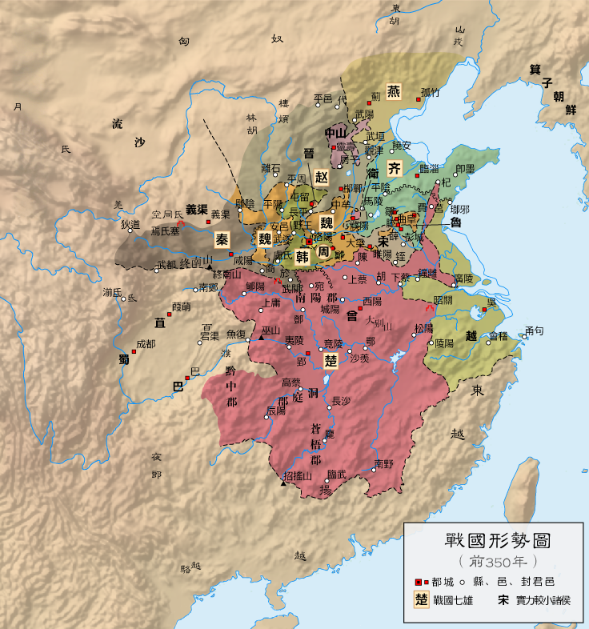
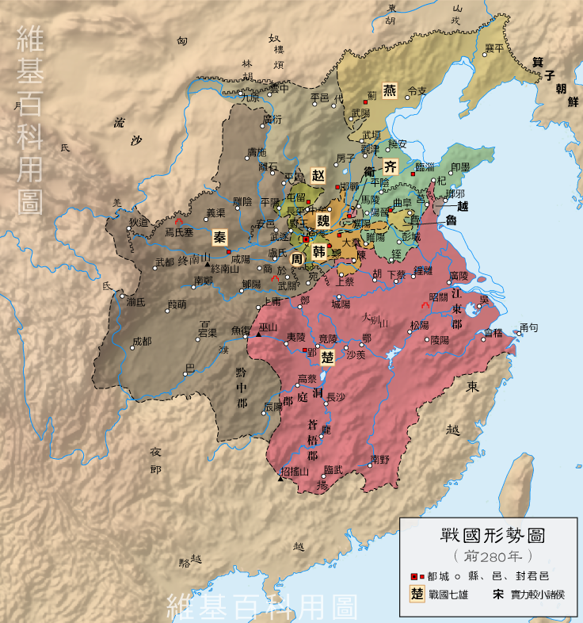

# 概述

[**周朝**](https://zh.wikipedia.org/wiki/周朝)（[前1046年](https://zh.wikipedia.org/wiki/牧野之战 "牧野之战")—[前256年](https://zh.wikipedia.org/wiki/秦灭周 "秦灭周")），是[中国历史主线](中国朝代.md#中国历史主线)之一，也是最后一个完全施行封建制度的世袭王朝，国号**周**，国君**姬**姓**周**氏，历经30代37王，国祚791年。

周朝可分为[**西周**](https://zh.wikipedia.org/wiki/西周)与[**东周**](https://zh.wikipedia.org/wiki/东周)两个时期：

- [**西周**](https://zh.wikipedia.org/wiki/西周)（[前1046年](https://zh.wikipedia.org/wiki/牧野之战 "牧野之战")—[前771年](https://zh.wikipedia.org/wiki/犬戎攻周之战 "犬戎攻周之战")），为[平王东迁](https://zh.wikipedia.org/wiki/平王东迁)之前的周朝时期，国号**周**，国君**姬**姓**周**氏，历经11代12王，国祚276年。
- [**东周**](https://zh.wikipedia.org/wiki/东周)（[前770年](https://zh.wikipedia.org/wiki/周平王东迁 "周平王东迁")—[前256年](https://zh.wikipedia.org/wiki/秦灭周 "秦灭周")），为[平王东迁](https://zh.wikipedia.org/wiki/平王东迁)之后的周朝时期，国号**周**，国君**姬**姓**周**氏，历经21代25王，国祚515年。
  - [**春秋时期**](春秋时期.md)（[前770年](https://zh.wikipedia.org/wiki/周平王东迁 "周平王东迁")—[前403年](https://zh.wikipedia.org/wiki/三家分晋 "三家分晋")），简称**春秋**， 是[东周](https://zh.wikipedia.org/wiki/东周)建立至[三家分晋](https://zh.wikipedia.org/wiki/三家分晋)的历史时期。
  - [**战国时期**](战国时期.md)（[前403年](https://zh.wikipedia.org/wiki/三家分晋 "三家分晋")—[前221年](https://zh.wikipedia.org/wiki/秦灭齐之战 "秦灭齐之战")），简称**战国**，是[三家分晋](https://zh.wikipedia.org/wiki/三家分晋)至[秦朝](https://zh.wikipedia.org/wiki/秦朝)建立的历史时期。

<figure>
  
  <figcaption style="font-size: 16px; color: gray">西周初期势力范围</figcaption>
</figure>

<figure>
  
  <figcaption style="font-size: 16px; color: gray">东周王畿与诸侯国的疆域（春秋时期）</figcaption>
</figure>

<figure>
  
  <figcaption style="font-size: 16px; color: gray">春秋诸侯大国简图</figcaption>
</figure>

<figure>
  
  <figcaption style="font-size: 16px; color: gray">战国形势图（前350年）</figcaption>
</figure>

<figure>
  
  <figcaption style="font-size: 16px; color: gray">战国（前280年）</figcaption>
</figure>

<figure>
  
  <figcaption style="font-size: 16px; color: gray">战国七雄</figcaption>
</figure>

# 历史

- 周人的始祖是[姬弃](<https://zh.wikipedia.org/wiki/后稷_(人物)>)，是五帝中[帝喾](帝喾.md)之子，[黄帝](黄帝.md)的四世孙。周人东迁岐山关中一带，遂逐步崛起。
- 《史记·周本纪》记载，从[姬弃](<https://zh.wikipedia.org/wiki/后稷_(人物)>)到[周文王](周文王.md)共15代。
- [周武王](周武王.md)十一年（前1046年），[牧野之战](https://zh.wikipedia.org/wiki/牧野之战)，周武王战胜[商纣王](商纣王.md)（史称“武王伐纣”），建立[西周](西周.md)。
- 历经[成康之治](https://zh.wikipedia.org/wiki/成康之治)、[三监之乱](https://zh.wikipedia.org/wiki/三監之亂)、[周公东征](https://zh.wikipedia.org/wiki/周公东征)、[共和行政](https://zh.wikipedia.org/wiki/共和行政)和[宣王中兴](https://zh.wikipedia.org/wiki/宣王中興)。
- 前771年，[犬戎之祸](https://zh.wikipedia.org/wiki/犬戎之禍)，[周幽王](https://zh.wikipedia.org/wiki/周幽王)被杀，西周结束。
- [周幽王](https://zh.wikipedia.org/wiki/周幽王)死后，诸侯共立宜臼为王，是为[周平王](https://zh.wikipedia.org/wiki/周平王)。
- 前770年，为避犬戎，[平王东迁](https://zh.wikipedia.org/wiki/平王东迁)。东周开始。
- 平王东迁以后，周朝实力大减，各诸侯开始争霸。
- 东周建立至[秦朝](秦朝.md)建立，可分为[春秋时期](春秋时期.md)和[战国时期](战国时期.md)。
- 前367年，[东周](https://zh.wikipedia.org/wiki/东周)国势益弱，分为[东周国](https://zh.wikipedia.org/wiki/东周国)和[西周国](https://zh.wikipedia.org/wiki/西周国)，[周赧王](https://zh.wikipedia.org/wiki/周赧王)迁都至**西周国**。
- 前256年（[秦昭襄王](秦昭襄王.md)五十一年，[周赧王](https://zh.wikipedia.org/wiki/周赧王)五十九年），秦灭[**西周国**](https://zh.wikipedia.org/wiki/西周国)，[东周](东周.md)灭亡。
- 前249年（[秦庄襄王](https://zh.wikipedia.org/wiki/秦庄襄王)元年），秦灭[**东周国**](https://zh.wikipedia.org/wiki/东周国)。至此，[周武王](周武王.md)姬发建立的姬周政权全部覆灭。

# 君主世系

> [周朝君主世系图](https://zh.wikipedia.org/wiki/周朝君主世系图)
>
> [周朝君主列表](https://zh.wikipedia.org/wiki/周朝君主列表)

# 诸侯国

> [周朝诸侯国列表](https://zh.wikipedia.org/wiki/周朝诸侯国列表)
>
> [周朝诸侯国君主列表](https://zh.wikipedia.org/wiki/周朝诸侯国君主列表)
