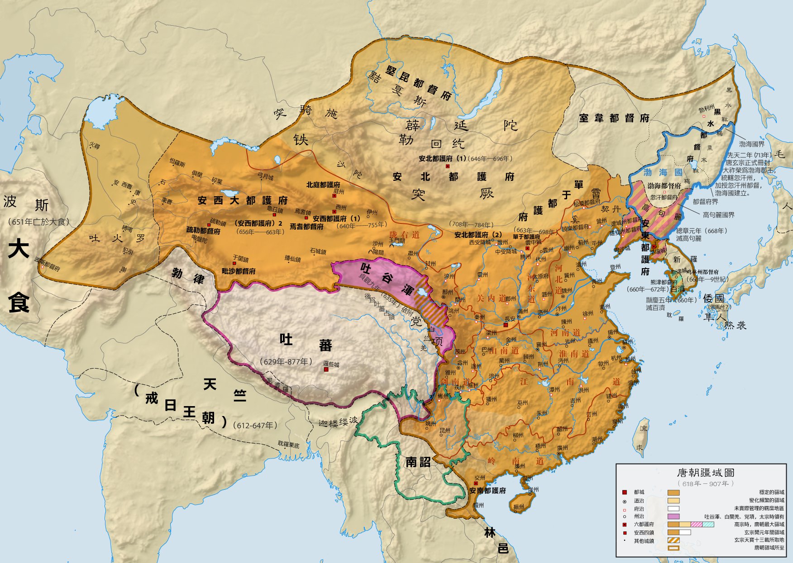

# 概述

[**唐朝**](https://zh.wikipedia.org/wiki/唐朝)（618年6月18日—690年10月16日、705年3月3日—907年5月12日），是[中国历史主线](中国历史主线.md)之一，与[隋朝](隋朝.md)合称[隋唐](https://zh.wikipedia.org/wiki/隋唐)，国号**唐**，国君姓氏**李**，历经14代22帝，国祚290年。（包含[武则天](武则天.md)）

<figure>
  
  <figcaption style="font-size: 16px; color: gray">
    
唐朝疆域图（280年）

    
橙色部分为唐朝较稳定的疆域

    
其他颜色则是唐朝曾短暂管治及影响力扩张到极限的区域（公元669年西至波斯东部，此时其势力范围面积约1237万平方公里）

  </figcaption>
</figure>

# 历史

- **初唐：高祖至高宗**
  - 618年6月18日，[隋恭帝](https://zh.wikipedia.org/wiki/杨侑)禅让[李渊](https://zh.wikipedia.org/wiki/李渊)，唐朝建立。
  - 690年10月16日，[武则天](https://zh.wikipedia.org/wiki/武則天)废[睿宗](https://zh.wikipedia.org/wiki/唐睿宗)李旦自立，国号为[武周](https://zh.wikipedia.org/wiki/武周)，唐朝国号被灭。

- **盛唐：武则天至玄宗**
  - 705年2月21日，群臣叛变发动[神龙政变](https://zh.wikipedia.org/wiki/神龍政變)，[武周](https://zh.wikipedia.org/wiki/武周)被领头的李显推翻。[中宗](https://zh.wikipedia.org/wiki/唐中宗)李显再次即位。
  - 705年3月3日，[中宗](https://zh.wikipedia.org/wiki/唐中宗)李显复国号“唐”。
  - 755年12月16日，[安史之乱](https://zh.wikipedia.org/wiki/安史之亂)爆发，唐朝由盛转衰。[玄宗](https://zh.wikipedia.org/wiki/唐玄宗)逃出皇城，[肃宗](https://zh.wikipedia.org/wiki/唐肅宗)李亨登基。

- **中唐：肃宗至文宗**
- **晚唐：武宗至哀帝**
  - 907年5月12日，[朱温](https://zh.wikipedia.org/wiki/朱溫)废[哀帝](https://zh.wikipedia.org/wiki/唐哀帝)李柷自立，唐朝彻底灭亡。

# 君主世系

> [唐朝皇帝世系图](https://zh.wikipedia.org/wiki/唐朝皇帝世系图)
>
> [唐朝君主列表](https://zh.wikipedia.org/wiki/唐朝君主列表)
