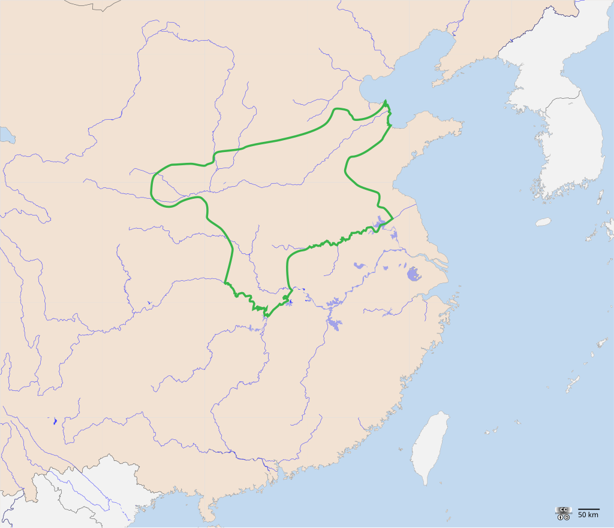

# 概述

[**商朝**](https://zh.wikipedia.org/wiki/商朝)（[约前1600年](https://zh.wikipedia.org/wiki/鸣条之战 "鸣条之战")—[约前1046年](https://zh.wikipedia.org/wiki/牧野之战 "牧野之战")），是[中国历史主线](中国朝代.md#中国历史主线)之一，是由[商人](<https://zh.wikipedia.org/wiki/商人_(古代人群)>)建立的国家，国号**商**，又称**殷**、**大邑商**，国君为**子**姓，历经17代31王，国祚约600年。

商朝是中国历史上有当时文字记载遗留至今的最早朝代，也是国际史学界普遍承认的中国最早朝代。

# 历史

- 《史记·殷本纪》记载商的始祖[契](https://zh.wikipedia.org/wiki/契)生活在三皇五帝时期，曾在舜帝下任职司徒，因辅佐大禹治水立下功绩，被“封于商，赐姓子氏”。
- 契是喾的儿子，黄帝的四世孙。
- 约前1600年，[鸣条之战](https://zh.wikipedia.org/wiki/鸣条之战)，[商汤](商汤.md)战胜夏桀，夏朝灭亡，商朝建立，成为中国历史上的第一次朝代更替。
- 商朝中期，出现[九世之乱](https://zh.wikipedia.org/wiki/九世之乱)。
- 商朝晚期，[盘庚迁殷](https://zh.wikipedia.org/wiki/盘庚迁殷)，王朝进入了相对稳定的新发展阶段。
- [武丁中兴](https://zh.wikipedia.org/wiki/武丁中兴)，武丁可以被历史学确信为中国历史上第一个强力君主，具有统一黄河流域的特征。
- 周武王十一年（约前1046年），[牧野之战](https://zh.wikipedia.org/wiki/牧野之战)，周武王战胜[商纣王](商纣王.md)，商纣王自尽，商朝灭亡。

# 君主世系

> [商朝君主世系图](https://zh.wikipedia.org/wiki/商朝君主世系图)
>
> [商朝君主列表](https://zh.wikipedia.org/wiki/商朝君主列表)

# 疆域

[盘庚迁殷](https://zh.wikipedia.org/wiki/盘庚迁殷)后，商朝都城为殷（今河南省安阳市西北殷墟遗址），陪都为朝歌（今河南省鹤壁市淇县朝歌镇）。

<figure>
  
  <figcaption style="font-size: 16px; color: gray">绿色范围为商朝核心疆域</figcaption>
</figure>

# 后裔

牧野之战后，商人一部分被周朝消灭，一部分并入周朝的匽侯（燕国）、宗周等。武王死后，帝辛继承人[武庚](https://zh.wikipedia.org/wiki/武庚)参与[三监之乱](https://zh.wikipedia.org/wiki/三监之乱)，被周公东征击败。可能另封纣王的庶兄、当年叛变商朝投降周朝的微子启于商丘，国号宋，以奉商朝的宗祀。
