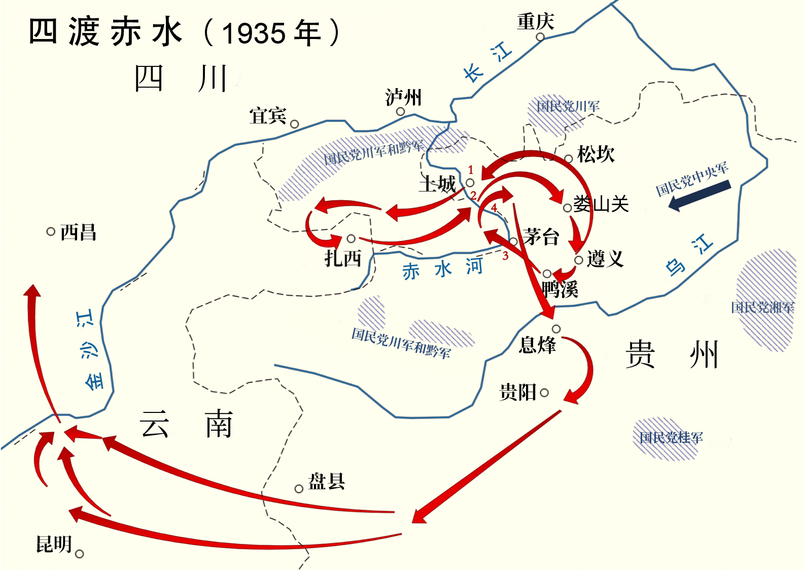

# 概述

[**四渡赤水**](https://zh.wikipedia.org/wiki/四渡赤水)（1935年1月19日—1935年3月22日），是[中国共产党](中国共产党.md)指挥的[中国工农红军](中国工农红军.md)在[长征](长征.md)过程中经历的一次转折性战役，是毛泽东生平最得意的一次战役。

<figure>
  
  <figcaption style="font-size: 16px; color: gray">四渡赤水路线图</figcaption>
</figure>

# 经过

# 结果

## 共产党

红军从此跳出了蒋介石百万大军的包围圈，暂时摆脱了被围歼的危险，[长征](长征.md)进入了在艰难的自然环境中，长途行军的阶段。

## 国名党

[蒋介石](蒋介石.md)正式免去[王家烈](https://zh.wikipedia.org/wiki/王家烈)的[贵州省政府主席](https://zh.wikipedia.org/wiki/貴州省政府主席)和第二十五军军长的职务，贵州军政完全进入蒋介石的直接控制之下。

## 毛泽东

四渡赤水是[毛泽东](毛泽东.md)复出后，第一次指挥的大型战役，并获得了第五次反围剿失败后的首次胜利，使一度危在旦夕的中国共产党暂时摆脱危机，毛泽东的领导地位和军事才华得到了中共领导层以及基层官兵的一致肯定。

# 影响

# 相关条目