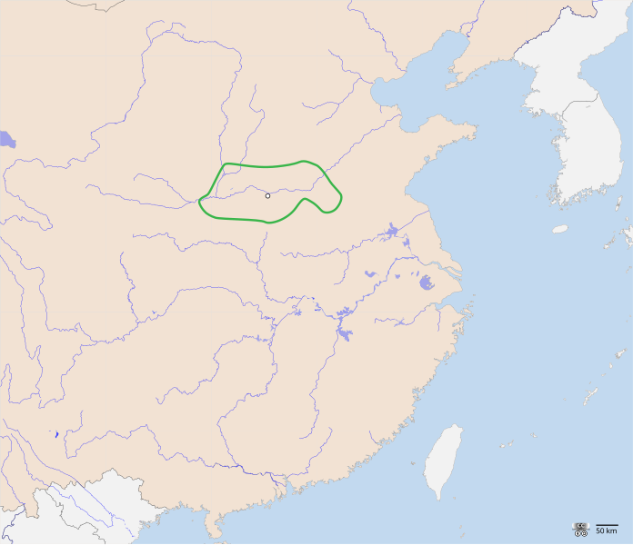

# 概述

[**夏朝**](https://zh.wikipedia.org/wiki/夏朝)（约前2070年—[约前1600年](https://zh.wikipedia.org/wiki/鸣条之战 "鸣条之战") ），是[中国历史主线](中国-朝代.md#中国历史主线)之一，国号**夏**，国君[**<ruby>姒<rp>(</rp><rt>sì</rt><rp>)</rp></ruby>**](https://zh.wikipedia.org/wiki/姒姓)姓[**夏后**](https://zh.wikipedia.org/wiki/夏后氏)氏，历经14朝17王，国祚约470年。

夏朝是西周《[尚书](尚书.md)》中记载的第一个世袭制朝代，作为中国传统历史的第一个王朝，拥有较高的历史地位，后人常以“华夏”、“诸夏”自称，使之成为中国的代名词。

[二里头遗址](https://zh.wikipedia.org/wiki/二里头遗址)具备了属于夏文化的年代和地理位置的基本条件，但由于一直未能出土类似殷墟甲骨卜辞的同时期的文字记载，始终无法证实来自夏朝，因此，国际史学界对于夏朝是否真的存在有争议。

# 历史

- 《史记·夏本纪》称[<ruby>鲧<rp>(</rp><rt>gǔn</rt><rp>)</rp></ruby>](https://zh.wikipedia.org/wiki/鲧)为**颛顼**之子，禹的父亲。
- 尧在位时，洪水泛滥，鲧治水失败被流放，接着命禹继续治水。
- 约前21世纪，[禹](禹.md)治水有功，舜把天子位禅让给禹。夏禹登位，立国号为**夏**，夏朝正式建立。
- 禹死后，他的儿子**启**被拥立，“公天下”变成“家天下”，启不再使用**伯**这个称号而改用**后**，即“夏后启”。
- 经[太康失国](https://zh.wikipedia.org/wiki/%E5%A4%AA%E5%BA%B7%E5%A4%B1%E5%9C%8B)、[少康中兴](https://zh.wikipedia.org/wiki/少康中興)等。
- 约前1600年，[鸣条之战](https://zh.wikipedia.org/wiki/鸣条之战)，商汤战胜夏桀，夏朝灭亡，商朝建立，成为中国历史上的第一次朝代更替。

# 君主世系

> [夏朝君主世系图](https://zh.wikipedia.org/wiki/夏朝君主世系图)
>
> [夏朝君主列表](https://zh.wikipedia.org/wiki/夏朝君主列表)

# 疆域

夏朝是部落城邦联盟到封建国家的过渡期，因此没有明确的疆域。夏部落的十一支姒姓氏族与夏后氏中央王室在血缘上有宗法关系，政治上有分封关系，经济上有贡赋关系，大致构成夏王朝的核心领土范围。

夏西起河南省西部、山西省南部，东至河南省、山东省和河北省三省交界处，南达湖北省北部，北及河北省南部。

<figure>
  
  <figcaption style="font-size: 16px; color: gray">绿色范围为夏朝核心区域</figcaption>
</figure>

# 后裔

- 少康时受封在越国的一支，夏禹姒姓后代世代在浙江绍兴会稽山禹陵村为禹守陵至今。
- 夏灭亡后，剩余势力除了主要留居中原，还有两支分别向南方、北方迁移。桀带着不少夏部落的民众从历山南迁至南巢，这便是南支。
- 传说向北一支进入蒙古草原，与当地诸部落融合，有人认为这便是后人所称的匈奴。《史记·匈奴列传》载道“匈奴，其先祖夏后氏之苗裔也，曰淳维”。

# 其它相关

- 行政区划采行[九州制](<https://zh.wikipedia.org/wiki/九州_(中国)>)，，铸造[九鼎](https://zh.wikipedia.org/wiki/九鼎)作为国家权利的象征，因此“九州”成为中国国家的代名词，而“定鼎”意指建立政权。
