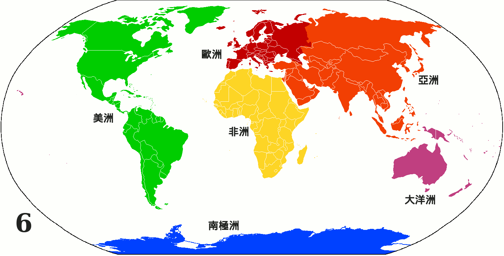

# 概述

[**大洲**](https://zh.wikipedia.org/wiki/洲)（英语：Continent），简称**洲**，是指地球上以大块[陆地](https://zh.wikipedia.org/wiki/陆地)为主体，包括附近[岛屿](https://zh.wikipedia.org/wiki/岛屿)的[地区](https://zh.wikipedia.org/wiki/地区)。

主流的[地理学](https://zh.wikipedia.org/wiki/地理学)将现今的地球分为**七大洲**，按面积大小依次为[亚洲](https://zh.wikipedia.org/wiki/亚洲)、[非洲](https://zh.wikipedia.org/wiki/非洲)、[北美洲](https://zh.wikipedia.org/wiki/北美洲)、[南美洲](https://zh.wikipedia.org/wiki/南美洲)、[南极洲](https://zh.wikipedia.org/wiki/南极洲)、[欧洲](https://zh.wikipedia.org/wiki/欧洲)和[大洋洲](https://zh.wikipedia.org/wiki/大洋洲)。

[联合国地理方案](https://zh.wikipedia.org/wiki/联合国地理方案)则把世界分为**六大洲**，[北美洲](https://zh.wikipedia.org/wiki/北美洲)和[南美洲](https://zh.wikipedia.org/wiki/南美洲)被合并成了[美洲](https://zh.wikipedia.org/wiki/美洲)。

[国际奥委会](https://zh.wikipedia.org/wiki/国际奥林匹克委员会)则在[联合国地理方案](https://zh.wikipedia.org/wiki/联合国地理方案)的基础上把无常住人口的[南极洲](https://zh.wikipedia.org/wiki/南极洲)去掉，把世界分为了**五大洲**（[奥运五环](https://zh.wikipedia.org/wiki/奥林匹克五环)分别代表了亚、欧、非、大洋、美五大洲）。

[亚洲](https://zh.wikipedia.org/wiki/亚洲)和[欧洲](https://zh.wikipedia.org/wiki/欧洲)属于同一个[陆块](https://zh.wikipedia.org/wiki/陸塊)（英语：Landmass）：[亚欧大陆](https://zh.wikipedia.org/wiki/亚欧大陆)。地球上一共有六块大陆，按面积大小依次为亚欧大陆、非洲大陆、北美大陆、南美大陆、南极大陆和[澳大利亚大陆](https://zh.wikipedia.org/wiki/澳洲大陆)。有些地理学家则选择忽视[苏伊士运河](https://zh.wikipedia.org/wiki/苏伊士运河)和[巴拿马运河](https://zh.wikipedia.org/wiki/巴拿马运河)这两条人工[运河](https://zh.wikipedia.org/wiki/运河)，将亚欧大陆和非洲大陆合并为[亚欧非大陆](https://zh.wikipedia.org/wiki/亚欧非大陆)，将北美大陆和南美大陆合并为[美洲大陆](https://zh.wikipedia.org/wiki/美洲)。

在[文化地理学](https://zh.wikipedia.org/wiki/文化地理学)、[地缘政治学](https://zh.wikipedia.org/wiki/地缘政治学)和[政治地理学](https://zh.wikipedia.org/wiki/政治地理学)领域，[非洲](https://zh.wikipedia.org/wiki/非洲)往往被拆分为[北非](https://zh.wikipedia.org/wiki/北非)和[撒哈拉以南非洲](https://zh.wikipedia.org/wiki/撒哈拉以南非洲)两大地区，[美洲](https://zh.wikipedia.org/wiki/美洲)被拆分为[拉丁美洲](https://zh.wikipedia.org/wiki/拉丁美洲)和[北美](https://zh.wikipedia.org/wiki/北美地区)两大地区，[欧洲](https://zh.wikipedia.org/wiki/欧洲)被拆分为[东欧](https://zh.wikipedia.org/wiki/东欧)和[西欧](https://zh.wikipedia.org/wiki/西欧)两大地区（由隶属[俄罗斯](https://zh.wikipedia.org/wiki/俄罗斯)的[西伯利亚](https://zh.wikipedia.org/wiki/西伯利亚)地区组成的[北亚](https://zh.wikipedia.org/wiki/北亚)往往被看作[东欧](https://zh.wikipedia.org/wiki/东欧)的一部分），而[亚洲](https://zh.wikipedia.org/wiki/亚洲)和[大洋洲](https://zh.wikipedia.org/wiki/大洋洲)则被重组为[亚太](https://zh.wikipedia.org/wiki/亚太地区)、[南亚次大陆](https://zh.wikipedia.org/wiki/南亚次大陆)和[中东](https://zh.wikipedia.org/wiki/中东)三大地区（[中亚](https://zh.wikipedia.org/wiki/中亚)和[北非](https://zh.wikipedia.org/wiki/北非)有时被算作[大中东地区](https://zh.wikipedia.org/wiki/大中东地区)的一部分）。

[中美洲](https://zh.wikipedia.org/wiki/中美洲)和[婆罗洲](https://zh.wikipedia.org/wiki/婆罗洲)虽然名字里带有“洲”字，但它们并不是传统意义上的大洲。[中美洲](https://zh.wikipedia.org/wiki/中美洲)只是[北美洲](https://zh.wikipedia.org/wiki/北美洲)或[拉丁美洲](https://zh.wikipedia.org/wiki/拉丁美洲)的一个地区，[婆罗洲](https://zh.wikipedia.org/wiki/婆罗洲)则是[马来群岛](https://zh.wikipedia.org/wiki/马来群岛)上一个面积巨大的岛屿（[世界第三大岛](https://zh.wikipedia.org/wiki/岛屿面积列表)）。

# 名称辨析

[**洲**](https://zh.wikipedia.org/wiki/洲)与[**大陆**](https://zh.wikipedia.org/wiki/大陆)在英文中皆可为 **continent**，但在汉语中的意义有所不同。在汉语中，“大陆”为侧重于[自然地理学](https://zh.wikipedia.org/wiki/自然地理学)的术语，指的是[地壳](https://zh.wikipedia.org/wiki/地壳)中厚度较大、密度较小的部分，面积一般大于[格陵兰岛](https://zh.wikipedia.org/wiki/格陵兰地理)；而“洲”的概念则更侧重于[人文](https://zh.wikipedia.org/wiki/人文学科)上的[历史](https://zh.wikipedia.org/wiki/历史)与[文化](https://zh.wikipedia.org/wiki/文化)的区别，洲界有人为而明确的划分且与[地缘政治学](https://zh.wikipedia.org/wiki/地缘政治学)息息相关，其概念不仅包括作为主体的[大陆](https://zh.wikipedia.org/wiki/大陸)，也包括周边岛屿乃至大陆架，如[大洋洲](https://zh.wikipedia.org/wiki/大洋洲)并非一块大陆但却是一个洲。

严格来说，某些岛屿不能被看作是某块大陆的一部分，但可以看作是同一个洲。如[格陵兰岛](https://zh.wikipedia.org/wiki/格陵兰)有时出于政治原因被认为是[欧洲](https://zh.wikipedia.org/wiki/欧洲)的一部分，尽管从地质学角度来看它是[北美大陆](https://zh.wikipedia.org/wiki/北美洲)的一部分[[3\]](https://zh.wikipedia.org/wiki/洲#cite_note-3)。而[冰岛](https://zh.wikipedia.org/wiki/冰岛)在板块上不属于任何大陆，但也被认为是[欧洲](https://zh.wikipedia.org/wiki/欧洲)的一部分。

除汉语之外，区分“大陆”与“洲”两大概念的其他语言还有同为[汉字文化圈](https://zh.wikipedia.org/wiki/漢字文化圈)语言的[日语](https://zh.wikipedia.org/wiki/日语)（“大陸”与“大州”）、[朝鲜语](https://zh.wikipedia.org/wiki/朝鮮語)（“대륙”与“대주”）、[越南语](https://zh.wikipedia.org/wiki/越南语)（“châu lục”与“lục địa”），以及包括[荷兰语](https://zh.wikipedia.org/wiki/荷蘭語)（“continent”与“werelddeel”）在内等部分欧陆语言。

# 洲与洲的分界线

- 亚洲与欧洲分界线：[乌拉尔山脉](https://zh.wikipedia.org/wiki/乌拉尔山脉)、[乌拉尔河](https://zh.wikipedia.org/wiki/乌拉尔河)、[大高加索山脉](https://zh.wikipedia.org/wiki/大高加索山脈)；[土耳其海峡](https://zh.wikipedia.org/wiki/土耳其海峡)。
- 亚洲与非洲分界线：[苏伊士运河](https://zh.wikipedia.org/wiki/苏伊士运河)、[红海](https://zh.wikipedia.org/wiki/紅海)、[曼德海峡](https://zh.wikipedia.org/wiki/曼德海峡)
- 亚洲与大洋洲分界线：[帝汶海](https://zh.wikipedia.org/wiki/帝汶海)、[阿拉弗拉海](https://zh.wikipedia.org/wiki/阿拉弗拉海)、[塞兰海](https://zh.wikipedia.org/wiki/塞蘭海)、[哈马黑拉海](https://zh.wikipedia.org/wiki/哈馬黑拉海)
- 亚洲与北美洲分界线：[白令海峡](https://zh.wikipedia.org/wiki/白令海峡)
- 欧洲与非洲分界线：[直布罗陀海峡](https://zh.wikipedia.org/wiki/直布罗陀海峡)、[地中海](https://zh.wikipedia.org/wiki/地中海)
- 欧洲与北美洲分界线：[丹麦海峡](https://zh.wikipedia.org/wiki/丹麦海峡)、[格陵兰海](https://zh.wikipedia.org/wiki/格陵兰海)
- 北美洲与南美洲分界线：[巴拿马运河](https://zh.wikipedia.org/wiki/巴拿马运河)
- 南美洲与南极洲分界线：[德雷克海峡](https://zh.wikipedia.org/wiki/德雷克海峡)

# 相关条目

- [模板:洲](https://zh.wikipedia.org/wiki/Template:洲)