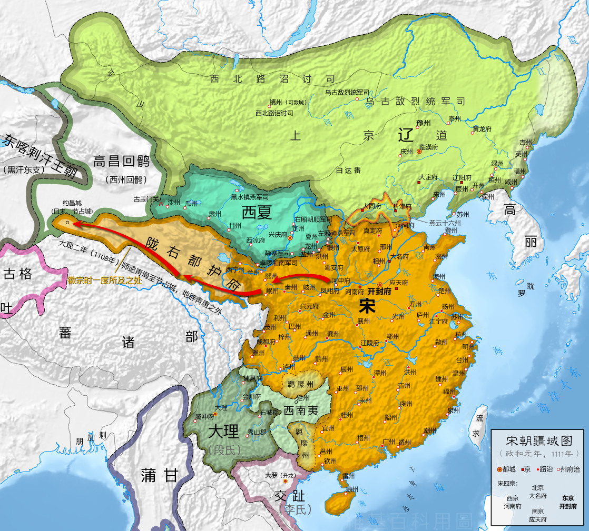
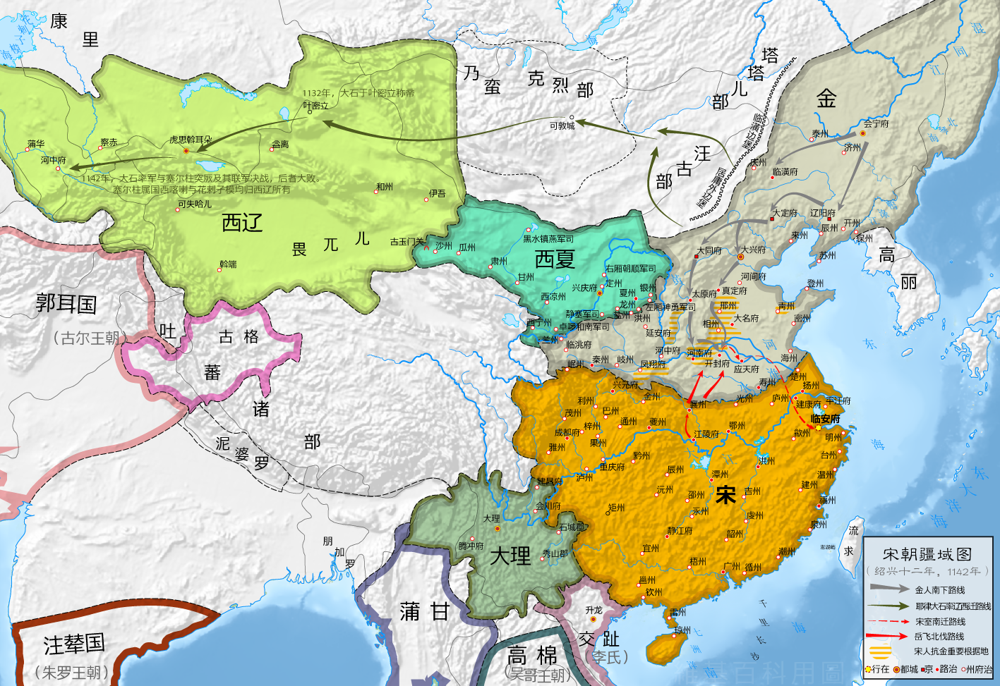

# 概述

[**宋朝**](https://zh.wikipedia.org/wiki/宋朝)（[960年2月4日](https://zh.wikipedia.org/wiki/陈桥兵变 "陈桥兵变")—[1279年3月19日](https://zh.wikipedia.org/wiki/崖门海战 "崖门海战")），是[中国历史主线](中国历史主线.md)之一，分为[北宋](https://zh.wikipedia.org/wiki/北宋)与[南宋](https://zh.wikipedia.org/wiki/南宋)时期，合称“**两宋**”，国号**宋**，国君姓氏**赵**，历经12代18帝，国祚320年。

宋朝是中国建立皇帝制度后，国祚最长的一个中国朝代（[汉朝](https://zh.wikipedia.org/wiki/漢朝)因被[新朝](https://zh.wikipedia.org/wiki/新朝)及[更始帝](https://zh.wikipedia.org/wiki/更始帝)时期隔断而非国祚延续最长）。

- [**北宋**](https://zh.wikipedia.org/wiki/北宋)（[960年2月4日](https://zh.wikipedia.org/wiki/陈桥兵变 "陈桥兵变")—[1127年3月20日](https://zh.wikipedia.org/wiki/靖康之变 "靖康之变")），是[宋朝](宋朝.md)的前半部分，与后来的[南宋](https://zh.wikipedia.org/wiki/南宋)合称**两宋**，国号**宋**，国君姓氏**赵**，历经6代9帝，国祚168年。

- [**南宋**](https://zh.wikipedia.org/wiki/南宋)（[1127年6月12日](https://zh.wikipedia.org/wiki/建炎南渡 "建炎南渡")—[1279年3月19日](https://zh.wikipedia.org/wiki/崖门海战 "崖门海战")），是[宋朝](宋朝.md)的后半部分，与之前的[北宋](https://zh.wikipedia.org/wiki/北宋)合称**两宋**，国号**宋**，国君姓氏**赵**，历经6代9帝，国祚153年。

  <figure>
    
    <figcaption style="font-size: 16px; color: gray">北宋疆域图（1111年）</figcaption>
  </figure>
  <figure>
    
    <figcaption style="font-size: 16px; color: gray">南宋疆域图（1142年）</figcaption>
  </figure>

<figure>
  
  <figcaption style="font-size: 16px; color: gray">北宋疆域图（1111年）</figcaption>
</figure>

<figure>
  
  <figcaption style="font-size: 16px; color: gray">南宋疆域图（1142年）</figcaption>
</figure>

# 历史

- 960年，[后周](https://zh.wikipedia.org/wiki/後周)大将[赵匡胤](https://zh.wikipedia.org/wiki/趙匡胤)发动[陈桥兵变](https://zh.wikipedia.org/wiki/陈桥兵变)，建立[北宋](https://zh.wikipedia.org/wiki/北宋)，定都[汴京](https://zh.wikipedia.org/wiki/汴京)（今河南开封市）。

- [宋神宗](https://zh.wikipedia.org/wiki/宋神宗)时，因着[王安石变法](https://zh.wikipedia.org/wiki/熙寧變法)，发生分别以[王安石](https://zh.wikipedia.org/wiki/王安石)、[司马光](https://zh.wikipedia.org/wiki/司馬光)为首的[新旧党争](https://zh.wikipedia.org/wiki/新舊黨爭)，增加社会的不安，新旧党争长达三十多年，影响深远，也使改革失败。

- 1005年[辽](辽朝.md)与[北宋](https://zh.wikipedia.org/wiki/北宋)签订[澶渊之盟](https://zh.wikipedia.org/wiki/澶渊之盟)，从此宋辽的和平局面长达一百多年。

    <figure>
      
      <figcaption style="font-size: 16px; color: gray">1111年北宋疆域</figcaption>
    </figure>

- 1115年，[完颜阿骨打](https://zh.wikipedia.org/wiki/完颜阿骨打)建立[金朝](金朝.md)并逐渐强大。

- 1038年，[李元昊](https://zh.wikipedia.org/wiki/李元昊)正式称帝，建立[西夏](西夏.md)。

- 1127年（靖康元年）金国攻破北宋首都汴京，俘虏三千多名皇族，其中包括当时的皇帝[宋钦宗](https://zh.wikipedia.org/wiki/宋欽宗)和太上皇[宋徽宗](https://zh.wikipedia.org/wiki/宋徽宗)，史称[靖康之变](https://zh.wikipedia.org/wiki/靖康之变)，北宋灭亡。

- 1127年，宋钦宗之弟[赵构](https://zh.wikipedia.org/wiki/宋高宗)于南京应天府（今河南[商丘市](https://zh.wikipedia.org/wiki/商丘市)）即皇帝位，是为[宋高宗](https://zh.wikipedia.org/wiki/宋高宗)，定都临安（今[浙江省](https://zh.wikipedia.org/wiki/浙江省)[杭州市](https://zh.wikipedia.org/wiki/杭州市)），史称**[南宋](https://zh.wikipedia.org/wiki/南宋)**。

- 1142年南宋和金达成[绍兴和议](https://zh.wikipedia.org/wiki/紹興和議)，导致宋金南北分治的局面。

    

      <figure style="margin-right: 50px">
        
        <figcaption style="font-size: 16px; color: gray">1141年《绍兴和议》后，南宋、金、西夏、蒙古版图</figcaption>
      </figure>
      <figure>
        
        <figcaption style="font-size: 16px; color: gray">橙色部分为南宋绍兴十二年（1142年）疆域</figcaption>
      </figure>
    

- 1234年，[蒙古帝国](蒙古帝国.md)与南宋联合灭[金](金朝.md)。随即蒙古与南宋对抗。

- 1276年，蒙古攻破临安，占领南宋大部分领土。

- 1279年，蒙古与南宋[崖山海战](https://zh.wikipedia.org/wiki/崖山海戰)，8岁的小皇帝[赵昺](https://zh.wikipedia.org/wiki/趙昺)被[陆秀夫](https://zh.wikipedia.org/wiki/陸秀夫)背着跳海殉国，南宋灭亡。

# 君主世系

> [宋朝皇帝世系图](https://zh.wikipedia.org/wiki/宋朝皇帝世系图)
>
> [宋朝君主列表](https://zh.wikipedia.org/wiki/宋朝君主列表)

# 辽宋夏金元

[**辽宋夏金元**](https://zh.wikipedia.org/wiki/辽宋夏金元)，是对[辽朝](https://zh.wikipedia.org/wiki/遼朝)（包括[北辽](北辽.md)、[西北辽](西北辽.md)、[西辽](西辽.md)）、[宋朝](https://zh.wikipedia.org/wiki/宋朝)、[金朝](西辽.md)和[西夏](西夏.md)和[元朝](元朝.md)（包括其前身[大蒙古国](蒙古帝国.md)）之合称，这几个朝代分别由不同的民族所建立，辽朝为[契丹族](契丹.md)、宋朝为汉族、西夏为[党项族](党项.md)、金朝为[女真族](满族.md)、蒙元为[蒙古族](<(蒙古族.md)>)统治。反映出[两宋](https://zh.wikipedia.org/wiki/宋朝)（即[北宋](https://zh.wikipedia.org/wiki/北宋)和[南宋](https://zh.wikipedia.org/wiki/南宋)）和与它同时存在的北方主要边疆少数民族政权的对峙局面。
