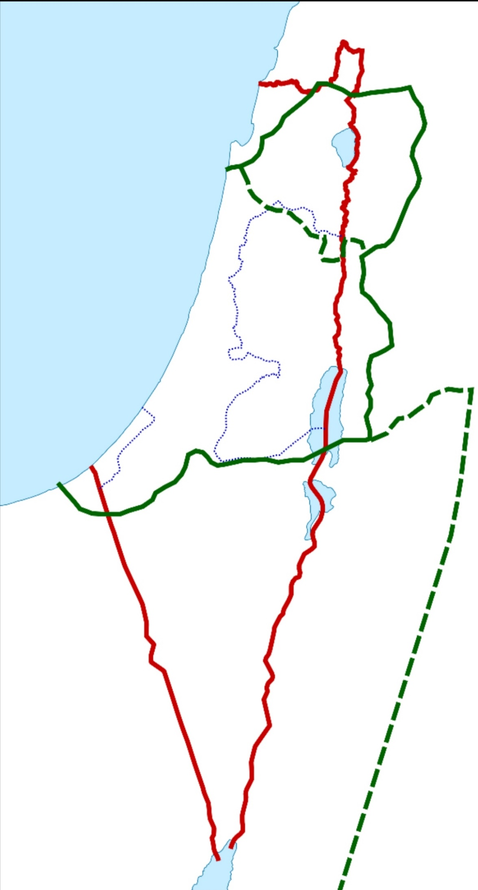
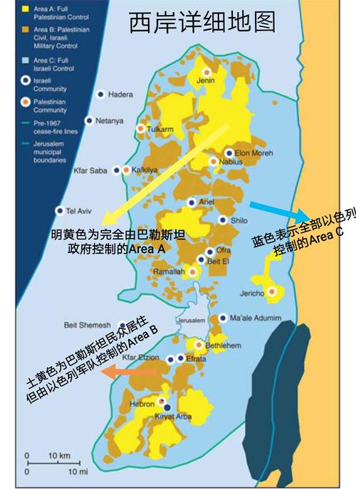

# 消歧义

本条目泛指[巴勒斯坦地区](巴勒斯坦地区.md)，有关巴勒斯坦国的情况，详见[巴勒斯坦](巴勒斯坦.md)。

# 概述

[**巴勒斯坦地区**](https://zh.wikipedia.org/wiki/巴勒斯坦地区)，是[中东](https://zh.wikipedia.org/wiki/中東)的一个地区，地处亚、非、欧三洲交通枢纽，位于西亚的一个地理区域，位于地中海与死海、约旦河之间，具有重要的战略意义。面积27090平方公里。现主要居民有阿拉伯人、犹太人。

今天的[以色列](以色列.md)、[约旦河西岸地区](https://zh.wikipedia.org/wiki/西岸)、[加沙走廊](https://zh.wikipedia.org/wiki/加沙走廊)以及[约旦](https://zh.wikipedia.org/wiki/約旦)西部均位于[巴勒斯坦地区](巴勒斯坦地区.md)范围内，但由于该地域的边界随历史上行政区划的不同而不断变化，所以至今还没有完全确定的边界。

该地区的[耶路撒冷](耶路撒冷.md)是[犹太教](犹太教.md)和[基督教](基督教.md)最神圣的圣城，同时也是[伊斯兰教](伊斯兰教.md)的第三大圣城。

由于阿以双方多年以来都未遵循1947年《[联合国大会第181号决议](联合国大会第181号决议.md)》划定的以色列和巴勒斯坦国国界，冲突不断，国际社会只能有限调解以巴冲突，至今仍未达成和平，目前该地区划分：

- **以色列除去合法占领1947年《[联合国大会第181号决议](联合国大会第181号决议.md)》“分治方案”土地外，还非法占领以下地区**
  - 加沙地带（1967年—2005年；2005年撤兵后以色列仍控制着边界、领空和海岸线）
  - 约旦河西岸地区（1967年全部—至今部分地区）
  - 西奈半岛（1967年—1982年）
  - 戈兰高地（1967年全部—至今）
  - 整个耶路撒冷（1967年全部—至今）

- **巴勒斯坦**
  - 民事管理加沙地带（2005年—至今；2005年以色列撤兵后以色列仍控制着边界、领空和海岸线）
  - 完全管理部分约旦河西岸地区

- **巴勒斯坦地区不同时期地域**

  

    

      
    

    <figcaption style="flex: 2; font-size: 16px; color: gray">
      <ul>
        <li>
          绿色实线：罗马帝国叙利亚—巴勒斯坦行省（英语：Syria
          Palaestina）的区域范围；
        </li>
        <li>
          绿色虚线：介于拜占庭帝国巴勒斯坦第一行省（英语：Palaestina
          Prima）（倭马亚王朝变更为巴勒斯坦军区（英语：Jund
          Filastin））与巴勒斯坦第二行省（英语：Palaestina
          Secunda）（倭马亚王朝变更为约旦军区（英语：Jund
          al-Urdunn））之间，也就是巴勒斯坦第三行省（英语：Palaestina
          Salutaris）；
        </li>
        <li>红色实线：英属巴勒斯坦托管地；</li>
        <li>蓝色虚线：加沙地带以及约旦河西岸地区。</li>
      </ul>
    </figcaption>
  

# 名称

- **巴勒斯坦**的辞源是希伯来语对从海上入侵[迦南](https://zh.wikipedia.org/wiki/迦南)的[**非利士人**](https://zh.wikipedia.org/wiki/非利士人)的称呼；
- 在亚述文中地中海西南部的海岸被称为“Pilaschtu”。
- 古希腊历史学家希罗多德的文章中出现了“叙利亚的巴勒斯坦”这个名字，来描写从今天的黎巴嫩到埃及的海岸地区。
- 波斯帝国到罗马帝国统治时期，巴勒斯坦地区被称为**犹太省**。
- 公元135年，[第三次犹太–罗马战争](https://zh.wikipedia.org/wiki/巴尔科赫巴起义 "巴尔科赫巴起义")后，为了消除犹太人的记忆，罗马人将“[犹太行省](https://zh.wikipedia.org/wiki/犹太 \_(罗马行省))”的名字改为“[叙利亚巴勒斯坦](https://zh.wikipedia.org/wiki/叙利亚巴勒斯坦)”来泛指这一地区。
- 一战结束，英国占领该地区，此地区遂被正式称为“[巴勒斯坦地区](巴勒斯坦地区.md)”。
- 现代的[巴勒斯坦](巴勒斯坦.md)指加沙地带和约旦河西岸地区的一个非正常国家。

# 历史

> [巴勒斯坦历史](https://zh.wikipedia.org/wiki/巴勒斯坦历史)

## 古代时期

- 公元前20世纪前后，闪米特族的[迦南人](https://zh.wikipedia.org/wiki/迦南人)定居在巴勒斯坦的沿海平原。
- 前13世纪，[腓尼基人](https://zh.wikipedia.org/wiki/腓尼基人)在沿海建立国家。
- 前12世纪，犹太人的祖先希伯来部落迁此，于前11世纪建立王国，之后一直受[古埃及](古埃及.md)统治直到公元前10世纪撤出巴勒斯坦地区。
- 前931年，[以色列联合王国](<(以色列联合王国.md)>)分裂为[北国以色列](北国以色列.md)和[犹大王国](犹大王国.md)，其后先后受到[新亚述帝国](新亚述帝国.md)、[新巴比伦帝国](https://zh.wikipedia.org/wiki/新巴比伦帝国)、波斯[阿契美尼德王朝](https://zh.wikipedia.org/wiki/阿契美尼德王朝)、希腊（[马其顿王国](https://zh.wikipedia.org/wiki/马其顿王国)、[托勒密王朝](https://zh.wikipedia.org/wiki/托勒密王朝)和[塞琉古王朝](https://zh.wikipedia.org/wiki/塞琉古王朝)）等帝国的统治。
- [马加比起义](https://zh.wikipedia.org/wiki/马加比起义)以后，犹太人建立[哈斯蒙尼王朝](https://zh.wikipedia.org/wiki/哈斯蒙尼王朝)，但[宗主国](https://zh.wikipedia.org/wiki/宗主国)为塞琉古（有过短暂独立）。
- 前63年，该地被[罗马人](https://zh.wikipedia.org/wiki/罗马人)占领，成为犹太行省，直到阿拉伯帝国的到来。

## 伊斯兰化

- 波斯[萨珊王朝](https://zh.wikipedia.org/wiki/薩珊王朝)于613年攻占整个巴勒斯坦地区，随后[东罗马帝国](https://zh.wikipedia.org/wiki/东罗马帝国)反击重新收复，刚好[阿拉伯人](https://zh.wikipedia.org/wiki/阿拉伯人)在[伊斯兰教](伊斯兰教.md)兴起后开始向[阿拉伯半岛](https://zh.wikipedia.org/wiki/阿拉伯半岛)以外的地区大举扩张。
- 公元638年，[阿拉伯帝国](https://zh.wikipedia.org/wiki/阿拉伯帝國)[穆斯林](https://zh.wikipedia.org/wiki/穆斯林)军队从[东罗马帝国](https://zh.wikipedia.org/wiki/东罗马帝国)夺取了该地区的控制权，之后一千多年数个穆斯林国家统治过这个地区。
- [十字军东征](https://zh.wikipedia.org/wiki/十字军东征)赶走了[法蒂玛王朝](https://zh.wikipedia.org/wiki/法蒂玛王朝)及[塞尔柱帝国](https://zh.wikipedia.org/wiki/塞尔柱帝国)，1099年建立的[耶路撒冷王国](https://zh.wikipedia.org/wiki/耶路撒冷王國)以及伊斯兰教的圣战将基督教和伊斯兰教的冲突带到了巴勒斯坦。
- [蒙古第三次西征](https://zh.wikipedia.org/wiki/蒙古第三次西征)时曾入侵过巴勒斯坦。
- 1291年埃及[马木留克王朝](https://zh.wikipedia.org/wiki/马穆鲁克苏丹国)的穆斯林灭了[耶路撒冷王国](https://zh.wikipedia.org/wiki/耶路撒冷王國)及所有的十字军国家，彻底占领巴勒斯坦地区。
- 1516年土耳其[奥斯曼帝国](https://zh.wikipedia.org/wiki/奥斯曼帝国)征服埃及[马木留克王朝](https://zh.wikipedia.org/wiki/马穆鲁克苏丹国)。由1516年直到[第一次世界大战](https://zh.wikipedia.org/wiki/第一次世界大战)末，巴勒斯坦是奥斯曼帝国的一部分。

## 英管时期

- 一战结束，[奥斯曼帝国](https://zh.wikipedia.org/wiki/奥斯曼帝国)完全退出此地区，英国占领巴勒斯坦地区。
- 1920年，国际联盟委托英国管辖巴勒斯坦。
- 1923年5月26日在巴勒斯坦的东部[约旦王国](https://zh.wikipedia.org/wiki/約旦王國)成立。
- [第二次世界大战](https://zh.wikipedia.org/wiki/第二次世界大战)后巴勒斯坦再次提上议程。1947年11月29日，联合国大会表决了《[联合国大会第181号决议](联合国大会第181号决议.md)》，在这巴勒斯坦地区分建一个犹太国家和一个阿拉伯国家。

## 独立建国

- 1948年5月14日[以色列国](以色列.md)正式成立。
- [巴勒斯坦国](巴勒斯坦.md)至今未能正式立国，[巴以冲突](https://zh.wikipedia.org/wiki/巴以冲突)仍在延续。

# 相关条目

# 待拆分

## 慕尼黑惨案

[慕尼黑惨案](https://zh.wikipedia.org/wiki/慕尼黑惨案)，1972年，巴勒斯坦民兵组织挟持以色列的奥运代表团成员作为人质，最后所有人质皆遭杀害，即“慕尼黑惨案”。以色列对此展开为期7年的报复性[上帝之怒行动](https://zh.wikipedia.org/wiki/上帝之怒行动)。

## 戴维营协议

[戴维营协议](https://zh.wikipedia.org/wiki/戴维营协议)

- 【**背景**】1978年9月9日，美国为扩大在中东的影响、避免阿以再次爆发战争而危及对西方的石油供应，应当时美国邀请下，美国总统卡特、埃及总统萨达特和以色列总理贝京三方在美国总统休养地戴维营举行最高级会议。在9月17日埃以双方签署了在中东和平进程中具有历史意义的《关于实现中东和平的纲要》和《关于签订一项埃及同以色列之间的和平条约的纲要》两份文件，这就是著名的“戴维营协议”。
- 《关于实现中东和平纲要》主要内容是：各方决心通过在联合国安理会第242号和338号决议基础上缔结和平条约；在约旦河西岸和加沙地带建立自治机构，并安排一个不超过5年的过渡期，在那里将建立自治机构来取代以色列的军事统治机构，以色列取消设在约旦河西岸和加沙地带的军事机构。此外，将建立一支警察部队，其中可以有约旦人参加。以色列、约旦部队将参加联合巡逻。在此期间，各方举行谈判，确定上述地区最后地位问题和同邻近地区的关系。在过渡期结束以前，以色列、约旦将缔结和约。
- 《关于签订埃及同以色列之间和平条约的纲要》的主要内容有：西奈半岛归还埃及；埃及、以色列在本纲要签字后3个月内举行谈判并缔结和约；在缔结和约后3—9个月内，以军从西奈半岛部分地区撤出，埃及、以色列建立正常外交关系；和约签订后2—3年内，以色列军队完全撤出西奈半岛；以色列船只可在苏伊士运河、蒂朗海峡和亚喀巴湾自由航行。纲要还对埃及在西奈的驻军人数、位置作了限制。
- 【**意义**】“戴维营协议”的签署，为埃及、以色列双方在1979年3月正式签订和平条约（埃以和约）、结束战争状态打开了通道，加速了巴勒斯坦和叙利亚同以色列进行谈判的历程，有力地推动了中东和平进程。协议的签订为实现中东和平开辟了一条新途径，使阿拉伯国家同以色列的关系开始由对抗向对话方向发展。但是，由于协议未提出解决巴勒斯坦民族自决权和归还其他阿拉伯被占领土等问题，引起大多数阿拉伯国家的不满和反对，使阿拉伯联盟发生严重分裂；约旦河西岸和加沙地带的自治安排也未如期实施。

## 奥斯陆协议

[奥斯陆协议](https://zh.wikipedia.org/wiki/奥斯陆协议)

- 1991年开始，展开“中东和平谈判”。1993年8月20日，以色列总理伊扎克·拉宾与巴解主席阿拉法特在挪威首都奥斯陆会面达成协议，并于1993年9月13日，在白宫签署了《临时自治安排原则宣言》。

  <figure>
    
    <figcaption style="font-size: 16px; color: gray">
      
将约旦河西岸地区分成“A、B、C”三个区域

      
“A”区则由阿拉伯人完全自治

      
“B”区巴勒斯坦民用控制，以色列军事控制。

      
“C”区由以色列人完全控制

    </figcaption>
  </figure>

- 允许巴勒斯坦人在加沙—杰里科地区先行自治，巴最终地位的谈判在1999年5月4日前解决。
- 相互承认对方政治地位，巴方放弃恐怖主义及对以色列的保利袭击。
- “奥斯陆协议”被认为是巴以和平进程中的里程碑。9月16日巴解宣布结束对以色列的敌对状态。这标志巴勒斯坦人和犹太人开始结束百年的敌对，走向和解。但在协议签署后两年，拉宾遭以色列极端分子剌杀，奥斯陆协议的执行遭无限期搁置。

## 第一次巴勒斯坦大起义

[第一次巴勒斯坦大起义](https://zh.wikipedia.org/wiki/第一次巴勒斯坦大起义)

- 在1987年爆发的巴勒斯坦大起义引燃了占领区域的一连串暴动。

## 第二次巴勒斯坦大起义

[第二次巴勒斯坦大起义](https://zh.wikipedia.org/wiki/阿克萨群众起义)

- 2000年9月，即“阿克萨群众起义”。大卫营协商失败，沙龙访问耶路撒冷圣殿山，巴勒斯坦爆发“第二次暴动”，被称为“阿克萨群众起义”。

## 铸铅行动

[铸铅行动](https://zh.wikipedia.org/wiki/2008年—2009年加沙战争)

## 云柱行动

[云柱行动](https://zh.wikipedia.org/wiki/云柱行动)

- 2012年11月14日，以色列展开“云柱行动”，反击哈马斯的袭击，击毙加沙地带哈玛斯军事首领艾哈迈德·贾巴里，直到11月21日停止行动。

## 保护边缘行动

[保护边缘行动](https://zh.wikipedia.org/wiki/2014年加沙战争)

- 2014年6月，巴以双方发生“青年之死”，7月8日，以色列发动“保护边缘行动”。
