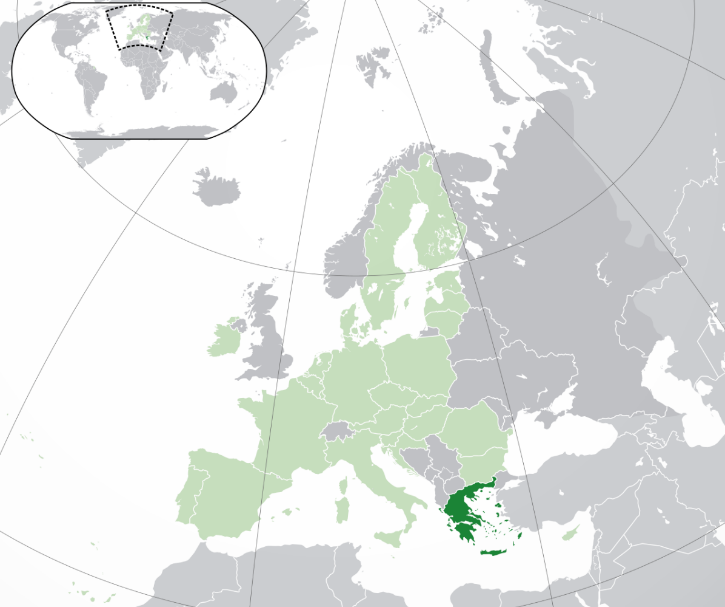

# 概述

[**希腊共和国**](https://zh.wikipedia.org/wiki/希腊)（The Hellenic Republic，1974年12月8日—至今），简称**希腊**（Greece），是位于[欧洲南部](https://zh.wikipedia.org/wiki/欧洲南部)的发达[跨大陆国家](https://zh.wikipedia.org/wiki/跨大陆国家列表)，主体民族为[希腊人](https://zh.wikipedia.org/wiki/希腊人)，官方语言为[希腊语](https://zh.wikipedia.org/wiki/希腊语)，国教为[希腊正教会](https://zh.wikipedia.org/wiki/希腊正教会)，首都为[雅典](https://zh.wikipedia.org/wiki/雅典)。

<figure>
  
  <figcaption style="font-size: 16px; color: gray">希腊位置</figcaption>
</figure>

# 历史

> [希腊历史](https://zh.wikipedia.org/wiki/希腊历史)

## 史前时期

- 希腊为世界上历史最悠久的国家之一，根据考古资料，希腊大约在二十万年前的旧石器时代中期已经有人类聚居，被称作“西方文明的摇篮”。
- 【**新石器时代**】前7000年左右，新石器时代革命开始影响到当时的巴尔干半岛与希腊地区。希腊的原住民彼拉斯齐人（荷马史诗中被提到)被认为可能是属于非印欧语系的民族，他们是希腊最早的居民。
- 【**青铜时代**】约公元前3200年，青铜时代的希腊孕育了欧洲最古老的文明：米诺斯文明（位于克里特岛），基克拉泽斯文明（位于基克拉泽斯群岛）及赫拉斯文明（位于希腊大陆）。公元前1600左右被迈锡尼文明取代，以上统称“爱琴文明”。
- 公元前第2千纪中期起，希腊人逐步向爱琴海（包括克里特岛）的诸岛扩张。
    - 传说发生于小亚细亚地区的特洛伊战争，可能就在希腊人向外扩张的公元前13世纪下半叶或者公元前12世纪初。

- 迈锡尼文明被多利安人取代，之后希腊经历一段黑暗时期，直到公元前9世纪新的希腊城邦诞生，出现荷马史诗等希腊文作品，称为“古风时期”，希腊进入“荷马时代”。
    - 此时希腊城邦在地中海和黑海沿岸纷纷建立起自己的殖民地。

## 城邦时期

- 公元前8世纪中叶至前6世纪末，随着希腊人口的增长和社会经济的发展，殖民范围扩大，在东起黑海东岸，西至今法国的马赛，包括意大利半岛南部和西西里岛的一部分，南达尼罗河口和利比亚，北抵今阿尔巴尼亚亚得里亚海沿岸地区的广大地域内，几十个希腊城邦先后建立了总数逾百的移民区。
- 其中最著名的有林斯人建立的叙拉古，斯巴达人建立的塔连同，迈加拉人建立的拜占庭，米利都人建立的奥尔比亚。
- 希腊在前776年举办第一次奥林匹克运动会

## 波斯时期

- 公元前547年，波斯的居鲁士大帝征服了爱奥尼亚，给这些城邦委任了僭主。
- 约前512年，阿契美尼德王朝以武力迫使马其顿王阿敏塔斯一世成为阿契美尼德王朝的附庸。
- “伊奥尼亚起义”（前499年—前493年）失败，马其顿成为一个在阿契美尼德王朝境内完全的从属国和其行政管理中的一部分。
- 波斯的入侵，促成了马其顿的崛起。
- “**第一次波希战争**”（前492年—前490年），波斯于雅典战败。
    - 后来的“马拉松长跑”就是为了纪念此间的“马拉松战役”。

- “**第二次波希战争**”（前480年—前449年）希腊获胜，波斯帝国从此承认小亚细亚之希腊城邦的独立地位，并且将其军队撤出爱琴海与黑海地区。
    - 西方世界的历史中心由两河流域向地中海地区推移。此后，世界文明发展的格局逐渐形成东西方并立共存之势，一直延续至今。
    - 雅典一跃上升为爱琴海地区的霸主。

- 此时希腊达到其科技文化的高峰，称为“古典时期”。

### 混战时期

- 公元前431-前404年，希腊数百个城邦卷入了规模空前的“希腊世界大战”，战火几乎波及当时整个地中海文明世界。

- 公元前431年，雅典领导的提洛同盟和斯巴达领导的伯罗奔尼撒同盟之间再次爆发战争，史称伯罗奔尼撒战争。雅典民主制结束，取而代之的是斯巴达人支持的寡头政府。但斯巴达人的霸权没能持续太久，希腊城邦就陷入了混战。

### 马其顿王国时期

- 公元前337年马其顿王国腓力二世在科林斯召集各邦开会，宣布希腊各城邦成立联盟，除斯巴达外的全希腊都被迫承认了马其顿的霸权，希腊完成统一。
- 前330年，波斯灭亡，地中海东部中近东地区进入“希腊化时代”。
- 公元前324年初，亚历山大将巴比伦作为新都，建立一个庞大的帝国—马其顿帝国，也称之为亚历山大帝国。
- 前323年，亚历山大逝世，希腊陷入“继业者战争”，帝国分裂为三个比较巩固的希腊化帝国，“安提柯王朝”、“塞琉古王朝”及“托勒密王朝”，这三个国家是希腊帝国后期最强大的帝国。
- 前30年，“托勒密王朝”被罗马帝国征服，希腊进入“罗马化时期”。

## 古罗马帝国时期

- 随着罗马共和国灭亡了安提柯王朝，公元前146年，希腊并入罗马帝国，结束了希腊化时代的动乱，罗马人的统治带来了和平，而希腊文化反过来征服了罗马人的生活。
- 395年，罗马帝国分裂，希腊归东罗马帝国管辖。
- 公元1世纪，希腊东正教会建立起来，塑造了现代希腊的文化认同，并将希腊传统传播至正教世界。
- 1453年5月29日，穆罕默德二世攻克君士坦丁堡，东罗马帝国灭亡。

## 奥斯曼帝国时期

- 1460年，希腊遭到兴起于亚洲西部的伊斯兰教封建军事帝国奥斯曼帝国统治。奥斯曼帝国采用阿尔巴尼亚族省督来统治希腊，用希腊官僚统治罗马尼亚人和斯拉夫人。
- 【**希腊第一共和国**】1814年9月14日，希腊人成立“友谊社”，1821年发动“希腊独立战争”（1821年—1829年），1827年建立“希腊第一共和国”（1827年—1831年），1832年，希腊第一共和国被“希腊王国”取代。

## 希腊王国时期

- 1832年，俄土两国签订了《君士坦丁堡条约》（Treaty of Constantinople），土耳其承认希腊独立。英法俄三大国决定推举巴伐利亚王子奥托一世做希腊王国国王，建立希拉王国，作为现代民族国家被国际社会所承认。
- 1843年，奥托一世被迫答应君主立宪制。
- 【**希腊第二共和国**】1924年，希腊议会通过成立共和国的决议案，乔治二世退位，“希腊第二共和国”（Second Hellenic Republic，1924-1935）建立。
    - 从1924年建立到1935年被推翻的短短11年之间，希腊第二共和国经历了23届政府、1次军事独裁和13次军事政变。
    - 【**第一次复辟**】1935年11月3日，乔治二世重登王位，希腊王国复辟，希腊第二共和国灭亡。

- 1936年，爱奥尼斯·美塔萨克斯发动政变，建立“八月四日体制”。
- 【**希腊国**】1941年德国、义大利和保加利亚入侵希腊，在希腊建立的傀儡国“希腊国”（1941年—1944年）。
- 【**第二次复辟**】1944年，二战完结，希腊国王第二次复辟。
- 【**希腊军政府时期**】1967年12月，希腊末代国王康斯坦丁二世遭军方驱逐，并由军方所指派的摄政王取而代之。1973年，在军政府所主导的公投下，废黜王政。“塞浦路斯问题”最终导致军人政权在1974年的垮台。

## 希腊共和国时期

- 1974年7月，希腊军政府垮台，康斯坦丁二世返国，但是他并未恢复王位。11月举行议会选举，新民主党获胜并执政；12月举行公民投票，有69%的民众赞成终止君主制度，确立国家政体为共和制，希腊王国至此宣告灭亡，走入历史。
- 此后由新民主党和泛希腊社会主义运动（简称泛希社运）轮流执政。
- 1981年希腊正式加入欧洲共同体并在2001年接受欧元作为货币。
- 2009年，希腊国债危机开始受到世界关注。

# 政治

现行宪法于1975年6月11日生效，希腊为资本主义国家，国家体制为“议会共和制”，一院制议会，设有300个席位，为最高立法机关。

立法权属议会和总统，行政权属总理，司法权由法院行使。总统为国家元首，总理和内阁主导着政治进程。总统、总理任期4年，由议会选举产生，可以再连任一次。希腊选举制度为“比例代表制”，政党为多党制。

# 司法

希腊最高司法机构包括最高法院和最高行政法院及检察机构。法院分初级、上诉及最高法院三级。

# 军事

希腊军队由希腊国家防御总指挥负责，军队由希腊陆军，希腊海军，希腊空军组成。管理部门为国防部。

希腊总统是名义上的武装部队最高统帅。总理负责国防政策和部队建设，任最高国防委员会主席。国防部长在总理领导下实施国防政策并管理武装部队。总参谋长主管作战指挥机构。军队受本国和北约双重指挥。

实行义务兵役制，服役期自2010年起由12个月减为9个月。

希军拥有200架以上第四代战机，数百辆德制先进战车和数千辆装甲车辆、20多艘导弹巡防舰，以其国力人口规模来讲属于异常庞大的战力。

# 经济

希腊属欧盟经济中等发达国家之一，经济基础较薄弱，工业制造业较落后。其海运业，旅游、侨汇并列为外汇收入三大支柱。

2010年2月，希腊政府欠债3千亿欧元，导致国家破产，在2011年几乎导致欧元区瓦解。2014年，由于市场担心希腊提前退出欧元区，导致国债收益率飙升，股市暴跌，欧洲债务危机可能爆发。

希腊属于高收入经济体，其生活质量较高，及人类发展指数为极高。

# 文化

希腊还是西方哲学、奥林匹克运动会、西方文学、历史学、政治科学、民主制度、科学和数学原理，以及西方戏剧的发源地。希腊的文化与技术进步对世界历史曾具有极大的影响力，通过亚历山大大帝和罗马帝国传播至东方世界和西方世界。

公元前776年，希腊人规定每4年在奥林匹亚举办一次运动会。

# 外交

希腊积极促进和维护欧洲一体化进程，依托欧盟维护民族独立和国家安全是希腊外交政策的根本出发点。

希腊是欧盟和北约的成员国，联合国创始国之一，反对科索沃独立，支持土耳其加入欧盟。

# 待拆分

## 马其顿王国

### 马其顿概述

马其顿是地处古希腊边陲地区，地处希腊中北部，西接艾普鲁斯，东邻色雷斯。

其民族渊源尚无定论，可能是伊利里亚人、色雷斯人和希腊的多利亚人的混血后裔。

由于偏僻落后，而且行君主制而非民主制，且主要居住于乡村中，因此被其南境外的繁荣的希腊称为没有文化的野蛮人。

马其顿王国（前808年-前168年）。

### 马其顿历史沿革

#### 早期历史

- 公元前808年，卡拉努斯建立阿吉德王朝，实行君主制。
- 公元前382年，阿明塔斯三世统一马其顿。
- 公元前359年，摄政王腓力二世（前359年—前336年）废黜幼主阿敏塔斯四世，自立为王，推行了一系列改革，马其顿迅速崛起，并向希腊各城邦扩张
- 他建立起一支忠于个人的常备军，创造了具有极强打击力的“马其顿方阵”。
- 公元前338年夏，马其顿军与以雅典、底比斯军为首的反马其顿联军决战于中希腊的克罗尼亚，联军惨败。
- 【**称霸希腊**】公元前337年腓力二世在科林斯召集各邦开会，宣布希腊各城邦成立联盟，除斯巴达外的全希腊都被迫承认了马其顿的霸权，并决定进攻波斯。
- 公元前336年，腓力二世被波斯派来的刺客杀死在他女儿的婚礼上。随后，他的儿子，亚历山大（前336年—前323年）继位。

#### 亚历山大时期

- 亚历山大以权谋和武力镇压了希腊人反马其顿运动。
- 【**灭波斯**】
    - 前334年春，亚历山大渡过了赫勒斯滂海峡入侵波斯帝国，亚历山大的军队与波斯王大流士三世的军队在小亚细亚的格拉尼库斯河战役首次展开会战，马其顿军大胜，不到半年即占领小亚细亚。
    - 前333年，亚历山大率军在今叙利亚的伊苏斯平原大败大流士三世亲率的10万多波斯军，俘虏了大流士的母亲、妻子和两个女儿。大流士三世向东溃逃。
    - 前333年亚历山大征服了叙利亚、腓尼基各城市。
    - 前332年攻陷埃及后，在尼罗河三角洲西部，建立亚历山大城。
    - 前331年春季又离开埃及，亚历山大继续东征。渡过幼发拉底河与底格里斯河，在高加米拉战役又战胜大流士三世，大流士三世又东逃。
    - 亚历山大继续前入巴比伦城，取得美索不达米亚。他从巴比伦又东行，进入波斯本土，占领波斯的苏萨与波斯波利斯两个都城，获得大量金银及珠宝后放火焚毁波斯波利斯城，杀戮其居民，以报复前480年波斯王薛西斯一世纵火焚毁雅典城的仇恨。
    - 以后三年间亚历山大又镇压了波斯东北部零星反抗。波斯王大流士三世亦被其部下所杀，波斯灭亡。

- 公元前329年—前327年征服巴克特里亚和马尔吉安娜，并趁机挥师东进印度，战败印度反抗者，征服旁遮普。亚历山大乃把征服的印度部分分为三省并留驻兵而兵分三路西还，将希腊文化和科学自东地中海地区传播至印度河流域。
- 【**亚历山大帝国**】
    - 公元前324年初，亚历山大将巴比伦作为新都，建立一个庞大的帝国—马其顿帝国，也称之为亚历山大帝国。此时马其顿帝国疆域达到顶峰，包含今天的希腊、马其顿、阿尔巴尼亚、保加利亚、罗马尼亚、土耳其、叙利亚、黎巴嫩、以色列、埃及、伊拉克、科威特、伊朗、阿富汗、巴基斯坦、土库曼斯坦、乌兹别克斯坦、塔吉克斯坦的全部或部分领土。
    - 亚历山大帝国是历史上继波斯帝国之后第二个地跨欧、亚、非三洲的帝国，其疆域东自费尔干纳盆地及印度河平原，西抵巴尔干半岛，北从中亚细亚、里海和黑海起，南达印度洋和非洲北部。

#### 帝国瓦解

- 公元前323年6月10日，亚历山大突然患恶性疟疾，发病10天后就离世，年仅33岁。
- 由于死亡的突然降临，亚历山大未明确他的接班人，导致争夺王权的“继业者战争”。在斗争中，他的母亲、妻子与儿女都被反对党杀死。将领们纷纷拥兵自立为王，横跨欧亚非三洲的马其顿王国从此分裂。亚历山大庞大的帝国只存在了短短的13年。
- 帝国分裂为三个比较巩固的希腊化帝国，“安提柯王朝”、“塞琉古王朝”及“托勒密王朝”，这三个国家是希腊帝国后期最强大的帝国。

##### 托勒密王朝

- 部将托勒密占领埃及及叙利亚南部，建立了托勒密王朝；
- 公元前30年，罗马共和国灭亡托勒密帝国。
- 古代希腊的历史随之告终。

##### 塞琉古王朝

- 部将塞琉古占领了小亚细亚、美索不达米亚、叙利亚北部和伊朗高原，公元前312年称王，以叙利亚为中心建立塞琉古王朝，中国古称条支；
- 塞琉西王国全盛时，疆域包括小亚细亚、叙利亚、两河流域、波斯和中亚的部分地区。
- 公元前63年，罗马共和国灭亡塞琉古王朝。

##### 安提柯王朝

- 安提柯的后代则占据马其顿和希腊建立了安提柯王朝。
- 罗马共和国于前168年灭亡安提柯王朝，前146年占领马其顿本土全境，马其顿王国灭亡。

## 希腊化时代

- “希腊化时代”指从公元前330年波斯帝国灭亡到公元前30年罗马征服托勒密王朝为止的一段中近东历史时期，这段时期内地中海东部中近东国家地区原有文明区域的语言、文字、风俗、政治制度等逐渐受希腊文明的影响而形成新的特点，在19世纪30年代以后逐渐被西方史学界称为“希腊化时代”。
- 希腊化时代持续了三百年，在此期间希腊化国家逐渐衰落，并先后为罗马共和国所灭。公元前30年屋大维率军征服埃及，最后一个继业者王国托勒密王朝覆灭，希腊化时代至此结束。

# 相关条目

- [希腊人](https://zh.wikipedia.org/wiki/希腊人)
- [古希腊](https://zh.wikipedia.org/wiki/古希腊)
- [希腊化](https://zh.wikipedia.org/wiki/希腊化)
- [马其顿王国](https://zh.wikipedia.org/wiki/马其顿王国)：马其顿王国（约前800年—前146年间，亚历山大帝国（前336年—前323年）），小亚细亚及希腊地区的国家，被罗马人所灭。