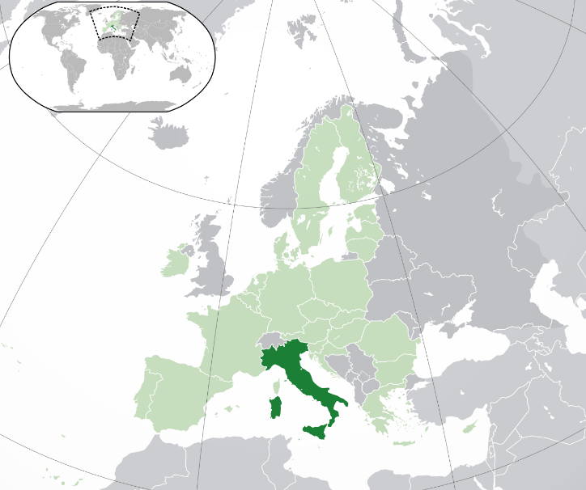
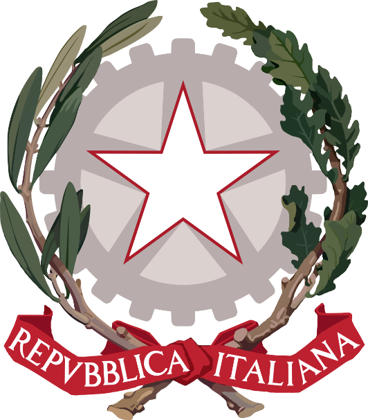

# 概述

[**意大利共和国**](https://zh.wikipedia.org/wiki/意大利)（1946年6月2日—至今），简称**意大利**，是位于[欧洲](https://zh.wikipedia.org/wiki/欧洲)[南部](https://zh.wikipedia.org/wiki/南欧)的[议会制](https://zh.wikipedia.org/wiki/议会制)[民主共和国](https://zh.wikipedia.org/wiki/民主共和制)，主体民族为[罗马人](https://zh.wikipedia.org/wiki/罗马人)，官方语言为[意大利语](https://zh.wikipedia.org/wiki/意大利语)，国教为[天主教](天主教.md)，首都为[罗马](https://zh.wikipedia.org/wiki/罗马)。

  <figure>
    
    <figcaption style="font-size: 16px; color: gray">意大利位置</figcaption>
  </figure>
  <figure>
    
    <figcaption style="font-size: 16px; color: gray">意大利国旗</figcaption>
  </figure>
  <figure>
    
    <figcaption style="font-size: 16px; color: gray">意大利国徽</figcaption>
  </figure>

# 历史

> [希腊历史](https://zh.wikipedia.org/wiki/希腊历史)

## 史前意大利

- 从旧石器时代开始，意大利这片领土上就有人类居住的痕迹。
- 在众多的旧石器时代的遗迹中，最引人注目的当属弗利（艾米利亚—罗马涅大区）的波乔洛山，英塞勒尼亚的松林，在这个考古遗址里，发现人类使用火的痕迹（美国的 SCIENCE 杂志里曾有提到这一发现），还有巴勒莫的阿道拉洞穴，在洞穴的墙壁上发现大量石器时代的人物和动物的雕刻画。新石器时代的人类逐渐从猎人演化为农民或牧人，这一时期的典型是卡穆尼人（在卡莫尼卡山谷）。

## 伊特鲁里亚人和古意大利人

- 关于意大利半岛先罗马时代居民的信息在某种程度上来讲是不完整的并且还在不停的修正。随着几次大的移民浪潮（维尼托人，翁布罗—萨贝利人和拉丁人等等），东欧和中欧地区的印欧人种移民到此，和已经存在于这片土地上的先民兼容并蓄，形成一种和平共处的状态。根据推测，这些移民应该开始于青铜时代中期（就是公元前两千年中期）并一直持续到公元前四世纪。在此期间凯尔特人也渐渐南下到波河平原地区。

## 大希腊

- “大希腊”是指公元前八世纪到公元前六6世纪，古希腊人在意大利半岛南部建立一系列殖民城邦的总称。这其中最著名的当属他林敦。
- 大希腊的诸城邦经常与周围意大利半岛各部族发生战争，另外，他们彼此之间也常有战争。
- 公元前4和前3世纪，大希腊诸城邦遭到叙拉古僭主狄奥尼西奥斯统治。
- 公元前282年他林敦与罗马发生战争,伊庇鲁斯国王皮洛士应他林敦人要求支援。但是他林敦仍然在公元前272年落入罗马人之手，至此大希腊的所有城邦陆续为罗马人占领。
- 大希腊在文学、艺术、建筑等方面对罗马文化发展有着重大影响。大希腊拥有发达的农业、手工业和商业，同时也是著名哲学家芝诺、巴门尼德、毕达哥拉斯等人主要的活动场所。

## 罗马时期

- 从\_\_\_\_到476年西罗马帝国灭亡，意大利被罗马帝国和西罗马帝国统治。详见【罗马帝国】

## 中世纪

- 476年，西罗马帝国被日耳曼人奥多亚塞推翻。
- 直到493年，奥多亚塞又被东哥德国王狄奥多里克推翻。
- 不久，伦巴第人进入意大利，在意大利北部建立伦巴第王国，在意大利南部建立三个公国。
- 罗马教廷受到威胁。
- 751年，伦巴第人占领拉文纳并废黜东罗马帝国的总督，彻底结束拜占庭在意大利半岛上的势力。
- 面对伦巴第人的威胁，教皇请求法兰克国王援助。
- 756年，法兰克国王丕平三世攻入义大利，为受伦巴底人威胁的教皇夺回大权。
- 之后创立教宗国。
- 800年，教皇在圣伯多禄大殿为查理大帝加冕为神圣罗马帝国皇帝。
- 在查理大帝死后（814年），新帝国在其软弱的继任者中瓦解。由于这个，意大利面临权力的真空，而此时伊斯兰正在阿拉伯半岛、北非和中东地区兴起。
- 在南部，意大利受到倭马亚王朝和阿拔斯王朝的攻击。
- 在北部，中世纪公社力量开始兴起。852年，撒拉森人控制巴里并建立酋长国。伊斯兰于902年开始统治西西里。萨拉森人和日耳曼人等都曾侵入过意大利境内。11世纪结束意大利中世纪最黑暗的时期。贸易逐渐发展起来，特别是在沿海出现四个城邦国家，阿马尔菲、比萨、热那亚、威尼斯。
- 在南意大利
  - 1130年，西西里伯爵鲁杰罗二世登基为西西里国王，建立起西西里的诺曼王朝。
  - 1155年，拜占庭皇帝曼努埃尔一世派军队在普利亚登陆，企图入侵意大利南部，但是遭到抵抗。1158年，拜占庭军队撤出意大利。
  - 1189年，西西里国王古列尔莫二世去世，但因其指定的继承人姑母科斯坦察已嫁给神圣罗马帝国皇子海恩里希，不愿被德国人统治的西西里上层贵族没有拥立她，而是拥立古列尔莫的私生堂兄坦克雷迪为王。海恩里希于1191年加冕为皇帝亨利六世后，以科斯坦察的名义要求西西里王位，多次入侵西西里。1194年坦克雷迪去世，亨利六世夺取西西里王位，废黜古列尔莫三世，诺曼王朝结束。

## 文艺复兴

- 意大利文艺复兴开创早期的文艺复兴时代，即从14世纪末期到大约1600年之间，一个具有文化上重大改变与成就的时代。虽然它的起源可以追溯到14世纪早期，意大利文化里的许多面向大致都是中世纪的，而且文艺复兴一直要到这个世纪结束时才整个呈现出来。这个时代最为人熟之的是，在被文艺复兴人文学者称为“黑暗时代”之后，重新对古典的古代的文化产生兴趣。这些改变虽然很有意义，却集中在菁英阶层，绝大多数的人民生活跟中世纪比较起来，几乎没有什么改变。
- 意大利文艺复兴从意大利北部开始，集中在佛罗伦斯。它接著往南传布，对罗马的影响尤其大，而罗马大致上是被文艺复兴教宗们重建的。意大利文艺复兴在15世纪晚期达到全盛时期，当时外国入侵使整个地区陷入混乱。但是，文艺复兴的想法跟理想散布到欧洲其他地方，开启北方文艺复兴与英国文艺复兴。
- 意大利文艺复兴最为人熟知的是文化方面的成就，包括佩脱拉克、卡斯蒂廖内和马基维利的文学作品，艺术家米开朗基罗和达文西，还有伟大的建筑物如佛罗伦斯的圣母百花大教堂和罗马的圣伯多禄大殿。
- 1494年爆发“意大利战争”（1494年—1595年），西欧主要国家入侵意大利城邦及教宗国，这个对意大利北部造成大范围的破坏并且结束许多城邦国家的独立。1559年的《卡托—康布雷齐和约》，在很大程度上改变了意大利的政治地图。此时意大利众多的邦国大体上可分为三种类型：第一种是西班牙统治的邦国和地区；第二种是独立的邦国，第三种是名义上独立实际上依附西班牙的邦国。

## 近代

- 近代时期的意大利主要特征是外国的统治和经济的衰弱。
- 在“意大利战争”结束后，意大利落入西班牙哈布斯堡王朝的控制中。在随后的近三百年间，意大利始终处在被列强争夺的状态。
- 【**第一次统一**】直到1796年，拿破仑入侵意大利，并且建立“意大利王国”，这是意大利近代史上第一个统一的国家（虽然实际上被法国控制）。但在拿破仑战败，1815年维也纳会议召开后，意大利再次陷入分裂。
- 17世纪是意大利历史上的一个动荡时期，其特点是深刻的政治和社会变革。其中包括西班牙对半岛的影响，以及教皇和罗马天主教会在反宗教改革的鼎盛时期，天主教对新教改革的反应。尽管有重要的艺术和科学成就，如伽利略在天文学和物理学领域的发现，以及巴洛克风格在建筑和绘画方面的繁荣，但意大利整体的经济仍然衰退。
- 18世纪意大利。面对法国和西班牙在欧洲大部分地区的霸权威胁，奥地利、英国、荷兰共和国和其他小国家（萨伏伊的公国）在海牙签署了一个大联盟。这个联盟成功地击败了法国-西班牙的“两个王冠”，随后的《乌得勒支和约》和《拉什塔特和约》将大部分意大利（米兰、那不勒斯和撒丁尼亚）的控制权从西班牙转移到奥地利，而西西里则被割让给萨沃伊的公国。

## 统一

- 自从“维也纳会议”将意大利再次置入分裂状态后，意大利人就不断为国家的统一努力。
- 1860年5月5日，加里波第和1000名红衫军从热那亚出发前往西西里岛，并推翻波旁的统治。随后加里波第又胜利的进入帕勒莫。
- 1861年，“意大利王国”成立。
- 直到1870年，罗马城被并入意大利，意大利至此宣告完全统一。

## 王国与法西斯政权

- 意大利独立建国后，其的经济状况较其他西欧国家落后，政局也较为动荡。
- 南北意大利之间巨大的经济差距，迫使不断有南方的意大利人搬迁到北部或前往新大陆。
- 意大利本来与德意志帝国和奥匈帝国之间签订有三国同盟。但在第一次世界大战中，意大利加入协约国一方。但意大利在战后并未完全得到英法应允的土地。由于谈判桌上的失败加上战争为意大利经济和社会带来的巨大冲击，导致国内形势持续不安。法西斯党则利用这一时期崛起掌权。在二战中，意大利站在轴心国的一方。二战战败后，君主制度被废除，取而代之的是意大利共和国的建立。

## 意大利共和国

- 第二次世界大战给意大利带来经济破坏和社会分裂。
- 根据1947年意大利和平条约，东部边境被南斯拉夫吞并。同时，意大利失去所有的海外领地。
- 随着维托里奥·埃马努埃莱三世的退位，他的儿子，新国王翁贝托二世受到意大利是否会进行另外一场内战的压力。一场全民公投发起来决定意大利是否保留君主制或者成为共和国。
- 1946年6月2日，共和派赢得54%的支持。意大利正式成为一个共和国。萨伏依王朝的男性成员被禁止进入意大利，这条禁令直至2002年废除。

# 名称

一般认为意大利这个名称是源自于希腊人传入的奥斯坎语 Víteliú 而来，拥有幼牛之地的意思。“意大利”这个名词第一次出现在希腊作家 Erodoto 的作品中，根据当时一位叫安条克的历史学家，Italia 从前只有用来称呼现在南意大利部分的地区，本指亚平宁半岛南部古布鲁蒂姆地区（拉丁文：Bruttium，现在的卡拉布里亚），再不久，Italia 已经可以视为意大利部落 Oenotria 的同义词，也可以适用于其他地区。希腊人逐渐使用“意大利”这个名称来称呼一个更广大的地区，但是直到罗马人征服整个半岛以后，意大利这个名词才适用于整个亚平宁半岛。

# 政治

意大利宪法规定，意大利是一个建立在劳动基础上的民主共和国。

意大利国会是最高立法和监督机构，采用两院制议会，参、众两院分别有315个和630个席位，参、众议员均由普选产生，国会议员的选举实行比例代表制。

议会选出总统，权力属象征性。总统可以任命国会的人事，是法院的首长，也是意大利军队的总指挥官，总统对外代表国家。

总理由国会议员之中择一提名，经国会两院议决指名，再依此由意大利总统任命。意大利总理正式名称为“部长会议主席”，是意大利共和国的最高行政首长，也是意大利实际的政府首脑，总理任命其他部长的人事，领导各行政机关运作。

意大利实行多党制，各主要政党或党派联盟大多分布在中左和中右两大阵营，主要政党有。

# 司法

最高司法委员会是最高司法权力机构，拥有独立司法体制和任命法官的权力，总统任主席。

意大利宪法法院主要是检查和监督法律条文是否符合宪法，由15名法官组成，任期9年，不得兼职，享有豁免权。此外，还依次设有地方调解法官、初审法院（轻罪）、法庭、初审法院（负责民事和刑事案件）、上诉法院、审计院（主管公共帐目及养老金）等。

# 军事

最高军事机构为最高国防委员会，总统为武装部队最高统帅，总理对国防政策及军队建设负有全部责任。

由于意大利是北约成员，所以在核武器共有的政策下，意大利也拥有90枚美军核武器，存放在格迪托里与阿维亚诺空军基地。

意大利海军目前拥有43,882人和各种舰种，包括航空母舰、驱逐舰、护卫舰、潜艇、两栖攻击舰及其他小型船舰。意大利海军被认为是世界第7强大的海军。

美国在意还设有多处军事基地与设施。

# 经济

意大利是发达工业国，欧洲第四大、世界第八大经济体，拥有高度的人类发展指数，位居世界第28位，超过希腊。

意大利的黄金储备数量为2,451.8公吨，位居世界第4位，仅次于国际货币基金组织、美国与德国，超过法国与中国。

实体经济发达，是欧盟内仅次于德国的第二大制造业强国；中小企业发达，被誉为“中小企业王国”，中小企业数量占企业总数的98%以上；旅游业发达，是世界第五大旅游国。对外贸易是意经济的主要支柱，外贸产值占国内生产总值40%以上。

意大利是世界著名的汽车跑车生产国，相关品牌包括法拉利、兰博基尼、玛莎拉蒂、布加迪（现法国）、阿尔法·罗密欧等。

# 文化

意大利的古文明有显赫一时的古罗马帝国、于公元79年毁于维苏威火山大爆发的庞贝古城、闻名于世的比萨斜塔、文艺复兴的发祥地佛罗伦萨、风光旖旎的水城威尼斯、被誉为世界第八大奇迹的古罗马竞技场。

公元14世纪—15世纪，意大利文艺空前繁荣，成为欧洲“文艺复兴”运动的发源地，但丁、达·芬奇、米开朗基罗、拉斐尔、伽利略等文化与科学巨匠对人类文化的进步作出了无可比拟的巨大贡献。

意大利是世界时尚之都。

意大利被誉为“世界足球王国之一”，曾赢得四届世界杯冠军。意大利足球甲级联赛是欧洲最顶级的足球联赛之一，曾有“小世界杯”的称号。

# 外交

意大利对外政策的基本点是立足西欧，积极推动欧洲一体化进程，主张欧洲应有共同的外交和防务政策；依靠北约，重视同美国的传统关系。

是八国集团及欧洲联盟的成员。

1970年11月6日，意大利与中国建交，关系友好。

意大利是美国传统盟友，战后一直与美国保持密切政治、经济和军事关系。

意大利积极发展与俄罗斯关系，视俄罗斯为世界政治、军事和能源大国，是俄罗斯在欧洲第二、全球第三大贸易伙伴。

# 待拆分

## 罗马帝国

### 罗马王政时代

- “罗马王政时代”（前753年—前509年）是罗马的一个时期，也称这个时期的罗马为“罗马王国”。
- 公元前753年，罗穆路斯成为罗马的第一任国王，罗马王国正式成立。罗穆路斯被罗马人称为国父。罗穆路斯并没有独揽大权，他把权力分成三个机构，分别是国王、元老院和库利亚大会，并由这三方共同治理罗马。作为宗教祭祀、军事和政治的最高领导人，国王由库里亚大会投票选举产生。和许多其他同时代的意大利城邦国家不同，罗马的君主制不完全是世袭的。
- 接下来的三任国王都由库里亚大会选举、或元老院推举产生。
- 第五代国王塔克文·普里斯库斯成为主动竞选罗马国王的第一人，并获得成功。在对外扩张并稳定周边以后，塔克文开始了对罗马的大规模开发，被称为罗马心脏的“罗马公共会场”、“古罗马广场”就这样诞生了，创设了“罗马竞技会”并修建了罗马城墙，罗马一跃成为意大利前所未有的新型城市。
- 塔克文被自己儿子暗杀之后，元老院推举塔克文的养子塞尔维乌斯·图里乌斯作为罗马的第六代国王。塞尔维乌斯建立了“军制=税制=选举制”的制度，并把罗马分为4个城区部落。
- 第五代国王塔克文的儿子“傲慢者塔克文”，杀害了塞尔维乌斯，没经过元老院或公民大会的任命，就擅自当上了第七代国王，并实行独裁统治，暴虐无道。
- 公元前509年，“傲慢者塔克文”被罗马群众放逐在罗马城外，罗马王政时代结束。

### 罗马共和国时期

- 罗马共和国（前509年—前27年）是古罗马在前509年到前27年之间的政体，其正式名称是“元老院与罗马人民”。
- 公元前509年罗马人结束了“罗马王政时代”，建立了罗马共和国，国家由元老院、执政官和部族会议（Comitia Tributa）三权分立。
  - 掌握国家实权的元老院由贵族组成；
  - 执政官由百人队会议从贵族中选举产生，行使最高行政权力；
  - 部族大会由男性平民和男性贵族构成。

- 驱逐国王之后的最初十六年，罗马陷入了长期的所谓骚乱之中。
- 前5世纪-前396，罗马与伊特鲁利亚城邦维爱进行了战争。最终维爱被灭，伊特鲁里亚人一蹶不振，罗马的领土却翻了一倍，成为了意大利中部强国。
- 【**高卢人**】公元前390-前331年，高卢人入侵并夷平罗马城，但后来被击败逐走。此后700多年罗马保持不被外族攻克。
- 【**迦太基**】公元前264年-前146年，罗马和迦太基之间为争夺地中海沿岸霸权发生了三次“布匿战争”，罗马征服了迦太基并使之成为罗马的一个行省—阿非利加行省。
- 【**希腊**】公元前215年-前148年，罗马发动了4次“马其顿战争”。
  - 罗马征服了马其顿并控制了整个希腊，建成一个横跨非洲、欧洲、亚洲，称霸地中海的大国。
  - 公元前192年—前188年，罗马与塞琉古王朝发生“叙利亚战争”，使塞琉古王朝割让小亚细亚给罗马的盟国，进一步确认罗马在希腊的霸权，更使罗马成为地中海唯一的一等强国。

- 【**内乱时代**】公元前2世纪30年代—前1世纪30年代。罗马经历了“内战时代”。
  - 爆发了“西西里奴隶起义”，发生了“格拉古兄弟改革”。
  - 公元前90年，为了争取罗马公民权，意大利人起义，史称“同盟者战争”。
  - 前82年贵族派支持的苏拉率军占领罗马。次年，迫使公民大会选举他为终身独裁官，开创了罗马历史上军事独裁的先例。
  - 前73年，爆发了“斯巴达克斯起义”。

- 【**凯撒**】前60年，克拉苏、恺撒、庞培秘密结盟（“前三头同盟”），共同控制罗马政局。前53年，克拉苏战死于安息。前48年，尤利乌斯·恺撒在内战中击败庞培，被宣布为终身独裁官，集军政大权于一身。
- 凯撒在前58年至前49年期间征服高卢地区，使之成为罗马的高卢行省。
- 公元前44年，凯撒被共和派元老布鲁图与卡西乌斯刺杀，遗嘱指定屋大维为其继承人。
- 【**屋大维**】公元前43年，安东尼、雷必达、屋大维公开结盟（“后三头同盟”），以对抗布鲁图与卡西乌斯。
- 公元前42年，布鲁图与卡西乌斯在“腓力比之战”中兵败自杀。
- 随后，屋大维返回罗马，安东尼则前往埃及，与凯撒的情人托勒密王朝女王克利奥帕特拉七世（埃及艳后）结盟。至此，罗马西属屋大维，东属安东尼。
- 公元前30年，屋大维入侵埃及托勒密王朝，安东尼和女王先后自杀，而女王与凯撒的私生子凯撒里昂被处死，托勒密王朝灭亡。至此，埃及成为罗马的一个行省。
- 公元前27年1月16日，罗马元老院授与屋大维“奥古斯都”（意为“至尊·至高无上”）的尊号，建立元首制。因为其崇高的地位遂得以自行指定继承人，屋大维大权在握成为事实上的皇帝，建立了罗马帝国，但并没有公开称帝，自称“第一公民”。罗马共和时代宣告结束。
- 也有观点主张尤利乌斯·恺撒担任终身独裁官的前44年作为共和国的结束时间。

### 罗马帝国时期

罗马帝国（前27年—1453年，西罗马帝国于476年灭亡，东罗马帝国于1453年灭亡），是以地中海为中心，跨越欧、亚、非三大洲的大帝国，正式名称为元老院与罗马人民，中国史书称为大秦、拂菻。

罗马帝国存在将近一千五百年，帝国的疆域在图拉真在位末年（117年）达到全盛，控制着大约五百万平方公里的土地，统治着七千万的人口，这相当于当时世界总人口的百分之二十一。

罗马皇位的承继方式一般为养子承继制，但也有亲子承继的。罗马多次出现两帝共治，甚至四帝共治。戴克里先创君主制，将皇帝进一步神化。

#### 罗马帝国·元首制

##### 儒略—克劳狄王朝

屋大维家族成员（养子或亲属）成为罗马皇帝的后继者，“儒略—克劳狄王朝”被后世史学家认为是罗马第一个王朝。

罗马人盛行养子继承，每任皇帝间并不一定有直接血缘相关，例如屋大维与其继承者提比略就无血缘，而之所以会被认定为同一王朝，乃是因为其姻亲关系与收养养子，形成同一家族，因此被认定为同一王朝，与中国一家一姓血脉相承的概念是大相迳庭的。

- 公元前27年1月16日，罗马元老院授与屋大维“奥古斯都”尊号，建立元首制，罗马共和时代宣告结束。
- 前19年，征服西班牙全境。
- 前16年起，出兵阿尔卑斯山东部和多瑙河上游，设雷蒂亚和诺里克两个行省，接着又出兵多瑙河中下游，设潘诺尼亚和米西亚两个行省。
- 前12年到5年，逐渐征服了莱茵河到易北河之间的土地，但新征服的土地不断发生暴动。9年，将领瓦鲁斯在镇压日耳曼人起义的条顿堡森林战役中遭伏击而全军覆没，屋大维不得不放弃莱茵河到易北河之间的土地。
- 从此，罗马帝国向西日耳曼的扩张停止，屋大维没有再进行大的征伐，随后的百余年是一段漫长的稳定局面，称之为“罗马和平” 时期。
- 屋大维之后，历经四任皇帝，提比里乌斯（14年—37年）、卡里古拉（37年—41年）、克劳狄乌斯（41年—54年）和尼禄（54年—68年）。
- 68年3月，高卢总督温代克斯与西班牙总督加尔巴起兵造反。5月，温代克斯兵败身亡。此时，元老院宣布尼禄为国家公敌，尼禄在逃亡途中自杀，“儒略—克劳狄王朝”结束。

##### 四帝内乱

- 尼禄死后，元老院承认加尔巴为帝。由于加尔巴年老体衰，无力控制局面，导致各地将领拥兵自重，形成“四帝内乱”。
- 69年1月，下日耳曼总督维特里乌斯称帝；
- 同时加尔巴被部下奥托所杀，奥托自立为帝。3月，维特里乌斯出兵与奥托争夺帝位，奥托战败自杀。
- 7月，正在平定犹太人叛乱的将领维斯帕先被多地军队拥立为帝。10月，维斯帕先击败维特里乌斯，结束了皇位争夺战。

##### 弗拉维王朝

- 69年12月，维斯帕先称帝。
- 弗拉维王朝历经三位皇帝，维斯帕先（69年—79年）、提图斯（79年—81年）、图密善（81年—96年）。
- 73年，维斯帕先平定“第一次犹太战争”（公元66年—73年）。
- 96年，图密善死于宫廷政变，弗拉维王朝结束。

##### 安敦尼王朝

- 96年，图密善死后，元老院推举年老而无嗣的前执政官涅尔瓦为帝，建立“安敦尼王朝”，史称“五贤帝时代”，历经八位皇帝：涅尔瓦（96年— 98年）、图拉真（98年—117年）、哈德良（117年—138年）、安敦尼（138年—161年，143年再任皇帝）、马可·奥勒留（161年—180年，其中161年—169年与维鲁斯共治，177年—180年与康茂德共治）、维鲁斯（161年—169年，与马可·奥勒留共治）、卡修斯（175年）、康茂德（177年—192年，177年—180年与马可·奥勒留共治）。

- **图拉真时代**
  - 从101年起，图拉真率兵入侵达契亚，至106年完全征服，设达契亚行省。
  - 105年，图拉真占领阿拉伯北部，设阿拉伯行省。
  - 114年，图拉真吞并亚美尼亚，设亚美尼亚行省。
  - 116年图拉真率兵占领帕提亚首都泰西封。
  - 116年底，图拉真兵抵波斯湾，他是唯一达到过这里的罗马统帅。
  - 117年，图拉真病重撤军，设亚述和美索不达米亚两个行省。
  - 图拉真在位时期，罗马帝国达到极盛，经济空前繁荣，疆域也达到最大：西起西班牙、高卢与不列颠，东到幼发拉底河上游，南至非洲北部，北达莱茵河与多瑙河一带，地中海成为帝国的内海，全盛时期控制了大约500万平方公里的土地，是世界古代史上国土面积最大的君主制国家之一。

- **哈德良时代**
  - 哈德良在不列颠岛北部修筑了横贯东西的“哈德良长城”，以防御苏格兰的蛮族侵入。
  - 哈德良将元首制过渡到绝对君主制，以皇帝的意志为最高法律，命令法学家编成《永久敕令》，作为帝国的法律基础。
  - 132年，哈德良平定“第二次犹太战争”（公元132年—136年）。

- **安敦尼时代**
  - 安敦尼时代对外收敛边境，大体无事；对内勤政爱民，与元老院关系良好，国库收入极多，罗马享受了20多年的太平盛世。

- **两帝共治时代**
  - 161年，安敦尼去世，帝位由两个养子维鲁斯和马可·奥勒留继承，这是罗马史上第一次两帝共治。
  - 维鲁斯维鲁斯则较平庸。
  - 帕提亚于162年入侵亚美尼亚，维鲁斯经过四年苦战才击退帕提亚人，并于164年至165年间吞并美索不达米亚。
  - 马可·奥勒留是著名的“哲学家皇帝”，是斯多葛派哲学的主要阐述者，著有《沉思录》。
  - 167年，日耳曼人再次入侵，两位皇帝不得不率军征讨。
  - 169年，维鲁斯去世，帝国又恢复了一个皇帝的局面。
  - 175年，将领阿维狄乌斯·卡西乌斯于帝国东方发动叛乱。
  - 平定叛乱后，马可·奥勒留又展开对日耳曼人的战争，试图吞并波西米亚，180年就在即将成功时，马可·奥勒留病死军中。
  - 马可·奥勒留错误地指定其子康茂德为皇位继承人，为“三世纪危机”埋下了伏笔。

- **康茂德时代**
  - 康茂德时代，罗马帝国开始走向没落。
  - 康茂德的统治引起人民不满，许多人都密谋刺杀他，这也促使他变得更加怪僻暴虐。
  - 193年元旦，当康茂德宣布要以角斗士装扮担任当年执政官时，他的情妇给他喝了杯毒酒，随后就被近卫军长官派来的摔跤手谋杀。

##### 五帝之年

- 公元192年康茂德被刺杀身亡，触发“五帝之年”，也称“193年内乱”，有五人同时称帝，分别是佩蒂纳克斯、尤利安努斯、奈哲尔、阿尔拜努斯和塞普蒂米乌斯·塞维鲁，事件最后由塞普蒂米乌斯·塞维鲁取得胜利。
- 康茂德死后，近卫军拥立城市长官佩蒂纳克斯。佩蒂纳克斯积极平息康茂德给帝国带来的负面影响，但当他想整肃军纪时，马上就被近卫军杀死。
- 佩蒂纳克斯死后，近卫军将皇位拍卖给尤利安努斯。但尤利安努斯没有一个追随者，军队更是对他不屑一顾。
- 叙利亚总督奈哲尔率先自立为帝，接着，潘诺尼亚总督、北非人塞维鲁造反，他率领部队急行军，迅速向罗马进发，近卫军士气低落，很快就溃败。元老院转而宣布塞维鲁为皇帝。近卫军为请求塞维鲁的谅解而处死了尤利安努斯。塞维鲁进入罗马后将原来的近卫军以叛国罪的罪名全部处死，并以自己的士兵组成了更为庞大的新近卫军。
- 塞维鲁称帝后，立即和已经称帝的奈哲尔开战，194年，奈哲尔在伊苏斯战败。
- 197年，塞维鲁又在里昂击败造反的不列颠总督阿尔拜努斯，“193年内乱”由此结束。

##### 塞维鲁王朝

- 原潘诺尼亚总督北非人塞普蒂米乌斯·塞维鲁创建塞维鲁王朝。
- 塞维鲁王朝共有5位君主：
  - 塞普蒂米乌斯·塞维鲁
  - 卡拉卡拉、盖塔共同执政（盖塔不久被卡拉卡拉所杀）
  - 马克里努斯
  - 埃拉伽巴路斯
  - 亚历山大·塞维鲁

- 235年军队爆发叛乱，最后一任皇帝亚历山大·塞维鲁被杀。
- 马克西米努斯·色雷克斯即位，结束了塞维鲁王朝。
- 公元235年皇帝亚历山大·塞维鲁被刺杀身亡，导致三世纪危机。

#### 三世纪危机时期

- 亚历山大·塞维鲁被刺杀身亡后，罗马帝国经历了“三世纪危机”，这段时期短短50年之内有26人被元老院封为皇帝。
- 275年，奥勒良在出征萨珊波斯时被杀，元老院立克劳狄·塔西佗为帝，这是最后一次由元老院推举皇帝。
- 公元283年6月，卡鲁斯亲自率兵东征波斯萨珊王朝，一路进展之顺利，到7月时，罗马人攻克波斯首都泰西封，大概是历次罗马东征中最为顺利的一次，卡鲁斯也因这次成功的东征而获得“伟大的波斯征服者”（PersicusMaximus）头衔。东征停止于卡鲁斯皇帝的突然驾崩。
- 284年，近卫军长官戴克里先造反，在贝尔格莱德附近击败了卡里努斯，成为了帝国的统治者。

#### 君主制时期

##### 四帝共治

- 戴克里先称帝后，先平定了内乱。
- 293年，戴克里先开始实施“四帝共治制”，即：帝国东、西两位奥古斯都（正帝）各自任命一位凯撒（副帝），奥古斯都在位20年后必须退位，由原先的两位凯撒继位为奥古斯都，并再各自任命一位凯撒。
  - 实行四帝共治，并不是把帝国分裂成四部分，而是将帝国的防卫任务交给四个人承担。戴克里先的地位在四人中仍是最高的。

- 297年，戴克里先的共治者伽列里乌斯入侵波斯萨珊王朝，298年，占领首都泰西封。
- 303年，在戴克里先统治其间，面对基督教明显的威胁，罗马帝国对基督徒发动有史以来最具组织性的迫害—“戴克里先迫害”。
- 戴克里先在位20年后，于305年退位，同时马克西米安也退位。
- 继位情况
  - 在东方，副帝伽列里乌斯继位，于311年去世后，时任副帝的李锡尼继位，李锡尼统一了东方。
  - 在西方，副帝君士坦丁一世继位。

- 323年，君士坦丁一世彻底击败李锡尼，成为了帝国的唯一统治者，“四帝共治”结束。

##### 君士坦丁王朝

- 这时的罗马帝国仍然是世界上的强权，并与其东面波斯萨珊王朝互相抗衡，持续着一个世纪的纷争。
- 君士坦丁一世任命三个儿子君士坦丁二世、君士坦提乌斯二世、君士坦斯为凯撒，各统治帝国的一部分。
- 自324年起，君士坦丁一世修建新都，并迁都至拜占庭，命名为“新罗马”。但史学家更喜欢以其名字―君士坦丁称之为“君士坦丁堡”。君士坦丁堡自此之后一直是帝国的首都，一直到其终结。其特殊的地理环境和战略地位，是东罗马帝国历经千年不亡的重要原因。

- 君士坦丁一世与基督教
  - 君士坦丁一世是第一位信基督教的皇帝。
  - 313年，君士坦丁一世和李锡尼颁布了《米兰敕令》，宣布基督教合法。
  - 君士坦丁一世的一系列举措为日后基督教在欧洲占据统治地位奠定了基础。

- 337年，君士坦丁大帝病重，死前接受了洗礼。
- 君士坦丁大帝去世后，罗马帝国马上就爆发了争夺帝位的混战，君士坦丁二世、君士坦斯、马格嫩提乌斯（篡位者）先后被杀。353年，君士坦提乌斯二世成为了帝国唯一的统治者。
- **尤利安**
  - 361年，君士坦提乌斯二世的堂弟背教者尤利安造反，君士坦提乌斯二世在征讨尤利安时去世，尤利安取得政权。
  - 尤利安受新柏拉图主义影响，上台后就实行反基督教政策，大力扶助多神教。他大肆攻击基督教，教堂多被焚毁和抢劫，基督徒被赶出军队和学校，他本人还写书攻击基督教。
  - 经济方面，尤利安取得了成功，制止了通货膨胀。
  - 军事方面，他击败了日耳曼人，并入侵波斯萨珊王朝。
  - 363年，尤利安阵亡。

- 即位的约维安取消了尤利安的反基督教政策。

##### 瓦伦丁尼安王朝

- 364年，约维安去世，多瑙河军官瓦伦提尼安一世被军队立为皇帝。
- 瓦伦提尼安一世把帝国东部分给弟弟瓦伦斯。瓦伦提尼安一世驻军米兰，瓦伦斯驻军君士坦丁堡。376年，瓦伦提尼安一世去世，瓦伦提尼安二世即位。378年，瓦伦斯在哈德良堡与哥特人的作战中阵亡。
- 随后帝国由格拉提安和狄奥多西一世共治，由格拉提安被叛军所杀。

##### 狄奥多西王朝

- 393年，狄奥多西一世宣布基督教为国教，基督教从而成为西方世界的主要宗教。狄奥多西一世反对一切异教和异端，关闭多神教的神庙，新建基督教教堂。他认为古奥运会有违基督教教旨，是异教徒的活动，于是宣布废止古奥运会。
- 394年，狄奥多西一世击败了西部的篡位者欧根尼乌斯后，成为了帝国的唯一统治者，这也是罗马帝国最后一次统一。
- 395年，狄奥多西一世于米兰去世，他将帝国分为东西两部分，东部分给长子阿卡迪乌斯，西部分给幼子霍诺里乌斯。至此，罗马帝国正式分裂为东罗马帝国和西罗马帝国。
- 自此之后罗马帝国永久分裂。

##### 西罗马帝国（395年—476年）

- 西罗马帝国（英语：Western Roman Empire），正式名称与东罗马帝国相同，均用罗马共和时代的“元老院与罗马人民”（Senatus Populusque Romanus），定都米兰。
- 西罗马帝国相继被日耳曼人等外族入侵，罗马城多次遭洗劫。
- 475年日耳曼人欧瑞斯特赶走西罗马帝国皇帝尼波斯，扶植自己的儿子罗慕路斯·奥古斯都为西罗马帝国皇帝。
- 476年日耳曼人奥多亚塞杀死欧瑞斯特，废黜罗慕路斯·奥古斯都，自立为意大利国王，这也象征了西罗马帝国的覆亡。
- 西罗马帝国的灭亡标志着西欧奴隶制的崩溃，西欧历史从此揭开了新的一页。
- 随着西罗马帝国的灭亡，欧洲历史进入到“中世纪”时期。

#### 西罗马帝国继承

- 在476年后三个并立政府出现，有以下势力号称自己是罗马正统的政府：
  - 前任被放逐的皇帝尼波斯，他控制达尔马提亚直到480年被杀；
  - 割据在高卢北部的行省，该省长直到487年被杀前仍效忠罗马；
  - 北非的罗马—阿兰行省，该地同时臣服于汪达尔人，直到533年拜占廷打败汪达尔人，才重回罗马的管辖。

- 西罗马帝国灭亡以后，东罗马帝国曾经收复部分原西罗马帝国土地，但最后意大利被日耳曼的伦巴底人所攻陷。
- 773年丕平三世的儿子查理大帝包围了伦巴底首都 Ticinum（今帕维亚），并俘获了伦巴底国王狄西德里乌斯，结果查理大帝兼任法兰克和伦巴底国王，伦巴底人对义大利的统治自此结束。
- 800年，教皇利奥三世在罗马为查理曼加冕为“罗马人的皇帝”，承认查理曼帝国为罗马帝国的继承者。843年，查理曼之子、虔诚者路易的三个儿子签订《凡尔登条约》，帝国分裂成三部分。
- 962年，东法兰克王国国王奥托一世在罗马被教皇约翰十二世加冕为罗马帝国皇帝，随即罗马教廷承认神圣罗马帝国为西罗马帝国的继承者。后来，拜占廷帝国也承认了它的这一地位。直到1806年，拿破仑一世勒令弗朗茨二世于8月6日放弃神圣罗马皇帝尊号，仅保留奥地利皇帝称号，神圣罗马帝国瓦解为奥地利帝国、莱茵邦联等，宣告解体。
- 东罗马帝国则一直存在至1453年，君士坦丁堡被土耳其人攻陷、皇帝君士坦丁十一世战死为止。史学家会称东罗马帝国为拜占庭帝国。
- 1460年，东罗马帝国在摩里亚的领土被奥斯曼帝国占领。1461年，奥斯曼帝国灭亡特拉布松帝国。至此，东罗马帝国永远退出历史舞台。
- 1472年莫斯科大公伊凡三世迎娶了东罗马末代皇帝君士坦丁十一世的侄女索菲娅宣称其继承了东罗马的正统，莫斯科公国将东罗马的国教引入公国。至今，俄罗斯仍是全球东正教的中心。
- 1547年，伊凡四世由东正教大主教马卡里为其加冕而称帝，他就是俄国的第一个沙皇。沙皇一词就来源于拉丁语中的“凯撒”，暗示其血统纯正。同时，为了时刻提醒世人自己是东罗马的合法继承者，他们以“第三罗马”自居，并将罗马帝国和神圣罗马帝国使用的双头鹰标志加入到了沙皇标志中。

##### 拜占庭帝国（395年—公元1453年）

拜占廷帝国（英语：Byzantine Empire），即“东罗马帝国”，正式名称与西罗马帝国相同，均用罗马共和时代的“元老院与罗马人民”（Senatus
Populusque Romanus），定都君士坦丁堡（今土耳其伊斯坦布尔），共历经12个朝代，93位皇帝，是欧洲历史上最悠久的君主制国家。

拜占庭帝国位于欧洲东南部，领土曾包括欧亚非三大洲的亚洲西部和非洲北部。

色雷斯、希腊和小亚细亚西部是帝国的核心地区；今日的土耳其、希腊、保加利亚、北马其顿、阿尔巴尼亚从4世纪至13世纪是帝国领土的主要组成部分；意大利和原南斯拉夫的大部、伊比利亚半岛南部、叙利亚、巴勒斯坦、埃及、利比亚、突尼斯、今阿特拉斯山脉以北的阿尔及利亚和今天摩洛哥的丹吉尔也在7世纪之前曾是帝国的国土。

为了与同样自称为罗马帝国的神圣罗马帝国区分开，在1453年帝国灭亡前，西欧人将其称为“拜占廷帝国”。

###### 建立初期

东罗马帝国基本上避免了西罗马帝国于三世纪和四世纪所遭遇的劫难。

首先，东罗马的城市文化已经相当成熟了。其次，民族大迁徙时，蛮族入侵的主要吸引力在于罗马的财富。狄奥多西二世加强了君士坦丁堡的城墙，使得这座城市成为外族攻不破的城市。476年，当西罗马帝国灭亡时，东罗马帝国的利奥一世与西哥特人谈判，他结束了西哥特人对东部帝国的威胁。

查士丁尼一世（527年—565年）是古罗马时代末期最重要的一位统治者，他的统治期一般被看作是罗马帝国历史从古典时期迈向中古世纪的的重要过渡期。

- 532年，圣索非亚大教堂（Hagia Sophia 意为神圣的真理）开始动工。这座教堂将成为拜占廷宗教生活和东正教的中心。
- 重编了古罗马的法规，制定了《查士丁尼法典》。
- 535年—554年，发动征伐亚平宁半岛上的东哥特王国，收复了它在西部丧失的部分总督区：亚平宁半岛、利比亚、突尼斯、今阿特拉斯山脉以北的阿尔及利亚和今天摩洛哥的丹吉尔和伊比利亚半岛最南端。
- 540年—562年，波斯萨珊王朝侵入罗马，占领、劫掠和摧毁了叙利亚的安条克。
- 541年—542年，发生“查士丁尼瘟疫”，拜占庭帝国人口下降明显。
- 554年，拜占廷帝国在卡西利努姆战役中击败了法兰克王国，国力达到了鼎盛态势。
- 在541年到600年，地中海沿岸爆发了数次大规模的瘟疫。拜占廷帝国南部的黎凡特、北非地区不断爆发叛乱。
- 由于帝国的重兵集结在东部边境，以对抗萨珊王朝，因此斯拉夫人（542年）、阿瓦尔人（557年）得以从帝国的西北部趁虚而入，穿越了多瑙河。

###### 第一次中衰与希腊化

- 查士丁尼一世给他的继承人留下了一个空空的国库，而他的继承人也无法对付所有边境上突然出现的新敌人。
  - 615年，阿瓦尔汗国的军队风卷残云般攻入了帝国境内，并一直进逼到离君士坦丁堡仅数里之遥的地方。
  - 在亚洲，东罗马帝国则遭到了中古波斯地区的萨珊王朝的进攻。611年，萨珊王朝占领了卡帕多细亚，接着占领了东罗马帝国东部的累范特地区最富庶的叙利亚，以及帝国第三大城市安提阿，并且在618年入侵了巴勒斯坦，619年占领了埃及，并于621年将埃及完全占领，将最神圣的基督教文物“真十字架”残片掳掠而去。
  - 斯拉夫人占领了巴尔干半岛的大部分地区，摧毁了多瑙河以南的帝国防务体系。
  - 西哥特人（418年—711年）对帝国属地发动全面进攻，624年将罗马的力量逐出伊比利亚半岛。
  - 东哥特人随即在意大利发动叛乱，伦巴底人于568年入侵亚平宁半岛占领了意大利北部，并建立了伦巴第王国。
  - 此时原东罗马帝国四分之三的领土已经丧失掉，为了帝国的生存，罗马帝国向陈兵于首都城外的外族缴纳保护费，这导致，626年阿瓦尔人把军队开到了君士坦丁堡的金门，洗劫了布拉基奈宫。

- 541年春天的“大瘟疫”给帝国造成了第一次毁灭性的打击，瘟疫起自尼罗河沼地，消灭了帝国三分之一的人口。541年秋天，瘟疫消失了，然而在此后70年里又多次爆发，毁掉了东罗马帝国的赋税和兵员来源，使东罗马帝国的货币处于崩溃的边缘。
- 希拉克略一世时代，帝国希腊化终于完成，希腊语被指定为唯一的官方语言。他不用古罗马的皇帝头衔“奥古斯都”为主头衔，而使用 “君主”（希腊语 “Basileus”）。
- 希拉克略后来收复了这些以前丧失的东部总督区，但伊斯兰教下统合起来的以贝都因人为主体的的伊斯兰哈里发之突然出现是希拉克略无法意料到的。
  - 634年在约旦附近摧毁了波斯萨珊王朝的军队，并迅速占领了叙利亚、巴勒斯坦，640年完全占领埃及，并出兵波斯地区彻底灭亡萨珊王朝。
  - 678年，阿拉伯舰队直扑君士坦丁堡城下，结果近三分之二的舰只毁于罗马帝国的“海洋之火”（十字军称“希腊火”，阿拉伯人称“罗马火”）。在退却中，又先后遭到暴风雨的袭击和东罗马海军的追击，几乎全军覆没。
  - 718年，利奥三世击退了伊斯兰哈里发军队对君士坦丁堡的第三次大围攻，使其元气大伤，数年内不敢对东罗马用兵。
  - 从9世纪中叶起，阿拉伯人再也不能越过托罗斯山脉。

- 希拉克略王朝末期，帝国再度出现内乱，从694年到716年的22年间，皇帝更换了6次。
- 8世纪最大的问题是对利奥三世发起的“圣像破坏运动”的争论，9世纪初运动重现，843年再次被制止。这些争论使得当时已经与东部离心离德的天主教和神圣罗马帝国未能重新与东罗马帝国统一起来。
- 746年，近东发生的大瘟疫蔓延到帝国全境，罗马人和希腊人的死亡人数甚为巨大。
- 到8世纪初期，帝国的情况已经濒于无政府状态，北非全部落入穆斯林手中，帝国的疆域也只剩下到君士坦丁堡城及其周围地区、东色雷斯、希腊的几个港口、南部意大利和西西里岛。
- 从8世纪末期起，帝国加速收复被斯拉夫人占领的巴尔干地区；从9世纪中叶起，东罗马帝国在东方重新向亚美尼亚的边境发动征战。
- 伊琳娜女皇弄瞎了作为法定继承人的儿子君士坦丁六世的眼睛，将其关入修道院，自己成为第一个大权独揽的东罗马女皇，导致教宗良三世在800年把法兰克国王查理大帝加冕为“罗马人的皇帝”，使西方帝国有了与东罗马帝国分庭抗礼的借口。

###### 黄金时代与突厥人危机

其顿王朝（866年—1057年）的开国皇帝巴西尔一世堪称第二个查士丁尼，在他和其他马其顿王朝皇帝的统治下，拜占廷帝国在
9、10和11世纪初达到了它的顶峰，开创了东罗马帝国历史上第二个最辉煌的时期，被称为“黄金时期”。

- 巴西尔一世获得亚得里亚海的制海权，占领了亚平宁半岛的一部分和攻占了保加利亚第一帝国的大部分。
- 1014年，巴西尔二世（绰号为“保加利亚人屠夫”）彻底打败了保加利亚人，并最终于1018年占领了保加利亚第一帝国。
- 巴西尔二世的统治下，东罗马帝国的疆域达到了自查士丁尼一世之后从未有过的规模，主宰了亚美尼亚、南意大利，整个巴尔干半岛也重新成为帝国的领土。
- 巴西尔二世帝国的皇权再次陷入混乱，皇权最终掌握在科穆宁一系。
- 1071年，突厥语族的塞尔柱帝国占领了小亚细亚，亚洲领土的丧失标志著东罗马帝国丧失了最大的兵力来源地。

###### 科穆宁中兴

- 阿莱克修斯登基时最大的外患，除了与君士坦丁堡一衣带水的突厥人，便是占据南意大利的诺曼人霸主罗伯尔·吉斯卡尔。
- 1081年，吉斯卡尔与帝国展开“底耳哈琴会战”，进而占据了帝国重要的贸易站科孚岛，更进逼帝国重镇帖撒罗尼迦，将新帝逼入穷途绝路。阿莱克修斯向威尼斯人和神圣罗马帝国求助，逼退吉斯卡尔。

- 1096年，为了抵抗塞尔柱帝国，阿莱克修斯向西方罗马天主教教宗求援，爆发“第一次十字军东征”，收复了尼西亚。后来，凭借十字军的力量，罗马帝国最终消灭诺曼人王国。
- 东罗马帝国从阿莱克修斯一世之后的中兴局面迅速跌落下来，落入全面衰落的深渊。到12世纪后期，原来雄踞东地中海的东罗马帝国几乎只剩下一个空壳，其军力、国力和人力已不足以应付四面受敌的局面，令边境防线濒临崩溃。
- 1204年第四次十字军东征，威尼斯人获得了领导权，攻克并洗劫了君士坦丁堡，他们建立了一个短期的封建王国（拉丁帝国）。
- 1261年他们收复君士坦丁堡（伊斯坦布尔），战败了伊庇鲁斯，恢复了帝国。
- 当奥斯曼帝国建立后除一些港口城市外拜占廷帝国几乎所有的其他地方都被奥斯曼帝国占领了。
- 1453年5月29日，奥斯曼帝国攻陷了君士坦丁堡，末代皇帝君士坦丁十一世战死，历时一千余年的东罗马帝国就此灭亡，长达1480年的罗马帝国也正式终结。
- 随着东罗马帝国的灭亡，欧洲历史结束了“中世纪”时期。
- 1461年东罗马帝国末代王族统治的特拉比松也被穆罕默德二世占领了。至此，所有拜占廷领地均彻底丧失。

# 相关条目

- [罗马人](https://zh.wikipedia.org/wiki/罗马人)
- [罗马帝国](https://zh.wikipedia.org/wiki/罗马帝国)：罗马帝国（前27年—1453年，西罗马帝国于476年灭亡，东罗马帝国（即拜占庭帝国 395年—1453年），是以地中海为中心，跨越欧、亚、非三大洲的大帝国。
- [意大利统一](https://zh.wikipedia.org/wiki/意大利统一)
