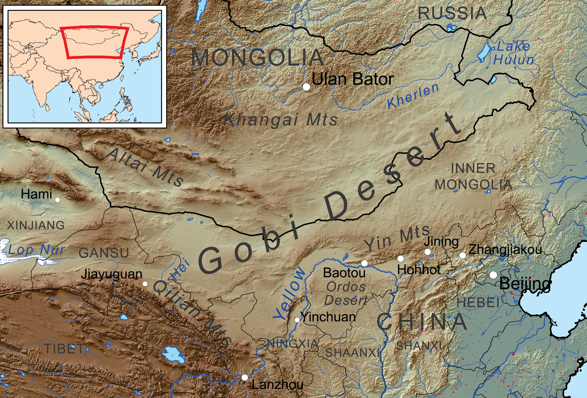

# 戈壁沙漠

[**戈壁沙漠**](https://zh.wikipedia.org/wiki/戈壁)，又称**大漠**、**戈壁**、**戈壁滩**，是位于[蒙古国](https://zh.wikipedia.org/wiki/蒙古国)南部和[中华人民共和国](中华人民共和国.md)北部的一片广袤的寒冷沙漠和草原地区，是[世界第六大沙漠](https://zh.wikipedia.org/wiki/荒漠面积列表)。[漠南](https://zh.wikipedia.org/wiki/漠南)、[漠北](https://zh.wikipedia.org/wiki/漠北)、[漠西](https://zh.wikipedia.org/wiki/漠西)以此分界。

<figure>
  
  <figcaption style="font-size: 16px; color: gray">戈壁沙漠</figcaption>
</figure>

自从[秦朝](https://zh.wikipedia.org/wiki/秦朝)起，“大漠”一词就经常在史书中出现。[汉朝](汉朝.md)时[汉武帝](https://zh.wikipedia.org/wiki/汉武帝)派大将军[卫青](https://zh.wikipedia.org/wiki/卫青)成功控制漠南及[河西走廊](https://zh.wikipedia.org/wiki/河西走廊)，将[匈奴](匈奴.md)赶到[漠北](https://zh.wikipedia.org/wiki/漠北)。后来[霍去病](https://zh.wikipedia.org/wiki/霍去病)深入漠北至[狼居胥山](<https://zh.wikipedia.org/wiki/肯特山_(蒙古国)>)，[漠南](https://zh.wikipedia.org/wiki/漠南)从此作为北方胡族及南方汉人政权的缓冲区。

[北魏](https://zh.wikipedia.org/wiki/北魏)把[柔然](https://zh.wikipedia.org/wiki/柔然)驱出“[漠南](https://zh.wikipedia.org/wiki/漠南)”。[清朝政府](https://zh.wikipedia.org/wiki/清朝政府)把漠北蒙古称为[喀尔喀蒙古](https://zh.wikipedia.org/wiki/喀尔喀蒙古)，至[民国](https://zh.wikipedia.org/wiki/中华民国)时期[外蒙古独立](https://zh.wikipedia.org/wiki/外蒙古独立)；而[漠南蒙古](漠南蒙古.md)所在的地域则演变为今[内蒙古自治区](https://zh.wikipedia.org/wiki/内蒙古自治区)。

这里作为今天内蒙古自治区和[蒙古国](https://zh.wikipedia.org/wiki/蒙古国)分界的“大漠”就是戈壁沙漠。
