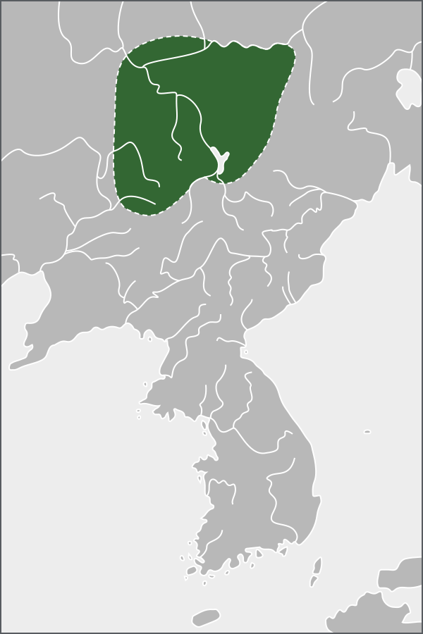

# 扶余国

## 消歧义

> [扶馀消歧义](https://zh.wikipedia.org/wiki/扶馀)

**扶馀**可以指：

- [扶余市](https://zh.wikipedia.org/wiki/扶余市)，中国吉林省一个县级市，于2013年设立
  - [扶余市 (1987年－1992年)](<https://zh.wikipedia.org/wiki/扶余市_(1987年－1992年)>)，中国吉林省历史上曾经存在的一个县级市，于1992年撤销
  - [扶余县](https://zh.wikipedia.org/wiki/扶余县)，中国吉林省历史上曾经存在的一个县，于2013年撤销
  - [扶余区](https://zh.wikipedia.org/wiki/扶余区)，中国吉林省历史上曾经存在的一个市辖区，于1995年更名为[宁江区](https://zh.wikipedia.org/wiki/宁江区)
- [扶馀郡](https://zh.wikipedia.org/wiki/扶餘郡)，韩国忠清南道的一个郡
- [扶余国](https://zh.wikipedia.org/wiki/扶馀国)，又称北扶余，扶余人在前2世纪于中国东北部建立的一个部落国家
  - [东扶余](https://zh.wikipedia.org/wiki/东扶余)，中国东北东部、朝鲜半岛西北部、俄罗斯滨海边疆区历史政权，与夫馀国混称
  - [卒本扶馀](https://zh.wikipedia.org/wiki/卒本扶餘)，即中国东北和朝鲜半岛历史政权高句丽的前身，自称继承自夫馀国
  - [南扶余](https://zh.wikipedia.org/wiki/南扶余)，即朝鲜半岛西南部历史政权百济的别称，自称继承自夫馀国
  - [扶馀姓](https://zh.wikipedia.org/wiki/扶餘姓)，复姓，据称出自扶余王室，百济王室姓氏
  - [扶馀府](https://zh.wikipedia.org/wiki/扶餘府)，中国东北和朝鲜半岛历史政权渤海国在夫馀故地设置的府

## 概述

[**扶余国**](https://zh.wikipedia.org/wiki/扶余国)（前2世纪—494年），是[**中国历史支线**](中国朝代.md#中国历史支线)之一，又称**夫余**、**扶馀**、**北扶余**，是[中国东北地区](https://zh.wikipedia.org/wiki/中国东北地区)第一个有史可考的国家，

疆域鼎盛时覆盖今吉林中部、辽宁北部及黑龙江中南部。前期王城位于今吉林市，后期西迁至今农安县一带。

<figure>
  
  <figcaption style="font-size: 16px; color: gray">夫馀国在3世纪时的版图</figcaption>
</figure>

## 历史

- 扶余人祖先可追溯到[濊貊](濊貊.md)。
- 前2世纪在今吉林市建国。
- 扶余自[汉朝](汉朝.md)以来成为了[中原王朝](https://zh.wikipedia.org/wiki/中原王朝)的[朝贡国](https://zh.wikipedia.org/wiki/朝貢)，被视作[东夷](https://zh.wikipedia.org/wiki/东夷)之一。
- [东汉](https://zh.wikipedia.org/wiki/东汉)到[三国](三国.md)时期为鼎盛时期。
- **亡国**
  - [晋](晋朝.md)[太康](<https://zh.wikipedia.org/wiki/太康_(西晋)>)六年（285年），[扶余国](扶余国.md)被[慕容](https://zh.wikipedia.org/wiki/慕容部)[鲜卑](鲜卑.md)灭亡，扶余王[依虑](https://zh.wikipedia.org/wiki/依虑王)战败自杀，国人逃入[沃沮](https://zh.wikipedia.org/wiki/沃沮)故地，建立[东扶余](https://zh.wikipedia.org/wiki/东扶余)。
  - [晋](晋朝.md)[永和](<https://zh.wikipedia.org/wiki/永和_(东晋)>)二年（346年），[东扶余](https://zh.wikipedia.org/wiki/东扶余)被[慕容](https://zh.wikipedia.org/wiki/慕容部)[鲜卑](鲜卑.md)打败，王城迁至今农安县。
  - [北魏](https://zh.wikipedia.org/wiki/北魏)[太和](<https://zh.wikipedia.org/wiki/太和_(北魏)>)十八年（494年），[勿吉](https://zh.wikipedia.org/wiki/勿吉)攻取[东扶余](https://zh.wikipedia.org/wiki/东扶余)，夫余王**率众逃入高句丽**，东夫余灭亡。
