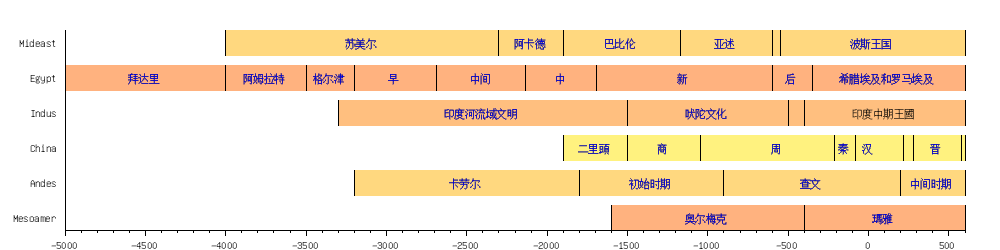

# 概述

[**文明摇篮**](https://zh.wikipedia.org/wiki/文明的摇篮)是指[文明](https://zh.wikipedia.org/wiki/文明)诞生的地方。[新月沃土](https://zh.wikipedia.org/wiki/新月沃土)（[古埃及](https://zh.wikipedia.org/wiki/古埃及)和[美索不达米亚](两河流域.md)）、[古印度](https://zh.wikipedia.org/wiki/印度河流域文明)、[中国](中国.md)，被视为世界上首先诞生出文明的地方，但他们之间有多紧密的关系尚未明朗。

# 时间线

  <map name="timeline_8v15liz9lz1emx5r5dd6xbbevdsciui"
    ><area
      href="https://zh.wikipedia.org/wiki/%E7%91%AA%E9%9B%85%E6%96%87%E6%98%8E"
      coords="847,209,916,230"
      title="玛雅文明"
      alt="玛雅文明" /><area
      href="https://zh.wikipedia.org/wiki/%E5%A5%A5%E5%B0%94%E6%A2%85%E5%85%8B%E6%96%87%E6%98%8E"
      coords="653,209,756,230"
      title="奥尔梅克文明"
      alt="奥尔梅克文明" /><area
      href="https://zh.wikipedia.org/wiki/%E5%8F%A4%E7%A7%98%E9%AD%AF%E6%99%82%E4%BB%A3%E5%8A%83%E5%88%86"
      coords="878,174,981,195"
      title="古秘鲁时代划分"
      alt="古秘鲁时代划分" /><area
      href="https://zh.wikipedia.org/wiki/%E6%9F%A5%E6%96%87%E6%96%87%E5%8C%96"
      coords="775,174,844,195"
      title="查文文化"
      alt="查文文化" /><area
      href="https://zh.wikipedia.org/wiki/%E5%8F%A4%E7%A7%98%E9%AD%AF%E6%99%82%E4%BB%A3%E5%8A%83%E5%88%86"
      coords="597,174,700,195"
      title="古秘鲁时代划分"
      alt="古秘鲁时代划分" /><area
      href="https://zh.wikipedia.org/wiki/%E5%B0%8F%E5%8C%97%E6%96%87%E6%98%8E"
      coords="421,174,507,195"
      title="小北文明"
      alt="小北文明" /><area
      href="https://zh.wikipedia.org/wiki/%E6%99%8B%E6%9C%9D"
      coords="908,139,961,160"
      title="晋朝"
      alt="晋朝" /><area
      href="https://zh.wikipedia.org/wiki/%E6%B1%89%E6%9C%9D"
      coords="840,139,893,160"
      title="汉朝"
      alt="汉朝" /><area
      href="https://zh.wikipedia.org/wiki/%E7%A7%A6%E6%9C%9D"
      coords="816,139,869,160"
      title="秦朝"
      alt="秦朝" /><area
      href="https://zh.wikipedia.org/wiki/%E5%91%A8%E6%9C%9D"
      coords="749,139,801,160"
      title="周朝"
      alt="周朝" /><area
      href="https://zh.wikipedia.org/wiki/%E5%95%86%E6%9C%9D"
      coords="635,139,687,160"
      title="商朝"
      alt="商朝" /><area
      href="https://zh.wikipedia.org/wiki/%E4%BA%8C%E9%87%8C%E9%A0%AD%E6%96%87%E5%8C%96"
      coords="549,139,635,160"
      title="二里头文化"
      alt="二里头文化" /><area
      href="https://zh.wikipedia.org/wiki/%E5%90%A0%E9%99%80%E6%96%87%E5%8C%96"
      coords="653,104,756,125"
      title="吠陀文化"
      alt="吠陀文化" /><area
      href="https://zh.wikipedia.org/wiki/%E5%8D%B0%E5%BA%A6%E6%B2%B3%E6%B5%81%E5%9F%9F%E6%96%87%E6%98%8E"
      coords="403,104,556,125"
      title="印度河流域文明"
      alt="印度河流域文明" /><area
      href="https://zh.wikipedia.org/wiki/%E5%9F%83%E5%8F%8A%E5%8E%86%E5%8F%B2"
      coords="793,69,979,90"
      title="埃及历史"
      alt="埃及历史" /><area
      href="https://zh.wikipedia.org/wiki/%E5%8F%A4%E5%9F%83%E5%8F%8A%E5%90%8E%E6%9C%9F"
      coords="763,69,816,90"
      title="古埃及后期"
      alt="古埃及后期" /><area
      href="https://zh.wikipedia.org/wiki/%E6%96%B0%E7%8E%8B%E5%9C%8B%E6%99%82%E6%9C%9F"
      coords="655,69,708,90"
      title="新王国时期"
      alt="新王国时期" /><area
      href="https://zh.wikipedia.org/wiki/%E4%B8%AD%E7%8E%8B%E5%9C%8B%E6%99%82%E6%9C%9F"
      coords="532,69,585,90"
      title="中王国时期"
      alt="中王国时期" /><area
      href="https://zh.wikipedia.org/wiki/%E7%AC%AC%E4%B8%80%E4%B8%AD%E9%97%B4%E6%97%B6%E6%9C%9F"
      coords="444,69,513,90"
      title="第一中间时期"
      alt="第一中间时期" /><area
      href="https://zh.wikipedia.org/wiki/%E6%97%A9%E7%8E%8B%E6%9C%9D%E6%99%82%E6%9C%9F_(%E5%9F%83%E5%8F%8A)"
      coords="366,69,419,90"
      title="早王朝时期 (埃及)"
      alt="早王朝时期 (埃及)" /><area
      href="https://zh.wikipedia.org/wiki/%E6%A0%BC%E5%B0%94%E6%B4%A5%E6%96%87%E5%8C%96"
      coords="284,69,370,90"
      title="格尔津文化"
      alt="格尔津文化" /><area
      href="https://zh.wikipedia.org/wiki/%E9%98%BF%E5%A7%86%E6%8B%89%E7%89%B9%E6%97%B6%E6%9C%9F"
      coords="212,69,314,90"
      title="阿姆拉特时期"
      alt="阿姆拉特时期" /><area
      href="https://zh.wikipedia.org/wiki/%E6%8B%9C%E8%BE%BE%E9%87%8C%E6%96%87%E5%8C%96"
      coords="99,69,185,90"
      title="拜达里文化"
      alt="拜达里文化" /><area
      href="https://zh.wikipedia.org/wiki/%E4%BC%8A%E6%9C%97%E6%AD%B7%E5%8F%B2"
      coords="818,34,921,55"
      title="伊朗历史"
      alt="伊朗历史" /><area
      href="https://zh.wikipedia.org/wiki/%E4%BA%9A%E8%BF%B0"
      coords="689,34,758,55"
      title="亚述"
      alt="亚述" /><area
      href="https://zh.wikipedia.org/wiki/%E5%B7%B4%E6%AF%94%E4%BC%A6"
      coords="576,34,662,55"
      title="巴比伦"
      alt="巴比伦" /><area
      href="https://zh.wikipedia.org/wiki/%E9%98%BF%E5%8D%A1%E5%BE%B7%E5%B8%9D%E5%9B%BD"
      coords="485,34,571,55"
      title="阿卡德帝国"
      alt="阿卡德帝国" /><area
      href="https://zh.wikipedia.org/wiki/%E8%8B%8F%E7%BE%8E%E5%B0%94"
      coords="316,34,402,55"
      title="苏美尔"
      alt="苏美尔" /></map
  >

# 相关条目

- [四大文明古国](四大文明古国.md)
- [两河文明](两河文明.md)
