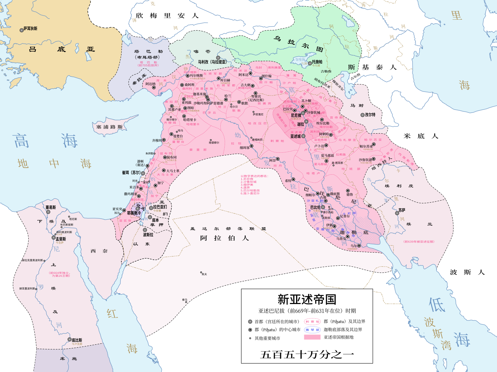

# 概述

[**新亚述帝国**](https://zh.wikipedia.org/wiki/新亚述帝国)（前911年—前609年），是古[亚述](亚述.md)历史的第四阶段。始于公元前911年[阿达德尼拉里二世](https://zh.wikipedia.org/wiki/阿达德尼拉里二世)即位，在公元前9至7世纪间成为截至当时最大的帝国，成功并吞了[巴比伦尼亚](https://zh.wikipedia.org/wiki/巴比伦尼亚)、[古埃及](古埃及.md)、[乌拉尔图](https://zh.wikipedia.org/wiki/乌拉尔图)和[埃兰](https://zh.wikipedia.org/wiki/埃兰)，称霸[近东](https://zh.wikipedia.org/wiki/近东)及[南高加索](https://zh.wikipedia.org/wiki/南高加索)、[北非](https://zh.wikipedia.org/wiki/北非)和[东地中海](https://zh.wikipedia.org/wiki/东地中海地区)的部分地区。[提格拉特帕拉沙尔三世](https://zh.wikipedia.org/wiki/提格拉特帕拉沙尔三世)在位时期，帝国达到极盛。

新亚述帝国承接[中亚述帝国](https://zh.wikipedia.org/wiki/中亚述帝国)。[弗赖伊](https://zh.wikipedia.org/wiki/理查德·纳尔逊·弗赖伊)等学者认为新亚述帝国是**人类历史上第一个真正的帝国**。在这一时期[亚拉姆语](https://zh.wikipedia.org/wiki/亚拉姆语)和[阿卡德语](https://zh.wikipedia.org/wiki/阿卡德语)成为帝国的官方语言。

<figure>
  
  <figcaption style="font-size: 16px; color: gray">新亚述帝国在亚述巴尼拔（前669-前631）时期的疆域、影响范围。</figcaption>
</figure>

# 历史

- 公元前612年，[新巴比伦帝国](https://zh.wikipedia.org/wiki/新巴比伦帝国)联合米底人，攻陷亚述首都[尼尼微](https://zh.wikipedia.org/wiki/尼尼微)，新亚述帝国解体。
- 公元前609年，新亚述帝国灭亡。

# 相关条目
