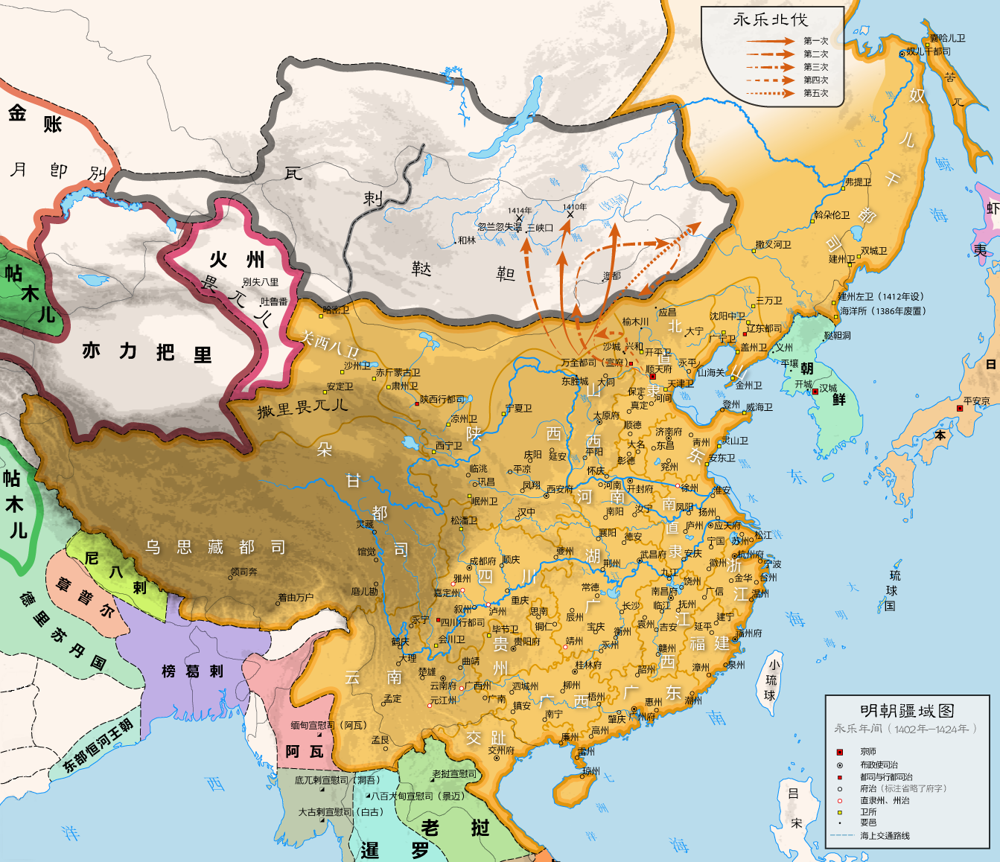

# 概述

[**明朝**](https://zh.wikipedia.org/wiki/明朝)（1368年1月23日—[1644年4月25日](https://zh.wikipedia.org/wiki/甲申之变 "甲申之变")），是[中国历史主线](中国朝代.md#中国历史主线)之一，是最后一个由汉族统治的帝制王朝，国号**大明**，国君姓氏**朱**，历经12代16帝，国祚277年。

<figure>
  
  <figcaption style="font-size: 16px; color: gray">永乐时期的明朝疆域图</figcaption>
</figure>

# 历史

- 1368年1月23日，[朱元璋](https://zh.wikipedia.org/wiki/朱元璋)于[应天府](<https://zh.wikipedia.org/wiki/应天府_(明朝)>)（今江苏南京）称帝，建立**大明**。
- 1402年7月13日，[ 靖难之役](https://zh.wikipedia.org/wiki/靖難之役)结束，[朱棣](https://zh.wikipedia.org/wiki/朱棣)登基，[永乐盛世](https://zh.wikipedia.org/wiki/永乐盛世)开始，明朝走向极盛时期。
- 1449年9月1日，[土木堡之变](https://zh.wikipedia.org/wiki/土木堡之变)，明朝对外政策由攻势转为防御，开始明中叶时期。
- 1644年4月25日，[甲申之变](https://zh.wikipedia.org/wiki/甲申之變)，[李自成](https://zh.wikipedia.org/wiki/李自成)攻占北京，[朱由检](https://zh.wikipedia.org/wiki/朱由檢)自缢，明朝灭亡。

# 君主世系

> [明朝皇帝世系图](https://zh.wikipedia.org/wiki/明朝皇帝世系图)
>
> [明朝君主列表](https://zh.wikipedia.org/wiki/明朝君主列表)
