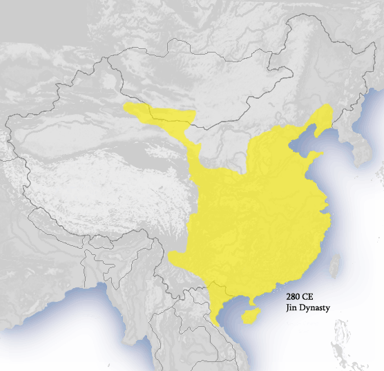
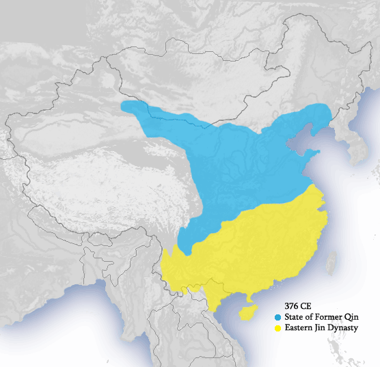

# 概述

[**晋朝**](https://zh.wikipedia.org/wiki/晋朝)（266年2月4日—420年7月10日）是[中国历史主线](中国-朝代.md#中国历史主线)之一，分为[西晋](https://zh.wikipedia.org/wiki/西晋)与[东晋](https://zh.wikipedia.org/wiki/东晋)时期，合称**两晋**，国号**晋**，国君姓氏**司马**，历经5代15帝，国祚155年。

- [**西晋**](https://zh.wikipedia.org/wiki/西晋)（266年2月4日—316年12月11日），是[晋朝](晋朝.md)的前半部分，与后来的东晋合称**两晋**，国号**晋**，国君姓氏**司马**，历经3代4帝，国祚51年。
- [**东晋**](https://zh.wikipedia.org/wiki/东晋)（[317年4月6日](https://zh.wikipedia.org/wiki/衣冠南渡 "衣冠南渡")—420年7月10日），是[晋朝](晋朝.md)的后半部分，与之前的西晋合称**两晋**，国号**晋**，国君姓氏**司马**，历经4代11帝，国祚104年。

<figure>
  
  <figcaption style="font-size: 16px; color: gray">西晋疆域图（280年）</figcaption>
</figure>

<figure>
  
  <figcaption style="font-size: 16px; color: gray">
    
376年疆域图

    
蓝色：前秦疆域

    
黄色：东晋疆域

  </figcaption>
</figure>

# 历史

> [晋朝历史](https://zh.wikipedia.org/wiki/晋朝历史)

## 西晋

- 晋朝由三国中最强大的[曹魏](https://zh.wikipedia.org/wiki/曹魏)的显赫家族[司马氏](https://zh.wikipedia.org/wiki/司马氏)建立。250年后，司马氏历[司马懿](https://zh.wikipedia.org/wiki/司馬懿)、[司马师](https://zh.wikipedia.org/wiki/司馬師)与[司马昭](https://zh.wikipedia.org/wiki/司馬昭)父子三人经营下实际控制了曹魏军权，成为政权的实际统治者。
- 266年2月，[司马炎](https://zh.wikipedia.org/wiki/司馬炎)代魏称帝，改国号曰“晋”，定都洛阳，是为晋武帝，西晋正式建立。
- 280年，晋武帝出兵灭孙吴，三国统一，中国再次统一。
- 西晋统一之初出现了短暂的繁荣时期，被称为“太康之治”。
- 晋武帝死后，发生[八王之乱](https://zh.wikipedia.org/wiki/八王之乱)，进而导致[五胡乱华](https://zh.wikipedia.org/wiki/五胡乱华)，中国再一次陷入分裂。
- 311年[汉赵](https://zh.wikipedia.org/wiki/汉赵)皇帝刘聪攻入洛阳，[晋怀帝](https://zh.wikipedia.org/wiki/晋怀帝)被掳后被杀，[晋愍帝](https://zh.wikipedia.org/wiki/晋愍帝)司马邺在[长安](https://zh.wikipedia.org/wiki/长安)继位，不久长安亦被汉赵攻陷，西晋灭亡。

## 东晋

- 因[五胡乱华](https://zh.wikipedia.org/wiki/五胡乱华)，导致西晋[晋怀帝](https://zh.wikipedia.org/wiki/晉懷帝)与[晋愍帝](https://zh.wikipedia.org/wiki/晉愍帝)先后被俘杀。
- 317年，琅琊王[司马睿](https://zh.wikipedia.org/wiki/晉元帝)在群臣拥戴下在建康（今南京）即位，即[晋元帝](https://zh.wikipedia.org/wiki/晉元帝)，史称东晋。
- 东晋与先前三国时期的东吴以及其后的[宋](https://zh.wikipedia.org/wiki/刘宋)、[齐](https://zh.wikipedia.org/wiki/南齐)、[梁](https://zh.wikipedia.org/wiki/南朝梁)、[陈](<https://zh.wikipedia.org/wiki/陳_(南朝)>)，合称为[**六朝**](https://zh.wikipedia.org/wiki/六朝)。
- 东晋虽然是司马氏政权的延续，但司马氏在政治上威望不高。
- 同时北方有多个游牧民族建立政权并连年征战，史称[五胡十六国](https://zh.wikipedia.org/wiki/五胡十六国)时期。
- 376年，[前秦](https://zh.wikipedia.org/wiki/前秦)灭掉[代国](<https://zh.wikipedia.org/wiki/代_(十六国)>)，统一北方，南北分立之势从此而成。
- 383年，东晋在[淝水之战](https://zh.wikipedia.org/wiki/淝水之战)中击败前秦，之后前秦力量衰弱，因此原本统一的北方再次分裂为多国，东晋成功北伐，疆域一度达至黄河以南。
- 420年，[刘裕](https://zh.wikipedia.org/wiki/宋武帝)篡位建立[刘宋](https://zh.wikipedia.org/wiki/劉宋)，开启[南北朝](https://zh.wikipedia.org/wiki/南北朝)时代，东晋亡。

# 君主世系

> [晋朝皇帝世系图](https://zh.wikipedia.org/wiki/晋朝皇帝世系图)
>
> [晋朝君主列表](https://zh.wikipedia.org/wiki/晋朝君主列表)
