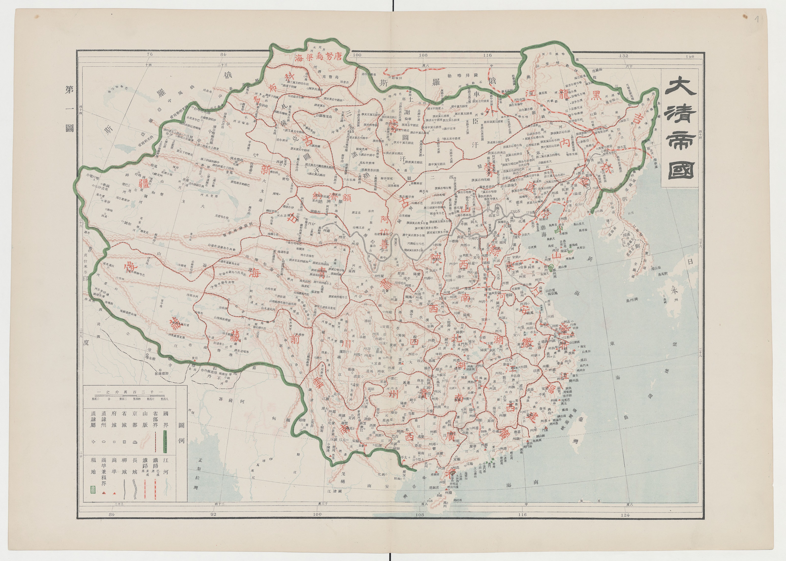

# 概述

[**清朝**](https://zh.wikipedia.org/wiki/清朝)（[1636年5月15日](https://zh.wikipedia.org/wiki/皇太極#建立大清 "皇太极称帝建立大清")或[1644年6月6日](https://zh.wikipedia.org/wiki/清朝#清兵入关 "清兵入关并迁都顺天府")—[1912年2月12日](https://zh.wikipedia.org/wiki/宣统帝退位诏书 "宣统帝退位")），是[中国历史主线](中国朝代.md#中国历史主线)之一，前身为[后金](后金.md)，是由[满族](满族.md)建立的大一统朝代，为中国历史上最后一个帝制王朝。国号**大清**，国君姓氏[**爱新觉罗**](https://zh.wikipedia.org/wiki/爱新觉罗氏)。历经9代11帝，国祚277年（自1636年皇太极称帝起算）；或者历经8代10帝，国祚269年（自1644年清兵入关迁都北京起算）。

<figure>
  
  <figcaption style="font-size: 16px; color: gray">1905年清朝官方公布的全国地图</figcaption>
</figure>
# 历史

> [清朝历史](https://zh.wikipedia.org/wiki/清朝历史)
>
> [模板:清朝历史事件](https://zh.wikipedia.org/wiki/Template:清朝历史事件)

## 立国

- [皇太极](皇太极.md)称帝之前的历史详见[后金](后金.md)。
- 1616年2月17日，[努尔哈赤](https://zh.wikipedia.org/wiki/努尔哈赤)称汗，建立[**后金**](后金.md)，定都[赫图阿拉](https://zh.wikipedia.org/wiki/赫图阿拉城)（今辽宁抚顺新宾）。
- 1636年5月15日，[皇太极](皇太极.md)称帝，改国号为[**大清**](清朝.md)，定都[盛京](https://zh.wikipedia.org/wiki/盛京城)（今辽宁沈阳）。
- 顺治元年（1644年），[吴三桂](https://zh.wikipedia.org/wiki/吴三桂)降清，[多尔衮](https://zh.wikipedia.org/wiki/多尔衮)率清兵入山海关，并迁都[顺天府](https://zh.wikipedia.org/wiki/顺天府)（今北京）。

## 巩固与盛世

- [三藩之乱](https://zh.wikipedia.org/wiki/三藩之乱)
- [文字狱](https://zh.wikipedia.org/wiki/文字狱)
- [迁界令](https://zh.wikipedia.org/wiki/迁界令)
- [施琅攻台](https://zh.wikipedia.org/wiki/澎湖海战)
- [雅克萨之战](https://zh.wikipedia.org/wiki/雅克萨之战)

## 中期改革

- [罗卜藏丹津](https://zh.wikipedia.org/wiki/罗卜藏丹津)叛乱
- [军机处](https://zh.wikipedia.org/wiki/军机处)

## 鼎盛与危机

- [康乾盛世](https://zh.wikipedia.org/wiki/康乾盛世)
  - [准噶尔之役](https://zh.wikipedia.org/wiki/准噶尔之役)
    - [三征噶尔丹](https://zh.wikipedia.org/wiki/准噶尔之役)
    - [准噶尔灭族](https://zh.wikipedia.org/wiki/准噶尔灭族)
  - [乾隆下江南](https://zh.wikipedia.org/wiki/乾隆下江南)
  - [大小和卓之乱](https://zh.wikipedia.org/wiki/大小和卓之乱)
  - [四库全书](https://zh.wikipedia.org/wiki/四库全书)
- [嘉道中衰](https://zh.wikipedia.org/wiki/嘉道中衰)

## 开启近代

- [虎门销烟](https://zh.wikipedia.org/wiki/虎门销烟)
- [鸦片战争](https://zh.wikipedia.org/wiki/鸦片战争)
  - [ 第一次鸦片战争](https://zh.wikipedia.org/wiki/第一次鸦片战争)
  - [第二次鸦片战争](https://zh.wikipedia.org/wiki/第二次鸦片战争)
- [太平天国](https://zh.wikipedia.org/wiki/太平天国)（1851年—[1864年7月19日](https://zh.wikipedia.org/wiki/天京之役 "湘军攻破太平天国首都天京")）
- [辛酉政变](https://zh.wikipedia.org/wiki/辛酉政变)
- [洋务运动](https://zh.wikipedia.org/wiki/洋务运动)
- [同治中兴](https://zh.wikipedia.org/wiki/同治中興)
  - [丁戊奇荒](https://zh.wikipedia.org/wiki/丁戊奇荒)
  - [1887年黄河决口](https://zh.wikipedia.org/wiki/1887年黄河决口)

## 双半社会的形成

- [甲午战争](甲午战争.md)
  - [旅顺大屠杀](https://zh.wikipedia.org/wiki/旅顺大屠杀)
  - [马关条约](https://zh.wikipedia.org/wiki/马关条约)
- [瓜分中国狂潮](https://zh.wikipedia.org/wiki/瓜分中國)
- [戊戌变法](https://zh.wikipedia.org/wiki/戊戌变法)
- [义和团运动](https://zh.wikipedia.org/wiki/义和团运动)
- [八国联军侵华](https://zh.wikipedia.org/wiki/八国联军之役)
  - [辛丑条约](https://zh.wikipedia.org/wiki/辛丑条约)

## 清末时期

- [清末新政](https://zh.wikipedia.org/wiki/清末新政#影响)（1901年1月29日—[1912年2月12日](https://zh.wikipedia.org/wiki/宣统帝退位诏书 "宣统帝退位")）
  - [立宪运动](https://zh.wikipedia.org/wiki/立宪运动)
  - [清朝责任内阁列表](https://zh.wikipedia.org/wiki/清朝责任内阁列表)
  - [新建陆军](https://zh.wikipedia.org/wiki/新建陆军)
- [辛亥革命](辛亥革命.md)
  - [武昌起义](武昌起义.md)
- 1912年2月12日，[宣统帝](https://zh.wikipedia.org/wiki/宣統帝)[退位](https://zh.wikipedia.org/wiki/宣统帝退位诏书)，清朝灭亡。

# 君主世系

> [清朝皇帝世系图](https://zh.wikipedia.org/wiki/清朝皇帝世系图)
>
> [清朝君主列表](https://zh.wikipedia.org/wiki/清朝君主列表)
>
> [模板:清朝君主](https://zh.wikipedia.org/wiki/Template:清朝君主)

# 皇族身世

```
道光
├── 奕𬣞（咸丰帝，道光第四子） ──→ 载淳（同治帝，咸丰独子，无子）
└── 奕譞（醇亲王，道光第七子）
    ├── 载湉（光绪帝，无子）
    └── 载沣
        └── 溥仪（宣统帝）
```

- 清朝最后两位皇帝[光绪帝](光绪帝.md)和[宣统帝](https://zh.wikipedia.org/wiki/溥仪)都出自[载沣](https://zh.wikipedia.org/wiki/载沣)一脉，都由[慈禧太后](慈禧太后.md)册立。
  - 实际都是为了维护[慈禧太后](慈禧太后.md)家族（[叶赫那拉氏](https://zh.wikipedia.org/wiki/叶赫那拉氏)）的政治地位。
  - 立光绪帝是为了能继续当太后
  - 立宣统帝是为了自己的亲外甥女（[隆裕太后](https://zh.wikipedia.org/wiki/隆裕太后)）能当太后

- [**奕譞**](https://zh.wikipedia.org/wiki/奕譞)
  - [奕譞](https://zh.wikipedia.org/wiki/奕譞)和[咸丰帝](https://zh.wikipedia.org/wiki/咸丰帝)都是[道光帝](ttps://zh.wikipedia.org/wiki/道光帝)的儿子，为同父异母兄弟。
  - [光绪帝](光绪帝.md)和[载沣](https://zh.wikipedia.org/wiki/载沣)都是[奕譞](https://zh.wikipedia.org/wiki/奕譞)的儿子，为同父异母兄弟。

- [**光绪帝**](光绪帝.md)
  - [同治帝](https://zh.wikipedia.org/wiki/同治帝)无子而崩，主政的[慈安太后](https://zh.wikipedia.org/wiki/慈安太后)、[慈禧太后](慈禧太后.md)选择**载湉**过继给[咸丰帝](https://zh.wikipedia.org/wiki/咸丰帝)，继承同治帝的皇位。
  - **载湉**的生母，是[慈禧太后](慈禧太后.md)的亲妹妹。
  - **载湉**的皇后（即[隆裕太后](https://zh.wikipedia.org/wiki/隆裕太后)）的父亲，是[慈禧太后](慈禧太后.md)的亲弟弟[桂祥](https://zh.wikipedia.org/wiki/桂祥)。
- [**宣统帝**](https://zh.wikipedia.org/wiki/溥仪)
  - [光绪帝](光绪帝.md)无子而崩，[慈禧太后](慈禧太后.md)选择**溥仪**过继给[同治帝](https://zh.wikipedia.org/wiki/同治帝)和[光绪帝](光绪帝.md)，[兼祧](https://zh.wikipedia.org/wiki/兼祧)两房，继承光绪帝的皇位。
  - **溥仪**是[载沣](https://zh.wikipedia.org/wiki/载沣)的儿子，[奕譞](https://zh.wikipedia.org/wiki/奕譞)的的孙子。
  - **溥仪**的生母，是[慈禧太后](慈禧太后.md)的养女[幼兰](https://zh.wikipedia.org/wiki/嫡福晋瓜尔佳氏)。

# 国号

- [**金**](后金.md)：1616年2月17日，[努尔哈赤](https://zh.wikipedia.org/wiki/努尔哈赤)称汗，建立**后金**。
- [**大清**](清朝.md)：1636年5月15日，[皇太极](皇太极.md)称帝，改国号为**大清**。
- [**中国**](中国名称.md)：1689年9月7日《[尼布楚条约](尼布楚条约.md)》，首次将**中国**作为**正式国家名称**使用。

# 相关条目

- [模板:清末政治团体](https://zh.wikipedia.org/wiki/Template:清末政治团体)
