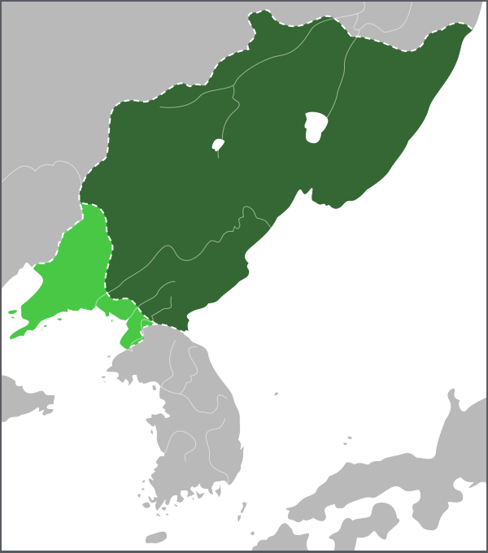

# 概述

[**渤海国**](https://zh.wikipedia.org/wiki/渤海国)（698年—926年），是[**中国历史支线**](中国朝代.md#中国历史支线)之一，是中国东北地区以[粟末靺鞨](https://zh.wikipedia.org/wiki/粟末靺鞨)部为主多民族王国，建国者为[粟末靺鞨](https://zh.wikipedia.org/wiki/粟末靺鞨)首领[大祚荣](https://zh.wikipedia.org/wiki/大祚荣)。

国都：

- [敖东城](https://zh.wikipedia.org/wiki/敖东城)（今吉林敦化市，698—742）
- [显德府](https://zh.wikipedia.org/wiki/显德府)（今吉林延边和龙市，742—756）
- [龙泉府](https://zh.wikipedia.org/wiki/龍泉府)（今黑龙江牡丹江宁安市，756—926）

<figure>
  
  <figcaption style="font-size: 16px; color: gray">渤海国</figcaption>
</figure>

# 历史

- [武则天](武则天.md)[圣历](https://zh.wikipedia.org/wiki/圣历)元年（698年），[粟末靺鞨](https://zh.wikipedia.org/wiki/粟末靺鞨)首领[大祚荣](https://zh.wikipedia.org/wiki/大祚荣)，在[敖东城](https://zh.wikipedia.org/wiki/敖东城)（今吉林敦化市）自称**震王**，建立**震国**。
- 大祚荣多次遣使向[长安](https://zh.wikipedia.org/wiki/长安)称臣，[唐玄宗](https://zh.wikipedia.org/wiki/唐玄宗)[先天](<https://zh.wikipedia.org/wiki/先天_(年号)>)二年（713年），唐赐封大祚荣为“[渤海郡王](https://zh.wikipedia.org/wiki/渤海郡王)”，大祚荣将国号改为**渤海**。
- 926年，渤海国被[契丹国](辽朝.md)所灭。

# 后裔

- 称帝的政权
  - [兴辽](https://zh.wikipedia.org/wiki/兴辽) 1029年-1030年
  - [大渤海](https://zh.wikipedia.org/wiki/大渤海)（大元） 1116年
- 称王的政权
  - [定安国](https://zh.wikipedia.org/wiki/定安国) 938年-1003年
  - [兀惹](https://zh.wikipedia.org/wiki/兀惹)（乌舍城渤海） 981年-996年之后
  - [日本](https://zh.wikipedia.org/wiki/日本)学者日野开三郎在其著述《定安国考》中描述的后渤海
    - 渤海（[后渤海](https://zh.wikipedia.org/wiki/后渤海)）928年-976年
    - 渤海（[大光显](https://zh.wikipedia.org/wiki/大光显)之势力） 930年-934年
    - 渤海（[再兴渤海](https://zh.wikipedia.org/wiki/再兴渤海)） 989年-1018年
- 其他渤海国遗民所建立政权
  - [大鸾河](https://zh.wikipedia.org/wiki/大鸾河)之势力979年-984年

# 君主世系

> [渤海国君主列表](https://zh.wikipedia.org/wiki/渤海国君主列表)
