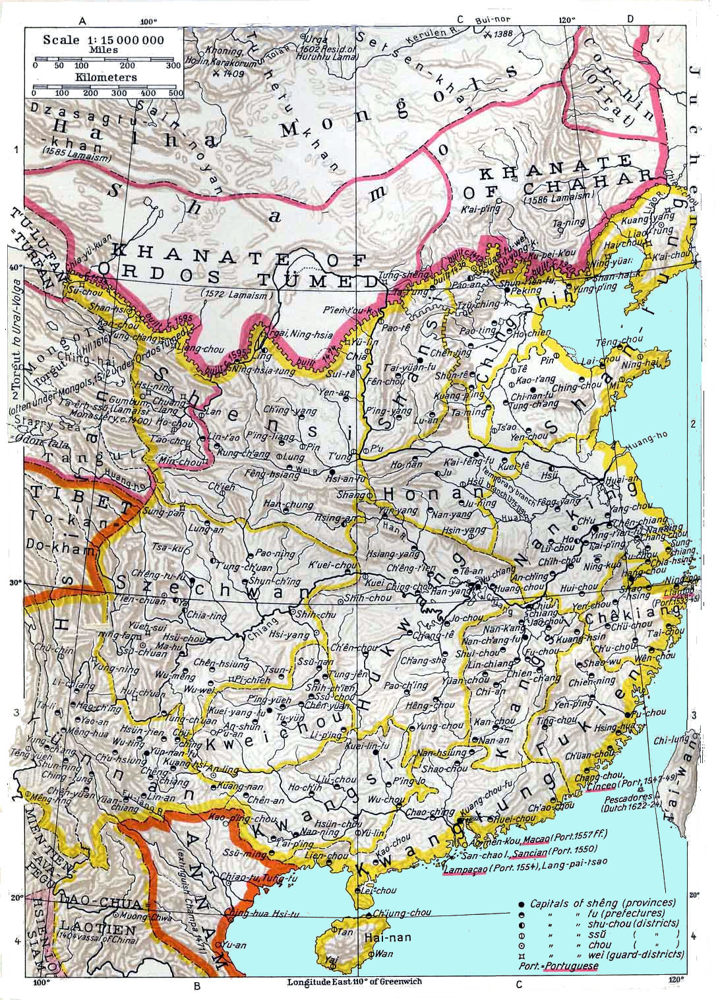

# 漠南蒙古

[**漠南蒙古**](https://zh.wikipedia.org/wiki/漠南蒙古)，是现代中文语境对明末居住于[大漠](戈壁沙漠.md)以南的[蒙古族](蒙古族.md)诸部的称谓，其居住地域大概为今[内蒙古自治区](https://zh.wikipedia.org/wiki/内蒙古自治区)（不包括北部的[呼伦贝尔](https://zh.wikipedia.org/wiki/呼伦貝爾部)及[西套蒙古](https://zh.wikipedia.org/wiki/西套蒙古)）。

<figure>
  
  <figcaption style="font-size: 16px; color: gray">明末时期，长城以北漠南蒙古的左右翼</figcaption>
</figure>
