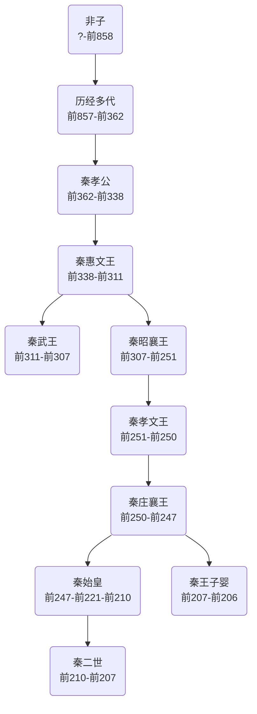

# 秦国

## 概述

> 关于中国第一个大一统朝代，详见[秦朝](秦朝.md)。

[**秦国**](https://zh.wikipedia.org/wiki/秦国)（前770年—前221年）是**中国历史支线**之一、[秦朝](秦朝.md)支线之一，是[战国时期](战国时期.md)的[诸侯国](https://zh.wikipedia.org/wiki/诸侯国)，国君为嬴姓，赵氏。

<figure>
  
  <figcaption style="font-size: 16px; color: gray">秦国（前260年）</figcaption>
</figure>

## 历史

- 据《史记·秦本纪》记载，秦人的先祖，为[三皇五帝](三皇五帝.md)时期[颛顼](颛顼.md)高阳氏苗裔、[东夷](https://zh.wikipedia.org/wiki/东夷)[少昊](https://zh.wikipedia.org/wiki/少昊)部族分支，是[大业](<https://zh.wikipedia.org/wiki/大业_(上古人物)>)之子[伯益](https://zh.wikipedia.org/wiki/伯益)。
- 前905年(周孝王六年)，[周孝王](https://zh.wikipedia.org/wiki/周孝王)因秦祖先[非子](https://zh.wikipedia.org/wiki/非子)善养马，因此将其封于“[秦（秦邑）](https://zh.wikipedia.org/wiki/秦邑)”（在今甘肃省天水市境内），作为[周朝](周朝.md)的[附庸](https://zh.wikipedia.org/wiki/附庸 "附庸，地位相当于诸侯")。
- 前770年(周平王元年)，[秦襄公](https://zh.wikipedia.org/wiki/秦襄公)受封[伯爵](https://zh.wikipedia.org/wiki/伯爵)位，列为[诸侯](https://zh.wikipedia.org/wiki/诸侯国)，秦国创立。
- 前325年(周显王四十四年)，[秦惠文王](https://zh.wikipedia.org/wiki/秦惠文王)称王。
- 前288年(周赧王二十七年)，[秦昭襄王](秦昭襄王.md)自称西帝。
- 前221年，秦王[嬴政](https://zh.wikipedia.org/wiki/秦始皇)统一六国建立[秦朝](秦朝.md)，称皇帝。
- 后续历史详见[秦朝](秦朝.md)。

## 君主世系

> [秦国君主世系图](https://zh.wikipedia.org/wiki/秦国君主世系图)

