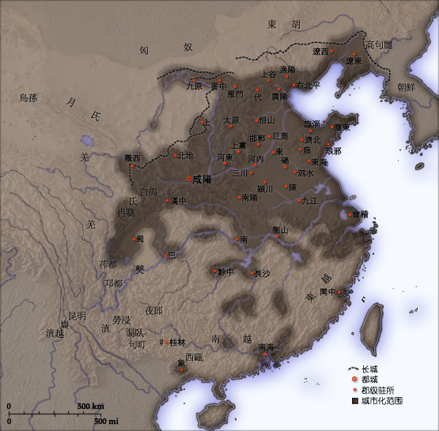
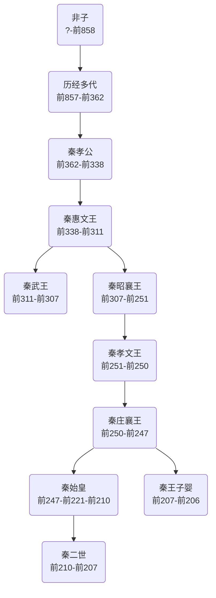

# 概述

> 关于战国时期的诸侯国，详见[秦国](秦国.md)。

[**秦朝**](https://zh.wikipedia.org/wiki/秦朝)（[前221年9月10日](https://zh.wikipedia.org/wiki/秦灭齐之战 "秦灭齐之战")—前207年11月17日），是[中国历史主线](中国朝代.md#中国历史主线)之一，中国历史上首个大一统中央集权的帝国，国号**秦**，国君**嬴**姓**赵**氏，历经3代2帝1王，国祚15年。（不含[秦国](秦国.md)，[子婴](https://zh.wikipedia.org/wiki/子婴)为**秦王**，按子婴为[扶苏](https://zh.wikipedia.org/wiki/扶苏)之子计算代数。）

<figure>
  
  <figcaption style="font-size: 16px; color: gray">秦朝前210年鼎盛直辖疆域约330万平方公里</figcaption>
</figure>

# 历史

- 前期历史详见[秦国](秦国.md)。
- 前221年，秦王[嬴政](https://zh.wikipedia.org/wiki/秦始皇)统一六国建立秦朝，称皇帝，继天子位。
- 前207年，[子婴](https://zh.wikipedia.org/wiki/子婴)向[刘邦](https://zh.wikipedia.org/wiki/刘邦)投降，秦朝灭亡。

# 君主世系

> [秦国君主世系图](https://zh.wikipedia.org/wiki/秦国君主世系图)
>
> [秦朝君主列表](https://zh.wikipedia.org/wiki/秦朝君主列表)

