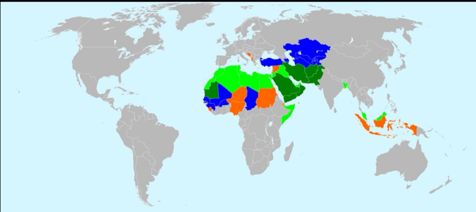
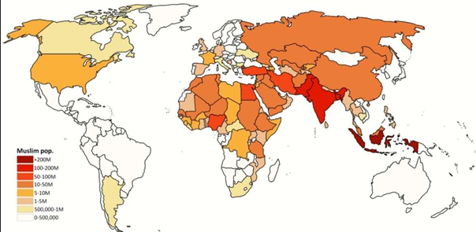

# 概述

[**穆斯林世界**](https://zh.wikipedia.org/wiki/穆斯林世界)指多数居民信奉[伊斯兰教](伊斯兰教.md)的国家和地区，共计57个国家和2个地区（西撒哈拉和科索沃）。

伊斯兰国家不一定是阿拉伯国家，也包括伊朗、巴基斯坦、孟加拉国、阿富汗、马来西亚这样的其他民族国家。

  <figure>
    
    <figcaption style="font-size: 16px; color: gray">穆斯林国家分布图</figcaption>
  </figure>
  <figure>
    
    <figcaption style="font-size: 16px; color: gray">世界各国穆斯林数量分布</figcaption>
  </figure>

