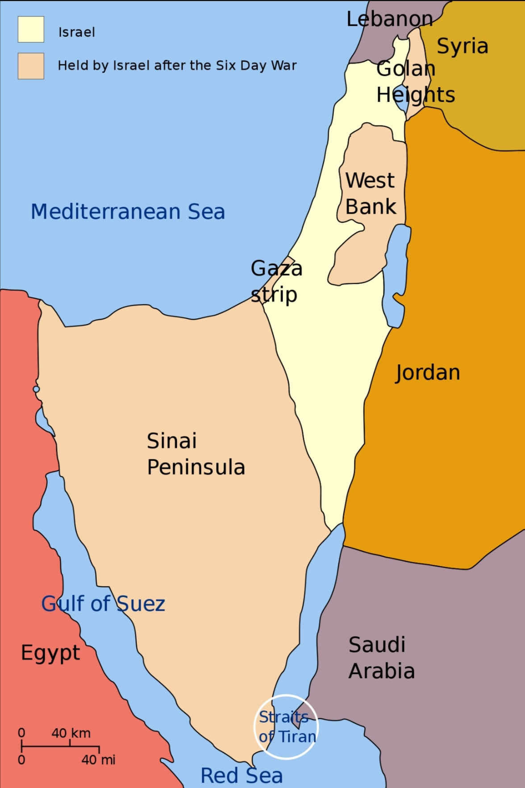

# 概述

[**第三次中东战争**](https://zh.wikipedia.org/wiki/第三次中东战争)（1967年6月5日—6月10日），[以色列](https://zh.wikipedia.org/wiki/以色列)方面称**六日战争**，[阿拉伯国家](https://zh.wikipedia.org/wiki/阿拉伯国家)方面称**六月战争**，是发生在[以色列](https://zh.wikipedia.org/wiki/以色列)与毗邻的[埃及](https://zh.wikipedia.org/wiki/埃及)、[叙利亚](https://zh.wikipedia.org/wiki/叙利亚)及[约旦](https://zh.wikipedia.org/wiki/約旦)等[阿拉伯国家](阿拉伯世界.md)之间的战争，是[中东战争](中东战争.md)的一部分。

# 经过

- 1967年6月5日，即“六日战争”。埃及驱逐在加沙地带的联合国维和部队，并且再次封锁帝朗蓝海峡，又在接壤以色列的边界大量屯兵，于是以色列对埃及开战，叙利亚和约旦后期参战。

- 以色列一口气夺下了约旦河西岸（1967年—现在）、加沙地带（1967年—2005年；但仍控制领空和水域）、西奈半岛（1967年—1982年）、和戈兰高地，控制了巴勒斯坦全境。以色列将其法律管辖范围拓展至戈兰高地和东耶路撒冷，很多巴人被迫流落到周围阿拉伯国家和世界各地，沦为难民。

- 以色列的领土扩大了三倍

- 第三次中东战争后格局

    <figure>
      
      <figcaption style="font-size: 16px; color: gray">
        
第三次中东战争后格局

        
白色：第三次中东战争前的以色列

        
粉红色：第三次中东战争后的以色列取得的领土（约旦河西岸、加沙地带、戈兰高地及西奈半岛）

      </figcaption>
    </figure>

# 相关条目