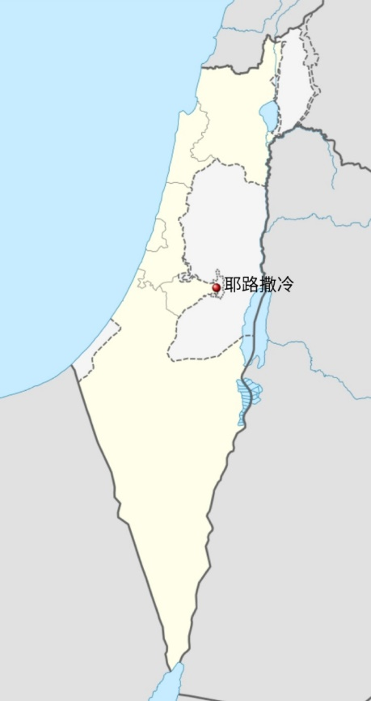
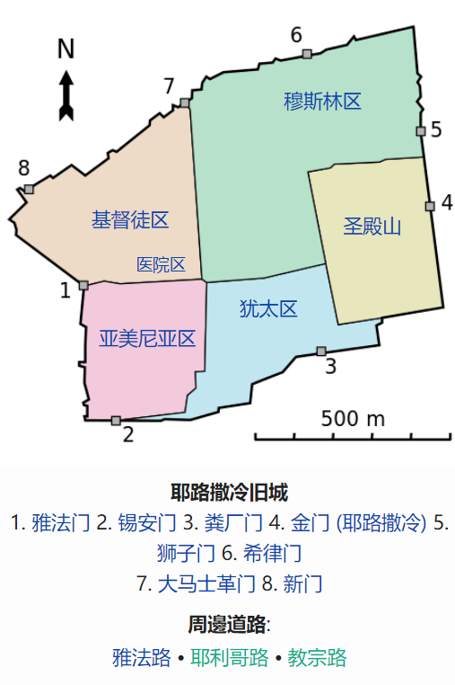

# 概述

[**耶路撒冷**](https://zh.wikipedia.org/wiki/耶路撒冷)（英语：Jerusalem），为[巴勒斯坦地区](巴勒斯坦地区.md)的一座城市，具有极其重要的宗教地位。根据《[联合国大会181号决议](https://zh.wikipedia.org/wiki/联合国大会181号决议)》，耶路撒冷由联合国管理，但目前以色列实际控制耶路撒冷。

[以色列](以色列.md)宣称耶路撒冷为其首都，而[巴勒斯坦国](巴勒斯坦.md)宣称[**东耶路撒冷**](https://zh.wikipedia.org/wiki/东耶路撒冷)为其首都，但都未获国际广泛认可。

  <figure>
    
    <figcaption style="font-size: 16px; color: gray">耶路撒冷位置</figcaption>
  </figure>
  <figure>
    
    <figcaption style="font-size: 16px; color: gray">耶路撒冷旧城</figcaption>
  </figure>

# 名称来历

**耶布斯**：

- 公元前3000年前后，[迦南人](https://zh.wikipedia.org/wiki/迦南人)的一支——[**耶布斯人**](https://zh.wikipedia.org/wiki/耶布斯人)从阿拉伯半岛迁居至巴勒斯坦中部山地，在此建立城堡并命名为 **“耶布斯”**（Jebus），即后世的**耶路撒冷**。
- [**耶布斯人**](https://zh.wikipedia.org/wiki/耶布斯人)是**耶布斯**的后裔，**耶布斯**是[迦南](https://zh.wikipedia.org/wiki/迦南)之子，[挪亚](https://zh.wikipedia.org/wiki/挪亚)之三世孙。

**耶路撒冷**：

- 约前1000年，[大卫王](https://zh.wikipedia.org/wiki/大卫王)攻取该城，将城市更名为 **“大卫城”或“锡安”** ，以此作为[以色列联合王国](https://zh.wikipedia.org/wiki/以色列王国 "前期")的首都，后逐渐演变为 **“耶路撒冷”**（Yerushalayim）。

**语义解析**：

- **耶路**（Yeru）：即“耶布斯”，意为 **“基石”或“城市”** 。
- **撒冷**（Salem）：源自闪米特语词根 **“Shalom”（和平）** 。
- **耶路撒冷**：即 **“和平之城”** 。

此后三千年间，尽管历经罗马、阿拉伯、十字军等多方势力的名称更迭，其核心语义始终与 **和平、神圣** 交织，成为犹太、基督、伊斯兰三教共同的精神坐标。

# 历史

- 联大之前详见 `巴勒斯坦地区 | 巴勒斯坦地区历史`
- 1947年11月29日，联大通过《[联合国大会181号决议](https://zh.wikipedia.org/wiki/联合国大会181号决议)》，成立耶路撒冷市国际特别政权，由联合国来管理。
- 1948年5月15日，[第一次中东战争](第一次中东战争.md)爆发，以色列占领[西耶路撒冷](https://zh.wikipedia.org/wiki/西耶路撒冷)，约旦占领[东耶路撒冷](https://zh.wikipedia.org/wiki/东耶路撒冷)及老城区。
- 1949年以色列将首都迁至[西耶路撒冷](https://zh.wikipedia.org/wiki/西耶路撒冷)。（未获国际广泛认可）。
- 1950年，以色列定都西耶路撒冷。同年，东耶路撒冷及老城区被正式合并入约旦王国，许多阿拉伯人持有约旦国护照，并保留至今。
- 1967年6月5日，[第三次中东战争](第三次中东战争.md)爆发，以色列占领东耶路撒冷及老城区，控制耶路撒冷全部，直到现在。
- 1980年，以色列立法认定耶路撒冷是该国“永远的和不可分割的首都”。
- 1988年巴勒斯坦自治政府宣布[耶路撒冷](耶路撒冷.md)是巴勒斯坦国的首都。但耶路撒冷由以色列实际控制。
- 2017年12月6日（北京7日凌晨2点），特朗普正式在白宫外交厅宣布美国承认[耶路撒冷](耶路撒冷.md)为以色列首都。
- 2017年12月21日，联合国大会以压倒性多数投票通过一项决议，认定任何宣称改变耶路撒冷地位的决定和行动无效。

# 宗教地位

耶路撒冷旧城区同时是[亚伯拉罕诸教](亚伯拉罕诸教.md)（[犹太教](犹太教.md)、[基督徒](https://zh.wikipedia.org/wiki/基督徒)和[伊斯兰教](伊斯兰教.md)）的圣地，三个宗教历史遗迹和历史事件均位于此处：

- **犹太教**：[西墙](https://zh.wikipedia.org/wiki/西墙)和[圣殿山](https://zh.wikipedia.org/wiki/圣殿山)；
- **伊斯兰教**：[圆顶清真寺](https://zh.wikipedia.org/wiki/岩石圆顶)、[阿克萨清真寺](https://zh.wikipedia.org/wiki/阿克萨清真寺)、[穆罕默德](https://zh.wikipedia.org/wiki/穆罕默德)的[夜行登霄](https://zh.wikipedia.org/wiki/夜行登霄)，为麦加、麦地那之后的第三圣地；
- **基督教**：[圣墓教堂](https://zh.wikipedia.org/wiki/圣墓教堂)、[苦路](https://zh.wikipedia.org/wiki/苦路)以及，[耶稣](https://zh.wikipedia.org/wiki/耶稣)在这里[受难](https://zh.wikipedia.org/wiki/耶稣受难)、[埋葬](https://zh.wikipedia.org/wiki/耶穌葬禮)、[复活](https://zh.wikipedia.org/wiki/耶稣复活)、[升天](https://zh.wikipedia.org/wiki/耶稣升天)。
- [**圣殿山**](https://zh.wikipedia.org/wiki/圣殿山)：纵跨穆斯林区和犹太区两个区，是圣地中的圣地！
  - 犹太教的圣殿、伊斯兰教的[圆顶清真寺](https://zh.wikipedia.org/wiki/岩石圆顶)、[阿克萨清真寺](https://zh.wikipedia.org/wiki/阿克萨清真寺)都位于圣殿山；
  - 亚伯拉罕献子、雅各与神角力、都在圣殿山；
  - 穆罕默德[夜行登霄](https://zh.wikipedia.org/wiki/夜行登霄)的登霄石、亚伯拉罕献子的石头是同一块巨石（位于[圆顶清真寺](https://zh.wikipedia.org/wiki/岩石圆顶)内）。

# 相关条目
