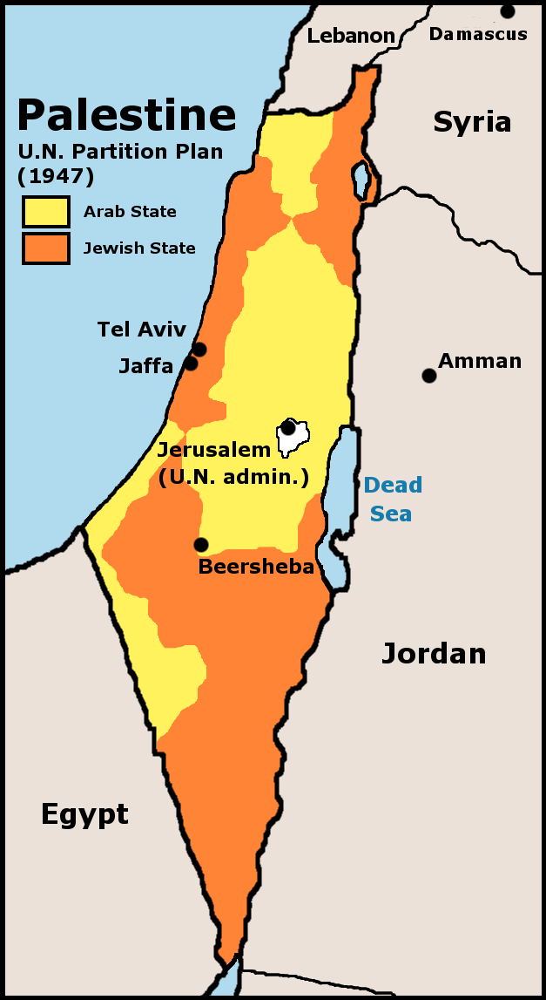

# 概述

[**联合国大会第181号决议**](https://zh.wikipedia.org/wiki/联合国大会第181号决议)，即**[联合国](https://zh.wikipedia.org/wiki/联合国)[巴勒斯坦托管地](https://zh.wikipedia.org/wiki/巴勒斯坦托管地)分割方案**，于1947年11月29日在[联合国大会](https://zh.wikipedia.org/wiki/联合国大会)通过。该决议提出了两个临时国家的建立，一个是[犹太国](以色列.md)，另一个是[阿拉伯国](巴勒斯坦.md)。该决议也建议了区域性经济共同体的框架，并提出在[耶路撒冷](耶路撒冷.md)成立[耶路撒冷独立个体](https://zh.wikipedia.org/wiki/耶路撒冷独立个体)，委由[联合国](https://zh.wikipedia.org/wiki/联合国)治理。

<figure>
  
  <figcaption style="font-size: 16px; color: gray">
    
浅黄色为阿拉伯国家（即<a href="巴勒斯坦.md">巴勒斯坦</a>）

    
橙黄色为犹太国家（即<a href="以色列.md">以色列</a>）

  </figcaption>
</figure>

# 决议内容

**联合国大会第181号决议内容**：[英国](https://zh.wikipedia.org/wiki/英国)于1948年8月1日之前结束在[巴勒斯坦地区](巴勒斯坦地区.md)的[委任统治](https://zh.wikipedia.org/wiki/巴勒斯坦托管地)，并撤出其军队；两个月后，在总面积2.7万平方公里的[巴勒斯坦地区](巴勒斯坦地区.md)的土地上建立两个国家，即[阿拉伯国](巴勒斯坦.md)和[犹太国](以色列.md)。

根据分治决议的蓝图，阿拉伯国国土11203平方公里，约占当时巴勒斯坦总面积的43%，人口中[阿拉伯人](阿拉伯人.md)为72.5万人，[犹太人](犹太人.md)为1万人；犹太国国土为14942平方公里，约占[巴勒斯坦地区](巴勒斯坦地区.md)总面积的57%，人口中阿拉伯人为40.7万人，犹太人为49.8万人。决议还规定：成立[耶路撒冷](耶路撒冷.md)市[耶路撒冷独立个体](https://zh.wikipedia.org/wiki/耶路撒冷独立个体)，由[联合国](https://zh.wikipedia.org/wiki/联合国)治理。

[阿拉伯人](阿拉伯人.md)因联大违背“民族自决权”而拒绝接受“分治方案”，并导致大规模冲突。

